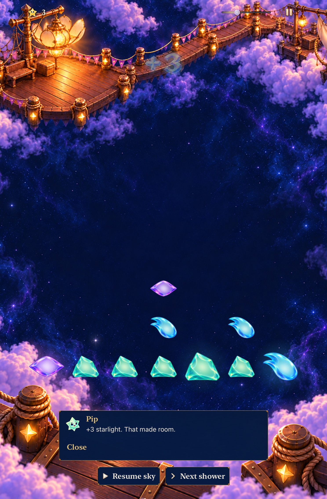

# Retain the committed sensory family and its rising chain phrase

**Result:** Verified — selected development acceptance · **Owner:** Queue coordinator · **Date:** October 23, 2026

[Goal 8 / #249](https://github.com/lbeezr/starfall/issues/249) adopts the existing [#236 / PR #262](https://github.com/lbeezr/starfall/pull/262) refinement after a wider feedback review. Ordinary contacts, recipe openings and survivor-created follow-ups already have distinct, bounded roles. No new runtime defect was reproduced; this is its own acceptance/report slice, with no new cue, asset or feedback subsystem.

**Next action:** Merge this result independently, then verify leaving/returning in Goal 9. At the next ordinary player session, assess contour recognition, alignment, speaker/headphone balance, tactile comfort and repetition; software checks do not establish those perceptions.

## The feedback has one committed meaning

| Event | Existing presentation and boundary |
| --- | --- |
| Move/return | Actual exchange/fall plus the committed movement acknowledgement; no collection award or clear sound for arranging alone. |
| Growth | Larger body and bounded aura identify a grown star; one board place and the saved-rule reward remain authoritative. |
| Ordinary clear | One of four selected quiet contacts rotates independently of gameplay RNG; ordinary light/receipt reflects actual collected value. |
| Recipe → causal chain | Recipe opening, then two rising accents selected by committed phase depth. Pop → fall → next pop uses each phase’s own board; cumulative text never awards again. Depth three caps the sound variation. |
| Restoration | Bounded collection packets reach the scenery, milestone paintings advance from committed progress, and the earned result names the next eligible place. Result/input admission never waits for decorative playback. |

The prior audio comparison replaced identical historical relay accents for every cascade with E5→G5, A5→C6 and D6→E6. The [original before/after and signal report](../chain-audio-2026-10-22/README.md) retains exact source and asset provenance. All six inspected audio/scene/motion/celebration owners are byte-identical to that accepted source and [Goal 4’s sampled causal-motion source](../game-goal-04-causal-cascades-2026-10-22/README.md); [verification.json](verification.json) records each comparison. Broader Store/copy changes since those sources are not falsely described as identical.

## Ordinary and exceptional remain readable

Clean main `02a36e67`, runtime `dev.a591c1b9bb` (Simulator label `dev.local`), iPad mini ordinary text. Actual rain produced the group, a native clear earned exactly three light, survivors settled, and manual controls remain visible. This is a current ordinary-clear sample, not an audio recording. Its pre-clear image was inspected separately. The [current Ribbon three-clear receipt](../game-goal-07-ribbon-identity-2026-10-23/dev-a591c1b9bb__ribbon__iphone-17e__chain-default.jpg) contrasts earned emphasis; the [Lantern payoff](../game-goal-06-lantern-payoff-2026-10-22/README.md) covers completed restoration. Their source labels remain intact.

## Selected acceptance and limits

**18 hosted methods pass, zero failures/skips.** They verify ordinary rotation versus distinct categories; capped/reset chain selection; both current openings × sound enabled/muted × normal/quiet; exact 15,000/30,000 committed awards/save; one native voice; all ten bundled players starting; finite resource durations; superseded/muted pending work; inactivity/headphone-route cancellation; bounded six-packet effects and energy; real SKView phase ordering/replacement; and one aggregate quiet receipt without re-award on resume. The exact selectors and summaries are in [verification.json](verification.json).

**Three native cases pass, zero failures/skips:** tablet Open Sky real automatic rain → paused ordinary clear → Calm settings dismissal → resumed rain → Replay Entry; phone largest-text sound/haptics/Calm controls and relaunch persistence; phone current Story square practice with optional Hint/Retry, real cascade and exact retained-round/world preservation. These are current normal-app routes, not the classic-tool sound journey.

This documentation-only result inherits **241 Core, Debug and Release passes** from Goal 7 with equal App/Sources/Config/project and hosted/native subtree IDs. It does not claim fresh execution of those builds. No resource/membership, rule, archive, cadence or preference default changes. Hygiene/diff/local-link checks run at staging. No failed selected tests are recorded.

Commands use the shared Starfall scheme/project and `scripts/simulator-command.py`, existing Debug products, `xcodebuild test-without-building -collect-test-diagnostics never`, no parallel testing and unique result bundles. Hosted selection contains the 18 explicit `-only-testing:StarfallAppTests/Class/method` arguments in the JSON. Native selection contains its three named `StarfallUITests` methods. Raw logs/xcresults remain disposable in `/private/tmp/starfall-ten-goals-20261022/`. Environment: Xcode 27.1 (`27A9275`), Swift 6.4, macOS 27.0.1 arm64; iOS 27.0 (`24A434`) iPhone 17e/iPad mini (A17 Pro) Simulators.

Mute/haptic preferences and suppression branches remain owned by GameFeedback; VoiceOver announcements suppress competing sound, and reduced motion suppresses the relevant haptics/motion without changing outcomes. These are source/selected software checks, not fresh actual VoiceOver or felt-device acceptance. Native playback-start success does not prove audibility or perceptual synchronization. Retain current effects/timing; revise or remove the two chain accents if the next real session finds masking or fatigue. Stale SONIC_WORLD pilot prose is deduplicated on final-review #251 for documentation reconciliation.
