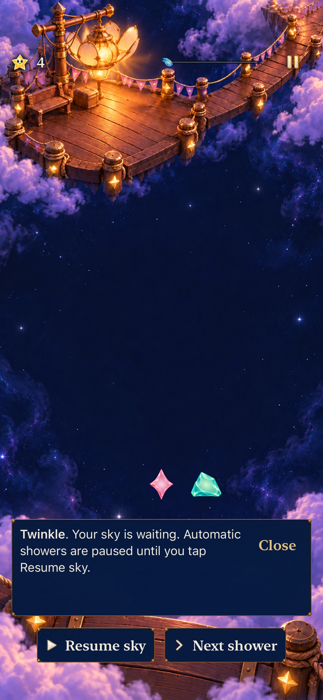

# Preserve the round while players leave, read and return

**Result:** Verified — selected development acceptance · **Owner:** Queue coordinator · **Date:** October 23, 2026

[Goal 9 / #250](https://github.com/lbeezr/starfall/issues/250) rechecks the accumulated state/reading journey and retains the existing owners. [#226 / PR #232](https://github.com/lbeezr/starfall/pull/232) already resolved the recorded restore-guide failure: the text was correct but intentionally collapsed, so the test needed to open its portrait. Goal 5 separately fixed expiry during deliberately paused reading. No new runtime disagreement is established; this is an independent acceptance/report merge.

**Next action:** Complete the individual merge, then perform Goal 10’s four-mode coherence review and bounded final correction. Human confidence and understanding remain questions for #206, not inferred from exact bytes or successful navigation.

## Continuity follows the kind of return

| Journey | Contract and selected evidence |
| --- | --- |
| Settings/Help/background within the process | Freeze the existing single deadline, retain the held remainder and pause choice; reject stale callbacks and avoid catch-up rain. |
| Home/Continue within the process | Reattach the same committed round and preserve intentional pause/remainder. |
| Terminate/relaunch/Continue | Validate the archived committed round and restore deliberately paused, with no running deadline. Transient clear prose is not archived; the restore guide explains the safe paused state. |
| Collapsed → read → Close/reopen | The portrait opens the retained guide without changing the board; paused reading stays open, while active timed receipts may expire and reopen without stopping rain. |
| New/Replay/Story Entry, Help or map preview | Preview the selected rules/objective. Cancellation or termination while staging preserves the old save; Begin alone replaces it. |
| Won/lost result → Replay or onward → cancel | Preserve terminal score/result and recorded repair. Named onward admission rechecks eligibility; cancellation returns to that same result. |

These distinctions avoid promising a wall-clock deadline across process death or replaying a transient celebration after restore. Core owns committed state, the store owns the clock/save, flow owns staging and the dialogue session owns reading. Neither artwork nor completion callbacks can replace a round.

## Selected verification

**14 hosted methods pass, zero failures/skips**, covering exact committed save comparisons, clock remainder/no catch-up, current/pending/historical help, saved targets, stale expiry/newer Help, startup/resume rule selection, and onward cancellation. [verification.json](verification.json) contains exact selectors and source subtree IDs.

**Five native cases pass, zero failures/skips:** phone actual six-shower growth → retained Dusk feedback → settings/background/relaunch → collapsed portrait → exact restore guide; phone current Lantern real 15,000-point receipt → expiry/reopen while rain advances → deliberate pause; tablet collapsed/open/Close with unchanged board and usable manual controls; tablet new/replay/Story staged Entry cancellation plus termination/Continue; tablet AX3XL loss/result → Replay Entry → background → cancel → same terminal score.

Phone ordinary text, source `fc0867e5` / `dev.a591c1b9bb`. Twinkle’s restored guidance is explicitly opened; the retained four-light round and Next shower remain intact. This image supports the reading surface, while exact save/deadline assertions are separate hosted evidence.

Reuse source-bound [Goal 5 deliberately paused recovery reading](../game-goal-05-pressure-recovery-2026-10-22/README.md), [Goal 6 earned onward/result preservation](../game-goal-06-lantern-payoff-2026-10-22/README.md), [Goal 7 current Ribbon choices/full round](../game-goal-07-ribbon-identity-2026-10-23/README.md), and [exact current/historical map goals](../map-goals-2026-10-22/README.md). Their source labels/counts are not counted as fresh Goal 9 runs. The relevant clock/overlay/flow owners and result/map copy are unchanged; Goal 7 changes only Ribbon Entry/startup/Replay prose and already rechecks its cancellation. Goal 8 is documentation-only. The current whole runtime/test subtree IDs equal Goal 7 main for build/Core reuse.

Source is clean main `fc0867e51873d9efeb4003c4d0cfa4997f957365`, computed identity `dev.a591c1b9bb`, Simulator label `dev.local`; no dirty build inputs or production changes. **241 Core, Debug and Release passes are inherited with byte-identical inputs**, not rerun for this report. Hygiene/diff/local links run at staging. No resource/membership or archive change.

Commands use `scripts/simulator-command.py` and existing Debug Starfall products, `xcodebuild test-without-building -project Starfall.xcodeproj -scheme Starfall -configuration Debug -collect-test-diagnostics never`, no parallel testing, exact selected `-only-testing` methods and unique result bundles. Raw logs/xcresults remain disposable in `/private/tmp/starfall-ten-goals-20261022/`. Environment: Xcode 27.1 (`27A9275`), Swift 6.4, macOS 27.0.1 arm64; iOS 27.0 (`24A434`) phone/tablet Simulators.

Retain these lifecycle/reading rules and remove no production path. Native outcomes establish reachable controls and software continuity; they do not establish human trust, actual VoiceOver, physical comfort, sustained performance or minimum-iOS17 acceptance. Existing #206–#209/#217 own those questions; #220 canonical Project Done visibility remains separate.
