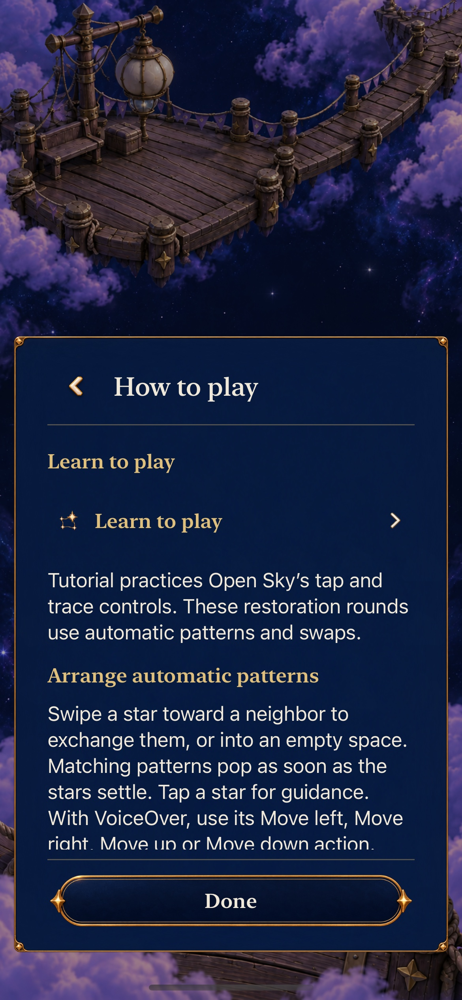
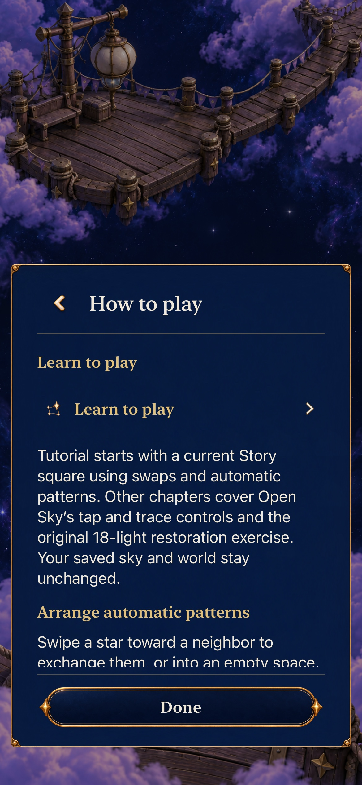
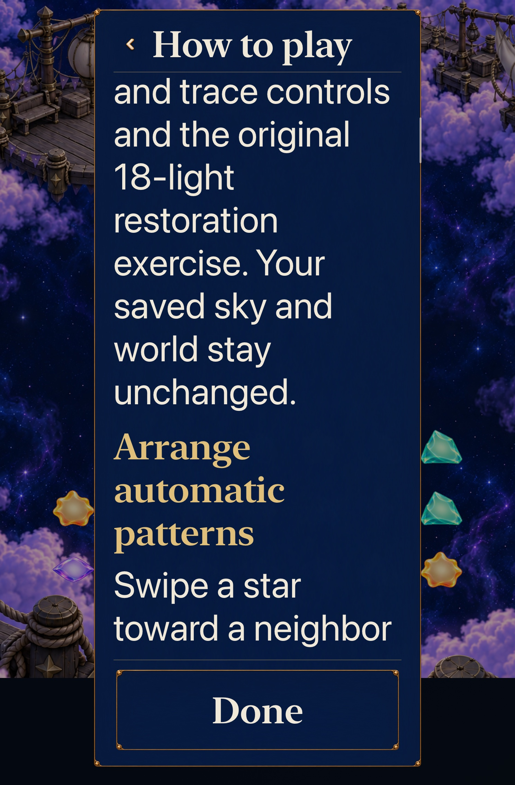
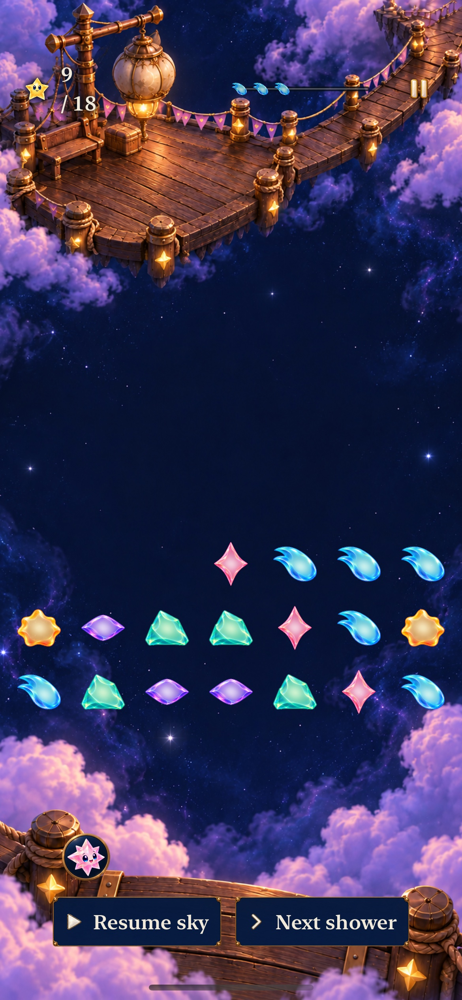

# Make Help promise the Tutorial players actually enter

**Result:** Verified — final development acceptance · **Owner:** Queue coordinator · **Date:** October 23, 2026

The final [Goal 10 / #251](https://github.com/lbeezr/starfall/issues/251) review finds one remaining source-evidenced explanation mismatch: Help describes Tutorial as Open Sky tap/trace practice, although its first chapter now teaches a current Story square. The native before check reproduces that exact disagreement. One existing catalogue value now explains the Story first chapter, later manual chapters and unchanged saved sky/world. The selected-rule gate remains intact; historical and Open Sky Help keep their own controls.

This is a wording correction supported by a four-mode integration review, not a claim that it is the largest remaining human pain point. The [ten-goal queue #240](https://github.com/lbeezr/starfall/issues/240) records individual merges. Human learning, enjoyment and physical/RC acceptance remain separate.

## One consistent route into safe practice

Actual baseline `121106c`, unchanged main app `dev.a591c1b9bb`, iPhone ordinary text/normal motion. The new native assertion fails on the shown old sentence, with zero skips. No timer, rule or fixture was altered to obtain the failure.

The replacement starts: “Tutorial starts with a current Story square using swaps and automatic patterns.” It then identifies Open Sky/manual restoration chapters and confirms the saved sky/world stay unchanged. `SkyHowToPlay` retains its existing `!manualClears` gate; Continue and same-round Replay select saved rules, while explicit new Entry selects today’s definition.

Actual candidate `447320e`, fingerprint `dev.976d4838a7`, same phone/ordinary text/normal motion. The complete replacement paragraph is visible above the next rules section and fixed Done control.

Candidate `447320e` / `dev.976d4838a7`, iPad mini AX3XL. The [initial viewport](dev-976d4838a7__ipad-mini-a17-pro__help-start-largest.jpg) and this scrolled ending show a real reading path, with full “Your saved sky and world stay unchanged” text above the fixed Done action. The Tutorial link is reached again by scrolling upward; no type shrinking or alternate screen is added. Returning after the actual exercise preserves the original 15,000-point Lantern board.

The stale [sound-world brief](../../design/audio/SONIC_WORLD.md) also now labels its original sound-off/no-cascade policy as historical and links today’s accepted phase phrase/default preference. No sound or default changes accompany this documentation reconciliation.

## All nine earlier decisions remain explicit

| Stacked outcome | Individual merge | Final retain/revise decision and evidence |
| --- | --- | --- |
| First minute | [#260](https://github.com/lbeezr/starfall/pull/260) | Retain saved-rule objective/action guidance through Begin/resume; full dialogue suite rechecked. [Goal 1](../game-goal-01-first-minute-2026-10-22/README.md). |
| Movement trust | [#261](https://github.com/lbeezr/starfall/pull/261) | Retain actionable incomplete-swipe feedback and gravity-return acknowledgement. Current native chain swaps remain usable; prior short-release reproduction stays source-bound. [Goal 2](../game-goal-02-movement-trust-2026-10-22/README.md). |
| Setup discovery | [#263](https://github.com/lbeezr/starfall/pull/263) | Retain optional clue/Hint/Retry; revise this stale Help promise. Actual exercise and exact return are rechecked in all four contexts. [Goal 3](../game-goal-03-setup-discovery-2026-10-22/README.md). |
| Causal feedback | [#264](https://github.com/lbeezr/starfall/pull/264) | Retain real pop/fall/next-pop and committed receipts, with unchanged scene/motion owners. [Goal 4 sampled sequence](../game-goal-04-causal-cascades-2026-10-22/README.md) is historical animation evidence, not a fresh continuous-motion claim. |
| Pressure/recovery | [#267](https://github.com/lbeezr/starfall/pull/267) | Retain truthful full-column status, actual recovery and deliberate paused reading. Full-top growth still disproves certain-loss predictions. [Goal 5](../game-goal-05-pressure-recovery-2026-10-22/README.md). |
| Lantern payoff | [#269](https://github.com/lbeezr/starfall/pull/269) | Retain inspected paintings and named onward admission; keep minor tablet-fitting continuity for the next asset revision. [Goal 6](../game-goal-06-lantern-payoff-2026-10-22/README.md) separates shared-renderer fixtures from actual current 151,000-point completion. |
| Ribbon identity | [#272](https://github.com/lbeezr/starfall/pull/272) | Retain closer-shower/survivor guidance and existing authored definitions. Current 30,000-point opening returns unchanged; [Goal 7](../game-goal-07-ribbon-identity-2026-10-23/README.md) separately verifies full 220,000-point win/replay/overflow. |
| Sensory language | [#273](https://github.com/lbeezr/starfall/pull/273) | Retain #262’s capped phrase and one quiet aggregate receipt; no competing cue. [Goal 8](../game-goal-08-sensory-language-2026-10-23/README.md) supplies current ordinary-clear/preferences, bounds and interruption evidence. |
| Safe return | [#274](https://github.com/lbeezr/starfall/pull/274) | Retain in-process timer remainder versus paused relaunch, collapsed/open guidance and Begin-only replacement. [Goal 9](../game-goal-09-safe-return-2026-10-23/README.md); exact flow/archive/practice protection rechecked here. |

Only this existing Help value changes production behavior in the final slice. All prior rules, scenes, clocks, save owners, geometry, assets and feedback paths remain byte-identical to immediately preceding verified main. Prior screenshots/recordings retain their own source labels and are not counted as fresh final runs. No comparison toggle, lab route, temporary production asset, new schema or speculative balance change remains from the queue.

## Source-bound final verification

Candidate `447320e7c053ef2f1d9dd8a74018c9b6fd89bb1f`, clean build inputs, computed fingerprint `dev.976d4838a7` (Simulator label `dev.local`). Baseline driver `121106c` uses unchanged production `dev.a591c1b9bb`. [verification.json](verification.json) records hashes, exact selectors, baseline failure, results and capture provenance.

**242 Core and 73 hosted tests pass, zero failures/skips. Debug and Release builds pass**, with exact catalogue bytes verified in both products and project/resource membership unchanged. Full hosted scope: SkyDialogue25, SkyFlowState33 and WorldJourney15. Extended Help selection covers 12 source rounds: Open Sky retained/current, historical 18-light Lantern/Ribbon, each revision1/2/3 and current4. Pending new visits and same-round Replay preserve selection and encoded retained bytes. The first Tutorial action is proven a real swap producing automatic resolution. Every practice chapter remains non-saving and grants no progression.

Initial Core passes 241 on `447320e`. Independent research PR #275 then advances main to `e8e4bb23` with a later-chain mastery recovery witness and one Core regression. It is integrated at `fb5701d`; combined Core passes 242. App, Core library, hosted/native sources, configuration and project bytes equal the tested candidate, so Apple results/captures remain valid without rerunning unchanged checks. The two documentation conflicts preserve both the completed queue and the incoming recovery-proof facts; no runtime mastery feature is inferred. Publication is based on that updated main.

**Two final native cases pass, zero failures/skips**, comprising four ordinary phone round contexts plus the AX3XL tablet journey. Each enters the real first Story chapter, performs its square→survivor-square exchange for exactly 15,000 practice points, and returns to the original 49-cell labels/values, score, board summary and intentional pause. Original current Lantern/Ribbon first earn 15,000/30,000; Open Sky calls a real shower; historical Lantern performs a real 5→9 clear, saves, terminates and restores before opening Help. The historical 9/18 round never adopts a current point target or automatic-only controls. Automatic Help shows the new scope note; manual/historical/Open Sky Help omits it while entering the same disposable Tutorial.

The four-mode case passes in 230.773 seconds including orchestration; tablet largest-text passes in 90.564 seconds. Baseline is separately recorded as one expected native failure on the old Help sentence, not included in candidate pass totals. All six ordinary phone Help/return captures and all three largest-text tablet captures were inspected, alongside the original baseline. Five selected images are retained without resizing; stills establish reading/state surfaces, not continuous smoothness, physical comfort or learning.

Commands: Core `swift test --scratch-path /private/tmp/starfall-factory-gameplay-20261022/CoreBuild --jobs 2`; shared Starfall scheme/project Debug `build-for-testing`, then `test-without-building -collect-test-diagnostics never` with the three full hosted classes and two named native methods in JSON. Use bounded `scripts/simulator-command.py` receipts, arm64, two build jobs, no signing/parallel testing, existing DerivedData and unique result bundles. Release builds generic iOS Simulator in separate DerivedData. Raw logs/xcresults remain disposable in `/private/tmp/starfall-ten-goals-20261022/`. Environment: Xcode 27.1 (`27A9275`), Swift 6.4, macOS 27.0.1 arm64; iOS 27.0 (`24A434`) iPhone 17e/iPad mini (A17 Pro) Simulators. Hygiene, diff, local links and 200 UI/441 hosted inventory are checked at staging; inventory is not a full-matrix pass.

## What this factory sequence establishes

Stack goals around a player action and its visible consequence, keep one small native situation as the test, compare an evidenced weakness, and carry earlier contracts forward through separate merges. A satisfied goal can merge an acceptance report; adding another effect is not evidence of improvement. The showcase prompts remain largely reconstructed/unverified examples, not a proven causal recipe for quality or throughput.

Retain the accepted slices for development. The next decision comes from [#206’s ordinary player observations](https://github.com/lbeezr/starfall/issues/206) and [#210’s setup-transfer study](https://github.com/lbeezr/starfall/issues/210): can a new player choose a useful setup, explain its cascade, recover space, recognize Ribbon’s difference and return confidently without coaching? Revise teaching/feedback or balance only against those observations. Physical sustained performance #207, minimum iOS17 #208, contrast #209 and deferred actual VoiceOver #217 retain their owners. This queue does not establish those passes or install a phone build. Project #220’s canonical Done visibility remains separate from verified GitHub merge/completed issue state.

**Completion boundary:** This slice’s default-branch PR closes #251 and parent #240 after all nine earlier issue completions/merges are verified; the coordinator then verifies the final merge/closures. No new autonomous backlog or background execution follows from finishing these ten goals.
