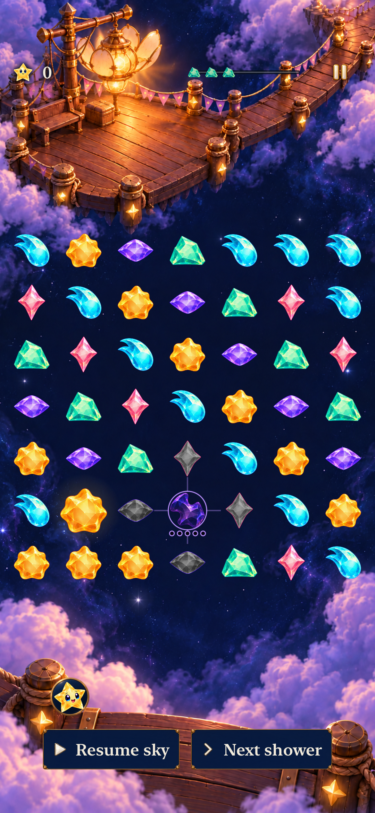
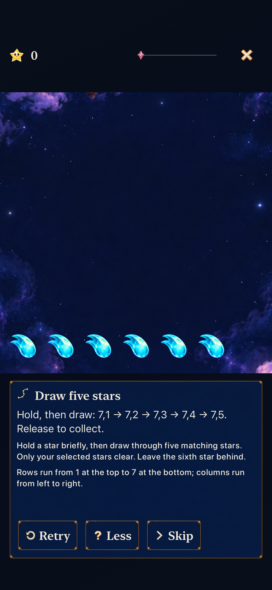
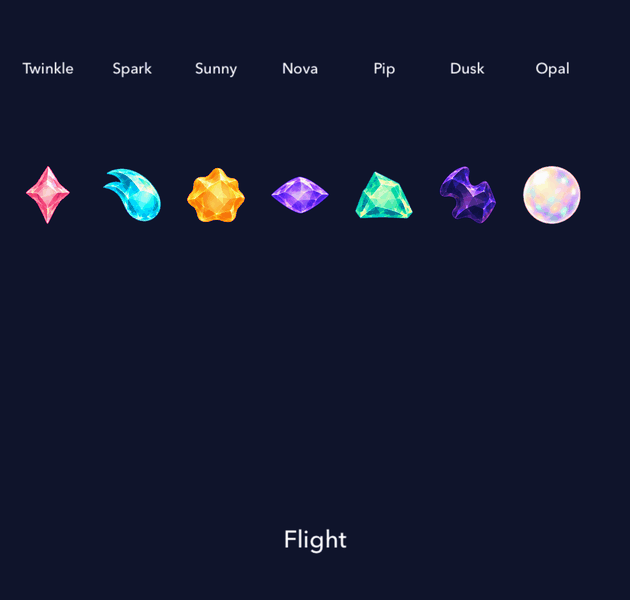
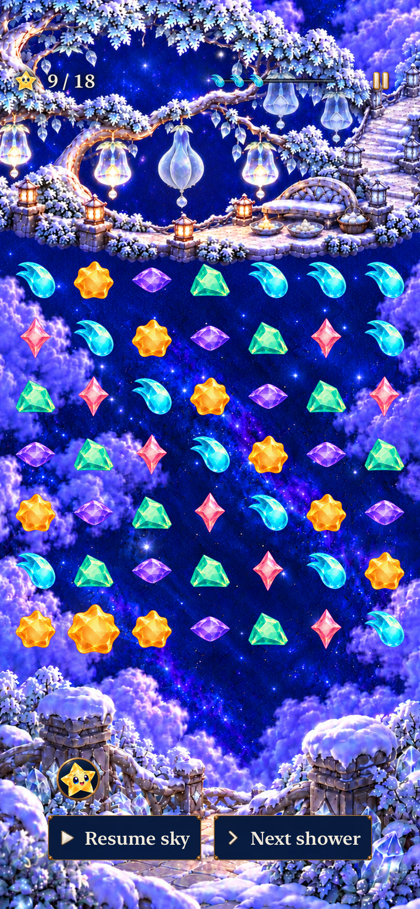

# Faceless gameplay pieces and family motion

**Result: adopted for development · October 20, 2026.** Seven approved faceless pieces are integrated into the normal game's forecast, flight and board. Original characters remain in story, map and ceremonies. One enlarged body and a renderer aura replace copied silhouettes and paired glints. Core rules, saves and progression are unchanged.

The [production contract](../../design/star-cast/README.md) and [motion acceptance](../../design/star-cast/characters-and-shards-2026-10-20/MOTION.md) own design behavior. [Source inputs](source.json) separate initial working-tree checks on `d0dfcc1` from integrated source `9e0732a`. App and test inputs were committed before the integrated runs; subsequent edits are documentation/evidence only. This is focused development verification, not full-matrix or physical-device acceptance.

## Inspected captures

| Dense board | Tutorial input |
| --- | --- |
|  |  |

Integrated source `9e0732a`, iPhone 17e / iOS 27.0 Simulator, normal Debug target, default text. The dense reset-only fixture deliberately includes historical Dusk, drained and grown states; fresh survival does not supply Dusk. Sparse board, menu, forecast and tutorial screenshots were also inspected. [Capture metadata and hashes](captures.json) identify the retained exports.

Twenty-two actual SpriteKit-host samples, chronologically assembled with brief before/settled review holds. This is an isolated animation specimen, not a continuous full-game recording. [The native material sheet](dev-9e0732a__piece-materials__iphone-17e__native-host.png) checks small-size contours; [the motion contact sheet](dev-9e0732a__piece-motion-samples__iphone-17e__native-host.png) retains sampled poses.

## Native findings

The material review shows all seven actual packaged materials at 24, 36 and 44 points, against dark/light backgrounds and as silhouettes/grayscale. Each contour stays distinct. Dusk has the lowest interior contrast on navy but retains its lilac contour; Opal relies more on its pink/lilac rim on light ground.

The visible SpriteKit host samples actual normal-motion actions for flight, landing, contact and stable rest, then grown landing/contact at one-cell center spacing. Inspected grown frames retain gaps between bodies, including Spark at its broadest impact pose. Aura layers sit behind every body. Yaw/pitch are shallow 2D perspective deformations, not full 3D turnarounds.

Neutral grown width is approximately 0.903 cell spacing, compared with 0.687 ordinary: 1.314× linear size. Literal double width would overlap neighbors heavily. The selected treatment preserves normal-size recognition and uses the aura as the additional growth cue.

## Verification

Environment: Xcode 27.1 (`27A9275`), iPhone 17e / iOS 27.0 Simulator named Starfall Crystal Glow QA, UDID `D65C5E40-734F-42BF-8F91-97E980ED19C2`. Runtime bundle remains `0.1.0 (1)`, `StarfallBuildID=dev.local`. No physical-device installation was performed.

| Check | Result |
| --- | --- |
| Core `swift test` | 184 passed, zero failures |
| Focused hosted suite | Initial 56 passed; integrated 60 passed, zero failures or skips |
| Native UI subset | Initial 10 passed; integrated five passed, zero failures or skips |
| Debug simulator build | Passed with explicit arm64 destination architecture |
| Release simulator build | Integrated source passed; all seven asset sets and new source/test membership present |
| Asset packaging | Seven RGBA 256×256 bodies, 208-pixel max extent, padded alpha and receipt hashes verified; nine original body assets unchanged |
| Hygiene / whitespace | Passed, including final explicitly staged paths |
| Actual VoiceOver / physical device / minimum OS | Not run; separate RC/device acceptance |

The initial hosted selection covers `SkyPieceTests` (7), `StarCastTests` (21), `DuskProductionTests` (8), `CriticalMassProductionTests` (6), `SkyDialogueTests` (12), and two `NativeInputWindowTests` overlap/quiet cases. The integrated run adds three `ObservatoryArtworkTests` and the `StarlightCelebrationTests` header/score-anchor registration check, reruns all 56, and verifies the widened motion capture. This is a focused subset of the source-counted development inventory, not a full development-matrix pass.

Exact selected commands and machine-readable counts are in [checks.json](checks.json). The integrated inventory contains 347 hosted and 146 UI cases; only the stated affected subsets ran. No assertion was weakened or normal motion disabled to obtain a pass.

The five post-merge UI checks cover sparse/dense projected taps, the current HUD/menu/guide pages, separated forecast/phase cues, several normal-motion shower cycles, and tutorial coordinates/disclosure. The initial ten additionally cover five-of-six tracing, Opal shared-orb spending, First Light success/overflow/restore/replay, settings/background preservation, all dialogue speakers, maximum text and system Reduce Motion.

Compiler diagnostics contained the existing AppIntents metadata warning (no linked AppIntents framework). A hosted UIKit fixture logged an unbalanced appearance-transition diagnostic during teardown; xcresult reports no runtime test warnings. No product Swift compile warnings or assertion failures remained.

## Final Orchard compatibility

Main advanced to `3f560e2` during publication. Local merge `8672668` preserves Frostfruit Orchard’s six-location progression, artwork, new copy, UI-test membership and shared result panels. Sprite routing, body assets and family motion are unchanged from the inspected `9e0732a` specimens above. [Exact commands and results](orchard-compatibility.json): **185 Core, 54 affected hosted, two Orchard native UI checks, Debug test build and Release build pass**, with zero failures/skips in the native selections. The UI cases cover a dense rapid clear through settings/background and normal-motion win, relaunch persistence and replay.

The dense board and restored result were inspected. The new icy painting is busier and brighter than Lantern Landing, but the colored contours remain distinct and the opaque result panels preserve readable actions. No tablet, physical-device or minimum-OS acceptance is inferred from these phone checks. The level-design kit now marks its old character-shaped scale specimens **Needs refresh**; current shard sizing is explicit until the generator is adapted.

Publication also retains main `58a466a`’s subsequent Orchard delivery documentation. That merge changes documentation only; the app/test/resources remain identical to tested `8672668`.

## Corrections found during verification

- The first default build selected x86_64 for the app while its local package built arm64. Explicit `ARCHS=arm64 ONLY_ACTIVE_ARCH=YES` matched this Mac and simulator. No repository build setting was changed to hide this mismatch.
- The first hosted build found two async-overload ambiguities in the new test harness. Keyed synchronous SpriteKit actions preserve concurrent sampling.
- One material-preservation test compared SpriteKit's Float-backed readbacks with ideal Double literals and compared scaled size with neutral size. It now requires exact before/after native readback equality and exact restoration to the original neutral size.
- New special-role coverage exposed a real size bug: `massStage` incorporated a raw grown flag even when the role had no double-value state. Body scaling now separately checks actual value and eligible committed age. Historical aged Opal/colored scaling remains covered; special roles no longer imply growth.
- Review found that upper-row auras could render over lower-row bodies. Aura depth now places all light fields behind all solid bodies.
- The first all-family motion capture cropped Opal at the right edge during a wide squash/kick. The isolated review canvas is widened from 400 to 420 points without changing cell spacing or production motion. The integrated run passes, and inspection confirms complete Opal coverage.

Raw build logs, xcresults and all exported attachments remain disposable under `/tmp/starfall-shards-*`. Retained captures are selected from those exports and identify their exact source. Native sampling does not establish physical feel, sustained performance or uncoached player recognition.
