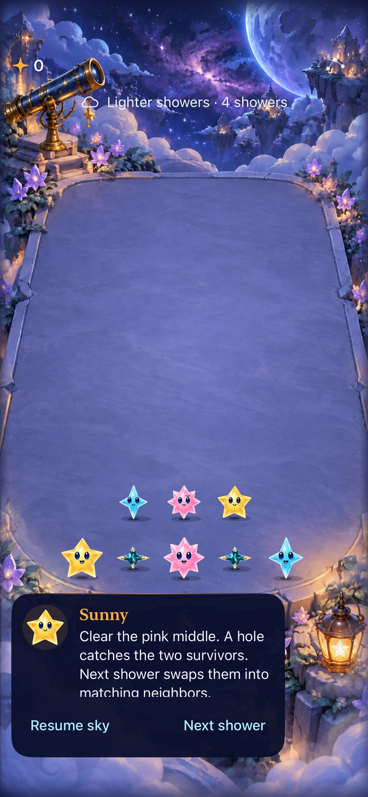
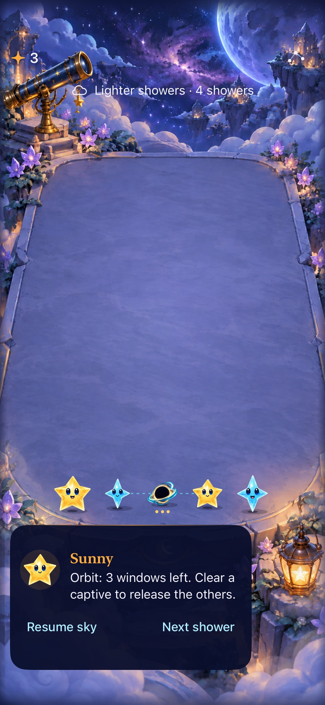
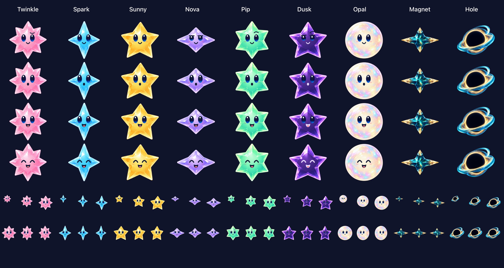

# Production artwork for magnetic stars and gravity holes

**Result:** Verified development checks · **Owner:** current implementer · **Date:** 2026-10-17

The arrow glyphs are replaced with original transparent artwork generated using the built-in imagegen tool: a teal magnetic crystal with opposed gold tips, and an opaque dark hole surrounded by a blue-gold accretion ribbon. One shared material per object serves the board, forecast and falling animation. A finite inward lean, contracting formation ring and small ring response accompany committed collision/orbit phases. Core, saved state, RNG and native hit geometry are unchanged.

**Next action:** inspect these objects during the next physical-device/human play session; actual VoiceOver acceptance remains an RC check. These development results establish asset integration and bounded native behavior, not human comprehension, enjoyment or device performance.

**Known gameplay limit:** main's separate [input-window study](../native-input-windows-2026-10-17/README.md) found that the existing serial orbit-plus-arrival sequence can consume nearly the full fast-shower interval. This art batch keeps those phase durations and sequencing; it does not fix or establish comfortable automatic input windows. The correction remains tracked in ENGINEERING.md.

## Appearance and source

**Native runtime captures:** iPhone 17e / iOS 27.0 Simulator, normal text, paused floor fixture, source below. The same native test creates the hole, rotates it, clears a captive and restores the resulting round. PNG attachments were converted to JPEG at quality 75 without cropping or scaling.

**Native material export:** the actual shared UIKit/SpriteKit factory, same source, JPEG quality 80. The review canvas now sizes to the cast count; its old seven-column width clipped the two new objects. Fixed faceless gravity materials intentionally reuse one texture across all expression/facing requests. The seven faced star identities retain their authored expressions.

[Largest-text capture](largest-text.jpg) retains a visible board and scrollable secondary content; native settings dismissal and captive clearing pass at that size. Original cutouts, exact prompt set and reproducible normalization receipts live in [Artwork/StarCast](../../../Artwork/StarCast/README.md#magnetic-crystal-and-gravity-hole). Generated 1254×1254 sources are preserved; the existing packaging pipeline produces padded, aspect-preserving 256×256 catalog assets. Hole center alpha is checked at ≥250; the exterior is transparent.

## Acceptance and commands

| Check | Result / evidence |
| --- | --- |
| Core / save boundary | `swift test`: 109 pass. No Core or save source changes in this workstream. `/tmp/starfall-gravity-art-core.log`. |
| Shared material / store / lifecycle | 155 initial hosted tests pass; 157 pass after merging main’s two native timing checks. Coverage includes packaged resources, padding/aspect/pivot, opaque centers, distinct identities and one shared texture per object; existing interruption, rapid-input and restart checks pass. `/tmp/starfall-gravity-art-hosted.xcresult` and `/tmp/starfall-gravity-art-merged-hosted.xcresult`. |
| Native play | Six gravity/trace checks pass: floor collision/rotation/clear/restore, three-window expiry after backgrounding, selected captive trace, maximum Dynamic Type, settings dismissal and actual system Reduce Motion. `/tmp/starfall-gravity-art-native.xcresult`. |
| Full motion | Recorded 159.325 seconds at `artifacts/gravity-production-art-2026-10-17/native-motion.mp4` (ignored). Exact-time frames inspected around 41.30–41.48 seconds for convergence/contracting ring and 44.98–45.12 for captive orbit/ring response. No animation suppression was used in the normal-motion cases. |
| Debug / Release | Both simulator builds pass; Debug resource loading is exercised by hosted tests. `/tmp/starfall-gravity-art-build.log`, `-release.log`, and the committed-source `-committed-build.log`. |
| Hygiene | `python3 scripts/ci-hygiene.py` and `git diff --check`: pass. |
| Scope limits | No new rule/save changes or alternate app. First Light cannot spawn these objects; no new native terminal scenario was run for this art-only batch. Actual VoiceOver, physical devices and performance profiling were not run. No new human balance/enjoyment claim. |

All xcodebuild commands use `-project Starfall.xcodeproj -scheme Starfall`, `ARCHS=arm64 ONLY_ACTIVE_ARCH=YES CODE_SIGNING_ALLOWED=NO`. Debug uses `-configuration Debug -destination 'platform=iOS Simulator,id=A83E40E8-E0BE-49C4-A48E-5938E3DA09E2' -derivedDataPath /tmp/starfall-gravity-art-build build-for-testing`, then `test-without-building` for `StarfallAppTests`, or `StarfallUITests/GravityUITests` and `StarfallUITests/GravityTraceUITests`. Release uses `-configuration Release -destination 'generic/platform=iOS Simulator' -derivedDataPath /tmp/starfall-gravity-art-release build`. Toolchain: Xcode 27.1 / Swift 6.4; dedicated **Starfall Gravity Orbit QA**, iPhone 17e / iOS 27.0.

## Tested source and resource bounds

Published runtime commit `5d2fcc3b930f1182cb30ca11ab16ede2e8d245f2` and local `51b93900e8a90a786cacb0fd8a4fe0b7693fd1cb` have identical tree `829d3037d2a715dd7a1a63a857c285b436737b96`. Tests ran on exactly those feature inputs before commit; a further Debug build ran from the committed source with only untracked documentation/evidence. Later evidence changes contain no runtime inputs. Main update #53 adds native timing tests and their hosted target membership; application/Core code and the art inputs remain identical. Its merged build and 157-test hosted run use local `7851e12095c4dd3c48c11aad5eeab477215dec79`; only this report/manifest were dirty afterward. `/tmp/starfall-gravity-art-merged-build.log` and `-merged-hosted.xcresult` both pass. The timing tests assert state parity and record intervals; passing them does not resolve the documented near-zero window. [Hashes and provenance](source.json).

The cache remains bounded at 86 material pairs (22,544,384 nominal RGBA8 bytes). Nine cached body rasters add 2,359,296 nominal bytes, 524,288 more than the previous seven; these are raster bounds, not process/GPU measurements. Resource decoding and coverage scans occur during prewarm. New phase effects are finite and removed on completion or existing presenter rebuild; reduced-motion paths render the same committed final state directly. Markdown source and local links were reviewed; rendered Markdown was not inspected.
