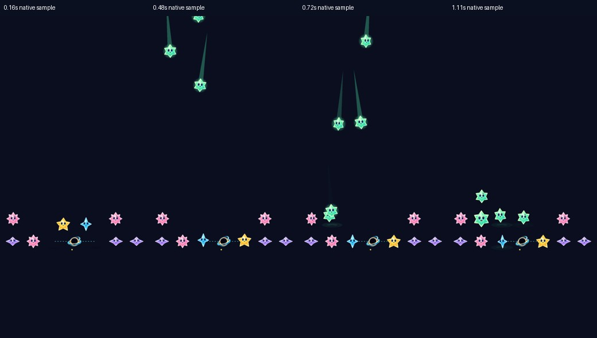

# Reopen input while preserving gravity and arrival motion

**Result: Verified for bounded development integration — physical comfort and human preference remain open.** Owner: current implementer.

Hypothesis before implementation: overlapping airborne approach with the preceding committed gravity phases removes unnecessary serial blocking without changing Core, cadence or full motion durations. Baseline [native measurement](../native-input-windows-2026-10-17/README.md) gives natural seed 68 / heavy shower 10 only 0–4 ms before its scheduled deadline. Rotation and release/settling are the sibling paths to examine.

Acceptance: one presentation timing owner retains existing phase/flight/stagger/landing durations; gravity phases keep their order; first landing occurs strictly after prior gravity phases; no duplicate grounded/airborne body or stale completion after replacement; normal and quiet presentations end at the same committed state. Live native measurement must materially reopen the prepared orbit/fast-heavy window, with Core and scheduled cadence unchanged. Inspect native motion captures, native orbit/menu/background/quiet checks, Core tests, Debug/Release builds and hygiene. Do not change the clock from an animation callback or shorten motion to obtain green tests.

Scope: scene/motion timing and focused tests only. No save/RNG/rules, gameplay selector or new asset. Compare the existing recorded baseline with the candidate; adopt only after ordering, identity, interruption and native-window checks pass. Otherwise remove the candidate and retain the measured constraint. Human enjoyment and physical-device comfort remain separate.

## Adopted correction

Gravity phases retain their ordered sequence and full durations. Only the airborne approach runs alongside them. StarfallMotion.GravityTimeline starts flight early enough to overlap, but leaves 0.04 seconds between the phase end and the first receiver response; landing follows afterward. The existing 0.38-second response delay, 0.48-second flight, 0.09-second stagger and 0.34-second landing response retain their values. Ordinary/gravity arrivals now share one flight constructor. No Core, Store clock, RNG, preview, save or hit geometry changed.

The first candidate protected landing only. After reconciling main's gravity artwork and child responses, the final candidate protects the earlier receiver response too. This retains the full gravity response before contact and intentionally leaves a slightly smaller interval than the initial candidate's roughly 0.44 seconds. Native sampling verifies that rotating captives have no movement action left when incoming receiver responses begin.

| Native seed-68 case | Before: ready to scheduled deadline | Final candidate, two observations |
| --- | ---: | ---: |
| Rotation + one lighter arrival, shower 9 | 0.650–0.664s | 1.001–1.008s |
| Rotation + five heavy arrivals, shower 10 | 0.000–0.004s | 0.334–0.335s |
| Release/settling + five heavy arrivals, shower 11 | 0.105s | 0.443–0.447s |

[Final sample](orbit.json) · [same-app-source repeat](orbit-repeat.json) · [ordinary sample](standard.json) · [before/after Core-state identity](state-parity.json)

The ordinary heavy windows remained about 0.50 seconds and breathing about 1.50 seconds. These are native Store admission intervals on a simulator, not physical reaction-time targets, a frame-rate profile or proof of human enjoyment. Ten automatic committed states (six ordinary and four orbit) exactly match the baseline's full Core values, including RNG and preview, despite different presentation timing.

## Native motion inspection

**Runtime evidence:** final source reconciled with attraction-field main 529a288, iPhone 17e / iOS 27.0 Simulator, normal effects. These are native SpriteKit captures composited over an opaque dark review stage and proportionally reduced; they are not the complete SwiftUI Observatory screen. Sample times come from the test's monotonic elapsed clock, [recorded here](frame-times.json). Inspected approach/rotation, the end of the phase, staggered landings and landing response. Dynamic native assertions, not these stills alone, establish overlapping flight, response-after-movement, landing order and single-body ownership. Continuous human motion comfort remains unmeasured.

## Verification and source limits

Final tested product source is main 529a288 plus App/FallingSkyScene.swift and App/FallingSkyMotion.swift. Hosted test changes reuse the bounded natural-orbit setup. [Source hashes and working-tree differences](source.json) identify exact bytes. Xcode 27.1 (27A9275), Swift 6.4, arm64 unsigned, Starfall scheme, private iPhone 17e / iOS 27.0 (24A434), simulator 536BCC00-751C-47BA-BC2F-C1702941CFC8. No source/resource membership or asset bytes changed in this workstream.

| Check | Result / evidence |
| --- | --- |
| Latest attraction-field main plus correction | 22 passed, zero failures/skips: five native-renderer checks, sixteen StarCastChecks and native collision/clear/restore. test_sim_2026-10-18T01-25-40-761Z_pid85535_1c79b1fa.xcresult. Same-source orbit repeat: one passed, zero failures/skips; test_sim_2026-10-18T01-27-21-757Z_pid85535_3eef4ddc.xcresult. This latest reconciliation preserves the field's nonphysical appearance and response rules. |
| Core | swift test: 109 passed, zero failures; /tmp/starfall-gravity-overlap-core.log. The later artwork merge changes no Core files. |
| Earlier combined artwork/timing | 21 passed, zero failures/skips: five NativeInputWindowTests, fifteen StarCastTests and native GravityUITests collision/clear/restore. test_sim_2026-10-18T01-11-00-514Z_pid85535_8bfcfda9.xcresult. Includes normal/quiet node outcome parity, cancellation, Opal motion, material bounds and exact Core state replay across automatic windows. |
| Earlier strengthened response ordering and repeat | Four passed, zero failures/skips: nominal contact/landing budget, actual captive movement finished before receiver responses, cancellation/quiet parity, and repeat native orbit windows. test_sim_2026-10-18T01-19-05-952Z_pid85535_f60a88e7.xcresult. App source unchanged from the 21-check run; this adds the stronger native assertion and repeats the measurement. |
| Supporting lifecycle/UI batch | Earlier candidate: fourteen passed, zero failures/skips, including six GravityStoreTests, native background/three-window expiry and system Reduce Motion. test_sim_2026-10-18T00-59-46-205Z_pid85535_b6cfa5be.xcresult. This predates the shared constructor, artwork reconciliation and contact refinement; it is supporting source-bound evidence, not a claim those exact UI cases reran on final source. Final-source quiet/cancellation and collision/restore ran above. |
| Builds | Debug compiled in hosted/native runs. Final integrated Release simulator build passed without warnings/errors; build_sim_2026-10-18T01-27-35-470Z_pid85535_cf2c3ae6.log. |
| Hygiene | python3 scripts/ci-hygiene.py and git diff --check passed. |
| Remaining acceptance | No new actual VoiceOver, physical-device gesture/comfort, broad frame-rate profile or uncoached preference result. Earlier actual VoiceOver evidence remains source-bound; routine iteration does not substitute for RC acceptance. |

The initial overlap case, shared-constructor consolidation and final contact refinement were tested separately; all accepted native runs used full motion with zero skips. The QA contact-sheet helper initially invoked system Python without Pillow; the bundled runtime completed the derivative. No source or native result was changed by that helper failure. Raw events/images remain in the cited xcresults and ignored artifacts/gravity-flight-overlap. No Core outcome, shower schedule or legal move depends on an animation callback or node position.

## Extent and decision

Adopt the presentation correction. It addresses the current automatic rotation and release/settling paths; collision/capture clears have no arrivals and retain their full phase sequence. Normal arrivals, growth, Opal soft motion, cancellation and quiet outcome parity were examined. The nominal timeline keeps the current five-arrival automatic paths below the fast deadline, and the measured target window reopens.

Larger future gravity phase batches, new motion durations, a changed cadence or slow-device rendering need the same native interval/ordering checks. This is not a guarantee of a particular usable interval on every device or proof that 0.33 seconds feels comfortable. Next: observe planning during falling and meaningful Opal/orbit choices in ordinary play, with physical motion and RC accessibility tracked separately.
