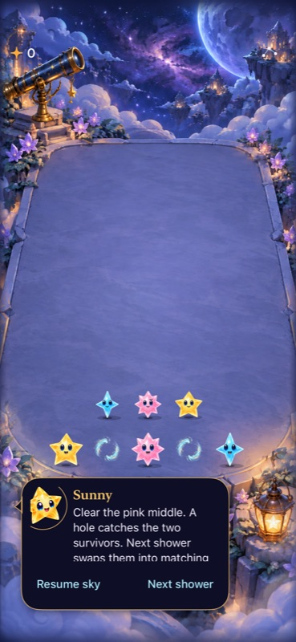
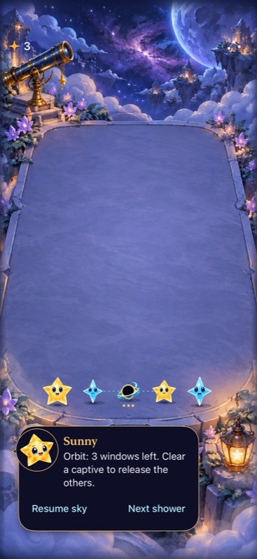
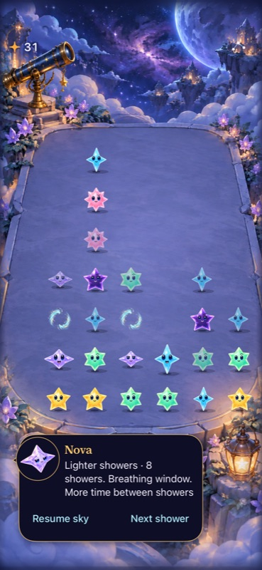

# Gravity needs a usable invitation before more appearances

**Result:** Partially verified · **Owner:** current implementer · **Date:** October 17, 2026

Keep production frequency unchanged. The galaxy graphic is the **attraction-field precursor**, not Dusk or the later hole. Repeated exposure supports the user's concern: fields often occupy cells without offering a clear route to their intended effect, then disappear beside ordinary clears. The orbit can create a useful wait-versus-clear choice, but more offers alone do not make that choice legible or common.

This is an informed agent review of native scripted play, full-motion recordings and deterministic samples. It is not human enjoyment, uncoached discovery or physical-touch acceptance. No production rules, artwork, saves or cadence changed.

**Next action:** compare one readable paired setup: clearly link the fields, identify the legal activating clear, and preview which stars will move. Assess activation and a predicted useful follow-up before revisiting frequency. Do not replace the orbit with a one-shot pull on this evidence alone.

## What the play showed

| Scenario and intended action | Observed consequence | Assessment |
| --- | --- | --- |
| Prepared `opportunity`: clear the rose middle, wait one shower, clear the newly connected amber stars | Score 0→3→6; two captives exchange sides, forming matches beside the larger outer stars; the captive clear releases the orbit | A useful rearrangement puzzle when the setup is readable. This was an explained fixture, not a discovery result. |
| Prepared `takeNow`: clear the middle, immediately take an existing captive match | Score 0→3→6 and release; Core counterpart confirms waiting breaks those immediate connections | The same mechanic can reward taking the opportunity now. It is not a guaranteed bonus for waiting. |
| `stranded`: clear the neighboring aqua group | Field disappears; no orbit or extra starlight from the field | Reproduces the user's “empty space that disappears” account. Intended behavior is still weak communication. |
| Passive automatic `opportunity` | Three windows→two→expiry and release, with no player clear | Field lifetime works, but the three dots do not explain activation, rotation direction or the benefit. This automatic fixture uses Gentle/6-second timing, not default pressure. |
| Natural supply, repeated manual showers and current-board choices | See native-round results below | More exposure tests opportunity quality as well as quantity. |

<table><tr><td></td><td></td></tr></table>

**Native fixture captures, clean runtime `afeca75`, iPhone 17e / iOS 27.0 Simulator, Debug/default text/full motion.** Same `opportunity` setup before and after activation. The first stage resembles empty space; only the second shows links to affected stars. These stills establish appearance, not animation or human understanding. Normal-motion frames around 21.06–21.55 seconds in the baseline recording separately show the captives lifting, crossing and landing on opposite sides.

## What increasing supply actually changed

Temporary candidate: on generation 3, every calm shower after the first four may offer a pair. Keep existing geometry, relief, Dusk/Opal, active-special and committed-forecast guards. The candidate used the ordinary target/bundle only on the isolated QA simulator. It was not a new app/product or a retained runtime flag.

Seeds **640–655**, at most **36 showers** or overflow, one clear per shower. Reused the canonical action enumerator: taps/full-component traces, with bounded five-star subsets at Opal states. Selection uses current visible consequences, not future arrivals. The sample is small and policy-dependent; no optimal-play or population estimate follows. [Detailed summary](supply-summary.json).

| Per 16 rounds | Current, largest immediate | Frequent, largest immediate | Current, collision first | Frequent, collision first |
| --- | ---: | ---: | ---: | ---: |
| Pairs offered | 17 | 33 | 17 | 34 |
| Orbits formed | 3 | 6 | 3 | 8 |
| Offered boards without an immediate orbit-forming action in the enumerated choices | 16 | 27 | 16 | 28 |
| Offered boards with no enumerated clear | 9 | 17 | 9 | 17 |
| Orbit states with different immediate two-clear totals | 2 | 0 | 2 | 1 |
| Overflowed rounds | 5 | 5 | 5 | 5 |

More offers increased encounters, but not the sampled immediate planning choices. The large number of offers without an activating action is the stronger finding. The supply checks space and alignment when the forecast is committed; it does not require the middle to be a legal clear on arrival. A small middle star can absorb its matching arrival as growth and still total only two. Intervening clears can also alter support heights before the immutable forecast lands. Examine both offer and arrival conditions before proposing stronger guarantees.

### Native-round results

Two corrected **24-shower native runs**, seeds **641 and 647**, completed with full motion and manual shower control. The policy prefers a legal clear directly between aligned fields, otherwise the largest ordinary match, otherwise waits. It uses no traces or forecast lookahead and is not interchangeable with the richer offline policies.

- **641:** a pair appears on shower 13 with no legal ordinary match. Both remain through shower 16; one survives on showers 17–19. Ordinary clears remove them; **no orbit forms**.
- **647:** a pair appears on shower 8; an ordinary clear removes one on shower 9, and the other goes on shower 13. Another pair arrives at different heights on shower 15; one disappears on shower 16 and the other on shower 20. **No orbit forms**.

Both rounds reach shower 24 without overflow. These observations support precursor ambiguity and strategy dependence, not impossibility: the richer offline collision policy forms eight orbits across sixteen rounds.

**Native temporary-candidate capture**, runtime fingerprint `dev.290d67aece`, same simulator/default text/full motion, before choosing an action. The fields occupy the aqua star’s sideways neighbors, but the aqua does not yet have a legal ordinary clear. This candidate is not adopted.

## How and when gravity should be used

**Role:** an optional, deliberate way to rearrange colors into a better next match. The successful examples support that role. Passive swirling and removal of a zero-value obstacle do not communicate it.

**Placement recommendation, not an adopted rule:** introduce it after ordinary matching/growth has been experienced, during a calm interval, on a board where an activating action and at least two surviving movable stars can be shown clearly. Favor a visible connection to make or preserve, with room and time to inspect it. Keep one setup at a time. Avoid adding more unlinked fields to a crowded board or introducing the mechanic alongside a heavy storm. No exact spawn interval is justified yet.

**Presentation recommendation:** link a genuine pair before activation; distinguish an inactive field from an active orbit; preview the affected stars and their next positions when inspecting the activating clear. Give ordinary dispelling a distinct, brief cause-and-effect response. Test whether a new player can predict activation and one follow-up without being told the rule. More dramatic swirl animation alone would preserve the ambiguity.

Current timing remains a separate limit: [the adopted overlap correction](../gravity-flight-overlap-2026-10-17/README.md) reopened the historical fast-heavy orbit interval to roughly 0.33–0.35 seconds in its source-bound sample. That is not a comfortable human recognition window proved by this playtest. This session's manual play and Gentle automatic case do not establish default storm-time usability.

## Verification and reproducibility

**Production source:** `afeca75`, runtime-input fingerprint `dev.9233a9863c`; actual baseline Info.plist build marker `dev.local`. Worktree differences affecting runtime: none. Only this report and register/navigation updates are retained. **Environment:** Xcode 27.1 / Swift 6.4, arm64 Debug, iPhone 17e / iOS 27.0, dedicated booted simulator `A83E40E8-E0BE-49C4-A48E-5938E3DA09E2`. Calm effects explicitly off in the disposable harness; normal-motion arc inspected. No phone round was touched.

- `swift test`: **115 passed**, zero failures. Raw `artifacts/gravity-focused-afeca75/core-tests.log`.
- Standard xcodebuild simulator build through XcodeBuildMCP (`-project Starfall.xcodeproj -scheme Starfall -configuration Debug -destination platform=iOS\ Simulator,id=A83E40E8-E0BE-49C4-A48E-5938E3DA09E2 ARCHS=arm64 CODE_SIGNING_ALLOWED=NO`; tests use the same destination, `-parallel-testing-enabled NO` and the selected test identifiers below): passed for baseline and temporary candidate. First incremental-tool attempt failed with an incompatible Core module target; fresh arm64 standard xcodebuild succeeded.
- Baseline native: **4 passed**: `GravityUITests/testFloorCollisionOrbitClearAndRestore`, `testTakeNowAndMenuDismissal`, `testBackgroundPreservesOrbitAndThreeWindowsExpire`, and `GravityOpportunityNativeTests/testExtraCalmWavePairReachesFieldAndHigherFollowupThroughNativeInput`. Includes native score-24→32 natural-history branch, restore, background and settings dismissal. Result bundle `test_sim_2026-10-18T03-20-40-918Z_pid88296_1ffde3dd.xcresult` in the XcodeBuildMCP Starfall workspace.
- Disposable harness: **3 completed native checks passed** across two runs: automatic Gentle expiry, isolated field dispelling, and the corrected two-round natural policy check. Corrected natural result bundle `test_sim_2026-10-18T03-25-42-953Z_pid88296_8e20bd16.xcresult` (one test containing both rounds). The first natural-run constructor accidentally selected legacy generation; canceled after detecting it and excluded it from conclusions. Corrected constructors explicitly select `.current`; revised runtime fingerprint `dev.290d67aece`, exact input hashes and harness under ignored artifacts. This was a harness error, not a game failure.
- Offline comparison and diagnostics assert save validity and encode/decode equality after every selected action; no production save/rule change to migrate. The frequent runner completed sampling, then its provenance wrapper failed because the temporary export has no `.git`; exact input hashes were recorded separately and an independent instrumented rerun confirmed the results.
- Direct MCP tap/touch attempts left the initial board unchanged and emitted snapshot-settlement warnings. They are not interaction evidence; the successful actions above use native XCTest input.
- Raw runs, hashes, diagnostics, screenshots and recordings: ignored `artifacts/gravity-focused-afeca75/`. The candidate inputs/patch are archived under ignored artifacts; its temporary source export was removed and the unchanged main app was reinstalled. Production sources remain unchanged. No Release acceptance claim for this rejected exposure-only candidate.
- No new largest-text, Reduce Motion, actual VoiceOver, terminal outcome, performance or physical-device checks. They are outside this unchanged-production design review; earlier acceptance records retain their own limits. Markdown source/links reviewed; rendered Markdown not inspected.

Repository hygiene and `git diff --check` pass.

**Decision:** close the frequent-supply trial without adoption. Retain the shipped mechanic while evaluating a readable activation/setup candidate. Human preference and fast-cadence execution remain open.
