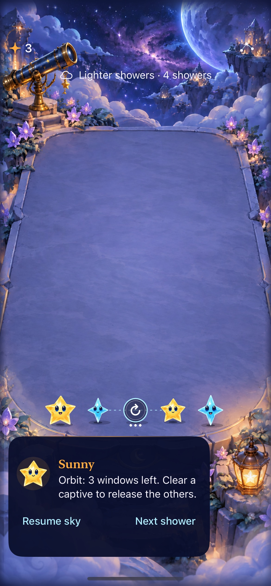
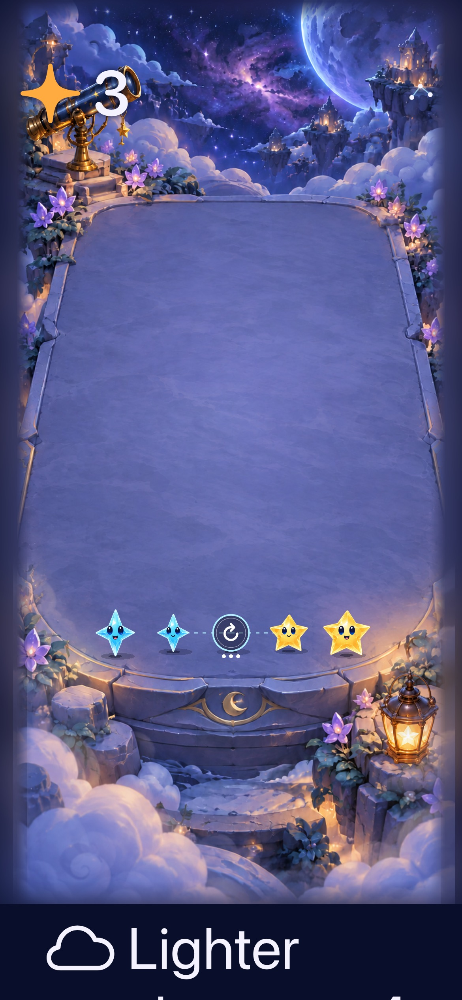

# Magnetic pairs and occupied orbits in the normal game

**Result:** Partially verified · **Owner:** current implementer · **Date:** 2026-10-17

The user requested adoption after merging #42. New skies now receive bounded paired magnetic opportunities; a legal middle clear forms a hole whose colored captives rotate through three settled windows. Clearing a captive or waiting out the field releases its supports. Dusk and Opal keep their distinct roles; Opal stays uncaptured. Production v5 saves preserve retained v4/v3 rounds and generation rules. The alternate bundle, envelope, menu route and duplicate lab fragments are retired.

Mechanical and native development checks are recorded below. Human enjoyment, desired natural frequency, full actual VoiceOver acceptance and physical-device behavior remain unverified. **Next action:** observe a human session with natural supply and check predictions of rotation, suspended landing and release before tuning frequency/lifetime; see [the follow-up](../../ENGINEERING.md#gravity-support-and-supply-follow-up--october-17-2026).

## Outcomes against acceptance

| Boundary | Result / limit |
| --- | --- |
| Deterministic rules and saves | 109 Core tests pass after merging current main. Covers floor/elevated supports, zero/one/two/three/four captives, expiry, selected trace release, Dusk non-chaining, Opal exclusion/use, invalid topology/accounting, replay and continuation. |
| Retained rules | 6,460 legacy/Opal encoded states match pre-adoption main byte for byte: forty seeds, first/largest immediate clearing policies, up to 24 showers. Sampled compatibility, not exhaustive proof. |
| Natural supply | 34 paired forecasts and eight clears ending in an active field across 2,518 showers from 80 seeds (up to 36 waves, clearing available matches with collision preference). Establishes reachability; does not establish enjoyment or desired frequency. |
| Store/material/input | 153 hosted tests pass, including v4/v3 migration, no fallback from corrupt newer data, save-before-animation, one deferred shower, stale phase/trace rejection, restart/background/motion interruption and bounded shared materials. |
| Native interaction | Nine pre-main-merge checks pass: First Light win/loss/replay, automatic overflow/background/resume, floor orbit/clear/restore, expiry, selected captive trace, largest text, settings dismissal and actual system Reduce Motion. The final combined source passes eight additional checks: all six gravity scenarios plus Opal allocation and tiny off-board release recovery. |
| Visuals and motion | Captures inspected on the final combined source; the additional floor recording shows normal-motion convergence, settling, the raised floor arc, and release. Glyphs distinguish magnets from holes; tethers and three dots identify the field. No geometry mapping was changed by gravity. |
| Build / hygiene | Debug test build and Release build pass; hygiene and whitespace pass. New Core helpers are included through SwiftPM; the focused hosted gravity file has explicit app-test target membership. |
| Accessibility / device | Native labels, captive hints, collision consequence content, maximum Dynamic Type interaction and system Reduce Motion checked. Actual VoiceOver session and physical-device/performance acceptance not run; RC/device follow-up remains open. |

## Native appearance

**Runtime captures — final combined source above, iPhone 17e / iOS 27.0.** Full-size PNG attachments were converted to JPEG at quality 75 without cropping or rescaling. The first image shows the three-window floor capture; the second shows the accessible layout's board and scrollable auxiliary content. Native taps, menu dismissal and a captive clear pass at that size. These stills do not prove animation or human understanding. Raw video stays under ignored `artifacts/gravity-integration-2026-10-17/final-floor-motion.mp4` (38.10 seconds; inspected collision around 12.72 seconds and rotation around 16.38–16.62 seconds); the normal-motion floor recording is separate from the actual system Reduce Motion check.

## Source and reproducibility

The final runtime/test source is published `abe27a1b95681d2959f5c1042403bb8ea0011d5d`, tree `5d35f47f23e24d161fa00dad9a9e3fb09553d4f9`; local tested merge `207b0cf927b4a54c6d485bdc8bf08c2ec335cc75` has that exact tree and was clean. Main's later #48 update changes only device-update scripts/documentation; `git diff 207b0cf HEAD -- App Sources AppTests UITests Config Starfall.xcodeproj Package.swift` is empty. Thirteen device-update script tests also pass. Later evidence/plan updates do not change runtime/test inputs. [Source manifest](source.json).

Xcode 27.1 / Swift 6.4, Debug and Release; dedicated iPhone 17e Simulator **Starfall Gravity Orbit QA**, iOS 27.0, UUID `A83E40E8-E0BE-49C4-A48E-5938E3DA09E2`. No physical install. Shared project/scheme `Starfall`; all xcodebuild commands use `ARCHS=arm64 ONLY_ACTIVE_ARCH=YES CODE_SIGNING_ALLOWED=NO`.

| Command / procedure | Raw local result |
| --- | --- |
| `swift test` | `/tmp/starfall-gravity-integrated-main-core.log` — 109 pass |
| `python3 tools/mechanics/check-gravity.py` | `/tmp/starfall-gravity-integration-replay.json` — 6,460 identical states |
| `xcodebuild -project Starfall.xcodeproj -scheme Starfall -configuration Debug -destination 'platform=iOS Simulator,id=A83E40E8-E0BE-49C4-A48E-5938E3DA09E2' -derivedDataPath /tmp/starfall-gravity-integrated-main-build ... build-for-testing` | `/tmp/starfall-gravity-integrated-main-build.log` — pass |
| Same Debug destination/derived data, `-only-testing:StarfallAppTests test-without-building` | `/tmp/starfall-gravity-integrated-main-hosted.xcresult` — 153 pass |
| Same native invocation: `GravityUITests`, `GravityTraceUITests`, `ConstellationTraceNativeTests/testTinyEdgeReleaseResumesAutomaticSkyAndOrdinaryInput` and `/testOpalPlanningTwoTapOrdersKeepTheirDistinctRewards` | `/tmp/starfall-gravity-integrated-main-native.xcresult` — eight pass |
| One extra normal-motion floor sequence on the same binary | `/tmp/starfall-gravity-integrated-main-motion.xcresult` — one pass; recorded and inspected |
| Release, `-destination 'generic/platform=iOS Simulator' -derivedDataPath /tmp/starfall-gravity-integrated-main-release ... build` | `/tmp/starfall-gravity-integrated-main-release.log` — pass |
| Earlier clean exported source `0029556`, Core + Debug test build; full first nine native checks on its matching runtime | `/tmp/starfall-gravity-integration-clean-core.log`, `-clean-build.log`, `-native.xcresult` — pass; superseded by merged-source checks for changed trace input |
| `python3 scripts/ci-hygiene.py`; `git diff --check`; `python3 scripts/test_device_update.py` | pass; script suite 13 pass |

An early hosted run exposed the cast's old fixed 84-material/12-pose assumption for the two new glyphs. The shared owner now caches one image per gravity object; seven faced stars retain their authored poses, yielding a bounded **86 materials / 22,544,384 raster bytes**. Tests explicitly check both contracts. An initial mixed Opal fixture accidentally included its neighboring Opal in an ordinary clear; the corrected committed selected-trace history omits it and verifies uncaptured Opal remains a valid connector. Both corrected suites pass without retries or motion suppression.

The historical [trial report](../gravity-orbit-2026-10-17/README.md) retains its pinned source. Markdown source/links were inspected; rendered Markdown was not checked. No human preference or timing comfort is inferred from automation.
