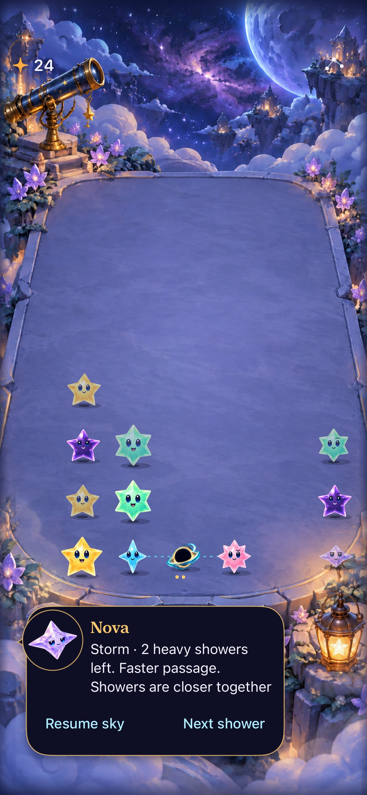
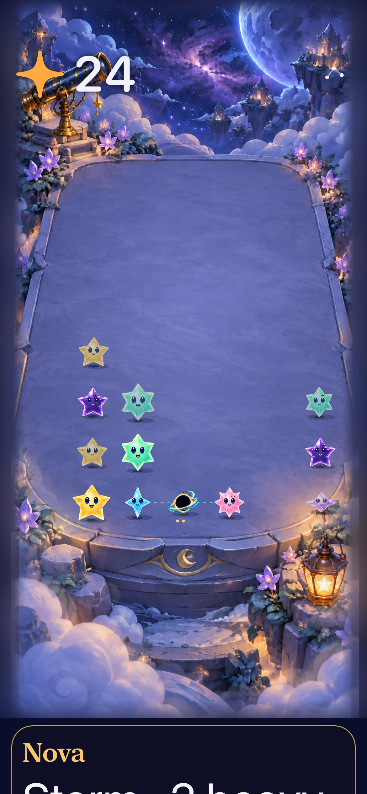

# More skies reach the magnetic choice

**Result:** Partially verified · **Owner:** current implementer · **Date:** October 17, 2026

Adopt generation 3 for **New sky**: a magnetic pair may arrive on calm wave seven or eight, with at most one committed pair per cycle. Existing restrictions, collisions, occupied orbits and pressure remain. Old saves and replays retain their generation. First Light stays unchanged.

The bounded comparison reaches fields in more rounds in both cohorts. A naturally reached extra-window example also supports distinct native outcomes. This establishes opportunity and functioning play, **not human enjoyment**. Confirmation overflows increase from 14 to 17 of 64 under collision-first play; most rounds are censored at 36 showers.

**Next action:** Observe ordinary player recognition and preference before further supply tuning. Keep the opening timing failure below open until its input-boundary investigation is resolved; actual VoiceOver and physical-device acceptance belong to RC checks.

## What the sample supports

Each cell below describes 64 fixed seeds, up to 36 showers, one visible-board clear per shower. Largest-immediate and collision-first-then-visible-reward use the existing action enumerator: taps, full connected components and bounded connected fives at Opal states. No forecast oracle selects a move; larger partial traces and waiting are not modeled. No enumeration caps occurred. Maximum consecutive states without a legal clear stayed one under every sample.

| Policy / cohort | Pair encounter rounds, old → new | Field encounter rounds | Field states with multiple selections | Overflows |
| --- | ---: | ---: | ---: | ---: |
| Largest, discovery 320–383 | 20 → 37 | 5 → 8 | 5 → 9 | 12 → 12 |
| Collision-first, discovery | 20 → 37 | 5 → 10 | 6 → 13 | 14 → 14 |
| Largest, confirmation 384–447 | 26 → 39 | 5 → 8 | 5 → 7 | 14 → 16 |
| Collision-first, confirmation | 26 → 39 | 5 → 12 | 5 → 11 | 14 → 17 |

Distinct visible two-clear totals occurred in 1 → 1 discovery and 2 → 3 confirmation field states under collision-first play. Counts remain small: more encounters do not prove deeper strategy. [Discovery](discovery.json), [confirmation](confirmation.json) and their source records retain denominators and counts. Repeating discovery produced byte-identical full JSON, including selected examples.

Reproduce from this source:

```sh
python3 tools/mechanics/study-gravity-opportunities.py --seed-start 320 --output /tmp/starfall-supply-discovery
python3 tools/mechanics/study-gravity-opportunities.py --seed-start 384 --output /tmp/starfall-supply-confirmation
python3 tools/mechanics/check-gravity-generation-replay.py --baseline 794a0d1
```

## A reachable choice, rather than an authored board

Seed 421's seventh-wave pair leads through seven ordinary clears to shower ten, score 24 and a two-window field. Clearing row 1/column 2 first yields 4 + 4 light; row 0/column 1 first yields 3 + 4. Neither comparison inserts an arrival between clears. The higher immediate option also wins this example; it is not evidence of a subtle smaller-first strategy. [Exact saved state, real history and actions](natural-choice.json); Debug fixture `naturalOffer` reconstructs it from wave seven without injected boards or RNG.



**Native implementation capture:** base `794a0d1` plus recorded working inputs, runtime fingerprint `dev.498a868592`; iPhone 17e / iOS 27.0 (24A434), default text, normal motion, Calm effects off. The hole and captives sit in the same normal Starfall board. Later main integration through `f0865f5` changed tests/docs only; runtime inputs match [source.json](source.json). This fingerprint describes inputs, not an installed build-number claim.



**Earlier matrix capture:** same behavior before a Core comment changed, fingerprint `dev.b0c6f88c96`, [initial source](initial-matrix-source.json). Accessibility XXXL places dialogue below the board in its scrolling panel. Native clears, settings dismissal, background and retained restore succeeded; this still image does not establish spoken VoiceOver acceptance.

## Verification and limits

Xcode 27.1, unsigned arm64 simulator, shared Starfall scheme; task-owned simulator `A35F00F8-C094-413C-9AE4-0DF4531AB62F`. The normal bundle is `com.starfall.prototype`; no alternate application or permanent selector was added. New native test target membership was confirmed by execution. Raw logs, xcresults and movie remain in temporary/XcodeBuildMCP storage; [source hashes](source.json) bind the worktree checks.

| Boundary | Result |
| --- | --- |
| Rules and saves | `swift test`: 115 passed. Opening/first six previews match generation 2, pair conditions/one-per-cycle hold, old-generation replay and First Light remain explicit. |
| Retained continuations | Generations 0/1/2: 12,890 encoded states byte-identical against `794a0d1`, 40 seeds × two policies, 36-shower cap. [Hash/result](retained-replay.json). |
| Hosted app | Full `-only-testing:StarfallAppTests`: 173 passed, zero failures/skips after anchoring the existing renderer reproduction to its original generation. Includes archive v4 rejection before specials, v5 restore, rapid-input rejection and stale completion cancellation. |
| Native interactions | Initial selected matrix: 27 passed, one opening-tap failure. New pair/collision/rotation, both clear orders, largest text/settings/background/restore, gravity/replay/Reduce Motion and First Light win/overflow checks passed. Paired isolated opening checks passed on immutable baseline and candidate; the initial failure is retained below. Final selected UI matrix: **10 passed, zero failures/skips**, including opening play. The MCP call timed out at 300 seconds; its original xcodebuild continued and completed, and the terminal xcresult confirmed the result. [Machine-readable verification](verification.json). |
| Motion/appearance | Explicit normal-motion recording of the new natural-pair native flow; inspected exact-time frames show falling at 19.2s, collision/capture at 20.2–20.6s and rotation concurrent with approach at 24.0–24.8s. Sampled default/XXXL board captures inspected. These samples do not establish every animation or physical comfort. |
| Builds | Debug simulator build/run and Release simulator build succeeded. Release includes current generation routing; fixture is Debug-only. |
| Hygiene | `python3 scripts/ci-hygiene.py` and `git diff --check` passed. |
| Actual VoiceOver / device / preference | Not run in this iteration. Full spoken acceptance remains an RC gate. No human preference conclusion. |

### Failures were not erased by later passes

The first hosted run passed 172 tests and failed `NativeInputWindowTests.testIncomingFlightOverlapsRotationButLandsAfterIt` at its combined observation assertion. Its setup searched `.current`, so the new supply changed which natural orbit the renderer reproduction selected. Pinning that fixture to `.gravityOrbits` preserves the original scenario and assertions; separate generation-3 native tests cover the added history. The full hosted rerun passed 173 with zero skips. This is a fixture correction, not a claimed renderer fix.

The first UI matrix failed `testOpeningCascadeAllowsNativeClearBeforeLastWave` at the two-second score-change assertion after a legal tap. Exact isolated baseline and candidate runs both passed. The supply change does not alter the first six showers, but that alone does not identify the failure mechanism. No assertion was weakened, no quiet mode forced and no blanket retry added. Preserve the failure as an input-timing risk before RC or the next input-boundary change; [engineering follow-up](../../ENGINEERING.md).

[Design and adoption criteria](../../design/GRAVITY_OPPORTUNITIES.md) · [Experiment register](../../EXPERIMENTS.md)
