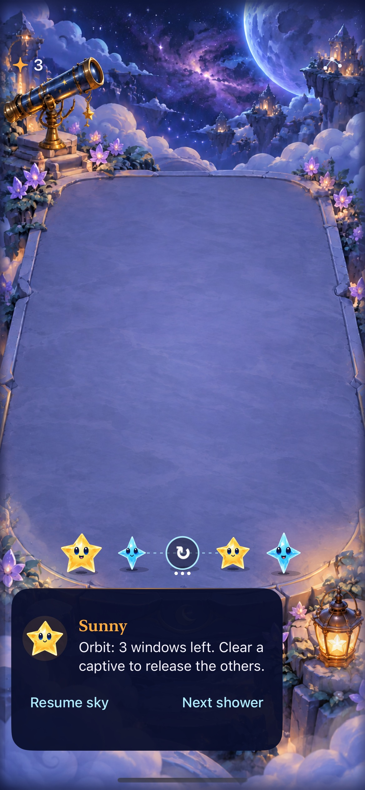
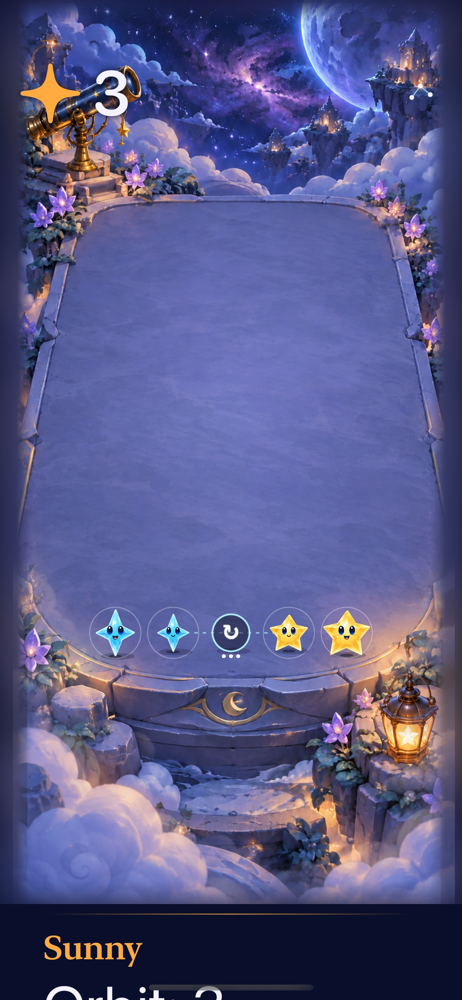

# Magnetic collision and captive orbit are playable in an isolated lab

**Result:** Partially verified · **Owner:** current implementer · **Date:** 2026-10-17

The bounded trial implements clear-triggered magnetic collisions, occupied captive supports, discrete rotations, three matching windows and release by captive clear or expiry. **104 candidate package tests, eight final hosted tests and nine native UI checks passed**, with Debug/Release simulator builds. Ordinary legacy/Opal replay stayed byte-identical across 6,460 sampled states. Production routing and save bytes are unchanged.

**Limits:** authored fixtures establish outcomes, not enjoyable balance. Natural magnet spawning, mixed Opal/capture behavior, physical-device feel/performance and actual VoiceOver acceptance remain unverified. Magnet/hole symbols are prototype presentation.

**Next action:** play the trigger/keep/close examples with the user, ask for a prediction before acting, then adopt, revise one named uncertainty or remove the trial. [Design](../../design/GRAVITY_MECHANICS.md) · [Plan](../../design/GRAVITY_MECHANICS_PLAN.md) · [Run instructions](../../../tools/mechanics/README.md#magnetic-collision-and-captive-orbit).

## Outcomes against acceptance

| Boundary | Result | Evidence / limit |
| --- | --- | --- |
| Meaningful windows | Rule examples pass | `opportunity` gains two connections after rotation; `takeNow` loses its existing connections if the player waits. These are immediate authored consequences, not a measured long-term hold advantage or human preference. |
| Floor and support geometry | Pass in Core; floor native taps pass | Zero/one captives close immediately; two/three/four captives permute with stable IDs. Elevated formation, a lower clear leaving a supported gap, arrival above the anchor and packed settling after expiry pass. Corner topology is a helper case; horizontal formation cannot produce a corner center. |
| Dusk and removal order | Pass | A regression rejects removal chaining through Dusk into an untouched magnet. Captive release removes supports before final settling; adjacent effects use original selected cells. No additional blast removal or score bonus. |
| Save / replay / isolation | Pass in scoped checks | Candidate envelope restores each window and rejects malformed field/accounting/version data. Final hosted checks preserve both `starfall.accumulation.v3` and `.v4` sentinels; lab uses `starfall.gravity.lab.v1`. Ordinary encoded replay matches baseline under two policies, both generations, seeds 0–39, through 24 showers or overflow. This is a sample, not exhaustive equivalence. |
| Input / lifecycle | Pass | Fake clock/presenter checks cover save before animation, overdue rain without catch-up, stale callbacks, fixture replacement, restart, background/pause and motion settlement. Native background/resume, expiry, restore, menu dismissal and repeated/gated input pass. |
| Selected tracing | Pass | Native straight swipe spends five chosen stars including the captive, closes the hole and retains the sixth star. Hosted checks preserve other IDs/forecast and reject a pre-orbit input ticket/snapshot. Current main's trace implementation is inherited. |
| Ordinary round outcomes | Pass in selected native methods | Automatic rain/paused clear/replay/settings, First Light completion/restore/replay/survival, and First Light overflow all pass. This is not a rerun of every historical UI method. |
| Accessibility and layout | Lightweight checks pass | Native labels distinguish hole, magnet and captive; custom trace actions remain. Largest-text captive input/menu dismissal and actual system Reduce Motion orbit/clear pass. Full spoken VoiceOver acceptance remains RC work. At largest text the guide continues below the viewport; the terrace and captive targets stay visible. |
| Visual / animation | Inspected, bounded | Normal captures and consecutive recorded frames show inward collision, hole formation, settling and the floor swap above the front edge. Prototype glyphs and stationary tethers are distinct from ready-group circles. No frame-time, memory or physical-device threshold is claimed. |

## Native presentation

| Captured neighbors | Largest text |
| --- | --- |
|  |  |

**Native screenshots — not concepts.** iPhone 17e / iOS 27.0, runtime `dev.af76f08cae`; original XCTest PNGs exported from `/tmp/starfall-gravity-verified-native.xcresult`. Stored JPEGs retain original dimensions without cropping. [Manifest](source.json) records original/stored hashes. Stills establish appearance, not animation.

The ignored local recording `artifacts/gravity-orbit-2026-10-17/gravity-motion.mp4` is 63.12 seconds from the same simulator/runtime. Inspected consecutive collision frames at 21.70/22.00/22.30 seconds and orbital frames at 25.56/25.72/25.88 seconds show travel and exact settling. Floor travel lifts into the terrace instead of passing beneath its front edge. The recording/hash is retained locally; temporary video frames and raw XCTest output are not repository dependencies.

## Source and reproduction

Baseline: published `06ce5141f14f1b4d371ba5b5246d752888b3a821`. The earlier local worktree analysis was deliberately replaced by this source before final acceptance. The exporter archives that commit and overlays only named canonical gravity fragments, failing changed anchors. The app inherits current main's Opal materials, versioned-save baseline, tracing, scene readiness and flow. Fixture histories use legacy generation; Opal is not captured. No ranking transport, SDK or dependency is added.

The final eight hosted checks add a production-key-isolation test to the earlier seven. The final hosted export and nine-UI export have **identical runtime file hashes and build ID**; only test inputs differ. [Manifest](source.json) records hashes, tools, exports and raw result/log paths. Candidate sources are generated inside those exports, not added to the normal app target. The shared archive helper and trial tools/docs are the only repository changes.

Toolchain: Xcode 27.1 (27A9275), Apple Swift 6.4, arm64; dedicated simulator `A83E40E8-E0BE-49C4-A48E-5938E3DA09E2` / iPhone 17e / iOS 27.0. No physical device was installed or tested.

- `swift test`: production baseline **89 passed**.
- `python3 tools/mechanics/check-gravity.py`: candidate **104 passed** and **6,460 byte-identical states**, including legacy and Opal generation. Each sampled state validates before encoding.
- `python3 tools/mechanics/prepare-gravity-lab.py`: generates the native project and `GRAVITY-LAB.json` with input hashes and `dev` runtime ID. Select `--gravity-fixture=opportunity`, `takeNow`, `stranded`, `supports` or `trace` with `--starfalls-reset`; normal launch restores only the lab envelope, paused.
- Native Debug: `xcodebuild ... -scheme Starfall -configuration Debug -destination 'platform=iOS Simulator,id=A83E40E8-E0BE-49C4-A48E-5938E3DA09E2' ARCHS=arm64 ONLY_ACTIVE_ARCH=YES CODE_SIGNING_ALLOWED=NO build-for-testing`. Followed by `test-without-building` for `GravityStoreTests`, `GravityTraceStoreTests`, `GravityUITests`, `GravityTraceUITests` and the three ordinary methods named above. Final hosted result: `/tmp/starfall-gravity-hosted-final.xcresult`; native matrix: `/tmp/starfall-gravity-verified-native.xcresult`.
- Release: `xcodebuild ... -scheme Starfall -configuration Release -destination 'generic/platform=iOS Simulator' ARCHS=arm64 ONLY_ACTIVE_ARCH=YES CODE_SIGNING_ALLOWED=NO build`: passed.
- Repository hygiene, whitespace and local document/image links: passed. Markdown was reviewed as source; rendered Markdown was not inspected.

## Corrections and remaining decision

An early test incorrectly looked for Next shower inside the menu; it was corrected to use the existing paused guide. An early rule test incorrectly assumed a diagonal neighbor was an ordinary match; its lone-magnet history was corrected to establish an orthogonal group. Assertions were retained; no blanket retries or forced quiet mode were used. These initial failures are not acceptance of those older inputs.

Code review also found that settling immediately on captive release could shift cells before adjacent effects completed, and that using removed Dusk cells for precursor adjacency could introduce a removal chain. The responsible resolution order now releases supports without early compaction and applies precursor adjacency only to the selected group; focused regression checks cover those boundaries. The examined extent is the gravity clear/closure path and existing Dusk/ordinary replay paths, not every future special-unit combination.

Support gravity and short changing windows still need uncoached player prediction. Natural supply/orphan lifetimes, arbitrary simultaneous fields, extra blast effects and capture of Opal remain outside this trial. Revisit these only after the existing fixtures earn the added rules; retain a single bounded field rather than accumulating permanent pilot flags.

Post-publication integration: merged main `7afadb5` and resolved shared README/engineering/register edits while preserving both workstreams. All tested gravity input hashes remain unchanged; production App/Core/project files equal that main source. The merged production package passes **90 tests** and its Debug simulator build passes; the original 89-test baseline above remains source-bound to `06ce514`.
