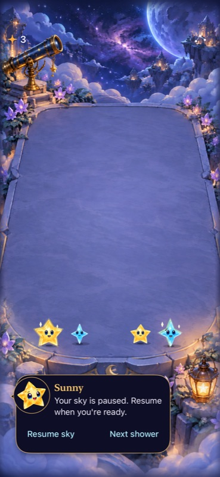

# Gravity removed from normal Starfall play

**Result:** Verified development checks; ready for publication · **Owner:** current implementer · **Started:** October 17, 2026 · **Updated:** October 18, 2026

At user request, new, resumed and replayed normal skies no longer contain galaxy-shaped attraction fields or orbiting holes. Remaining stars and score are preserved; previously held stars settle. Dusk, Opal, ordinary falling, matching, tracing, cadence and First Light stay in place. No automatic replacement was implemented.

**Publication:** target GitHub main and the existing single-app iPhone updater. Confirmed remote revision and installation belong to the publication receipt; a simulator build alone is not a phone delivery or App Store release. This repository has no configured App Store distribution.

## Behavior and acceptance

Acceptance was recorded before implementation: remove specials from all normal entry paths, preserve round values and stable survivors, migrate deterministically without RNG draws, reject malformed archives, keep initialization read-only, and verify input/interruption/accessibility/build paths before publication.

`SkyGeneration.standardSky` (saved generation 4) retains Opal/storm generation without magnetic supply. On normal restore, `FallingSky.removingGravity()` removes the zero-value board objects, releases occupied supports and packs surviving columns. Score, seed, turns, arrival count, Dusk-clear count, outcome, balance, cadence, star IDs and grown values remain. Announced magnetic entries become ordinary stars using the first colored family in that shower (aqua fallback), preserving size, order, column and incoming ID. Migration draws no randomness.

Retired magnetic mass and the monotonic ID allocator remain historical accounting so removed objects do not become score or invalidate surviving IDs. Generation 4 rejects live fields/holes. V4 envelopes accept only their original legacy/Opal generations; raw v5 decoding remains source-faithful before the store applies retirement. Same-sky replay also passes through retirement. Initialization writes nothing; activation/committed saves persist the valid normalized round.

Historical generation readers, renderer materials and reset-only Debug histories remain compatibility/reproduction tooling, with no normal player route or new pilot flag. Original Core replay tests continue to verify their raw histories. Removing the mechanic does not erase old evidence or implement a second gameplay mode.

| Check | Result |
| --- | --- |
| Core rules/save/replay | **120 passed**, including five retirement checks: pending pair conversion/RNG parity, active orbit/support/expiry migration, repeated encode/decode continuation, stable IDs/score/cadence, overflow stays ended, and rejection of forged live gravity in generation 4. |
| Hosted store/persistence/lifecycle | **188 passed, zero failed/skipped** in the final full hosted run. Covers read-only restore, persist-before-play, stale completions, pause/background, malformed archives and replay retirement alongside the full hosted suite. |
| Native interaction | Eight initial scenarios passed: old orbit restore, old pair restore, opening clear, win/restore/replay/survival, loss, actual system Reduce Motion, largest-text settings/dismissal, and automatic play/pause/replay/settings. Explicit background/relaunch/overflow passed in the second run: **nine distinct native scenarios passed, zero skipped**. |
| Build and membership | Debug standard xcodebuild and Release generic simulator builds passed. New Core test is automatically included by SwiftPM; hosted/UI additions use files already in their Xcode targets. No app resource or project membership changes. |
| Visual/animation | Restored 3- and 18-starlight boards inspected: ordinary survivors remain and both gravity graphics are absent. Normal-motion native play and hosted real-scene checks remain unsuppressed; no animation duration or hit geometry was changed. |
| Actual VoiceOver / physical play | Actual VoiceOver deferred to RC; no new full session. Phone installation is a separate delivery receipt, not physical gameplay acceptance. |
| Hygiene | `python3 scripts/ci-hygiene.py` and `git diff --check` pass; repeated after final staging. |

**Native capture:** normal restore after an old orbit, iPhone 17e / iOS 27.0 Simulator, Debug/default text/full motion. Source `cd5baca` plus runtime snapshot `c64a08904f`; actual test build marker `dev.local`. The score remains three. This still proves the sampled resting appearance, not frame rate or physical touch.

## Tested source and commands

Base: `cd5baca`, integrating remote main `b80edd8` with the prior focused-playtest report. Runtime fingerprint: **`dev.c64a08904f`**. Source/test changes were dirty during testing and are captured by exact [hashes](source.json); the final commit must contain these same runtime inputs. Test-only correction of the obsolete historical-orbit expectation does not change that fingerprint. No other worktree or phone save was modified by the simulator checks.

- Core: `swift test`; raw `artifacts/gravity-removal/core.log`.
- Debug/hosted/native: XcodeBuildMCP standard xcodebuild, `-project Starfall.xcodeproj -scheme Starfall -configuration Debug -destination 'platform=iOS Simulator,id=A83E40E8-E0BE-49C4-A48E-5938E3DA09E2' ARCHS=arm64 CODE_SIGNING_ALLOWED=NO -parallel-testing-enabled NO`. Initial selection: all `StarfallAppTests`, `GravityRetirementNativeTests`, and the six ordinary native scenarios above. Final selection: all hosted tests plus `FallingSkyInteractionTests/testBackgroundRelaunchAndAutomaticOverflow`.
- Release: `xcodebuild -project Starfall.xcodeproj -scheme Starfall -configuration Release -destination 'generic/platform=iOS Simulator' -derivedDataPath /tmp/StarfallGravityRemovalRelease ARCHS=arm64 CODE_SIGNING_ALLOWED=NO build`.
- Raw logs/attachments remain under ignored `artifacts/gravity-removal/`; native result bundles live in the XcodeBuildMCP Starfall workspace. No Release-only fixture route was added.

## Failed attempt and limits

The initial combined native/hosted run completed with **195 passed, one failed, zero skipped**. Its old orbit timing test expected a normal restore to preserve the now-retired orbit. The replacement asserts exact normalized deterministic continuation and zero gravity phases; it keeps the bounded readiness/arrival checks. No timeout, retry policy, assertion strength or production timing was relaxed. A second full-suite attempt passed the corrected retirement test and the explicit native background case, but the unchanged independent-arrival scene check stalled while SpriteKit logged “no drawables available.” The identical three scene checks passed on clean main `b80edd8` after refreshing the dedicated simulator. The final full hosted run passes all 188 checks using that same refreshed-simulator procedure; no rendering code or animation assertion was changed. Surface availability remains a test-environment follow-up rather than a claimed rendering fix. The initial eight native cases were not rerun solely for this test-only correction; all application runtime hashes remained unchanged. The MCP transport timed out at 300 seconds while Apple's run continued; results were read from the completed xcresult/log, not inferred from the transport error.

No new human preference, performance profile, minimum-OS or full tablet matrix is claimed. Markdown links/images were checked as source; rendered Markdown was not inspected. [Engineering follow-up](../../ENGINEERING.md#gravity-retirement-compatibility-boundary) protects the retained historical accounting/decoder boundary. The earlier readable-activation proposal is superseded by this user-selected removal.
