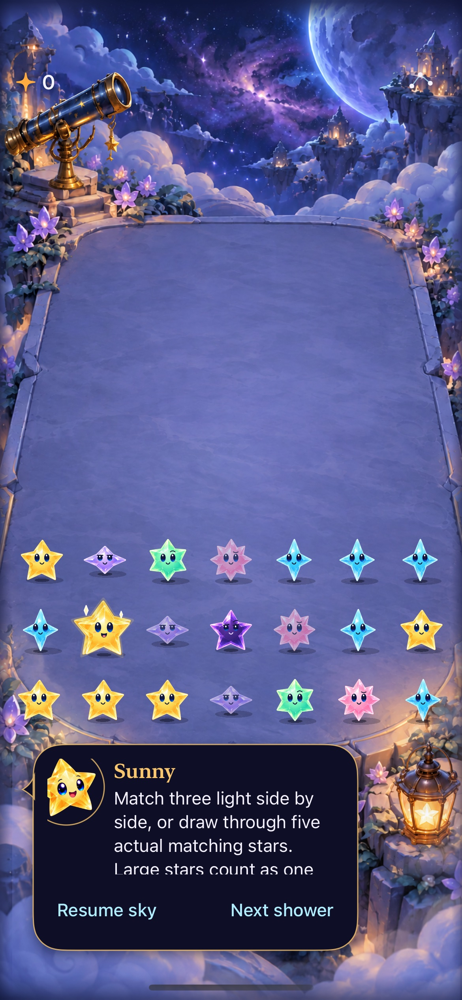

# A gentle aura pulse for grown stars

**Result:** Verified for development integration · **Owner:** current implementer · **Date:** 2026-10-17

The user approved the pulse and requested merging it. The earlier double silhouette and glints are integrated onto published main `afeca75`, preserving its current Opal, gravity, tracing, dialogue and input behavior. Only 2-starlight stars get the cue. Human preference and physical-device feel remain unverified.

**Native capture:** clean local validation commit `8e23cbf`, Debug, iPhone 17e / iOS 27.0, `--starfalls-reset --observatory-review -calmEffects NO`. JPEG encoding of native PNG. This still verifies appearance only; the hosted motion test below samples the live SpriteKit animation. The dialogue card's clipped fixture guidance is a separate layout follow-up in [Engineering](../../ENGINEERING.md).

## Acceptance results

| Criterion recorded before verification | Result |
| --- | --- |
| Gentle outer aura, steady recognition cue | Native motion sampling observes opacity variation greater than 0.18 within four seconds, bounded to 0.14–0.34. Authored period is 2.8 seconds. Rim opacity, body size/scale and rotation remain steady. |
| Quiet modes remain still | Calm effects/Reduce Motion use the existing reduced-motion boundary. Hosted checks verify cancellation/restored alpha 0.24; native system Reduce Motion manual play passes. VoiceOver uses the same quiet boundary; actual VoiceOver deferred to RC. |
| Interruption and replacement own cancellation | One keyed action per grown star; menu/background suspension, full/column replacement, clear, gravity removal and scene detachment cancel it. Hosted checks retain removed-node references to verify cancellation. Native growth/clear/settings/background/relaunch passes. |
| Stable value cue, no rule changes | All five colored families checked at 32/45/64-point cell steps. Ordinary stars, Dusk, Opal and gravity objects have no cue/pulse. Face changes preserve the current action; uptime plus ID offset preserves phase across rebuilds. No rule, save, RNG, cadence, input or projection changes. |

**Next human check:** Ask the reporting tester to identify grown stars before explaining the cue, then assess comfort with several grown stars on screen. Retain or tune the aura amplitude based on that check; no pilot route was introduced.

## Exact verification

Source: local clean `8e23cbf`; [runtime/test hashes](pulse-source-sha256.txt). Subsequent edits are evidence/prose only. Xcode 27.1 (`27A9275`), arm64, iPhone 17e named Starfall Crystal Glow QA (`D65C5E40-734F-42BF-8F91-97E980ED19C2`), iOS 27.0.

| Check | Result |
| --- | --- |
| `swift test` | 115 pass. Core is unchanged from `afeca75`. |
| Hosted `StarCastTests`, `FallingSkyStoreTests`, `ObservatoryGeometryTests` | 68 pass on final source, no motion skips. Includes actual pulse sampling, special-star exclusions, unchanged geometry, contact/landing, action disposal and interruption. |
| Focused native UI | Five methods pass: opening cascade/rapid tap, paused-guide growth/dark clear/restore, largest-text settings/dismissal, system Reduce Motion, and First Light win/loss/replay/restore. Growth/restore and Reduce Motion were repeated on final `8e23cbf` after the shared removal helper was added; both pass. |
| Debug / Release simulator builds | Pass on final runtime source. |
| Hygiene | `python3 scripts/ci-hygiene.py`, `git diff --check` pass. |
| Actual VoiceOver | Deferred to RC; not run on this development build. |
| Physical device / human preference | Not run; no installation or preference claim. |

Native command prefix: `xcodebuild -project Starfall.xcodeproj -scheme Starfall -configuration Debug -destination 'platform=iOS Simulator,arch=arm64,id=D65C5E40-734F-42BF-8F91-97E980ED19C2' -derivedDataPath /tmp/starfall-aura-dd -parallel-testing-enabled NO -collect-test-diagnostics never ARCHS=arm64 ONLY_ACTIVE_ARCH=YES test`.

Hosted selectors: `-only-testing:StarfallAppTests/<suite>` for the three suites above. UI selectors: `-only-testing:StarfallUITests/FallingSkyInteractionTests/` followed by `testOpeningCascadeAllowsNativeClearBeforeLastWave`, `testPausedGuideReportsGrowthDarkOutcomesAndRestore`, `testLargestTextSettingsFeedbackAndDismissal`, or `testSystemReduceMotionKeepsManualPlayWorking`; plus `-only-testing:StarfallUITests/SkyFlowInteractionTests/testFirstLightWinReplayAndFullSky`.

Final combined result: `/tmp/starfall-aura-acceptance.xcresult`; preceding five-method UI result: `/tmp/starfall-aura-ui.xcresult`. Raw logs are retained locally under ignored `artifacts/grown-star-aura/`.

Release command: `xcodebuild -project Starfall.xcodeproj -scheme Starfall -configuration Release -destination 'generic/platform=iOS Simulator' -derivedDataPath /tmp/starfall-aura-release ARCHS=arm64 ONLY_ACTIVE_ARCH=YES CODE_SIGNING_ALLOWED=NO build`.

**Initial failed check:** The new pulse test compared SpriteKit float-backed alpha with exact CGFloat literals (0.899999976 vs 0.9). Its opacity comparisons now use a 0.000001 tolerance; the animation bounds and geometry assertions remain intact. The initial failed-run diagnostic finalization stalled and was stopped after the suite summary; all final bundles completed normally with verbose failure diagnostics disabled. Assertions and retry policy were not weakened.

## Ownership and examined paths

Character owns the cue and its one opacity action; theme owns timing/light. Scene supplies the existing quiet-motion decision; store supplies suspension. The per-frame callback changes only the outer aura alpha, using cached material and constants. It reads no files, generates no artwork, updates no SwiftUI state, and never commits gameplay. Stable phase is computed once at configuration; no new timer/task or catch-up schedule is introduced.

Inspected full and partial render, landing, face changes, ordinary clear, gravity disappearance, scene detachment, store suspension and reduced-motion paths. The shared character-removal boundary stops decoration before exit animations continue. This is bounded coverage of those paths, not every device/frame interleaving or a performance profile.
