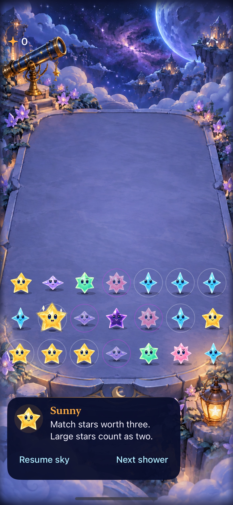

# Grown stars stay recognizable at rest

**Current implementation:** The user subsequently approved a gentle outer-aura pulse. See [current-main pulse integration and verification](PULSE.md). The static iteration and source-bound captures below remain historical.

**Result:** Partially verified · **Owner:** current implementer · **Date:** 2026-10-17

Grown stars now have a warm luminous double silhouette and paired diamond glints. Native rendering, rule/store/geometry checks and affected interactions pass. Human recognition and physical-device acceptance remain unverified.

**Next action:** Ask the reporting tester to identify grown stars on a settled board before explaining the cue. Retain or revise based on recognition and crowding. This extends the existing presentation directly, with no pilot flag.

**Native runtime capture:** `f35eba8` plus the runtime changes below; iPhone 17e / iOS 27.0, Debug, existing `--starfalls-reset --observatory-review -calmEffects YES` fixture. Inspect grown Sunny against ordinary Sunny below it. JPEG re-encoding of native PNG. The [live-play capture](growth.jpg) also shows mint, aqua and violet cues during a subsequent landing; neither still image proves animation or human recognition.

## Acceptance results

These criteria were recorded before implementation.

| Criterion | Result / limit |
| --- | --- |
| Persistent silhouette and paired glints, excluding ordinary/dark stars | Hosted checks pass for every family at 32/45/64-point cell steps. Native Sunny/mint/aqua/violet captures inspected; settled Calm effects fixture inspected. Human recognition pending. |
| Survives landing, expression changes, render, restore and Reduce Motion | Hosted expression/contact/landing checks and native growth/clear/background/relaunch, Calm fixture and system Reduce Motion manual-play checks pass. No idle actions or motion dependency. |
| Bounded updates, disposal and unchanged gameplay | Four cue children plus a container per character; repeated updates/renders stay bounded. Clear/rebuild/restart inherit character lifetime. Rules, RNG, saves, body sizes, projection and native targets unchanged. |
| Normal play, rapid taps, win/loss, restart, settings and large text | Six focused UI methods pass across the runs below. Actual VoiceOver: deferred to RC; not run on this development build. Physical device not run. |

## Source and checks

Started clean at `f35eba8`. Runtime changes: `App/FallingSkyMotion.swift`, `App/StarfallTheme.swift`. Tests: `AppTests/StarCastTests.swift`, `UITests/FallingSkyInteractionTests.swift`. [Exact hashes](source-sha256.txt) identify final bytes. Remaining dirty paths are documentation/evidence; no project/resource changes. This accepts a working tree, not a published commit.

**Environment:** Xcode 27.1 (`27A9275`), arm64, booted iPhone 17e named Starfall Crystal Glow QA (`D65C5E40-734F-42BF-8F91-97E980ED19C2`), iOS 27.0.

| Check | Result |
| --- | --- |
| `swift test` | 63/63 pass. |
| Hosted `StarCastTests`, `FallingSkyStoreTests`, `ObservatoryGeometryTests` | 42/42 pass, including cue regression, sampled full-motion landing/contact, cancellation, bounded rendering and geometry. Sampling is separate from human animation review. |
| `FallingSkyInteractionTests` | Opening cascade/rapid tap, paused-guide growth/dark clear/restore, largest-text settings/dismissal and system Reduce Motion pass. First Light completion/restore/replay and overflow pass after the helper correction below. |
| Debug / Release simulator builds | Both pass, arm64. |
| Hygiene / diff | `python3 scripts/ci-hygiene.py` and `git diff --check` pass. |

Native commands use `xcodebuild -project Starfall.xcodeproj -scheme Starfall`, `-destination 'platform=iOS Simulator,arch=arm64,id=D65C5E40-734F-42BF-8F91-97E980ED19C2'`, `-derivedDataPath /tmp/starfall-grown-dd`, `-parallel-testing-enabled NO`, `ARCHS=arm64 ONLY_ACTIVE_ARCH=YES test`, and these selectors:

- `-only-testing:StarfallAppTests/<suite>`: the three hosted suites above.
- `-only-testing:StarfallUITests/FallingSkyInteractionTests/<method>`: `testOpeningCascadeAllowsNativeClearBeforeLastWave`, `testPausedGuideReportsGrowthDarkOutcomesAndRestore`, `testLargestTextSettingsFeedbackAndDismissal`, `testSystemReduceMotionKeepsManualPlayWorking`, `testFirstLightGoalCompletionRestoreReplayAndSurvival`, `testFirstLightCanOverflowWithoutCompletingGoal`.

Release uses `-configuration Release -destination 'generic/platform=iOS Simulator' -derivedDataPath /tmp/starfall-grown-release ARCHS=arm64 ONLY_ACTIVE_ARCH=YES CODE_SIGNING_ALLOWED=NO build`. Raw output is retained locally under ignored `artifacts/grown-star-readability/`.

**Failed checks and corrections:** The initial native command omitted the CI arm64 selection and could not resolve `StarfallCore` for x86_64; the existing arm64 CI settings passed without build-setting changes. The first UI run reported four passes and two failures before First Light gameplay: its helper did not scroll to the challenge below the Form viewport. Added the existing bounded `reveal` call, retaining assertions; both affected methods then passed in `/tmp/starfall-grown-firstlight.xcresult`. The initial failed run hung during result finalization/package resolution and was interrupted after its suite summary; its screenshot export was unavailable. Its four passing methods are supported by retained console output; the hosted and First Light result bundles completed normally. Native captures above were obtained directly with `simctl`, independently of that failed export.

## Cause and remaining risk

The old settled cue relied on a 0.35-to-0.43 body-radius increase and a happy face. The correction lives in `FallingSkyCharacter`: two tinted echoes reuse the exact cached body alpha; theme owns their light/opacity. The cue follows committed `gem.grown`, excludes dark stars, and moves with the character through local reactions and landing transforms.

Examined character update/contact, scene make/render/land/clear/rebuild, reduced-motion rendering, shadows, material expression/cache ownership, native labels and shared geometry tests. These checks cover the examined paths, not every device/frame combination. Dense neighboring grown stars and dark-star shading need the next human/device review. The [experiment register](../../EXPERIMENTS.md) and [roadmap](../../ROADMAP.md) track that decision.
