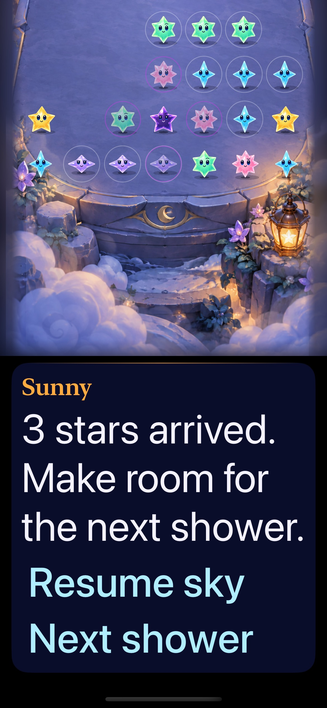
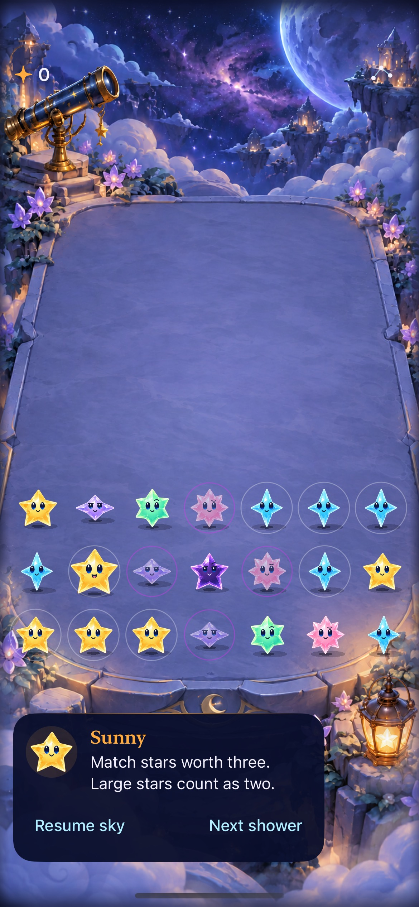

# Restrained guide-name typography

**Result: Partially verified · Owner: current implementer · Date: 2026-10-17.** Adopt the restrained Sunny heading. The decorative character name grows through the first accessibility size, while instructions, action labels and primary outcome headings retain full Dynamic Type scaling. Native ordinary/maximum-text and actual VoiceOver checks pass on iPhone 17e. Physical-device, compact-phone and minimum-OS visual coverage were not repeated for this polish.

## Acceptance and result

Acceptance before implementation: bound only the decorative character heading; retain Dynamic Type for body text, controls and terminal results. At largest accessibility text, inspect native guide layout and verify name/control hierarchy, complete readable copy, board separation, projected taps, props and reachable actions. Check ordinary layout, VoiceOver focus/menu flow and terminal replay. No rule/save/clock or geometry changes. Run core, relevant native checks, Debug/Release builds and hygiene; keep physical-device coverage separate.

| Criterion | Observed result |
| --- | --- |
| Secondary heading | Sunny stays within a compact 44-point-high single line at maximum text and is smaller than the full-size action label. Native hierarchy assertions pass. |
| Primary text and controls | Text-size bound applies only to the name Text view. Instructions and controls retain full scaling, wrapping and native scrolling. Outcome titles explicitly use the full-size primary role. |
| Board and actions | Maximum-text real group clear, board/guide separation, telescope/lantern activation, manual shower and settings dismissal pass. |
| Ordinary presentation | Native welcome, help, balance and menu-preserves-round flow passes; inspected capture retains its composition. |
| VoiceOver | Star identity/value, adjacent navigation, dark/empty/grown labels, both props and menu focus return pass. Largest-text sequential guide navigation, overflow and replay also pass. |

Typography roles live in StarfallTheme. SkyGuideCard applies the bound only to its title; it does not cap its subtree. No rules, saves, clock, hit geometry, asset resources or app-target membership change.

## Native appearance

| Largest accessibility size | Ordinary size |
| --- | --- |
|  |  |

Inspected native iPhone 17e/iOS 27.0 captures from the tested source below. The largest-text guide uses a compact name while preserving the complete message and both large controls. The [earlier large-heading capture](../accessible-terrace-layout-2026-10-17/guide-largest.jpg) remains historical evidence. Still images do not prove animations or spoken delivery. Markdown rendering was not separately reviewed.

## Verification context

**Source:** `fee0ffc`, clean feature worktree; [file hashes](source.json). Subsequent edits add documentation/evidence only. **Environment:** Xcode 27.1 (27A9275), arm64 iPhone 17e “Starfall Crystal Glow QA” (`D65C5E40-734F-42BF-8F91-97E980ED19C2`), iOS 27.0. Reset-only deterministic QA state remains isolated to this disposable simulator.

| Check | Result / artifact |
| --- | --- |
| `swift test` | 61 passed; `/tmp/starfall-guide-typography-core.log`. |
| Debug native UI | Four passed, zero failures/skips; `/tmp/starfall-guide-typography.xcresult`. |
| Release simulator build | Passed; `/tmp/starfall-guide-typography-release.log`. |
| Hygiene / diff | `python3 scripts/ci-hygiene.py`; `git diff --check`; passed. |

Native selection: `StarfallUITests/ObservatoryInteractionTests/` methods `testCelestialHUDGuideAndMenuPagesKeepTheRound`, `testLargestTextKeepsPropsAndPausedControlsReachable`, `testVoiceOverLargestTextOverflowAndReplay`, `testVoiceOverSpeechActivationPropsClearAndMenuFocus`. Use the shared Starfall scheme, Debug, simulator destination above, `ARCHS=arm64 ONLY_ACTIVE_ARCH=YES CODE_SIGN_IDENTITY=- CODE_SIGNING_ALLOWED=YES DEVELOPMENT_TEAM= CODE_SIGN_STYLE=Manual -parallel-testing-enabled NO -collect-test-diagnostics never`, and `-only-testing:` for each selector followed by `test`. Raw invocation/build output: `/tmp/starfall-guide-typography.log`. Release uses generic iOS Simulator destination and `CODE_SIGNING_ALLOWED=NO`.

Actual screen-reader transcripts: [overflow/replay](overflow-replay-speech.txt), [stars/props/menu](star-menu-speech.txt). The service can truncate speech. No new full-motion, physical-device, tablet/landscape, custom-rotor or minimum-OS claim is made. Background/save/rule behavior is unchanged; its broader acceptance remains in the [VoiceOver flow record](../voiceover-gameplay-2026-10-17/README.md).

**Decision:** adopt this bounded polish. Broader accessibility/device acceptance remains in ENGINEERING.md; no further typography work is required for the tested Sunny treatment.
