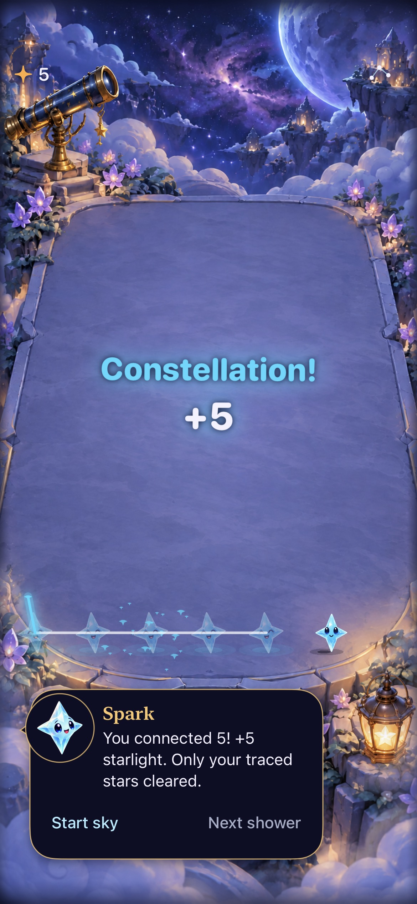
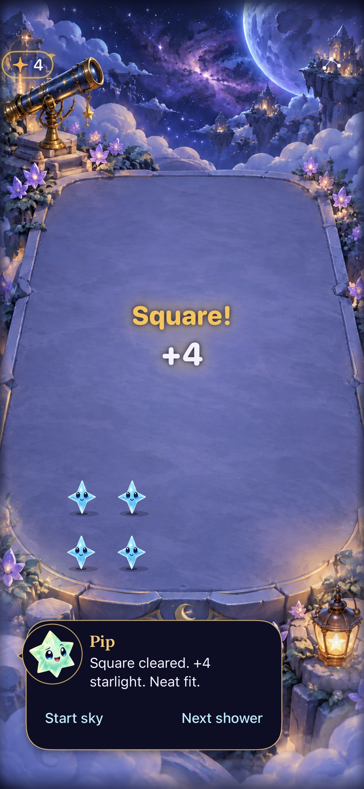
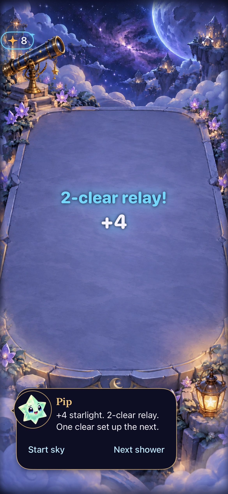

# Family-colored collection and central celebrations

**Result:** Partially verified development refinement · **Owner:** current implementer · **Date:** October 18, 2026

Collection light now inherits the harvested stars' material colors. Actual awarded points increase trail width, head size, release reach and counter response; grown contributors carry extra weight. Larger special titles enter near the center of the terrace, recoil briefly, hold, then rise and dissolve. Exceptional awards and causal relays produce one translucent family-colored aurora. Scores, rules, saves, touch coordinates and shower ownership are unchanged.

**Next action:** compare repeated ordinary, large, constellation and relay clears on a physical iPhone. Decide whether to retain this balance or tune a named weak beat. Dense/danger layouts, compact/large-phone visual coverage, smoothness and subjective/tactile preference remain open. Actual VoiceOver is deferred to RC; not run on this development build.

## Acceptance and observed limits

| Criterion from [the design](../../design/HARVEST_FEEDBACK.md) | Result |
| --- | --- |
| Match collection colors to actual rewarding stars | Receipt snapshots preserve pre-clear identity/reward. Opal and grown-star coverage passes; drained stars do not produce light. Inspected aqua constellation release and amber square/score resolution match their families. |
| Scale with committed points, keep bounded work | Energy increases from 3 to 18 awarded points, then caps. Six packets and 24 release glints maximum. Grown packet weight is retained. The 21-point/14-star regression passes: six distinct packets sample both ends of the group, with seven grown contributors. |
| Make special notices central and readable | Full-game native hosted captures show constellation, square, cross and relay awards in the central region. Tests require additional award pixels there, excluding the header and cleared front row. Ordinary awards retain their previous region. |
| Preserve interaction and lifecycle | Existing receipt replacement, stale completion, save/restore, interruption, geometry cancellation and zero-reward checks pass. Five native gesture, background/settings, largest-text and system Reduce Motion checks pass. Native First Light win/replay/full-sky ending and persisted ending restore pass (163.086 seconds). |
| Quiet presentation | Static exact award remains; no Canvas/travel/recoil/bloom or counter scaling in quiet mode. Normal/quiet ordinary rendering checks pass. Special-title largest-text appearance remains unverified; it retains the existing numeric-only fallback below the terrace. |
| Rules/build/hygiene | 149 core tests pass; Debug simulator app/hosted/UI build and 12 celebration tests pass. Final 13-test receipt rerun passes, zero skips. Hygiene and diff checks pass. No resource/configuration/routing or Core changes; Release not rerun. |
| Motion, tactile feel and preference | Timed normal-motion native samples establish release and hold rendering, not smoothness or enjoyment. Existing sound and haptic categories are unchanged. No physical-device audition/install or full actual VoiceOver run. |

## Inspected native frames

| Aqua release | Amber square | Aqua relay |
| --- | --- | --- |
|  |  |  |

**Implementation evidence:** real `FallingSkyView`, store and SpriteKit scene hosted in a native UIKit window, normal effects and default text. These are timed samples from an active native hierarchy, not concepts. Fixture boards are sparse; the frames cannot establish busy-board distraction, animation smoothness or human preference. The header/menu and bottom dialogue/actions remain visible in these samples. JPEG exports preserve the full screenshot; raw PNG attachments remain disposable under artifacts.

## Source, environment and commands

Starting checkout was clean `f35eba8`, which predates the described features. This clean worktree was moved to new branch `codex/harvest-celebration-drama` from locally available `origin/main` at `33ae6fb`. No other checkout was modified. Tested runtime snapshot **`cd5d7bec9627`**, with changed inputs and captured attachment hashes in [source.json](source.json). Runtime changes are `App/StarlightCelebration.swift`, `App/FallingSkyView.swift` and `App/StarfallTheme.swift`; focused test changes are recorded separately. Other dirty paths are documentation/evidence only.

Xcode 27.1 (27A9275), Swift 6.4, arm64, Debug; task-owned **Starfall Harvest Feedback QA**, iPhone 17e / iOS 27.0 (24A434), UUID `3447731D-D3C6-4DBC-A823-52E1C84C2A5B`. No other simulator was reset or used; normal player saves and physical phone installations were untouched.

Raw logs/results: ignored `artifacts/harvest-feedback/`. `core.log` runs `swift test --jobs 2`; `hosted.log` / `Hosted.xcresult` run all StarlightCelebrationTests; `native.log` / `Native.xcresult` run the five completed native checks; `final.log` / `Final.xcresult` contain the passing final 13-test receipt suite and ending check. Initial capture tests predate the added large-harvest test; all three runtime source files are byte-identical across these runs. An initial ending selector used the wrong class and did not execute; it was corrected to `SkyFlowInteractionTests` in the final run, with no assertion changes or retries.

Common native invocation:

```sh
xcodebuild -project Starfall.xcodeproj -scheme Starfall -configuration Debug \
  -destination 'platform=iOS Simulator,id=3447731D-D3C6-4DBC-A823-52E1C84C2A5B' \
  -derivedDataPath artifacts/harvest-feedback/DerivedData -jobs 2 \
  ARCHS=arm64 ONLY_ACTIVE_ARCH=YES CODE_SIGN_IDENTITY=- CODE_SIGNING_ALLOWED=YES \
  DEVELOPMENT_TEAM= CODE_SIGN_STYLE=Manual -parallel-testing-enabled NO \
  -collect-test-diagnostics never \
  -only-testing:StarfallAppTests/StarlightCelebrationTests \
  -only-testing:StarfallUITests/SkyFlowInteractionTests/testFirstLightWinReplayAndFullSky \
  -resultBundlePath artifacts/harvest-feedback/Final.xcresult test
```

Native selectors in the completed first run: `SkyTechniqueInteractionTests/testTapRecipesRelayWithoutAnyModeOrMenuToggle`, `testSwipeSpendsFiveFromSixAndShortTraceCancels`, `testSettingsAndBackgroundLeaveGesturesReadyWithoutRetoggling`; `ResponsiveInputUITests/testSixteenPointOrdinaryDriftClearsOnceAtNormalAndLargestText`; `FallingSkyInteractionTests/testSystemReduceMotionKeepsManualPlayWorking`. System motion is restored by the test. The full-game render test now waits for receipt expiry with a bounded two-second deadline, matching the new 1.4-second decorative lifespan; input/presentation completion assertions remain independent.

## Responsible boundary and research

The prior receipt stored cells but discarded their families/reward weights. The overlay therefore invented alternating cyan/gold and used a binary ordinary/special strength. Its space-above-back-row rule placed titles high or hid them. Inspection covered receipt creation, live anchors/counter, material identity colors, feedback/audio routing, interruption cancellation and existing render/store/native tests. The correction captures immutable contributors once, reuses `StarCast.Identity.color`, and gives special titles an explicit live-canvas center placement. It does not infer awards from moving nodes or callbacks.

Apple's [audio-haptic design principles](https://developer.apple.com/videos/play/wwdc2021/10278/) and the [game-feel survey](https://arxiv.org/abs/2011.09201) informed the coordinated cause/impact/collection approach; the chosen thresholds, timings and aurora strength remain design judgments. Existing audio/haptic categories are retained pending physical review. Whole-board camera shake remains a possible later comparison: this pass keeps native hit mapping stationary and applies recoil only to decoration. User preference, not a passing test, determines the next tuning decision.
