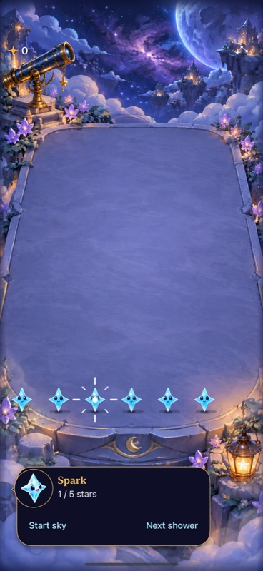

# A clear transition from contact to drawing

**Result:** Partially verified · **Owner:** current implementer · **Date:** October 18, 2026

Eligible contact builds twelve short segments along four open rays during the existing 300 ms hold. Arming replaces them with solid rays, joining the four diagonal contact rays, and emits one distinct preference-aware haptic. Quiet modes use static contact and armed states. [Acceptance](../../design/HOLD_DRAW_FEEDBACK.md).

**Next action:** publish and deliver this fourth independent batch after the preceding three. Publication remains blocked by automatic review pending destination-specific authorization; physical haptic comfort and actual VoiceOver remain unverified.

## Verification

Source: `8d29bc1` plus [source/test hashes](source-snapshot.json), runtime `dev.0f08b779a9`. Xcode 27.1 (`27A9275`), Swift 6.4; iPhone 16 Pro Max Simulator / iOS 27.0 (`24A434`), `5107CBBF-108B-4B94-9125-A873F948A38C`. No Core, save, geometry, resource-membership or timing-rule change.

| Check | Result |
| --- | --- |
| Core | 169 pass; `artifacts/immediate-swipes/hold-core.log` |
| Final Debug hosted/native | 49 pass, zero failures/skips: 22 technique/store, 23 touch, two selection/bounds, two native quick-same-color/hold and maximum-text vertical-swipe cases; `hold-sparkle.xcresult` |
| Release | Build succeeds; log `build_sim_2026-10-19T00-38-43-038Z_pid62736_bc93d1ce.log` |
| Feedback/lifecycle | One arming transition, canceled/stale holds, eligibility, preference and quiet-mode guards pass; existing Settings/background cases passed on the earlier visual candidate, unchanged lifecycle code |
| Native appearance | Inspected pending/full-armed scene exports and actual game armed screenshot below; open paths remain unenclosed and bounded |
| Hygiene | `python3 scripts/ci-hygiene.py` and `git diff --check` pass |
| Physical / actual VoiceOver | Not run; actual VoiceOver remains RC acceptance |

Core command uses `CLANG_MODULE_CACHE_PATH=/tmp/starfall-swipe-clang SWIFTPM_MODULECACHE_OVERRIDE=/tmp/starfall-swipe-clang swift test --disable-sandbox`. Xcode checks use `-sdk iphonesimulator CODE_SIGNING_ALLOWED=NO ARCHS=arm64 ONLY_ACTIVE_ARCH=YES`, tests additionally `-parallel-testing-enabled NO`. Final test log: `test_sim_2026-10-19T00-35-46-902Z_pid62736_1c7a2bb2.log`. Native tests use full motion, not animation suppression.

An initial exact alpha assertion exposed floating-point representation and now uses a 0.001 tolerance. The first cue candidate enclosed the star; inspection of the existing open-ray contract prompted replacement before acceptance. Earlier candidate results are not visual evidence of the final cue. The final suite explicitly verifies four unclosed line segments per outline. The production touch task remains the only authority for arming; SpriteKit progress actions cannot choose gameplay.

## Inspected native presentation

**Current for this sampled armed state:** normal game in a reset-only trace fixture, full motion, no text-size launch override. A native touch-down on the third Aqua star produced the armed sparkle and count. The cue remains distinct against the Observatory floor and does not enclose the star. The existing fingertip dot is still centered over the star. Touch-up succeeded after refreshing a tool-invalidated UI reference. This still does not establish transition smoothness or haptic feel; the hosted recognizer/scene test separately checks progressive marks before arming and removes them at the transition. Raw scene exports remain disposable under `artifacts/immediate-swipes/hold-sparkle-export`.
