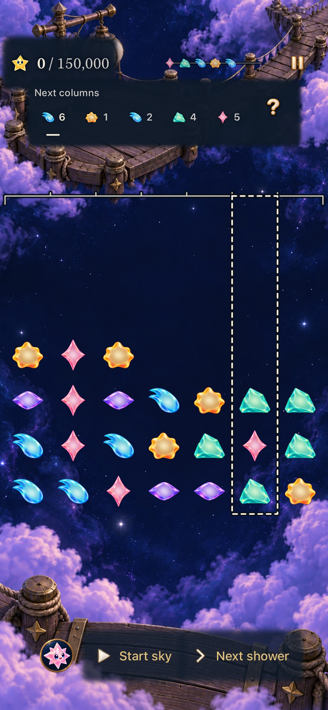
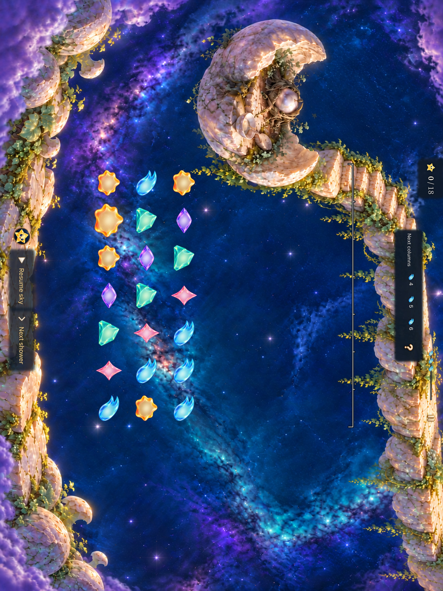
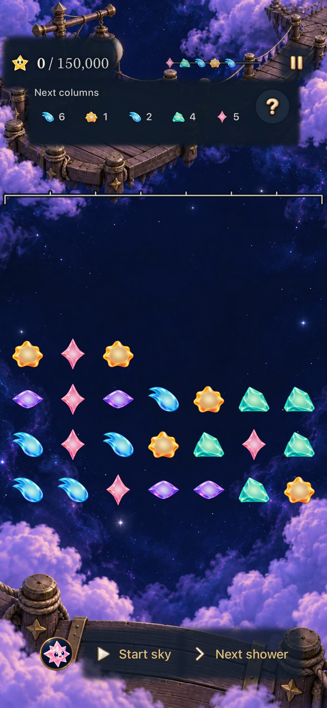
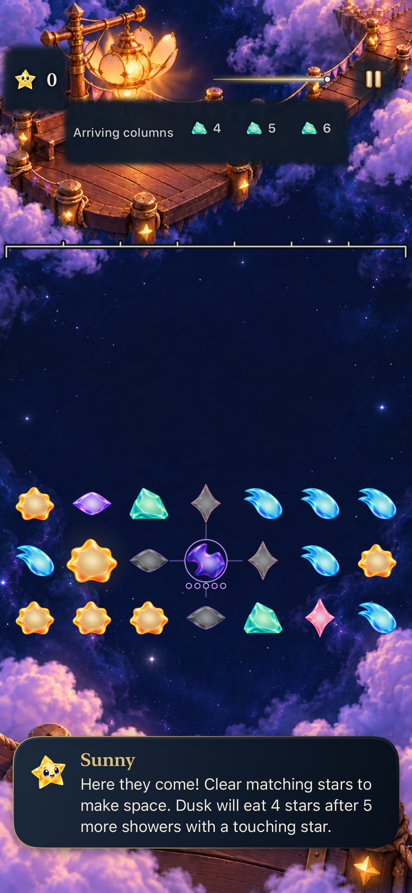
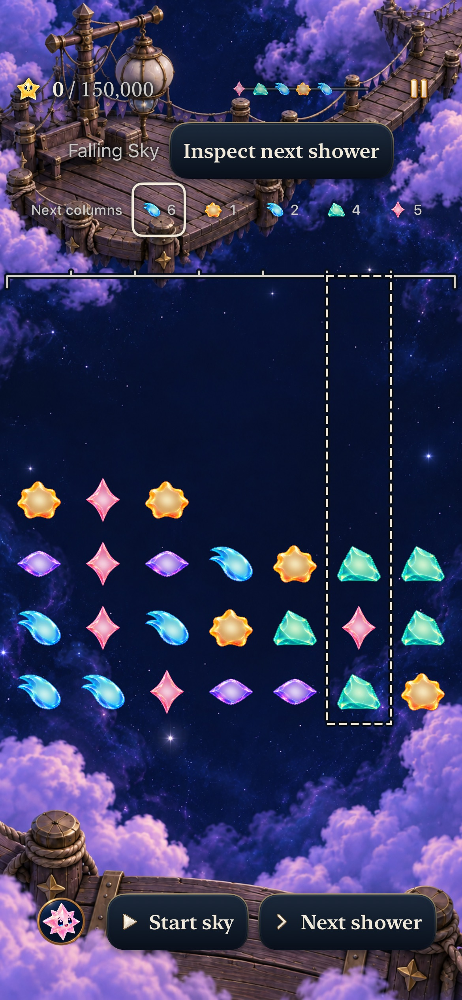
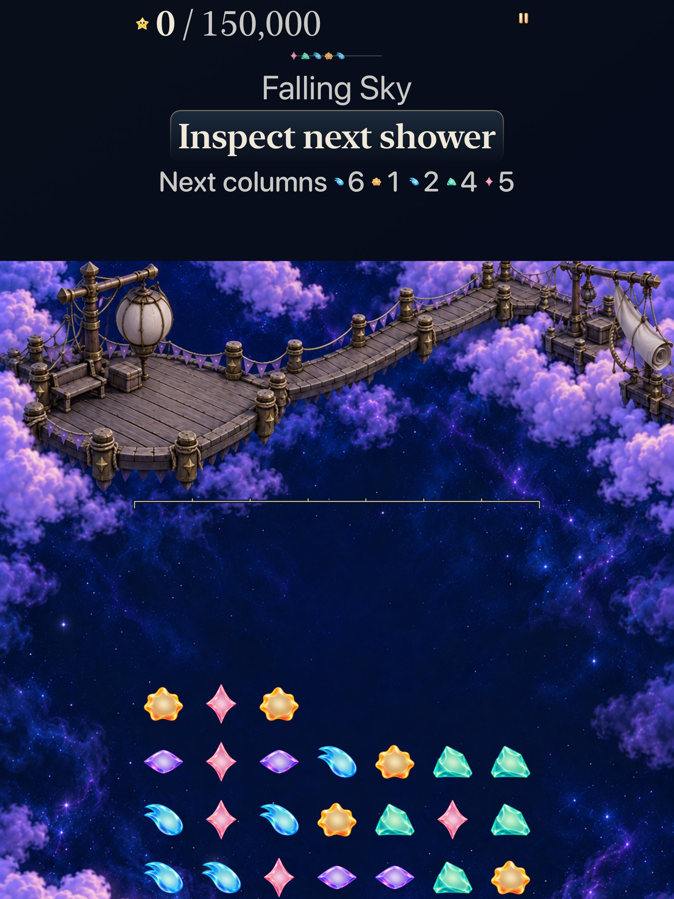
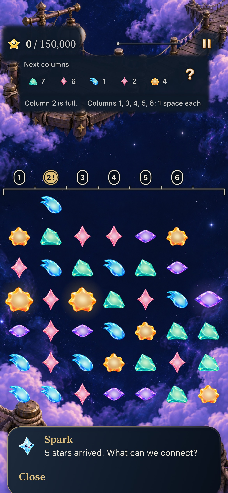
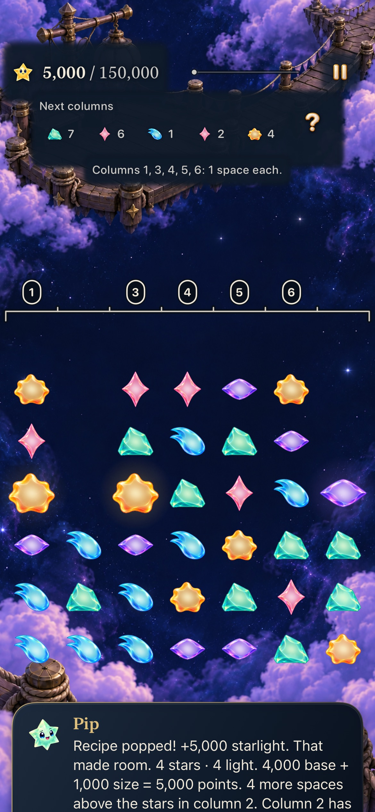
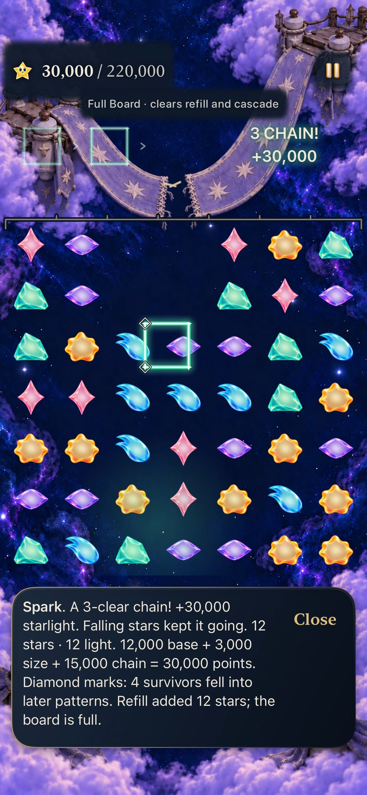
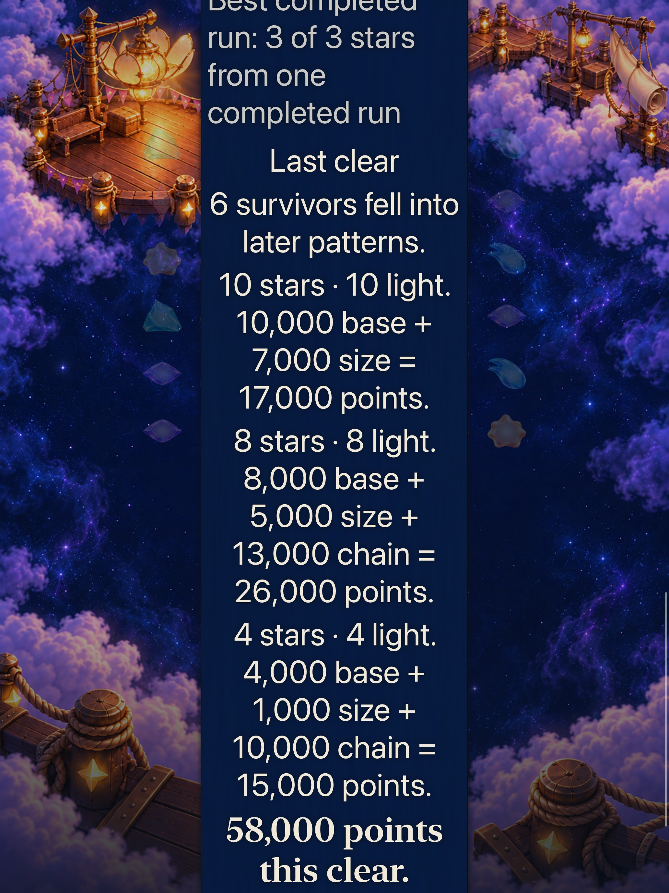

# A coherent set of native HUD instruments

**Status:** Goal 1 correction merged in [PR #402](https://github.com/lbeezr/starfall/pull/402); goal 2 merged in [PR #403](https://github.com/lbeezr/starfall/pull/403); goal 3 merged in [PR #404](https://github.com/lbeezr/starfall/pull/404); goal 4 merged in [PR #405](https://github.com/lbeezr/starfall/pull/405); goal 5 merged in [PR #406](https://github.com/lbeezr/starfall/pull/406); goal 6 merged in [PR #407](https://github.com/lbeezr/starfall/pull/407); goal 7 merged in [PR #408](https://github.com/lbeezr/starfall/pull/408); goal 8 verified; individual merge pending · **Owner:** HUD coordinator, worktree dcf3 · **Started:** October 24, 2026

The user authorized [ten ordered HUD refinements](https://github.com/lbeezr/starfall/issues/381), with each goal tested and merged before the next implementation. Each pass retains the previous accepted behavior and corrects its current presentation seam in the normal app. Existing Observatory materials, native controls, rules, saves, replay, clocks and board mapping remain authoritative.

## October 24 visual rejection erratum

The user rejected goal 1's appearance after its initial merge in [PR #392](https://github.com/lbeezr/starfall/pull/392). The optional **Inspect next shower** action uses a menu component role and becomes an oversized enamel headline in active play. The tablet composition also disconnects the instruments from the scenery. These failures conflict with the [official game UI system](../../design/GAME_UI_SYSTEM.md) and [native production workflow](../../design/UI_PRODUCTION.md), even though the action's target, row placement and state preservation passed their mechanical checks.

The initial development-adoption verdict below is superseded. Its source identities, capture bytes/hashes, successful tests, earlier failures and original inspection statement remain historical evidence; they do not establish visual acceptance. [Goal 1 / #382](https://github.com/lbeezr/starfall/issues/382) was reopened for correction, and goal 2 was held until the corrected composition passed independent comparison with the approved reference and official component roles. That correction subsequently merged in #402. The rejected action and disconnected scenery were corrected in goal 1; later goals did not inherit a known visual failure.

| Order | Outcome | Issue | Integration |
| --- | --- | --- | --- |
| 1 | Expanded HUD reading order | [#382](https://github.com/lbeezr/starfall/issues/382) | Corrected native slice reviewed; merged #402, issue completed |
| 2 | Coherent instrument typography | [#383](https://github.com/lbeezr/starfall/issues/383) | Verified and merged #403; issue completed |
| 3 | Readability across every sky | [#384](https://github.com/lbeezr/starfall/issues/384) | Verified and merged #404; issue completed |
| 4 | Shared control states and glyph craft | [#385](https://github.com/lbeezr/starfall/issues/385) | Verified and merged #405; issue completed |
| 5 | One coherent forecast instrument | [#386](https://github.com/lbeezr/starfall/issues/386) | Verified and merged #406; issue completed |
| 6 | Specific, calm pressure feedback | [#387](https://github.com/lbeezr/starfall/issues/387) | Merged #407; issue completed |
| 7 | Causal move-to-earned-light attention | [#388](https://github.com/lbeezr/starfall/issues/388) | Merged in [PR #408](https://github.com/lbeezr/starfall/pull/408) as `c81b59ee`, completing issue #388. Goal 8 is active after this verified individual merge. |
| 8 | Consistent optional detail readers | [#389](https://github.com/lbeezr/starfall/issues/389) | Adopted for named corrected development slice; individual verified merge pending |
| 9 | Whole-HUD adaptive layouts | [#390](https://github.com/lbeezr/starfall/issues/390) | After goal 8 merge |
| 10 | Complete native journey cohesion | [#391](https://github.com/lbeezr/starfall/issues/391) | After goal 9 merge |

## Goal 1 correction: native and visual acceptance

The corrected normal-app HUD uses one existing 48-point help utility beside the complete forecast, shared 44-point forecast controls and instrument text roles. The oversized menu action and redundant Falling Sky heading are removed. One continuous painting backs the pinned instruments and scrolling board. Exact score/target text keeps its complete native size; largest text reflows while the board, hit cells and receipt anchors retain one projection. Full Board keeps its mode context and omits shower forecast/inspection.

The missing scenery-protection role is now part of `StarfallTheme`: fitted nightglass behind measured instruments and explicitly scenic gameplay actions, with visual-only outsets and opaque contrast/transparency fallbacks. Sunny's earlier sampled contrast failure is retained; selected corrected RGB pairs measure 6.39:1–15.29:1, without a whole-font or physical contrast claim. Packet ink and shadow now respect the measured complete header as well as the score; existing paths, arrivals and lifetime remain.

Rendered App source is `bf5e6d23`, runtime `dev.3ebf052fca`; test checkpoint `3fe9f9a8` adds the exact reader hit/extent regression. Main `271fd925` is integrated. [Clean archive identity](source-01-correction.json) matches all 567 runtime/build inputs. Later evidence-only edits do not change that runtime. [Mechanical history](verification-01-correction.json), [retained captures](captures-01-correction.json), [independent whole-screen review](visual-review-01-correction.json) and [packet review](visual-review-01-packet.json) preserve their exact scopes.

| Evidence | Result and scope |
| --- | --- |
| Core | 352 passed; Core bytes unchanged through the App-only integration |
| Affected hosted checks | Current integrated 228 passed; phone packet/reading pair passed; new complete-reader extent/hit case passed at the exact failed native position |
| Native phone | Default selection/inspection and background/world preservation passed at `ec40c9a3`; unchanged largest-text Sunny/Studio reader passed alone at `3fe9f9a8` in 64.788 seconds |
| Actual tablet | Largest-text real-Calm selection, real 15,000-point chain and Full Board journey passed at `d5d02a7b`; settled HUD geometry/material is unchanged by the later readiness and packet-only changes |
| Build and membership | Debug/test builds and current integrated Release passed; focused-suite membership explicit; discovery is 815 hosted/260 UI, not a full executed-pass count |
| Visual | Independent comparison with the approved Play concept passes the identified whole native phone/tablet states and retained exports; separate compact live-packet review passes |

Two earlier native runs stalled before Sunny's final line during overlapping simulator UI work. Their frames and failure image remain failures. The same unchanged case passed with one native controller active; an eight-second sample mostly waited for events. The cause is unproved, and neither an assertion nor performance fix is claimed. [Engineering](../../ENGINEERING.md) records the recurrence trigger and passive pan/offset investigation. All 12-pan, overlap, full-final-line, target and fixed-control gates remain. Visual acceptance does not erase this interaction uncertainty.

No actual VoiceOver, minimum-iOS execution, physical reading/comfort, human enjoyment or sustained-performance acceptance is claimed. The corrected components are adopted for this development slice. [PR #402](https://github.com/lbeezr/starfall/pull/402) merged as `8e196ccb`, with byte-identical reviewed/published trees and issue #382 completed. [Publication proof](publication-01-correction.json) records the unavailable Project projection honestly; goal 2 now follows this individual main merge. Original PR #392 evidence below remains historical and visually rejected.

## Goal 2: instrument typography

**Status:** Verified for this development slice and merged in [PR #403](https://github.com/lbeezr/starfall/pull/403), main `1ed733bb`; issue #383 is completed.

The score's existing 24-point star follows the earned line when its exact objective reflows. Shared `instrumentScore`, `instrumentTarget`, `instrumentLabel` and `instrumentNumber` roles retain the official native sizes and full Dynamic Type. Forecast digits gain a modest semibold weight; supporting labels remain quieter. Mode/pressure and control-state ink stay in their existing shared owners. No general caption consumer changes.

The first 240-point AX5 check exposed a missing width reservation in the stacked score fallback. The shared component now reserves the objective's digit width in both fitting paths. All original guards remain. Two retained stress specimens show complete glyphs on three lines; the 375-point hosted production header retains the complete objective on its second line. Display-only high totals are component evidence, not earned-game histories.

Tested source is `ac78832a`, based on accepted main `8e196ccb`. [Source proof](source-02-final.json) matches all 567 committed runtime inputs to the working tree; the computed fingerprint is `dev.f4ecc1c437`. Final native products explicitly embed that same build ID. Earlier component products embedded `dev.local`; their fingerprint labels are source identities, not observed embedded labels. Later evidence edits do not change App or test source.

| Evidence | Result and scope |
| --- | --- |
| Core | 352 passed, zero failures/skips |
| Affected hosted | 13 existing score, forecast, mode, headroom and receipt methods passed, zero failures/skips |
| Native phone | Default normal selection/inspection/Return; AX5 quiet actual pressure/recovery; AX5 normal complete Sunny/Spark readers all passed |
| Actual tablet | AX5 real Settings Calm, three selections, real 15,000-point chain, new Full Board and 42,000-point refill passed; the retained Full Board frame precedes that refill |
| Build | Debug/test and Release passed; source discovery remains 815 hosted/260 development UI methods, not full executed-pass counts |
| Visual | Independent whole-screen and exact retained-export review passes the named phone/tablet states; no depicted current visual failure remains |

[Acceptance](goal-02-acceptance.json), [mechanical history and commands](verification-02.json), [capture index](captures-02.json) and [independent visual review](visual-review-02.json) and [tablet export review](visual-review-02-tablet-exports.json) preserve their separate scopes. [Publication proof](publication-02.json) confirms identical reviewed/published/main trees and completed issue state; the canonical Project projection remains unavailable. The new unchanged isolated reader pass is additional bounded evidence; earlier goal 1 pan failures retain their unassigned cause and engineering recurrence trigger. Actual VoiceOver, physical reading/comfort, minimum-iOS execution and complete animation/performance acceptance remain separate. No alternate route, new asset family, rule, save, clock or receipt timing change is introduced.

Native iPhone 17e, iOS 27.0, normal effects, actual paused Lantern opening. Source `ac78832a` / embedded `dev.f4ecc1c437`; raw and exact JPEG export passed independent review. This current-frame example does not replace the separate AX5 phone/tablet evidence.

## Goal 3: pause separation over scenery

**Status:** Adopted for the named development slice and merged in [PR #404](https://github.com/lbeezr/starfall/pull/404), main `47b0b5e9`; issue #384 is completed. [Publication proof](publication-03.json) confirms identical reviewed/published/main trees; the canonical Project projection is unavailable. Goal 4 follows this individual merge.

The viewport pause now opts into the official utility style’s fitted scenery backdrop. Its actual glyph stays 20 points within the existing 24-point visual allocation and 48-point target. The existing 82% nightglass, 8-point visual-only outset and 3-point feather follow the visual before the outer target. Help stays clear within its protected forecast group; tutorial Close and other utilities retain clear defaults. Existing pressed, disabled and focused treatments remain. No trail, board, rule, save, clock, resource or membership owner changes.

The original pearl fill can blend into bright wood/stone; its dark authored contour still distinguishes the whole symbol. A source survey ranks 105 registered paintings across seven places, five milestones and three compositions. Its 350 candidate samples are source-derived regions, not measured native bounds or contrast certification. Matched actual Seed frames show selected pearl/background RGB ratios changing from 1.085–3.417 to 8.921–11.534. Actual darker Frostfruit states remain distinct. These composited selected pixels establish neither every glyph edge nor physical recognition; [#209](https://github.com/lbeezr/starfall/issues/209) stays open.

Tested App and test source is `4d7cfa21`, based on accepted main `1ed733bb`; [source proof](source-03-final.json) matches all 567 committed runtime inputs. Debug and Release products explicitly embed `dev.189706f888`. The only App owners are `StarfallTheme` and `FallingSkyView`. Final evidence edits do not change tested runtime/test bytes.

| Evidence | Result and scope |
| --- | --- |
| Core | 352 passed, zero failures/skips |
| Affected hosted | 12 existing artwork, score, reading, forecast, restoration and header methods passed |
| Native phone | Three methods passed: default current Lantern selection/inspection/Return; AX5 quiet full-column pressure/recovery; AX5 normal complete Sunny/Spark reading |
| Actual tablet | Two methods passed: normal-effect Seed portrait/landscape real clears and darker dense Frostfruit completion; historical 18-light fixtures establish material/input states, not current revision rules |
| Builds | Debug/test and Release passed; no runtime warnings in the selected result summaries; three expected AppIntents extraction-skip warnings |
| Visual | Independent complete native-screen review and all eleven final export/raw pairs pass for the named states; no known current visible failure found |

[Acceptance](goal-03-acceptance.json), [verification and exact commands](verification-03.json), [capture index](captures-03.json), [native review](visual-review-03.json) and [final export review](visual-review-03-exports.json) retain their separate scopes. The export reviewer caught an opening image that duplicated the selected state. It was replaced with the already captured genuine unselected opening and independently rechecked; the correction history remains. Source images are untouched. JPEG80 exports retain full dimensions and orientation; RGB sampling uses the original PNGs.

The unchanged isolated Sunny/Spark method passes again with its original 12-pan and complete-final-line gates. Earlier intermittent pan failures retain their unassigned cause and engineering recurrence trigger; this pass does not establish a performance fix. Increased Contrast, Reduced Transparency, platform focus, native disabled appearance, actual VoiceOver, physical reading/comfort, minimum-iOS execution and continuous animation/performance acceptance remain unperformed. No alternate route remains.

| Bright native Seed, preceding accepted source | Same state, shared pause protection |
| --- | --- |
|  |  |

## Goal 4: stable glyphs and shared contact material

**Status:** Adopted for the named development slice and merged in [PR #405](https://github.com/lbeezr/starfall/pull/405), main `bac7bcf3`; issue #385 completed. [Publication proof](publication-04.json) confirms identical reviewed/published/main trees. Canonical Project projection is unavailable. Goal 5 follows this individual merge.

Help and pause now retain their original glyph sizes during contact and use the same pressed material as forecast controls. The shared utility style paints a passive 40-point circle inside its existing 48-point target. Pause remains 20 points, forecast Help 24 points, and the style allocation 24 points. The old shrink/dim transforms are removed. Forecast selection keeps its separate underline; disabled artwork keeps one muted treatment, and the existing focus circle uses the shared width token. Clear/scenery resting roles and native input ownership remain.

Actual native contacts hold and drag outside pause, a forecast target and Help. Each cancellation preserves the exact round, forecast, target frames and absence of a sheet/selection; immediate valid selection, inspection, Return and reopening pass. Independent review of fifteen whole video frames observes pressed material around stable glyphs and the later clean states. Timing correlation is approximate: the nominal drag sample still contains Pause’s material, so no exact pointer-exit or release-latency claim follows. These are sampled contact states, not continuous-animation or physical-touch acceptance.

App/native test source is `4218c877`, based on main `47b0b5e9`, embedded `dev.dcb267d534`. [Source proof](source-04-final.json) matches all 567 runtime inputs. A new hosted probe holds a genuine zero-award Seed setup to inspect the muted Help state. Review found its initial AX5 capture premature; test-only `f0005119` waits for actual board/canvas/scroll placement and seven visible occupied cells. App/runtime and native tests remain unchanged. The corrected AX5 frames show stars; the remaining early default-before header probe is excluded from retained exports. No all-six settled-board claim is made.

| Evidence | Result and scope |
| --- | --- |
| Core | 352 passed; zero failures/skips |
| Affected hosted | Same eight methods passed initially and after the test-only capture correction; complete digits1–7, 2×/3× resting/disabled utility geometry and genuine busy header states |
| Native phone/tablet | Four passed: real contact/cancel/Return/reopen; background/world preservation; actual AX5 Calm selection, real15k chain and Full Board; current Frostfruit complete forecast reading and real automatic dismissal |
| Builds | Debug/test, corrected test-only Debug and Release passed; both App configurations embed the same source fingerprint |
| Visual | Independent whole-native-screen/contact, bounded hosted and all thirteen final retained-export reviews pass; no known current visible failure in named native states |

[Acceptance](goal-04-acceptance.json), [verification and commands](verification-04.json), [captures](captures-04.json), [native/contact review](visual-review-04-native.json), [hosted review](visual-review-04-hosted.json) and [final export review](visual-review-04-exports.json) preserve their distinct scopes. Full Board’s retained image precedes the mechanically verified42k refill. Optional reader captures retain their actual scroll positions. Current encounter rules, Core, saves, clock, board mapping, resources and membership are unchanged. Earlier reader-pan uncertainty remains with its existing recurrence trigger.

Actual platform focus, native disabled-touch rejection, current Increased Contrast/Reduced Transparency, actual VoiceOver, minimum-iOS execution and physical comfort/performance remain unperformed. No temporary route, state framework or new asset remains.

| Resting native utilities | Actual recorded Help contact sample |
| --- | --- |
|  |  |

## Goal 5: one forecast row and a timing-only trail

**Status:** Adopted for the named development slice and merged in [PR #406](https://github.com/lbeezr/starfall/pull/406), main `1ed4a975`; issue #386 completed. [Publication proof](publication-05.json) confirms identical reviewed/published/main trees. Canonical Project projection is unavailable. Goal 6 follows this individual merge.

The regular trail now shows time with one small pearl head. The complete ordered row remains the single family/column reading, with its original selection, locator and inspection utility. The shared Canvas keeps its 132×28 footprint, computed head, normal glow/dust, quiet updates and paused opacity. A five-point head with a one-point dark keyline remains painted at cycle start. Calibrated island followers and drawing stay unchanged; no new asset, route, clock or game state remains.

App/tests froze at `08aa30c0`, based on main `bac7bcf3`, with `dev.38edbb845c` embedded in Debug and Release. [Source proof](source-05.json) matches all 567 runtime inputs. Twelve affected hosted methods and seven native methods pass with zero failures/skips; all 352 Core tests, Debug/test, Release, hygiene and whitespace pass. The native cases retain real clock approach/commit, repeated cycles, pause/resume, contact cancellation/Return/reopening, exact Seed IDs 0–4→5–9 replacement, actual Settings Calm, a real 15k Lantern chain and Full Board absence. Source inventory remains 816 hosted/260 UI methods; this is a selected subset, not a full matrix run.

Independent reviewers accept the complete current Lantern/Seed/default-phone and AX5 actual-Calm tablet compositions, all 19 countdown/cycle still records and 27 whole native-motion samples. The final reviewer inspects every one of 16 retained JPEG80 exports against its raw source. No known visible failure remains within those named states. Normal pixels actually show Arriving at the endpoint. Quiet and actual system Reduce Motion captures already show refreshed Next; no quiet Arriving dwell is claimed or added. Two sampled paused windows retain the same head and forecast, and real resume advances the shower counter. Sampled frames do not prove continuous smoothness, exact cadence/latency or physical comfort.

[Acceptance](goal-05-acceptance.json), [commands/results](verification-05.json), [captures](captures-05.json), [native timing review](visual-review-05-native.json), [current-story review](visual-review-05-current.json) and [final export review](visual-review-05-exports.json) preserve source, hashes and actual phase labels. Pacing uses a reset Debug observatory fixture with retained Dusk copy, separately from current Story and fresh survival. The tablet guide retains its actual scrolling position; Full Board’s image is its opening before the mechanically verified 42k refill. Earlier reader-pan uncertainty remains unassigned. No fresh native AX5-phone/island, actual VoiceOver, minimum-iOS, physical contrast or continuous-motion/performance acceptance is claimed.

| Current native Lantern, timing only | Normal real Arriving state |
| --- | --- |
|  |  |

## Goal 1 initial implementation: mechanical results retained

The hypothesis is that the expanded header can retain its ordered forecast and optional reading without giving each supporting item a separate row. Lantern and Ribbon now place the existing mode label beside **Inspect next shower** when their natural widths fit. Accessibility text and narrow widths retain complete stacked content. Full Board retains its standalone mode label and absence of shower controls; other locations retain their existing inspection action.

`FallingSkyView` owns composition and still captures and revalidates the exact forecast source. No Store, Core, clock, save, resource or target-membership change belongs to this pass. The forecast remains a complete separate group with native column buttons. Inspection keeps its 48-point target, busy gating and distinct live-clock behavior.

Tested working-tree base: `0d71f18cf8d41277bc3ae1a5b8c6536cde7cb9ca`; build-affecting changes: `App/FallingSkyView.swift` and `UITests/ForecastColumnInspectionInteractionTests.swift`. Computed runtime fingerprint: `dev.72a01d9bb7`; actual simulator label: `dev.local`. All 352 Core tests, 26 selected hosted checks and three final native methods pass with zero failures/skips; Debug build-for-testing, hygiene and diff checks pass. [Verification, exact source hashes and commands](verification-01.json) and [capture provenance](captures-01.json) retain their scopes.

The initial combined phone method reached inspection Return without a product assertion failure, then the command stopped at its 360.044-second boundary. Native test startup consumed about 68 seconds before the method; at the last logged action the method had run 260.19 seconds. This is incomplete acceptance, not a pass. Its unfinished result bundle has no `Info.plist`, so attachment export failed; the bounded-stage receipt, log and directly captured native stills remain available. The correction splits inspection and background/world preservation into two independent reset scenarios with the same 300-second method bounds. Frame checks reuse immutable samples instead of repeatedly querying accessibility; every target/containment/order assertion and outcome remains.

The first split run retained two failures: repeated scroll/reveal checks delayed the pinned-menu tap beyond the real first shower, violating the unchanged zero-shower setup assertion; the second method failed to launch system Settings before Starfall launched. The responsible test helper now checks the fixed menu once and taps it directly, keeping full target, viewport, Pause/Start sky and exact opening assertions. Only the dedicated phone was restarted, preserving data. Only diagnostic child 43406 of completed failed xcodebuild 41036 was stopped to finalize its result; unrelated processes were untouched. Independent final invocations pass: phone inspection 223.989 seconds, phone background/world 86.742 seconds, tablet 208.219 seconds. The outer 420-second single-method command bound accommodates measured launch/finalization overhead; each method retains its original 300-second allowance. No product clock, normal-motion mode, rule or assertion changed to obtain acceptance.

The normal phone cases verify complete targets, real column selection, inspector Return, background selection retirement and exact round/world preservation. The actual AX3XL Calm tablet case verifies full stacked support, native column taps, a real 15,000-point automatic chain, exact Full Board mode and absence of shower inspection/forecast controls. Calm is changed and restored through the existing native preference; it is not forced to hide a motion failure. Hosted checks preserve header/score/board anchors, exact forecast facts, source invalidation and score reflow. Core and hosted inputs did not change during the test-only setup correction. No resources, routes or membership changed; Release was not required for this layout/test-only slice.

| Historical, visually rejected: phone, selected column 6 | Historical, visually rejected: AX3XL actual-Calm tablet |
| --- | --- |
|  |  |

**Original inspection/adoption statement — superseded by the visual rejection above:** Original-resolution exports were inspected. These frames establish the header's layout and selected-column appearance; the tablet's scrolling board extends below the captured viewport. They do not establish whole-board visibility, measured physical contrast or continuous animation quality. Retain the adaptive composition for development and revisit combined density in goals 2–9, then the final journey pass. No alternate runtime route remains.

The dedicated iPhone 17e (`89BC6263-797D-4573-838E-E238A90D0D79`) and iPad Pro 13-inch M5 (`3C3726C1-8880-48AE-AC2D-4C9376250DF7`) run iOS 27.0. Xcode 27.1 / 27A9275 builds the iOS 17+ app. No physical-device installation or reset is authorized by verification.

Human recognition, physical reading comfort, sustained performance, minimum-iOS execution and full actual VoiceOver are separate, unperformed acceptance. Existing physical contrast [#209](https://github.com/lbeezr/starfall/issues/209) remains open. Native correctness and inspected screenshots cannot establish enjoyment or learning.

## Goal 6: specific, calm pressure facts

**Status:** Adopted for the named development slice and merged in [PR #407](https://github.com/lbeezr/starfall/pull/407), main `5b783e47`; issue #387 completed. [Publication proof](publication-06.json) confirms identical reviewed, published and main trees. Commit statuses are empty, so no remote CI pass is claimed; the canonical Project is unavailable. Goal 7 is active after this individual merge. [Acceptance](goal-06-acceptance.json) retains the observable contract.

Ordinary automatic Story visits now show exact one-space columns through the official status instrument, separately from full-column pressure and the ordered future forecast. `SkyCeilingSnapshot` supplies the read-only column facts; Core retains occupancy. Compact portrait Story keeps the existing cropped reading canvas throughout opening, pressure and recovery; full native text, complete targets, top-row input and the 80-point return band retain their strict gates. Practice, calibrated islands, Full Board and manual routes retain their existing branches. Rules, supply, RNG, scores, saves, Replay and shower clocks are unchanged.

App source is `0ba8de86` / `dev.606ce1efbe`; all six final native executions use test checkpoint `b28321ca`. [Source proof](source-06.json) verifies matching Debug and Release build IDs. [Mechanical evidence](verification-06.json) records 352 Core tests, 16 affected hosted methods and six native executions of five unique methods, all with zero failures/skips, plus Debug/Release. The hosted total carries 14 unchanged-source layout/behavior checks and two existing canonical-guide oracles; it is not a full-suite run. Hosted programmatic reveal proves extent and geometry; actual pans, reading, taps, recovery, round/world preservation and final preference restoration come from the native cases.

Independent [hosted](visual-review-06-hosted-final.json), [whole-native-screen](visual-review-06-native.json) and [exact-export](visual-review-06-exports.json) reviews pass their named scopes. The [15-image index](captures-06.json) separates current default/AX5 phone/tablet pressure and recovery, Kite outcomes, Full Board refills and the historical full-only Goal5 video frame. Full Board stills show the real 15,000-point eight-refill guide and following 30,000-point clear, not 42,000. Guide-focused stills retain their actual scroll positions; expanded Lantern recovery continues below its pictured window. A still does not prove whole-board and complete-guide access together. There is no matched old recovery image.

All [initial failures](verification-06-failures.json), [tail setup/oracle failures](verification-06-tail-failures.json), [physical-coordinate audit](projection-audit-06.json) and [scroll measurements](verification-06-scroll.json) remain. The old baseline failed strict semantic clearance although its badge ink was visibly complete. Native Settings restoration later failed after the gameplay gates; an unchanged diagnostic pass measured lost pan travel. The shared test helper now reserves that travel and checks after its eighth allowed pan, preserving the same eight-pan limit and strict containment/hittability. The fresh six-case batch requalifies that correction; no App scrolling fix is claimed.

| Current native full-column pressure | Current native real recovery |
| --- | --- |
|  |  |

No actual VoiceOver, physical-device reading/performance, minimum-iOS or continuous-motion acceptance follows. The earlier isolated reader-pan uncertainty retains its engineering trigger. Revisit physical recognition under [#206](https://github.com/lbeezr/starfall/issues/206) or before changing the shared status/reading roles. No temporary route or asset remains.

## Goal 7: source-local earned light and ceiling-safe receipts

**Status:** Adopted for the named development slice. Merged in [PR #408](https://github.com/lbeezr/starfall/pull/408) as `c81b59ee`, completing issue #388. Goal 8 is active after this verified individual merge. [Publication proof](publication-07.json) confirms identical reviewed, published and main trees. Empty commit-status/workflow lists establish no remote CI pass; canonical Project Done remains unavailable. [Acceptance](goal-07-acceptance.json) records the observable contract; the linked verification and independent reviews establish the named development acceptance.

Exceptional normal-effect light now starts at the actual committed clear centroid, with a 1.5–2-star-step radius over the existing 0.06–0.85-second envelope. The existing family tint, physical-light energy, source pulse, packet flight, returned figures, receiver and latest-only 1.4-second receipt retain their owners. The wash stays inside the shared arena and outside measured header, score and registered award/return regions. Ordinary, quiet, pre-onset and expired cases draw no source wash; a centroid between simultaneous patterns does not identify one individual star.

The initial whole-screen review rejected receipt/component ink crossing the column-4 ceiling badge at default 375- and 430-point Survival widths. The shared non-AX award now ends four points before the complete scaled ceiling strip, and fallback manual/recipe/chronological figure fitting shares that safe boundary. Compact non-island portrait Survival and retained Dusk use the existing reading composition from opening. Explicit practice and fixed 80-point return bands remain authoritative; AX awards keep the below-board apron. Short Story instruments/near copy do not spread to manual play. Full native fonts, 44/48-point targets, common board/hit/accessibility mapping, input, score, saves, Replay and shower clocks retain their contracts.

App source is `a985c5dc`, final test source `5d4a7250`, embedded runtime `dev.e045b9e428`, based on main `5b783e47`. [Source proof](source-07.json) binds all 567 canonical runtime inputs and exact Debug/Release catalogue bytes. [Mechanical evidence](verification-07.json) records the selected 352 Core tests, 18 hosted methods and six native executions of five unique methods. All selected checks pass with zero failures/skips, Debug/Release builds and exact runtime/catalogue agreement; hygiene and diff checks pass. Discovery remains 818 hosted/260 development-phone UI methods; this selection is not a complete matrix. Normal Lantern/Ribbon phases, separate actions and Replay, actual Calm AX5 tablet, explicit-normal manual trace/following clear/lifecycle, and normal Pacing retain distinct selections. Native command latency does not prove the following clear occurred inside the receipt lifetime.

Independent corrected hosted, whole-native/sampled-motion and exact 13-export reviews pass for the named source-bound slice. AX5 offscreen-content limits and the faint local lower-arena wash edge remain explicit. The review records and retained image index bind source, device, state, scroll position and normal/quiet mode: [hosted review](visual-review-07-hosted-ceiling.json), [native and sampled-motion review](visual-review-07-native.json), [exact-export review](visual-review-07-exports.json), [13-image index](captures-07.json). All 57 supplied normal movie frames were inspected; the tablet final two requests repeat one actual moment, so these are not 57 distinct times. Pink/teal source emphasis, flights, prior/current figures and receiver phases are visible without sampled essential-text loss. Process-start/ready bookends retain media-epoch uncertainty; no exact latency or continuous smoothness is inferred. Hosted fixed-age wash masks and settled actual-node/anchor probes establish component geometry separately from native gestures and sampled recorded motion.

Actual normal iPhone simulator, Ribbon Full Board: third-phase +30,000 receipt and localized teal source wash; the current square is already rising. Whole original-size sampled frame at actual AV time 45.503333 seconds, App `a985c5dc` / `dev.e045b9e428`. This is a sampled phase, not a global peak or latency measurement.

[Initial verification](verification-07-initial.json) and [rejected whole-screen review](visual-review-07-hosted.json) retain the initial mechanical pass and visual hold; their early AX captures are excluded from settled whole-layout proof. [Failure history](verification-07-failures.json) retains the ambiguous `SKNode.convert(.zero, ...)` compile error and the later wrong new pressure precondition. The witness’s actual Core heights are `[6,5,4,6,6,3,3]` before and `[4,3,2,6,6,3,3]` after the real eight-light clear: columns 1/4/5 then 4/5 have one space, and none are full. The corrected oracle requires column 4 `.oneSpace`/`spaces == 1` while preserving strict strip exclusion and every earlier gate. This does not supply a reproduced full-column receipt witness. The rejected decode preflight also remains: a punctuation suffix entered a timing-number token; the corrected parser decodes the same finalized recordings into a separate output manifest, preserving actual times and recording-epoch uncertainty. No failed result is erased or converted into a product pass.

No actual VoiceOver, physical reading/comfort, minimum-iOS, human recognition or continuous-motion/performance acceptance follows. Earlier isolated-reader pan uncertainty keeps its existing engineering trigger. No temporary app route, new artwork family, preference or gameplay delay remains. Revisit recognition under [#206](https://github.com/lbeezr/starfall/issues/206), or before changing shared receipt, ceiling, reading-layout or cancellation owners.

## Goal 8: exact whole-clear reader totals

**Status:** Adopted for the named corrected development slice at source `5a0cf19535639f9f385122d17318f28278ce179b` / `dev.2c4e822ca7`, on accepted main `c81b59ee`. Individual verified merge is pending; Goal 9 waits for it.

Complete Last clear and multi-phase terminal totals use existing `skyHeading` and primary ink. Native full fonts, equations, IDs, passive diagrams, context, existing surfaces/Return and single-phase terminal omission retain their owners. Rendering correction: Exact whole-clear totals use the existing official serif heading and primary ink. The registered FallingSkySceneSurface owns an explicitly transparent native SKView, detaches the prior owner before transfer, ignores unchanged requests from retiring hosts, and releases only its current attachment. The original layout, scene body, common coordinate mapping and Store clock/save policies retain their ownership. Temporary instrumentation and the short diagnostic UI method were removed; a focused hosted regression covers transfer, stale updates and teardown. Cause scope: The initial private SpriteView compositor mechanism remains unproven; no cause is assigned to the two font modifiers or an established pre-existing defect. The passive trace at 6cdad635 proves the first native-host candidate let an old host detach a newer scene attachment, leaving readiness false. Explicit transfer and current-owner teardown correct that witnessed boundary. Corrected source 5a0cf195 passes the actual empty reader/return/cold states, full original six-case suite, and independent native/export reviews. Supplemental normal-cascade samples establish clear/fall/post-clear visibility only; no new-shower or refill ingress, exact latency, continuous frame pacing, actual VoiceOver or physical-device acceptance is inferred.

352 Core tests, seventeen hosted methods and six distinct native methods pass with zero failures/skips, Debug/Release identity and exact catalogue agreement. Independent final hosted, whole-native and exact-export reviews pass for the named corrected-source development slice. Actual normal-phone Silver separates independent clears, cold omissions and exact Replay; Open Sky separately retains Last clear through no-award loss. Actual AX5 Calm Full Board reads **58,000 points this clear** separately from **156,000 round points**, preserving original reader/outcome/Replay gates. Final shower cases preserve canonical facts, running deadline and stale-source withdrawal.

Accepted Goal7 baseline retains its own `e045` product snapshot, two hosted checks and normal Silver native journey. It establishes normal-phone plus isolated default accounting, not a matched whole AX5 baseline. Final source proof records actual dump/preflight timing without relabeling the initial mid-run dump.

Initial881 remains held evidence: three early Open Sky frames contain a gray scenic rectangle; the initial run passed Debug/nine hosted/five native, while Calm shower was externally truncated at 168.915s (exit 124) before its unchanged 300s method allowance and Core/Release were unrun. The 341c9f4e diagnostic fixture oracle failed after collecting five states. Corrected test-only d70ca1ca diagnostics and all initial frozen records retain their own results; none are relabeled final acceptance. The 0ac stable-Group hypothesis also retained gray and failed native score identity; its other five native methods/Release/Core were unrun and its layout was reverted. The initial3652 surface probe improved before/covered visuals but failed returned input admission. Its exact sealed records and later transfer probes remain distinct from final acceptance. [Initial source](source-08-initial.json), [partial verification](verification-08-initial.json) and [initial Open Sky HOLD](visual-review-08-native-open-sky.json) remain unchanged. [Rejected stable Group](verification-08-correction1.json) and [first surface probe](verification-08-surface-probe.json) preserve their failed native boundaries. Exactly one indexed `INITIAL_VISUAL_HOLD` gray comparison is historical failure evidence, excluded from final PASS scope.

[independent final review 1](visual-review-08-final-hosted.json), [independent final review 2](visual-review-08-final-native.json), [independent final review 3](visual-review-08-final-motion.json), [independent final review 4](visual-review-08-final-exports.json), [final source](source-08.json), [final verification](verification-08.json), [capture index](captures-08.json).

Final source 5a0cf195: actual AX5 Calm ordinary Lantern Full Board terminal accounting: complete 17,000+26,000+15,000 phase equations and58,000 points this clear. The 156,000 completed-round score/actions were read separately above this scroll position; ordinary round, not practice. Exact retained whole native still at `5a0cf195` / `dev.2c4e822ca7`; the captured scroll position limits which surrounding facts are visible.

No actual VoiceOver, physical-device, minimum-iOS, continuous-motion/performance or human-recognition claim. Still visibility is limited to each actual captured scroll position. Earlier isolated-reader pan uncertainty and its engineering trigger remain open.
