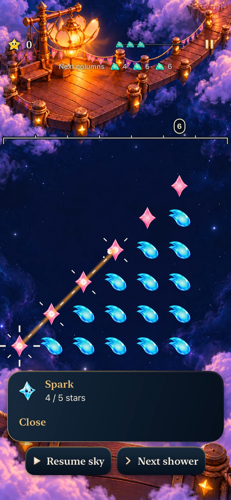
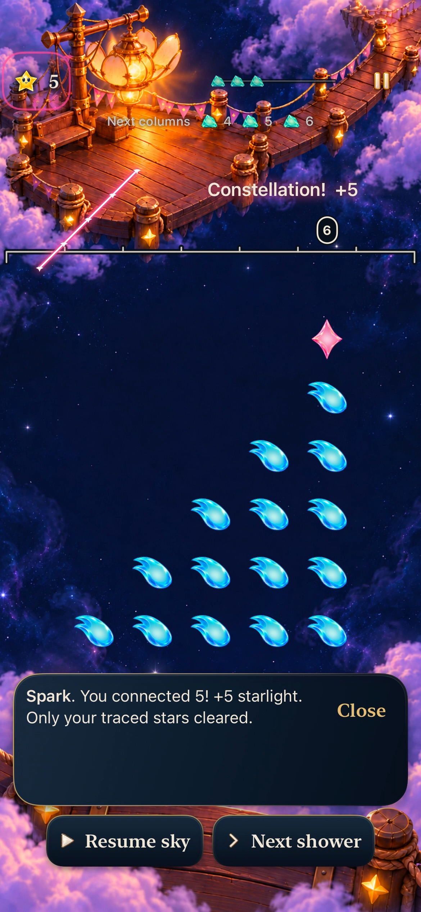
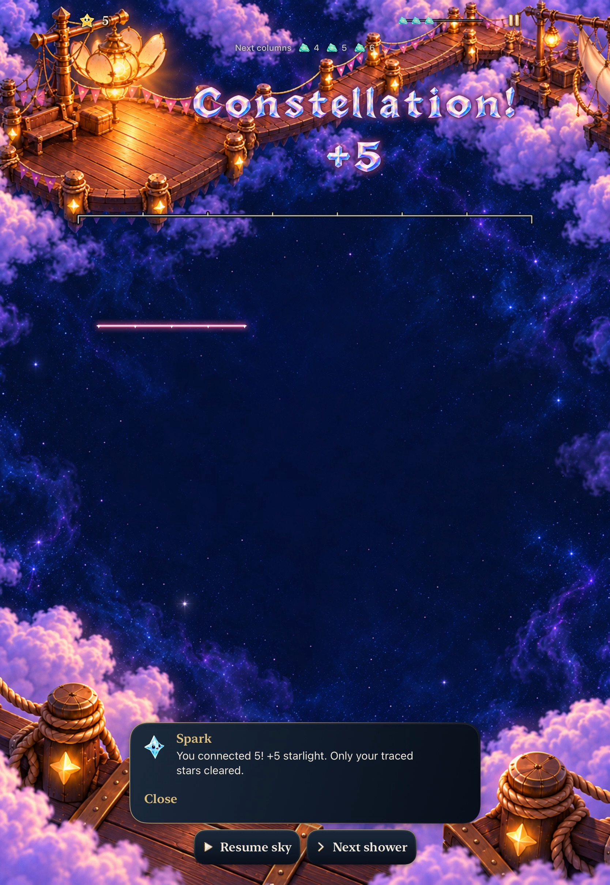
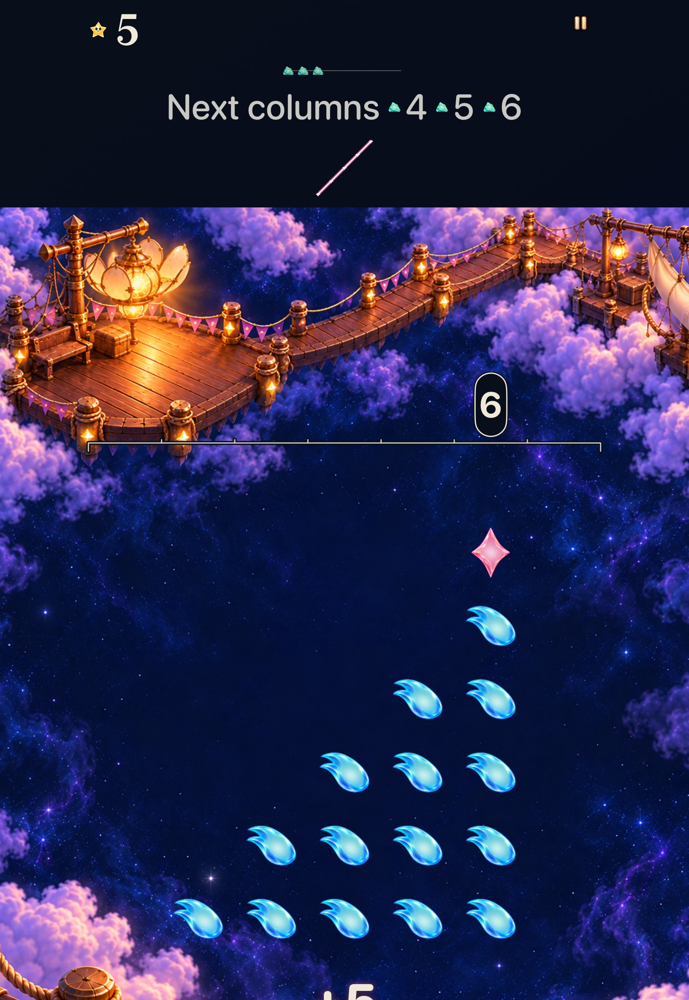
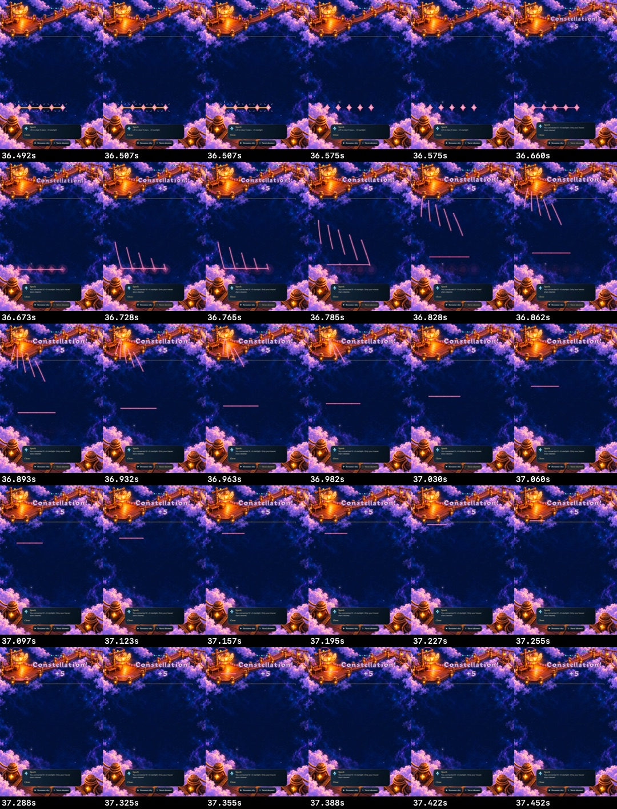

# The drawn constellation returns to the sky

**Verified development slice for [identity goal 1, #336](https://github.com/lbeezr/starfall/issues/336).** A successful Open Sky trace now rises as the original ordered figure, then fades in protected reading space. Quiet presentation shows that same figure statically. The existing clear, survivors and next input remain authoritative. Human recognition and preference remain unmeasured; [#335](https://github.com/lbeezr/starfall/issues/335) retains that observation and the remaining nine implementation goals.

## Preserve the drawing and its owners

`StarlightCelebration.constellationPath` retains the Store-validated manual walk separately from recipe presentation order. Open lines, diagonal links, legal empty-midpoint gaps and branch revisits keep their topology; there is no sorted-cell outline, hull or closing segment. A selected drained star remains part of the figure even when it contributes no reward. Automatic Story phases, recipes and ordinary taps do not invent a manual return.

The renderer uses at most 196 walk entries, 195 links and 49 distinct glints. Existing collection packets remain capped at six. One uniform scale and translation carry the figure toward its destination, arriving at 0.92 seconds within the unchanged 1.4-second latest-only receipt. Quiet presentation starts at the same destination. Store replacement, expiry and interruption cancellation remain unchanged; the Canvas never finishes gameplay or owns a shower, score, save or input lock.

Review found a real scrolling boundary: a 900-point reading canvas can move its arena top above the fixed header while lower stars remain playable, leaving no default band above the arena. Manual reading layouts now reserve a passive 80-point sky slot with eight-point vertical pads outside the scrolling viewport. Tutorial reuses its existing award band. Automatic Story and Full Board reserve no extra row. Hosted regression covers that exact scrolled phone geometry, normal/quiet equivalence and invalid geometry. The overlay excludes measured score, header and adjusted award text, including shadow. A positive raster control really paints through a synthetic score location; zero exclusion ink cannot pass by drawing nothing.

Core, RNG, scoring, supply, clocks, archive v19, world envelope v1, historical Continue and exact same-round Replay are unchanged. Both Story modes retain their shipped rules. This transient presentation is not encoded or resurrected by restoring a committed round.

## Source and executed checks

Runtime/test checkpoint `a3b6799183afc12388b8d4c07b561ab84ef13081`, tree `61259c233ff942a2b1d4cead1a50e8804a3ea1ae`, is based on fresh main `1f322e8db30abe8e887e2a5c360e545093734700` after #349. Final hosted/native executions use its clean test products; later changes are documentation/evidence only. Local app bundles identify `dev.local`. [verification.json](verification.json) records source hashes, exact command forms, environment, scope and failed attempts. Raw logs, movies and xcresults remain in `/private/tmp/starfall-identity-01-20261024/`.

| Check | Result | Extent |
| --- | --- | --- |
| Complete Core suite | 348 passed, zero failures/skips | Core/Tests/Package bytes stayed identical through the final checkpoint. |
| Selected hosted | 117 passed, zero failures/skips | Celebration27, TraceInputPolish32, FallingSkyStore51, CrystalCelebrationArtwork7. Includes real Store topology/identity, geometry, actual Canvas raster, cancellation and automatic/tap siblings. |
| Phone native | Four passed | Horizontal versus ordinary tap; diagonal five-of-six; legal gap; next clear, settings, background/relaunch and Replay cancellation. |
| Tablet native | Three passed, plus one capture-only repeat | Horizontal/tap, largest-text trace/build menu, AX3XL Calm selected-five/next-input. The unchanged horizontal case passed again to recover its missing recording. Eight total executions, six distinct methods across both devices. |
| arm64 simulator Debug build-for-testing and generic Release | Passed | Shared Starfall scheme, simulator signing disabled; existing target membership retained. |
| Hygiene, whitespace, membership and local links | Passed | No new production resource/configuration/target membership. |

Xcode 27.1 (27A9275), macOS 27.0.1, iOS 27.0 Simulator. Native destinations: iPhone17e `64231AFE-4CDB-4B5A-B6D5-70CD7CEED324`, then iPad Pro11 M5 `255E141F-D4D6-45DA-89FF-51436BF1BBA7`, one owned simulator booted at a time. Both were shut down after acceptance; no physical phone or unrelated device was touched.

## Inspect the selection and return

| During the diagonal drawing | Returned five, sixth retained |
| --- | --- |
|  |  |

**Native Debug a3b6799 / dev.local, iPhone17e, normal motion.** Original-resolution decoded frames from the accepted phone recording; the first is an intermediate held stroke, not a claim that all five are already selected. Exact decoded timestamps and hashes are in [captures.json](captures.json). The complete inspected horizontal, gap and diagonal sequences distinguish figure return from the separate collection packets, through fade and the next usable state.

| Tablet normal return | AX3XL Calm fixed slot |
| --- | --- |
|  |  |

**Native Debug a3b6799 / dev.local, iPad Pro11 M5.** Left: ordinary text/motion, recovered recording. Right: AX3XL, Calm enabled through the actual Settings control and restored afterward. The reading viewport scrolls; lower instructions are outside this screenshot. The fixed return does not scroll onto playable stars.

**Derived contact sheet, 36.492–37.452 seconds.** Thumbnails and timestamp labels are generated from actual recorded frames; duplicate recorded timestamps remain visible. The coordinator inspected the complete 35.5–38.2-second tablet window, not just this sheet. Phone capture distinct-image intervals around the return were roughly 0.13–0.18 seconds; the tablet interval around this return was approximately 0.033 seconds. Neither establishes physical frame rate, continuous smoothness or an attributed cause for capture cadence.

**Hosted component raster, not a native branch gesture.** A real Store branch/revisit receipt supplies this exact five-point figure. The bottom marker prevents a stale/blank raster from passing; it is test-only. Store/geometry/raster establish branch preservation. Native horizontal, diagonal and gap gestures are separate evidence; no multipoint native branching gesture was exercised.

## Failures and remaining limits

The first sandboxed Core command failed before tests because its module cache was unwritable; the authorized rerun passed. Initial 115/116 hosted and earlier phone executions belong to their earlier inputs. They are not substituted for final counts.

Recording initially needed an explicit output path; a subsequent stop found its target shut down, with no isolated shutdown owner. The final tablet recording tool then failed to save with ENOENT despite all three tests passing. One unchanged horizontal case was repeated with direct `simctl io recordVideo`; it passed, produced a valid movie and supplied the inspected tablet sequence. These capture failures remain distinct from application failures. No assertions, clock policy, ordinary motion or acceptance criteria were weakened.

This selected development matrix establishes neither actual VoiceOver, minimum-iOS17 runtime, physical installation/play, human recognition/enjoyment nor sustained performance. Keep the return for the ordinary game, revisit uncoached recognition through the existing #335/#206 observation, and refresh motion/reading evidence whenever the shared layout or receipt owner changes. Next implementation is ordered [#337](https://github.com/lbeezr/starfall/issues/337), reusing this exact-path owner.
