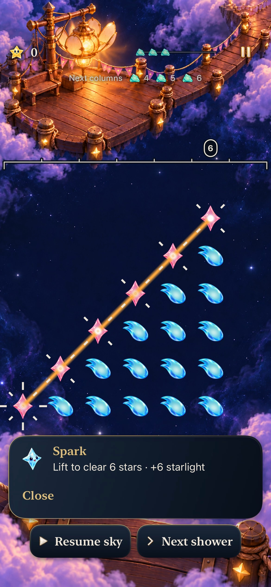
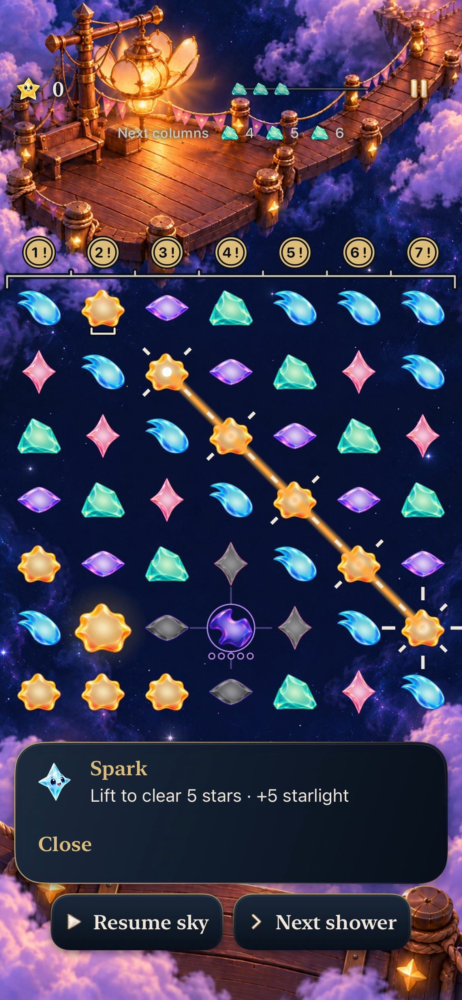
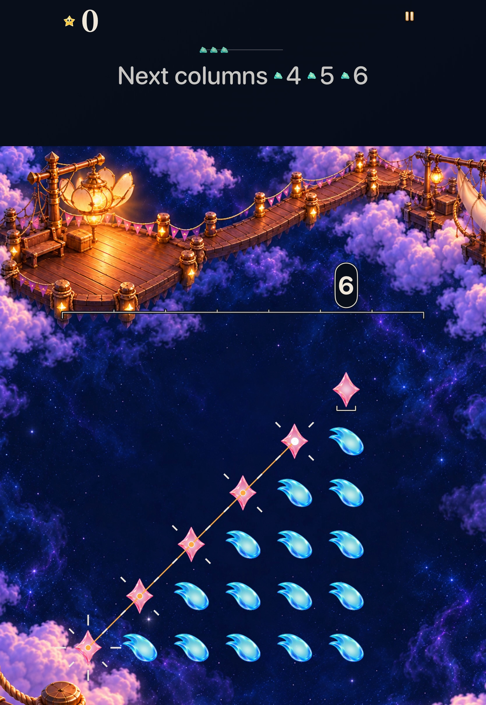
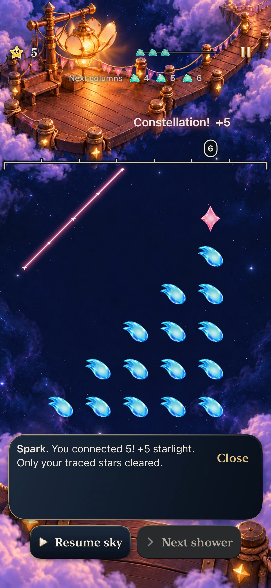

# See which stars stay

**Verified development slice · identity goal2 [#337](https://github.com/lbeezr/starfall/issues/337).** During an Open Sky trace, chosen stars retain their linked rays; matching stars omitted from the drawing now have static open cradles beneath them. Releasing five from six leaves the sixth star, while tracing all six leaves none. The original drawn figure still returns into protected sky space.

348 Core,165 selected hosted and seven native executions across five methods passed, plus arm64 Debug and generic Release. These scripted and inspected results support development adoption; uncoached recognition, physical play, minimum-OS and actual VoiceOver remain unmeasured. [Goal3 #338](https://github.com/lbeezr/starfall/issues/338) is next after this individual merge; [#335](https://github.com/lbeezr/starfall/issues/335) retains the remaining stack and player acceptance.

## Chosen and retained use different shapes

| Five of six | All six |
| --- | --- |
|  |  |

**Native iPhone17e, iOS27.0 Simulator, default text/ordinary motion, clean runtime/test source `bfa39140`, actual bundle `dev.local`.** These are original-resolution decoded recording frames, exported to JPEG without a crop. [Capture provenance](captures.json) records requested/actual times, dimensions and hashes. The matching-family cue conveys membership, not a proposed route or guaranteed future value.

| Dense49 ordinary phone | AX3XL Calm tablet |
| --- | --- |
|  |  |

Tablet tests use clean `07aec73`; its only delta from `bfa39140` is the hosted geometry comparison described below. App/Core/native-test bytes are identical. The largest-text native case enables Calm through the actual Settings control, performs the clear and next input, then restores its preference. Its held capture shows the scrolled board reading position; controls outside that viewport are revealed separately by the interaction test.

## One transient presentation owner

`FallingSkyScene` extends the existing trace subtree with **two aggregate shape nodes**, one light stroke and one dark understroke. Each retained body gets an independent open U with no connecting route, fill, body dimming, scaling or new animation. Geometry clears ordinary and grown bodies. The maximum is48 retained marks on a49-cell board; normal and quiet modes use the same geometry.

The View passes `ConstellationTraceIntent.snapshot`. Core owns valid-prefix and family membership, including diagonal/gap/Opal links. Its existing four-star-square query handles the eligible family below five; no square rule is duplicated. Exact snapshot, cell and gem identity checks omit stale or moving bodies. Historical revision2's later automatic phases can consume other stars, so `supportsAutomaticRecipes` excludes the kept-body promise there. Resizing, scene detachment, release and existing lifecycle cancellation clear the same subtree. Rules, input thresholds, RNG, score, clocks, saves, artwork and Story arrangements are unchanged.

The [goal1 return](../identity-goal-01-constellation-return-2026-10-24/README.md) retains its original ordered walk, gaps and revisits. It is separate from recipe presentation and still has one bounded Canvas and receipt lifetime.

**Same recorded partial-clear sequence.** Selected markers have disappeared; the sixth Rose survives. The figure is a committed return, not another input surface.

## What ran and what failed first

[Verification record](verification.json) retains exact checkpoints, input hashes, commands, environment and disposable log locations. No compiled dirty inputs were present at the accepted test checkpoints; subsequent changes are documentation/evidence only.

| Check | Result and scope |
| --- | --- |
| Core |348 passed,0 failed,0 skipped; Core inputs unchanged from fresh main |
| Affected hosted |165 passed: StarCast25, TraceInputPolish32, FallingSkyStore51, SkyTechniqueStore30, StarlightCelebration27;0 skipped |
| Ordinary phone |4 passed: partial/full/cancel, actual49-star density, gap/repeated attempt and lifecycle/next input |
| Tablet |3 passed: dense selection, partial/full/cancel and AX3XL Calm/next input |
| Build |arm64 Debug build-for-testing and generic simulator Release passed |
| Source boundaries |Existing target membership, hygiene and diff checks; final local target checks in verification record |

The first hosted selection had162 passes and three failures in the new geometry checks. Expected doubles were compared at1e-6 against coordinates transformed by SpriteKit at Float32 precision. The correction compares **exact Float values**, without increasing an epsilon; open paths, body clearance, actual raster ink, survivor and lifecycle assertions remain. The same165 selected checks then passed.

The initial default Debug attempt compiled App for arm64/x86_64 against a selected arm64 Core module and failed resolution. The existing arm64 `ONLY_ACTIVE_ARCH=YES` configuration passed. An initial Release command redundantly specified both `-arch` and a generic destination and was rejected before compilation; the canonical generic command passed. The first tablet shell attempt could not access CoreSimulatorService/default test logs inside the sandbox and ran no tests; the same prepared selectors passed with normal authorized Simulator access. These failures remain separate from the accepted results.

## Limits and next observation

Hosted checks exercise real Core/Store selection, branch/revisit/gap/Opal geometry, four-star squares, zero-reward membership, moving columns, stale snapshots, actual raster ink and scene detachment. Native gestures cover straight/diagonal/gap contrasts; **native multipoint branching remains unexecuted**.

Decoded sequences show held cues, release, exact returned figures, cleanup and subsequent decisions. Native next inputs occurred after receipt expiry, so they do not prove sub1.4-second input latency. Sampled recordings/stills do not establish physical smoothness, sustained performance or human comprehension. No physical phone was probed or installed; no minimum-iOS17 or actual VoiceOver acceptance is claimed. Selected tests are not a full Apple matrix.

Retain this candidate without a temporary route. At the next uncoached Open Sky session under [#206](https://github.com/lbeezr/starfall/issues/206), observe whether a player can distinguish chosen from retained stars before release and explain the survivor afterward. Record the actual installed build and any help. That observation remains separate from the next authorized identity implementation.
