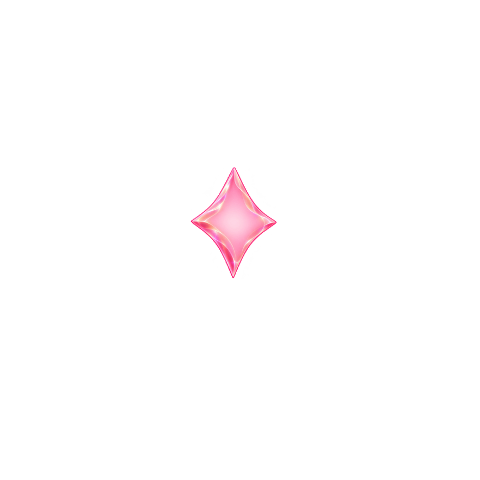
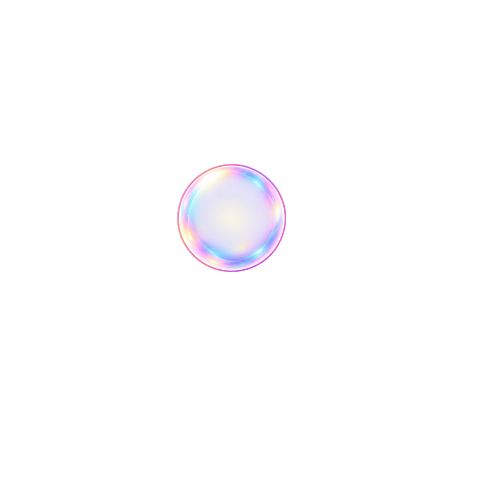
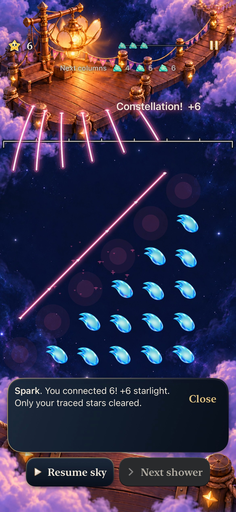
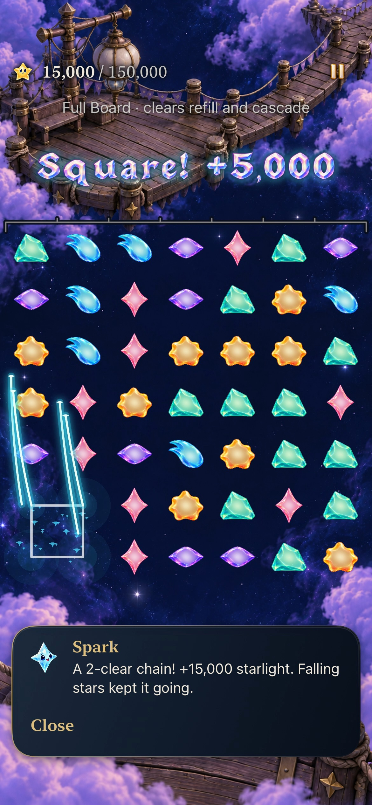
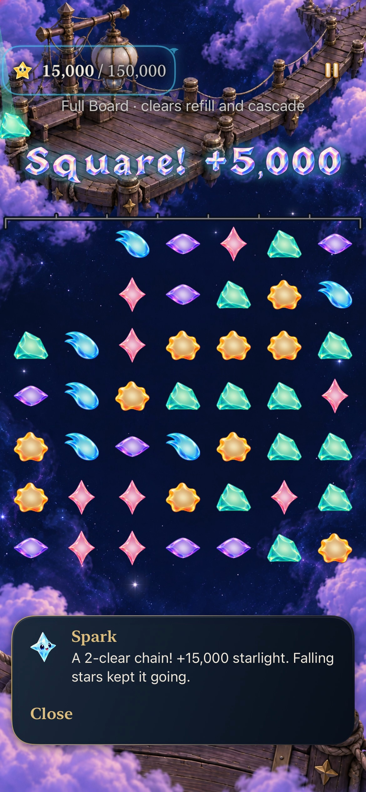
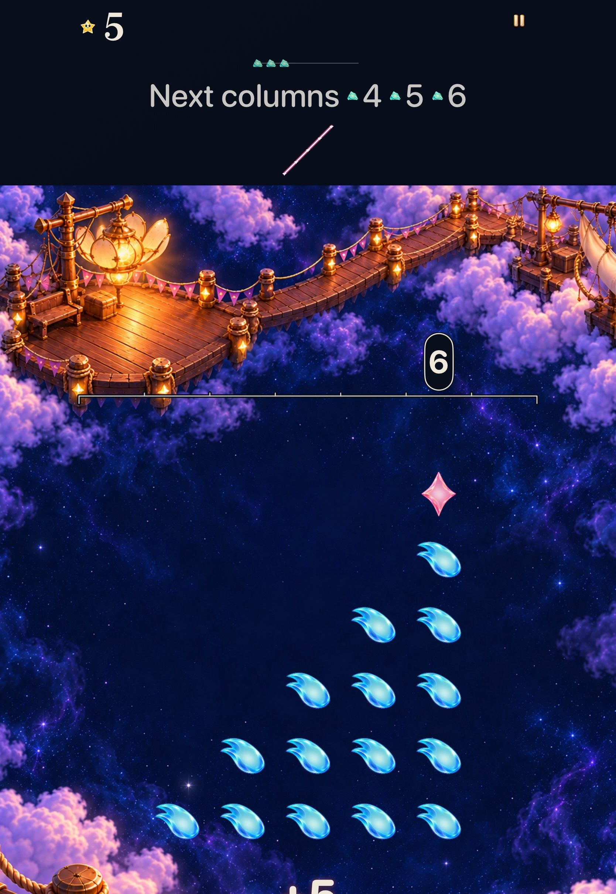

# Helpers leave; their light travels onward

**Verified development slice · identity goal3 [#338](https://github.com/lbeezr/starfall/issues/338).** A cleared star now lifts, drifts and turns as the same body before fading. Its material and grown size survive the departure; credited light and the original drawn constellation retain their separate presentation. Manual clears and automatic Story phases share this owner.

348 Core,174 selected hosted and eight native executions across seven methods passed, plus arm64 Debug and generic Release. Real SpriteKit tests verify the short body movement; native recordings verify release, light, survivor falls/refill and following decisions. **Some 0.18-second body intervals fall between recorded native frames**, so a complete native trajectory and physical smoothness remain unproved. [Goal4 #339](https://github.com/lbeezr/starfall/issues/339) follows this individual merge; [#335](https://github.com/lbeezr/starfall/issues/335) retains the stack and actual player-recognition acceptance.

## The helper keeps its identity

| Ordinary Rose | Grown Aqua | Opal |
| --- | --- | --- |
|  |  |  |

**Real SKView hosted test, normal motion, clean `0e92c49`, actual bundle `dev.local`.** These are labeled480×480 pixel crops from1170×2532 test attachments, without scaling or repainting. They show material appearance, not motion by themselves. The same test observes actual lift, lateral drift, rotation, late fade and removal while asserting unchanged body size, texture and child count. [Capture provenance](captures.json) retains raw hashes and crop coordinates.

`FallingSkyCharacter.depart` owns one keyed finite action. The actual removed node lifts0.68 cell, drifts at most0.18 cell and turns0.24 radians, with deterministic ID parity and no RNG. It stays full size; its original opacity fades only near the end. The0.18-second lifetime fits inside existing manual clear and automatic-pop deadlines. No new wait, input lock, animation callback or completion owner is introduced.

`FallingSkyScene` withdraws exact committed cleared IDs from active maps first. Manual removal uses the old board; each automatic phase uses its own `before` board. Ordinary, grown, Opal, Dusk and drained bodies all leave. **Zero-value removal emits no credited radial light or award receipt**; the existing zero feedback stays separate. Historical gravity attraction/consumption feedback is unchanged. Resize, replacement, detachment, suspension and quiet-mode cleanup retire outgoing actions even when another object retains a reference. Quiet/detached presentation settles immediately.

## Drawn return and automatic causality remain distinct

| Manual full-family return | First automatic clear | Survivor fall and refill |
| --- | --- | --- |
|  |  |  |

**iPhone17e, iOS27.0 Simulator, default text/ordinary motion, clean `0e92c49`, `dev.local`.** Original-resolution decoded frames, JPEG85 export. The last two images are intermediate phases, not final49-star occupancy evidence. Native tests separately assert exact final occupancy, survivor corners, next exchange, Settings/background/relaunch and Replay. Current Lantern Sky4 finishes its first chain at15,000/16 occupied; FullBoard6 finishes at15,000/49, then the next exchange reaches34,000/49. Automatic patterns never acquire a fabricated manual walk.

**iPad Pro11 M5, iOS27.0 Simulator, actual Settings AX3XL Calm.** Five chosen Rose stars leave while the sixth stays. This is the scrolled board reading position; native interaction separately reveals and operates controls. Goals1–2’s exact ordered return, selective cradles and existing expiry/cancellation remain unchanged.

## Checks and the first failed measurement

[Verification record](verification.json) contains source hashes, commands, environment, raw locations and limits. Runtime/native checkpoint `1eaf7d9f` and accepted `0e92c49` have identical App/Core/native bytes; only the existing StarCast hosted test changed. Accepted checks used clean source. Later changes are documentation/evidence only.

| Check | Result |
| --- | --- |
| Core |348 passed,0 failed,0 skipped |
| Affected hosted |174 passed,0 skipped:51 Store,5 helper departure,4 input-window,30 technique Store,25 StarCast,27 celebration,32 trace-input |
| Phone |5 passed: partial/full/cancel, trace/lifecycle/next input, actual winning-clear restoration/Replay, current Sky4 and FullBoard6 cascades |
| Tablet |3 passed: actual49-star selective trace, AX3XL Calm/next input, current FullBoard6 cascade/lifecycle/Replay |
| Build and boundaries |arm64 Debug build-for-testing, generic simulator Release, target membership, hygiene, diff and local targets passed |

The first hosted selection had173 passes and one failure. Its old contact test treated every opaque node as a stationary survivor; departing cleared bodies now move while opaque. Nominal20ms sleeps could also cross the actual gravity boundary before a position assertion. The correction derives **survivors from Core cleared IDs** and samples only before an actual `ContinuousClock` deadline. Exact parent-position, ripple, scale, geometry, material, final-board and completion assertions remain; five new tests independently assert removed-body behavior. All174 then passed without assertion weakening or a blanket retry.

The initial sandboxed Core invocation failed manifest/cache access before any test ran. The same command passed348 with normal authorized cache access. One intermediate test build warned about a redundant cast in the now-typed survivor loop; it was removed before the clean warning-free accepted build. Those outputs remain separate.

## Limits and next observation

Hosted tests establish actual body movement, exact manual/phase IDs, zero reward, immediate quiet settlement and rapid replacement/resize/detachment cleanup. Native next inputs occurred after receipt expiry; these runs do not prove sub1.4-second input latency. Native multipoint branch/revisit gestures, sustained performance, physical smoothness, minimum-iOS17 and actual VoiceOver were not executed. Selected checks are not a full Apple matrix.

Both owned simulators were confirmed Shutdown afterward. No physical phone was probed or installed. Retain this implementation without a temporary route; at the next uncoached session under [#206](https://github.com/lbeezr/starfall/issues/206), observe whether the player distinguishes helpers leaving from light returning and can read the next decision. Record the actual installed build and assistance. Human recognition remains separate from continued identity delivery.
