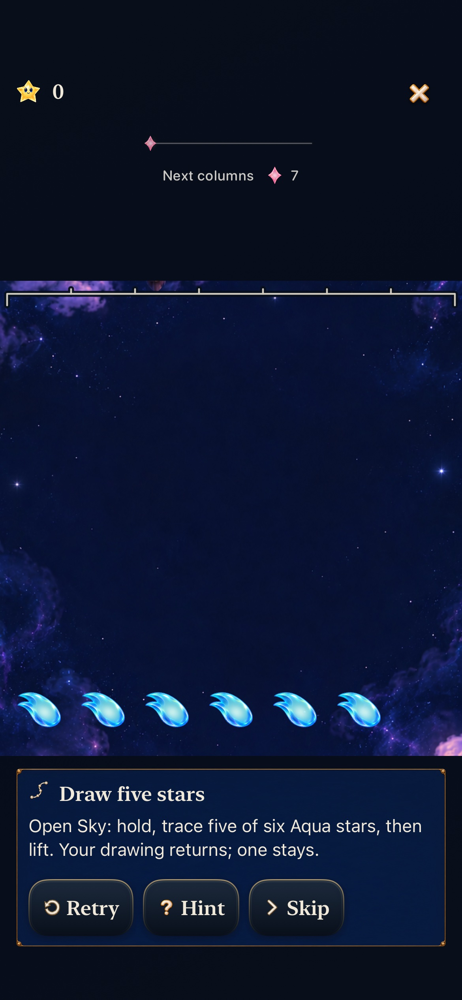
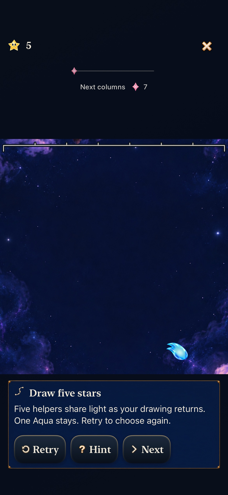
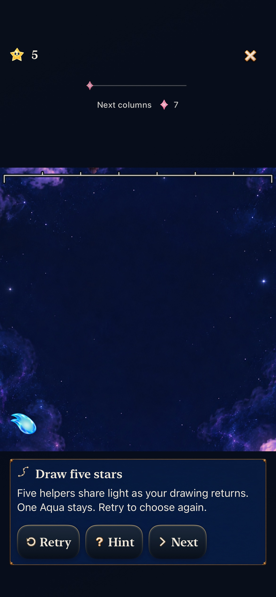
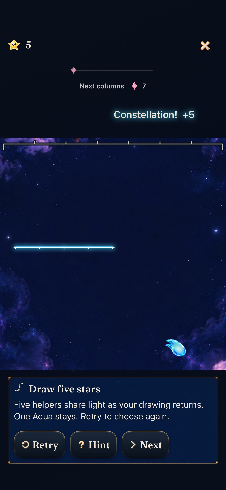
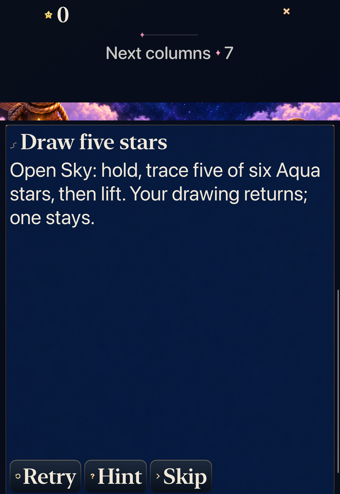
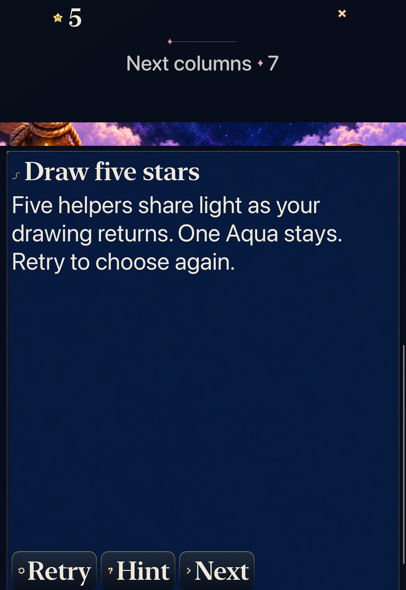

# Choose five helpers; see one stay

**Verified development slice · identity goal 4 [#339](https://github.com/lbeezr/starfall/issues/339).** The existing six-Aqua Open Sky lesson now asks the player to choose five, then shows their light returning as the original drawing while the sixth stays. Hint is optional. Either end may remain; Retry restores the same six stars and hides the answer again.

The lesson reuses goals 1–3’s production input, exact constellation return, retained-star cues and helper departures. It changes a practice rubric and its guidance, with no new chapter, gameplay rule, generator, save schema or reward gate. Development checks and native reading are recorded below; uncoached learning remains unmeasured. [Goal 5 #340](https://github.com/lbeezr/starfall/issues/340) follows this individual merge; six ordered leaves remain under [#335](https://github.com/lbeezr/starfall/issues/335).

## The player chooses who stays

| Optional prompt | Five chosen, right end kept | Other five, left end kept |
| --- | --- | --- |
|  |  |  |

**iPhone17e, iOS27.0 Simulator, ordinary motion/default text, runtime `52b3551`, actual bundle `dev.local`.** Original-resolution native exports. The phone checks the complete short prompt and completion fit in one guide viewport. Stills establish appearance; the recorded release sequence is a separate observation. [Capture provenance](captures.json) identifies source attachments, hashes and any decoded frames.

`SkyTutorialRun` accepts exactly five Core-valid traced cells in the first existing trace step, recomputes the action from the identical prior game and requires the entire resulting game to match. This permits both five-star choices and legal revisits. It does not accept a forged result or a different input method. Other chapters retain their own exact rubrics.

A four-star canceled trace commits nothing. Clearing all six or tapping the legal six-star group still earns the ordinary six points; the lesson asks for Retry because it did not demonstrate choosing five. No normal award, repair or unlock depends on this optional exercise. Hint reveals the existing worked route and coordinates only when requested.

**Same final-source ordinary phone recording, actual 110.8933s.** A sampled 108.8–111.5s sequence shows held selection, release, separate credited light, the same five-point line rising and the sixth Aqua staying. This frame is an intermediate return position; the sequence continues into the protected band. Some short body intervals fall between frames, so this is not a complete 0.18-second helper trajectory or a physical-smoothness claim.

## Reading and returning remain usable

| Largest-text Calm prompt | Largest-text completion |
| --- | --- |
|  |  |

**iPad Pro11 M5, iOS27.0 Simulator, AX3XL and the actual app Settings Calm switch.** Native interaction reads the start/end of the longer accessible text, operates Hint/Retry, makes the five-star choice and exits. Calm is restored afterward; system Reduce Motion was not changed. Largest-text scrolling is intentional.

The practice Store has no player-save writes. Hosted checks preserve exact current Falling Sky, current Ribbon Full Board7 and retained Lantern3 round/world bytes through practice, Retry and exit. Native phone/tablet start a real Lantern Sky4 round, pause before its first shower, earn 15,000, then enter practice. Returning, viewing Map and relaunching preserve that original round’s score, board, paused supply and world entries.

The authored trace board retains its historical generation and original six stars. It exercises the current manual input/clear/presentation owners; it does not establish current shower-supply behavior or suggest Story accepts manual drawing. Story’s automatic practice remains separate.

## Verification and the copy refinement

[Verification record](verification.json) contains exact source hashes, commands, environment and results. Final runtime/copy checkpoint `52b3551` includes the shorter two-line messages. Core and the production guide/input/renderer bytes match the earlier checkpoints; intermediate `b2ff778`/`628e822` changed hosted measurement/native admission only. Later report/index changes are documentation/evidence only.

| Check | Result |
| --- | --- |
| Core |352 passed,0 failed,0 skipped; includes 4 new rubric tests |
| Affected hosted |120 selected checks passed; exact persistence, guide/copy, dialogue inventory, trace/return and helper owners |
| Native interaction |Final source 3/3 passed: two phone journeys and AX3XL Calm tablet reading/choice/return,0 skipped. All 11 executions across iterations retain three earlier failures separately |
| Build and boundaries |arm64 Debug build-for-testing, generic simulator Release,541-key catalogue, target membership, native-plan checks, hygiene and diff |

The first checkpoint passed all selected assertions and its phone/tablet flows, but inspected phone captures showed the longer prompt and completion placed their final clause below the guide’s initial viewport. Two messages were shortened; the phone test now checks full reading and simultaneous viewport bounds. That stronger assertion later caught 11 points still below the prompt viewport at `628e822`, prompting the final shorter messages at `52b3551`. Final-source build, copy/guide checks and native interaction were rerun. The earlier successful executions remain identified with their original source rather than recertifying the refinement.

The repeated hosted run had 119 passes and one failure in the unchanged helper-departure sampling test. Its shared assertion line did not identify which individual motion flags were missed; only two of three material captures were produced. The test previously polled wall time and performed synchronous rasterization during a 0.18-second action. A test-only SpriteKit frame observer now requires rendered-frame readiness, records per-gem states and waits until lift, drift, turn and late fade are all observed before its one raster capture. The same thresholds, material/grown-size checks, one-second deadline, capture and retirement assertions remain. All 120 then passed. This corrects a measurement boundary; the old missing flags and an exclusive environmental cause remain unproved.

The first refined phone choice case failed before entering practice. The recording shows a transient menu over Entry-like scenery after Begin, with Pause visible; no paused controls appeared. The exact flow/handoff state was not isolated from those frames. A first setup correction waited for an enabled+hittable cell, but its next run failed at the same absent paused-control condition. It did not establish the menu’s readiness. The final setup uses the existing bounded control-reveal/enabled/hittable helper for both Settings and Pause and asserts the actual Pause label, retaining zero-shower and exact-round assertions. Its sibling tap/swap/trace journey passed in that same run. The transitional-menu observation is retained in existing [goal10 #345](https://github.com/lbeezr/starfall/issues/345#issuecomment-6379329092) for its Entry/return acceptance; no product clock or flow workaround ships in this lesson.

Initial sandbox Core cache access and an incorrectly invoked planner test failed before their intended checks; the existing commands passed with normal authorized cache access and the script’s canonical invocation. No blanket retries, assertion weakening, reduced-motion workaround or clock change was used.

## Limits and next observation

Exact Core IDs are checked in Core/Store tests; native endpoint cell, family and sole-star count identify the retained end without claiming an ID unavailable in accessibility. Real Store gap/branch/revisit coverage is separate from native multipoint gestures, which were not executed. Normal return/departure renderers are unchanged from goals 1–3; sampled recordings do not prove every 0.18-second body interval, physical smoothness or sustained performance. Selected checks are not a full Apple matrix.

Both owned simulators were confirmed Shutdown after acceptance. Actual VoiceOver remains deferred. Minimum-iOS17, physical-device play and uncoached recognition were not run; no physical phone was probed or installed. At the next [#206](https://github.com/lbeezr/starfall/issues/206) session, observe whether the player can choose five without Hint, name the remaining helper and recognize their returned drawing. Record the actual installed build and assistance. That observation does not gate independent identity work.
