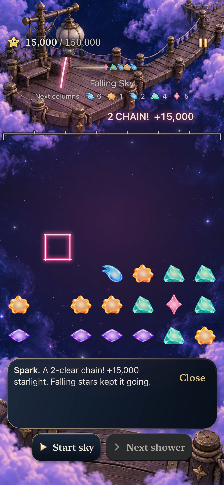
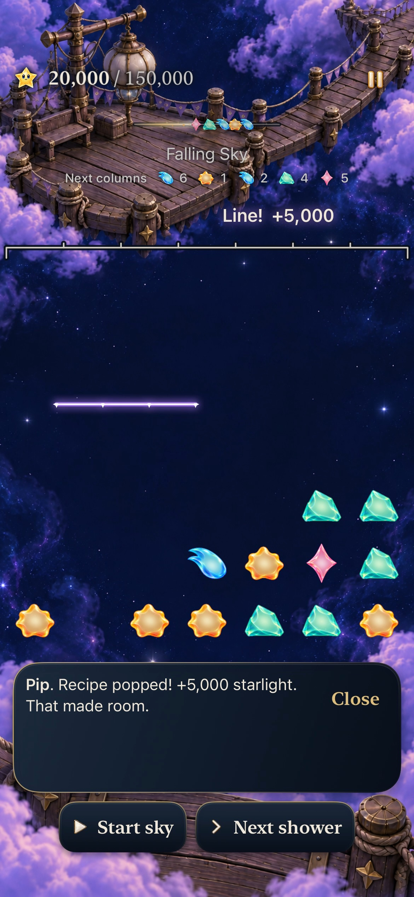
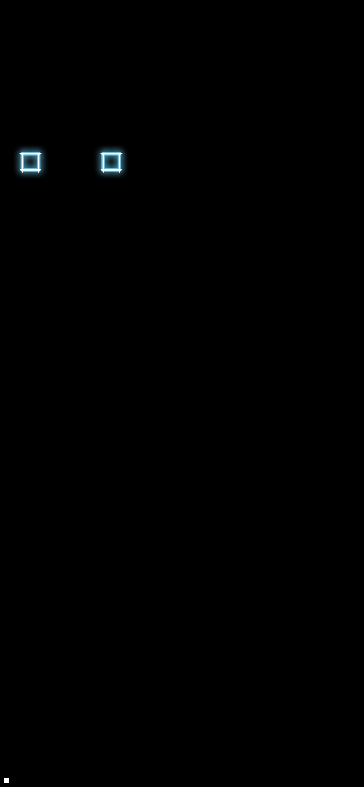
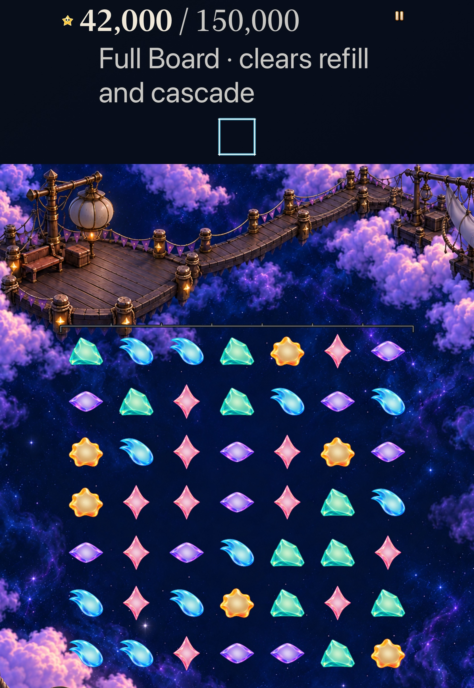
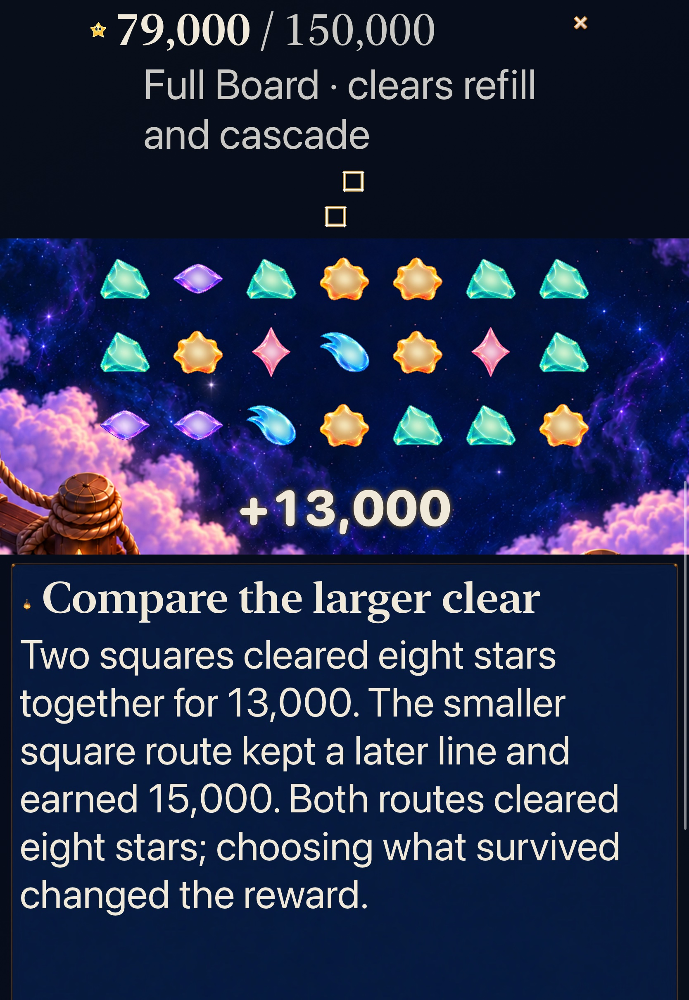
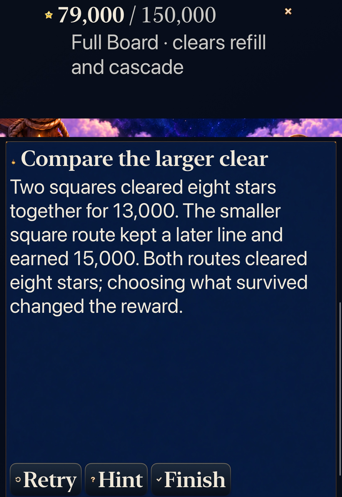

# Story patterns return as their actual figures

**Verified development slice · identity goal 5 [#340](https://github.com/lbeezr/starfall/issues/340).** Committed Story squares, crosses and lines now rise as their own figures through the existing return owner. Every simultaneous recipe stays separate, including overlaps. Open Sky keeps the player's exact drawn walk; inspection and nonclearing setup still create no return.

This carries goals 1–4's selection, helper departures, return geometry and practice forward. It changes two App presentation files and adds focused tests. Rules, RNG, score, clocks, supply, archive 19, exact Continue/Replay and progression retain their existing owners. Human recognition remains unmeasured. [Goal 6 #341](https://github.com/lbeezr/starfall/issues/341) follows this individual merge; five implementation leaves remain under [#335](https://github.com/lbeezr/starfall/issues/335).

## A real setup returns a square or line

| Square from a causal phase | Current four-star line |
| --- | --- |
|  |  |

**Ordinary-motion iPhone17e, iOS27.0 Simulator; App/native source `024e14a`, actual bundle `dev.local`.** Original-resolution frames from the passing native recording, at actual 159.975s and 168.097s. These are intermediate positions. Inspected sampled sequences include release, successive square phases, the four-star line's rise, protected-band arrival and expiry. [Capture provenance](captures.json) records exact requests, actual frame times, source and hashes. The sequences do not establish every short helper-body frame, sustained performance or physical smoothness.

The phone journey first inspects without clearing, makes and reverses a nonclearing setup, then earns 15,000 through the two-square action, 20,000 through a four-star line and 25,000 through another square. Settings, background/return and relaunch retain the same paused 0-shower round. A separate real current Silver4 action earns 19,000, commits its repair, exposes result controls and replays the exact opening. Its existing-install access fixture proves a genuine repair; it does not prove a previously locked destination was first unlocked here. An unchanged native Open Sky trace-versus-tap case retains chosen-set behavior.

## Simultaneous recipes remain separate

**Hosted production Canvas, source `05235c4`, fixed arrived age.** This isolated raster establishes separate ink and HUD exclusion, not native reachability. Actual Full Board comparison practice supplies two disjoint committed squares through production actions. Explicit geometry fixtures separately call the unchanged production resolver for a cross, four-through-seven lines, retained seven-star policy, an overlapping square/two-lines union and a dense 49-star phase containing all 75 recipes/478 path entries. They establish resolver/presentation behavior without claiming those synthetic boards are reachable saves.

`StarlightCelebration.Pattern` carries each phase recipe's actual shape, cells, IDs and presentation path. `PatternReturnLayout` uses the shared affine fit and easing. It fits a unique footprint only to calculate bounds; drawing starts a separate subpath for each recipe. Shared ingredients glint once. The7×7 geometry bounds recipes conservatively at 131, per-recipe paths at 8 entries and unique glints at 49, without truncating valid phases. The manual 196-entry walk budget and topology remain intact. No new nodes, asset family or per-frame state writes are introduced.

The existing latest-only 1.4-second receipt, six-packet limit, score/header/award exclusions, phase cancellation and result timing remain authoritative. A later phase or earned result can replace an earlier return before its 0.92-second arrival; presentation never delays gameplay or a win. Quiet shows the actual last-phase figure immediately through the existing aggregate-receipt behavior. Successive-phase composition belongs to the next goal; this slice does not claim a new cascade queue.

## Largest-text Calm keeps the current round

| Current Full Board return | Two actual simultaneous squares | Complete practice outcome |
| --- | --- | --- |
|  |  |  |

**iPad Pro11 M5, iOS27.0 Simulator, AX3XL; final native-test source `c0616cf`, same App bytes.** The journey explicitly operates Settings OFF→ON, checks the actual value, performs current Lantern Full Board play and both existing paired-clear practice choices, reads their complete outcomes, then returns to the exact 42,000-point retained round and restores the original preference. The fixed 80-point return band sits outside scrolling play; native interaction and inspected captures own its viewport acceptance. The final native method actually executed and passed in 154.348 seconds.

## Verification and retained failures

[Verification record](verification.json) contains source hashes, environment, commands, result paths and selected counts. The final changes after the code/test checkpoint are documentation/evidence only. Runtime fingerprint is `dev.65e76cefff`; actual local bundles report `StarfallBuildID=dev.local`, version 0.1.0/build 1.

| Check | Observed result |
| --- | --- |
| Core |352 passed,0 failed/skipped; all Core/test bytes unchanged throughout |
| Affected hosted |168 passed,0 failed/skipped;14 new pattern tests plus existing return/input/Store/helper/practice coverage |
| Native |4 distinct passing cases,0 skips across phone/tablet; six executions preserve two earlier tablet setup failures separately |
| Build/boundaries |arm64 Debug build-for-testing and generic simulator Release passed; explicit new test memberships, native plan, hygiene/diff and local links pass |

The first Debug build failed at two untyped nonfinite constants in the new geometry test. Explicit `CGFloat.nan`/`CGFloat.infinity` corrected the compiler ambiguity. Its historical direct-recipe test also now performs the real lesson setup before asking for a recipe.

The first hosted run passed 167 of 168 checks. The single failed test compared floating-point interpolation endpoints bit for bit with fitted destinations, differing by about 10⁻¹⁴ points at three sizes. The corrected measurement retains exact quiet/normal arrival parity and independently bounds each destination coordinate to four ULPs at its coordinate magnitude. Existing geometric tolerances, topology, identity, visibility, clipping, lifetime and save assertions remain. The complete affected selection then passed.

Two tablet executions stopped before gameplay while trying to enable Calm. Changing a right-edge gesture to the native switch action did not fix it, so the initial hit-position hypothesis was incomplete. The new test had launched with `-calmEffects NO`, overriding the very `@AppStorage` preference it was trying to change. A disposable Foundation probe confirmed the argument-domain value stays false after a persistent true write. The passing sibling practice journey already omits that override for largest text. Matching that launch boundary and retaining exact OFF→ON value checks corrected the setup; no production toggle, clock or accessibility workaround was introduced. Both failed results/videos remain separate from final acceptance. Actual VoiceOver was not investigated.

## Limits and next observation

This is a selected development matrix, not the full Apple matrix. Crosses, historical variants, dense/overlapping geometry and exact IDs have deterministic/hosted evidence; the native journeys exercise current squares/lines, simultaneous practice and final-result behavior. Native multipoint branching, minimum-iOS17, physical-device play, actual VoiceOver, sustained performance and uncoached recognition were not run. No physical phone was probed or installed.

At the next [#206](https://github.com/lbeezr/starfall/issues/206) session, observe whether the player can identify the returned automatic figure and distinguish arranging Story stars from drawing in Open Sky. Record the actual installed build and assistance. That observation remains independent of implementing the next queued identity goal. Both owned simulators were confirmed Shutdown after acceptance.
