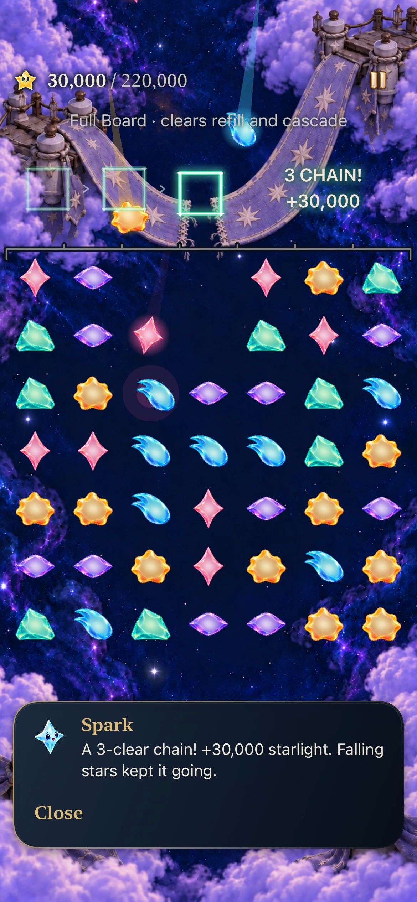
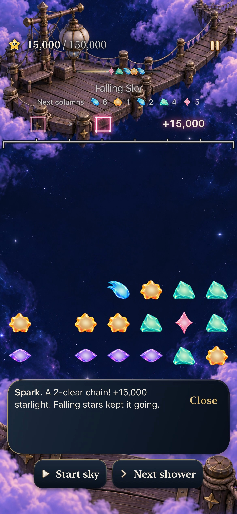
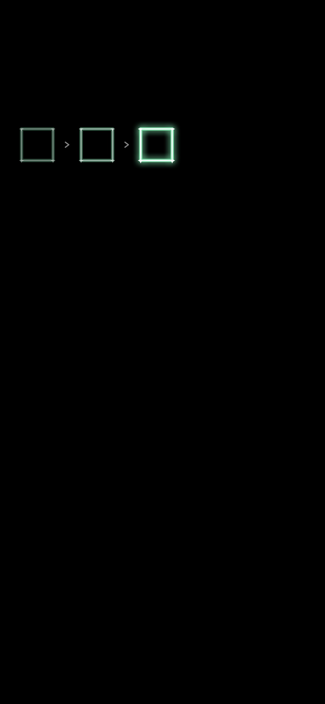
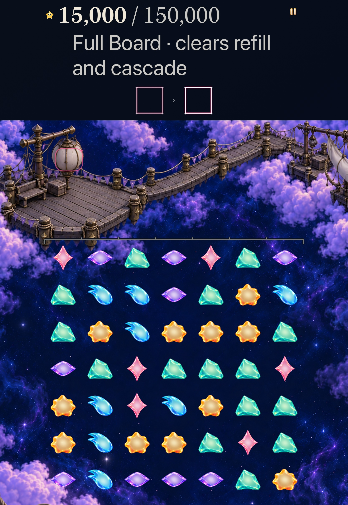
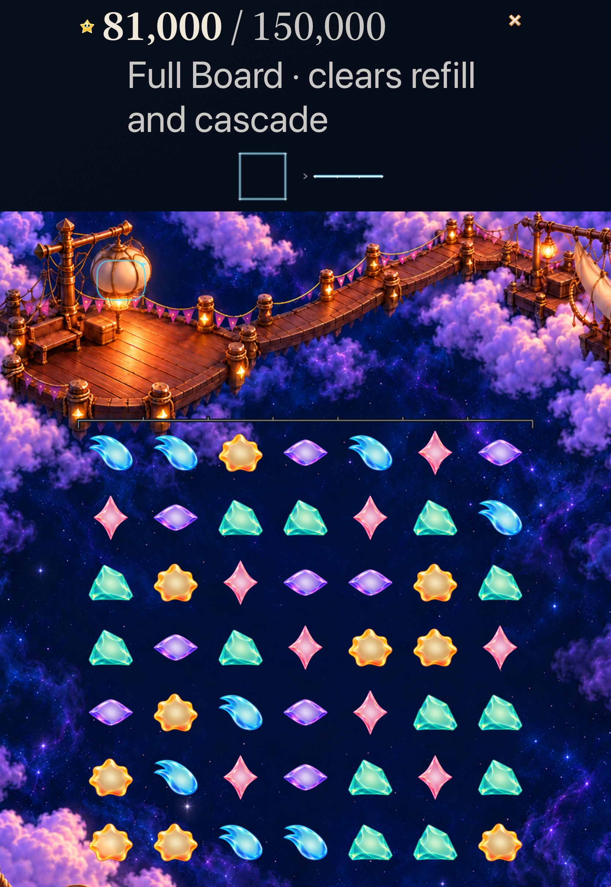
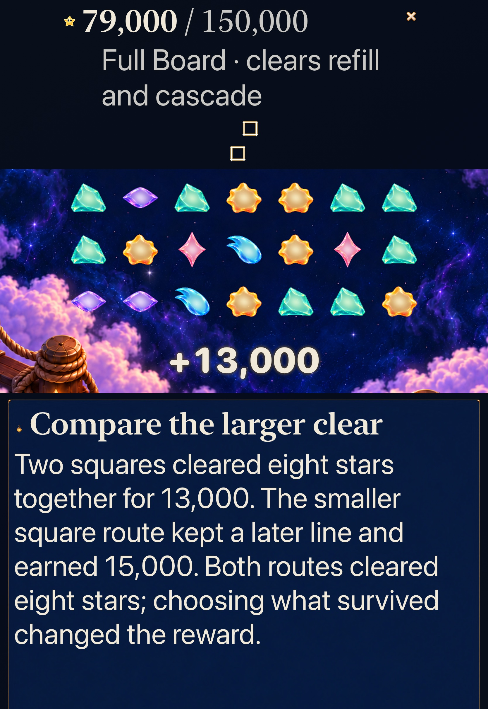

# Successive connected Story returns

**Status:** Development verified; retained · **Goal:** [#341](https://github.com/lbeezr/starfall/issues/341), identity goal 6/10 under [#335](https://github.com/lbeezr/starfall/issues/335) · **Source:** clean code checkpoint `b0fbbb31cd2afb84de3263a9baf8063fe2c6600e`, tree `baa66c093fd7919c86d7a631c95e3fdf81df49c2` · **Runtime:** `dev.5c713aa44d`; actual local bundle `dev.local`

The active phase now rises beside up to two earlier committed figures in a chronological strip. Earlier figures are static echoes, not new awards or flights. Multiple recipes from one phase remain together, and a separate action starts a new strip. Recognition is the hypothesis; human evidence remains open.

## Ownership and preservation

`StarlightCelebration` retains each phase's actual recipes and pre-clear IDs. `CascadeReturnLayout` fits their separate paths into chronological slots with inter-figure chevrons. Solitary patterns retain goal5's exact destination fit; manual constellation walks retain their original owner and ordered topology. At most three figures, each with 131 recipe paths/eight entries and 49 unique glints, means a bounded 147 figure glints, plus the unchanged six active packets. Synthetic bounds are not reachable-save claims.

The Store supplies only the current turn's preceding prefix and rejects invalid, repeated and regressing phase indices. A valid later callback may skip an earlier signal without losing the actual prefix. Existing receipt replacement cancels the old Canvas and its flights. The separate score-commit keyframe no longer schedules a future pulse: only the active receipt's actual last packet arrival owns the receiver acknowledgement. Quiet presentation directly shows the same committed prefix and acknowledgement. No award, save, input, phase, clock or terminal completion depends on this art.

Production changes are limited to `App/StarlightCelebration.swift`, `App/FallingSkyStore.swift` and `App/FallingSkyView.swift`. No Core/rule/RNG/score/save/archive19/asset changes. Existing pause, interruption, latest-only 1.4-second expiry, sounds, immediate committed wins, selected-place goals, Begin-only replacement and exact historical Continue/Replay remain.

## Executed checks

| Check | Result at the recorded source |
| --- | --- |
| Core | 352 passed, zero failures/skips; 21.007 seconds; unchanged package/Core/test input manifest |
| Selected hosted | 189 passed, zero failures/skips; includes all 15 new cascade cases and manual/pattern/phase/Store/trace/practice siblings |
| Debug | arm64 simulator build-for-testing passed, 23.2 seconds |
| Release | Generic iOS Simulator build passed; only the existing absent-AppIntents metadata note |
| Membership | All App/AppTests/UITests Swift sources registered |
| Tooling | Three native-planner tests, hygiene and diff checks passed |
| Native phone | Four distinct cases passed, zero failures/skips; complete run 350.331 seconds |
| Native tablet | One complete AX3XL actual Calm case passed, zero failures/skips; method 203.580 seconds |

[Verification](verification.json) records exact commands, hashes, selected classes, configuration and environment. The 189 hosted checks comprise CascadeReturn15, AutomaticPatternReturn14, StarlightCelebration27, FallingSkyStore51, SkyTechniqueStore30, TraceInputPolish32, SkyPhasePresentation6, HelperDeparture5, OpenSkyPracticePresentation4 and FullBoardCascadePracticePresentation5. This is a selected matrix, not all discovered native tests. Final changes after the code checkpoint are documentation/evidence only; all 640 recorded runtime/test inputs remain byte-identical.

Hosted fixed-age rasters were inspected: separate early/arrived/quiet figures, chevrons outside the paths and protected regions, blank receiver before arrival and actual/quiet acknowledgement afterward. The fixtures establish presentation geometry and ownership, not native timing or human understanding.

## Reproduction and limits

Raw output, products, results and recordings: `/private/tmp/starfall-identity-06-20261024/`. Nonpersistent XcodeBuildMCP profile: `starfall-identity-06-20261024`. Builds/tests use the normal shared scheme and owned simulators; no physical device operations. The source manifest records exact runtime/test/config hashes and subsequent documentation-only differences.

The new phone cases use real Lantern Sky4 `8→9` (two phases, 15,000), then separate `0→1` and `5→12` (25,000 total), and Ribbon FullBoard7 `8→9` (three phases, 30,000) followed by `11→12` (35,000). Native consecutive actions may use the existing short input buffer because automatic resolution reserves all columns. Actual consecutive gesture durations were 0.534 and 0.606 seconds, 1.140 seconds together with no intervening query; that is gesture timing, not a sub-1.4-second input-admission guarantee. The recording shows their separate line and square receipts; deterministic overlap is independently established through hosted controlled callbacks.

The tablet case uses actual Settings Calm OFF→ON at AX3XL, Lantern FullBoard6 and the retained comparison lessons: a square followed by a survivor line versus one phase with two simultaneous squares. It reads the complete instruction, returns to the exact retained 15,000-point round, checks settings/background/relaunch/world state and restores the original preference. Existing Silver earned-win/Replay and Open Sky manual trace/tap cases also pass on this source. The Silver fixture uses legacy access; it does not establish newly unlocking Frostfruit from locked. Settings/background follow the settled native result; hosted tests separately interrupt the in-flight prefix.

The six promoted original-resolution JPEG85 exports were inspected separately from their raw originals. [Capture hashes and provenance](captures.json) distinguish native recording frames, native XCTest attachments and a fixed-age hosted raster. [Inspected sequences](return-sequences.json) retain 201 sample requests with actual timestamps, including repeated decoded timestamps. They show successive releases, static earlier figures, active rise, arrival/expiry and independent following clears; they do not establish every short helper-body frame or physical smoothness. No tests were repeated to repair a late screenshot selection.

## Inspected exports

*Normal phone, three-phase Ribbon FullBoard7; active refill flights remain visible in this selected frame. The later native settled assertion separately confirms 49 occupied cells.*

*Normal phone, Lantern Sky4 at 15,000. The two figures and award occupy separate protected regions; play has returned to its ordinary controls.*

*Hosted fixed-age production renderer, not native gameplay or reachable-history proof.*

*Actual AX3XL Calm tablet, current Lantern FullBoard6 with 49 visible stars. The small static receiver outline identifies this receipt's lantern destination.*

*Retained comparison practice, 81,000 total; actual earlier square and later line remain distinct.*

*Same-phase comparison, 79,000 total: no causal chevron is invented between simultaneous recipes. This early capture shows the award; complete instruction/Retry/Hint/Finish were separately inspected after a deliberate scroll.*

## Failures, decision and next trigger

The phone MCP response timed out at its 300-second transport limit while the verified owned XCTest process continued. The existing process finalized all four cases successfully at 350.331 seconds; the final xcresult and log, rather than the interrupted response, establish acceptance. No case was rerun. One phone shutdown request found it already Shutdown (405); the shutdown owner was not isolated. Only the owned tablet was subsequently booted, and both owned devices were finally confirmed Shutdown. No unrelated process/device was stopped.

Retain this bounded production change. Technical and native inspection support the intended distinction between phases and separate actions; they do not prove better human recognition. Revisit comprehension under #335/#206, and recheck prefix/flight cancellation, receiver registration, compact/large layouts and terminal precedence whenever their existing owners change. No comparison route, new dependency, gameplay gate or resource family remains. Workers and independent review reported no additional discoveries after deduplication.

No full current Apple matrix, sustained performance, physical smoothness, minimum-iOS17, human recognition/enjoyment or actual VoiceOver acceptance is claimed. Actual VoiceOver remains deferred. A phase/result can still cancel an earlier flight; the correction prevents its later acknowledgement and keeps its actual figure in the bounded causal prefix, without extending gameplay timing.
