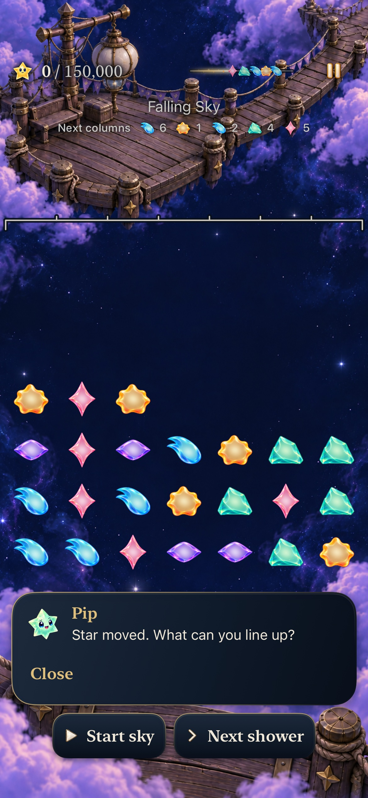
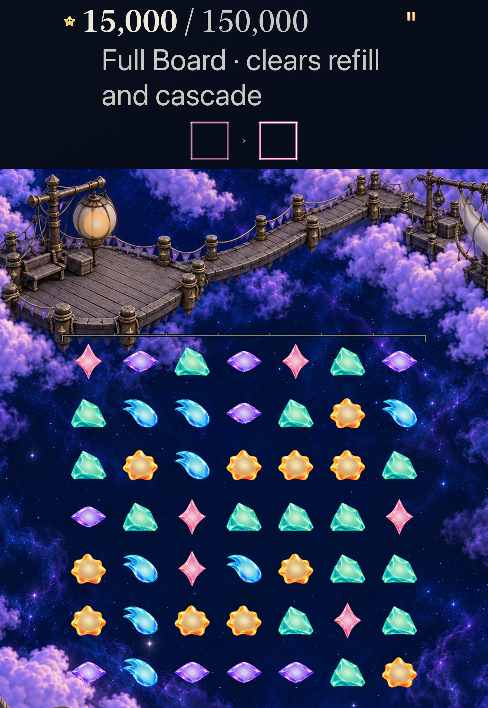
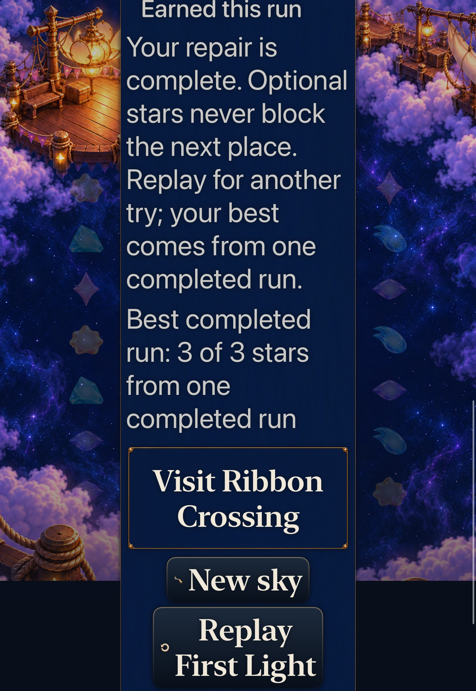
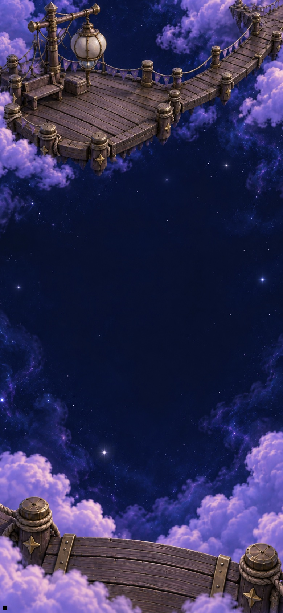
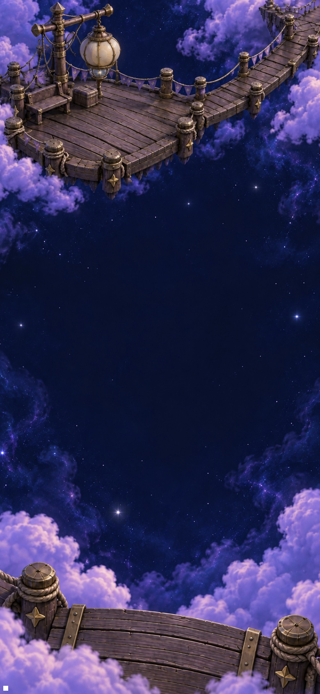

# Lantern answers delivered light

**Status:** Adopted development slice · **Goal:** [#342](https://github.com/lbeezr/starfall/issues/342), identity 7/10 under [#335](https://github.com/lbeezr/starfall/issues/335) · **Accepted checkpoint:** `092ca6e3efc29fdb102bde7dbf17faf336fd685e` · **Runtime:** `dev.7dad281bab`; actual local bundle `dev.local`

Lantern's registered aperture now answers a delivered award below a restoration-painting milestone. A warm aperture and a bounded halo use the current receipt's actual arrival progress. Quiet presentation acknowledges the same committed light directly. Human recognition remains unmeasured.

## One arrival owner, scenery beneath native text

`RestorationEnvironment` draws at its existing registered light rectangle in its existing 24 Hz timeline, beneath native HUD text. `LanternAwardResponse` owns two bounded shapes, with at most 18 points of halo expansion and existing warm materials. It reads immutable `StarlightCelebration` values and the shared `receiverProgress`; it awards nothing and changes no milestone, painting, state or save.

The current award can keep that existing subtree ticking while ambient scenery rests, including paused moves and Full Board. Award motion is separate from the scenery's Reduce Transparency policy, so transparency alone cannot acknowledge a normal flight early. Actual Calm/system reduced motion directly shows a static response. Replacement, expiry, suspension and navigation withdraw the eligible receipt; no delayed response task exists. The root celebration Canvas leaves Lantern acknowledgement to scenery, avoiding duplication, while other locations and Open Sky retain their prior receiver.

Goals1–6's manual topology, selective cues, helper departures, practice, all simultaneous patterns and bounded causal strips remain. Production touches only `RestorationEnvironment.swift`, `StarlightCelebration.swift` and `FallingSkyView.swift`. No Store/Core/rule/RNG/score/clock/archive19/asset changes, no gameplay delay and no reward withholding. Final handoff may truncate decoration; earned success and controls never wait.

## Source-bound checks

| Check | Recorded result |
| --- | --- |
| Core | 352 passed, zero failures/skips; all 68 package/Core/test inputs unchanged |
| Selected hosted | 162 passed, zero failures/skips, at accepted `092ca6e` |
| Debug | arm64 simulator build-for-testing passed |
| Release | Generic iOS Simulator build passed at corrected source |
| Tooling | Three native-planner tests, explicit membership and hygiene/diff pass |
| Native | Three distinct corrected-source methods passed, zero failures/skips: two normal phone journeys and one AX3XL Calm tablet journey |

The 162 hosted checks comprise LanternAwardResponse11, CascadeReturn15, AutomaticPatternReturn14, StarlightCelebration27, RestorationPresentation12, FallingSkyStore51 and TraceInputPolish32. They cover exact current 15,000-point below-quarter and 42,000-point crossing receipts, actual winning repair/Replay, read-only saves/world/deadlines, wrong-location/no-award suppression, invalid geometry, before/after arrival, quiet equivalence and lifecycle cancellation. Fixed-age Canvas checks target the actual scenery owner; synthetic clipping rectangles remain explicitly synthetic.

Corrected runtime source is `67f78c0`. Test-only `912a897` adds the actual composed quiet-body regression; test-only `092ca6e` adds live normal-render sampling. All App/Core/native-test/configuration bytes remain identical across those checkpoints. The final 162-test run actually executed at `092ca6e`; the corrected native phone runs used `67f78c0` and the corrected tablet used `912a897`. Final documentation does not change those recorded inputs. [Verification](verification.json) binds sources, hashes, counts and commands; [capture manifest](captures.json) identifies every original and export.

The normal phone performs inspection, a no-award setup and reversal, then earns 15,000 in Lantern Sky4 while preserving zero showers through Settings, background, relaunch and exact Replay. A separate existing FullBoard6 phone method completes the real 156,000-point repair and Replay. Tablet changes actual Settings Calm OFF→ON at AX3XL, earns 15,000 below quarter, restores/replays exactly, then follows ten production moves to 42,000 and finally 156,000. All intermediate Full Board states retain 49 stars. Genuine repair makes initially locked Ribbon ready; the scrolled final actions and exact zero-score Replay are usable. The tablet method actually executed in 267.547 seconds. No score/board injection or new authoring search was used.

## Inspected appearance and live response

The phone setup leaves the aperture unchanged. On the tablet, the 15,000-point warm aperture is visible before the quarter painting is earned; at 42,000 the same response coexists with cumulative dock illumination. The result retains immediately usable onward/New/Replay actions. These are native game captures, not component previews.

Normal native recordings show the committed figures and flights, but contain repeated timestamps/gaps around the short aperture beat. They do not establish the complete normal pulse. To resolve whether the existing ambient-paused Timeline actually admits a fresh award, a real hosted UIWindow keeps the same Environment identity, waits for delivered display frames, then changes only nil→current immutable receipt. The actual registered aperture remains pixel-identical in 24 pre-arrival samples. Of18 samples wholly inside the shared0.425–0.745-second arrival window,15 show warm change; later samples return to baseline. [Actual sample ages](live-normal-samples.txt) retain admission and readiness diagnostics. No gameplay clock change was needed. This proves live component rendering on Simulator, separately from native full-game interaction and human perception.

Raw products, logs, movies and xcresults are in `/private/tmp/starfall-identity-07-20261024/`; nonpersistent XcodeBuildMCP profile `starfall-identity-07-20261024`. macOS27.0.1, Xcode27.1 (`27A9275`), iOS27.0 Simulator; shared Starfall scheme, local bundle `com.starfall.prototype` version0.1.0/build1. Native resources are the factory-owned iPhone17e and iPadPro11M5, used serially. No physical device operations or package installation.

## Failure that changed the implementation

The first source `7f40344` failed to compile two hosted Canvas references that required explicit `self`. Test-only `81d025d` fixed those references without changing runtime bytes or assertions. Its 159 hosted checks and three native cases passed mechanically, but visual inspection rejected the normal-phone response: the root Canvas clipped against the entire full-width header container, erasing the aperture along with its empty surrounding space. A [native still around266.7seconds](dev-81d025d__rejected-header-clip__iphone-17e__normal-rejected.jpg) retains that rejection. Synthetic clipping coverage could not establish actual HUD placement.

The correction moves the response into its scenery owner beneath text, retains shared arrival timing, and adds a regression for the whole-header counterexample and duplicate-response prevention. It does not alter clocks or hit mapping. Earlier passes certify their own source, not this correction.

The first phone tool response timed out at 300 seconds while the verified owned XCTest continued. Its actual log and xcresult finalized both passes at 318.432 seconds; no case was rerun on that source. Corrected-source phone selectors are dispatched separately to remain within the response limit. Initial sandbox Core manifest compilation ran zero tests because compiler-cache access was unavailable; the same command with authorized cache access passed all352.

One live-regression invocation supplied an unsupported selector field, so its logged command began a broader UI suite. The coordinator interrupted only the verified owned xcodebuild51508; the tool reported one canceled case, zero passes and a result-save timeout. That interrupted run supplies no acceptance. The intended explicit Xcode selector then passed the one live test, and the final explicit seven-class selection passed all162. No assertion, motion setting or product behavior was weakened to obtain green results.

## Remaining evidence

Selected native scope is not the complete Apple matrix. Human recognition/enjoyment, physical reading/smoothness, sustained performance, minimum-iOS17 and actual VoiceOver remain separate. Actual VoiceOver stays deferred. Stills and sampled movie frames do not establish every short body trajectory or physical feel. No new process, witness search, progression, schema or asset family is introduced.
