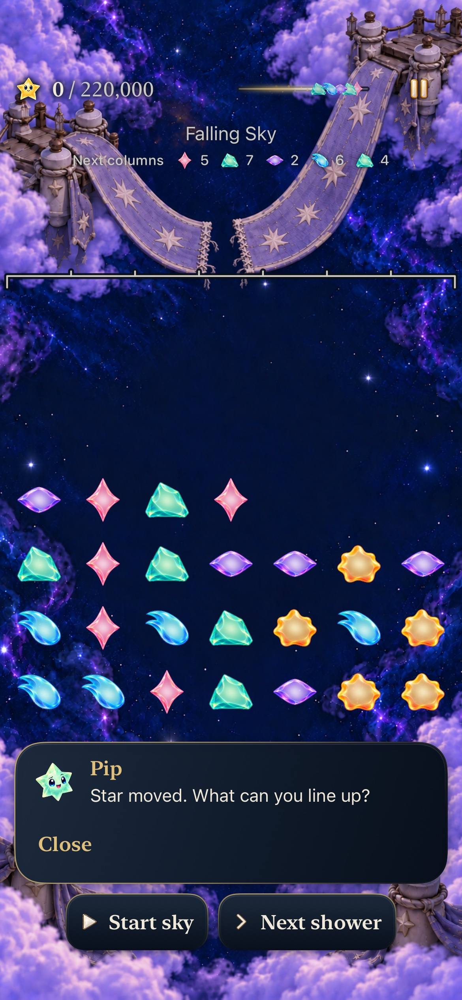
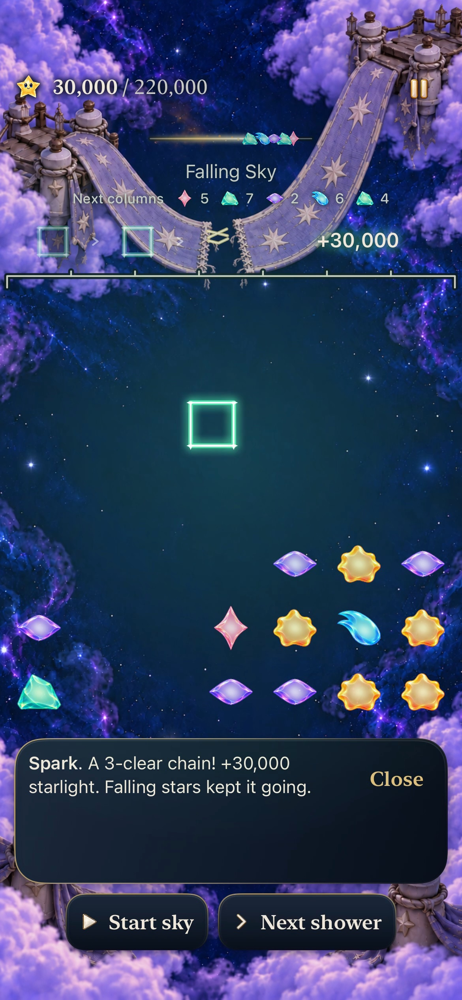
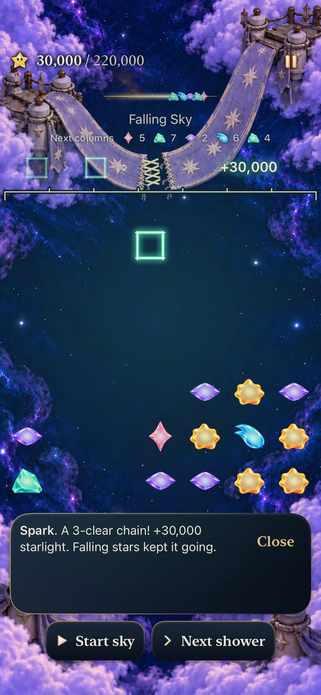
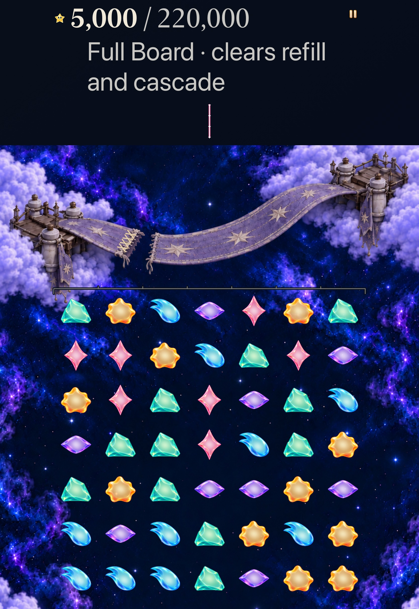
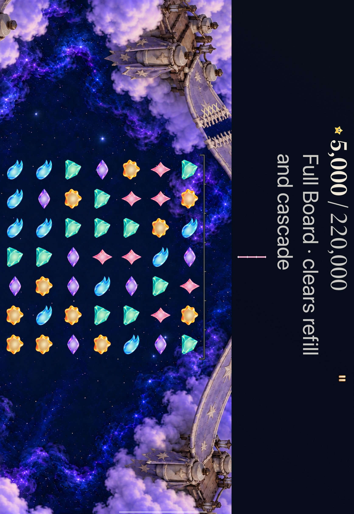
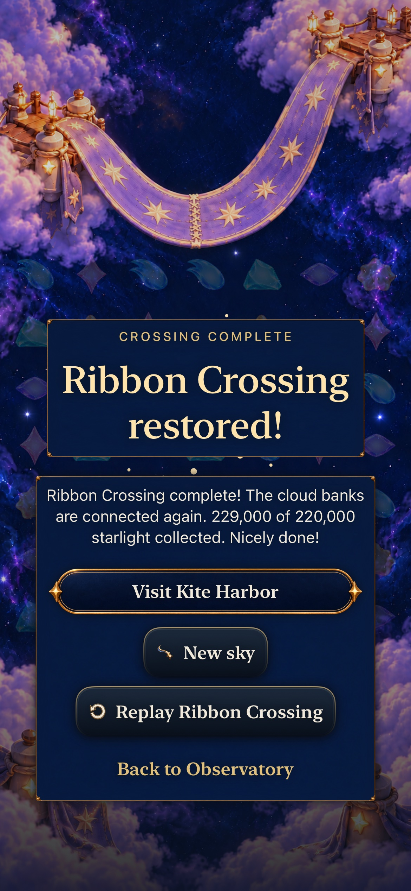

# Ribbon answers through its woven seam

**Status:** Adopted development slice · **Goal:** [#343](https://github.com/lbeezr/starfall/issues/343), identity8/10 under [#335](https://github.com/lbeezr/starfall/issues/335) · **Accepted checkpoint:** `2615c6d81c23d17dcc8149a1a4e04532e36d9ee9` · **Runtime:** `dev.27d1719bfc`; actual local bundle `dev.local`

Ribbon receives a committed award through four short crossed-thread stitches at its registered material seam. The hypothesis is that returning light visibly belongs to this woven bridge before another painting milestone. Normal phone samples show partial threads, the complete figure and cleanup. Actual largest-text Calm tablet captures show the same figure in portrait and landscape. Human recognition remains unmeasured.

## One receipt, local material

`RestorationAwardResponse` shares the existing positive-receipt, finite-geometry and actual-arrival admission between Lantern and Ribbon. Lantern retains its geometry and material math. Ribbon owns eight independent line segments: four crossed threads within a42-point seam and18-point cross-span, using existing pearl/brass strokes. It adds no halo, blur, bridge motion or persistent early repair. Normal presentation reveals successive crosses then fades within the existing0.32-second shared response. Quiet presentation directly shows the same complete temporary figure.

The Environment's existing24Hz Timeline and Canvas draw beneath native text. Latest-only receipt replacement, expiry and lifecycle own cancellation, without another task or timer. Root celebration avoids duplicate material acknowledgement only for these two actual restoration locations; other places and Open Sky retain the generic receiver. Goals1–7 remain. Production touches only `RestorationEnvironment.swift`, `StarlightCelebration.swift` and `FallingSkyView.swift`. No Core, Store, rule, RNG, score, clock, archive19, artwork or asset changes. Input, phases and earned results never wait for decoration.

## Registration follows the painting

The unchanged completed-painting registration places the thread at the join. In damaged tablet paintings that same location is on the receiving frayed edge, rather than the center of the open gap. The response follows that material without drawing a continuous line to the opposite broken end. Phone, portrait-tablet and landscape-tablet axes are local composition data inferred from actual paintings, not a pixel-survey claim. A wide tablet device can still use portrait artwork on a taller scrolling canvas; response and painting use the same composition selector.

## Source-bound acceptance

| Check | Recorded result |
| --- | --- |
| Core |352 passed, zero failures/skips; all68 package/Core/test inputs unchanged |
| Selected hosted |171 passed, zero failures/skips at accepted2615c6d |
| Debug |arm64 simulator build-for-testing passed; test-only correction rebuilt successfully |
| Release |Generic iOS Simulator build passed with identical runtime/configuration inputs |
| Tooling |Three native-planner tests, explicit membership, hygiene/diff and local targets pass |
| Native |Three distinct methods passed, zero failures/skips: normal Sky phone, AX3XL Calm tablet in both orientations, complete normal Full Board phone |

The171 hosted checks comprise RibbonAwardResponse9, LanternAwardResponse11, CascadeReturn15, AutomaticPatternReturn14, StarlightCelebration27, RestorationPresentation12, FallingSkyStore51 and TraceInputPolish32. They compare real5,000-point clears from current Lantern/Ribbon definitions with each local material, and cover before/after arrival, no award/wrong location, exact bounded geometry in each composition, independent paths, quiet equivalence, invalid geometry, actual scenery compositing, root duplicate suppression and current-receipt cancellation. Real Store checks preserve committed score, board, deadlines, world and save bytes through replacement/expiry/Replay; the renderer cannot create outcomes.

Runtime/native checkpoint `6adc17ebf9fbdd572dd681527a445bd563ee58f7` passed the normal Sky phone method. Accepted `2615c6d` changes only one hosted fixture; App/Core/native/configuration bytes are identical. The corrected171-test selection, tablet and complete-round phone actually executed from that prepared source. Final documentation changes one noncompiled `App/README.md` among695 recorded inputs; every runtime/test/configuration input still matches2615c6d. [Verification](verification.json) binds hashes, commands and actual executions; [capture manifest](captures.json) identifies originals and exports.

Normal phone inspects, performs a zero-award setup/reversal, then earns30,000 through three actual current RibbonSky4 phases below quarter. Settings, background, relaunch and exact Replay preserve actual round/world; zero showers is asserted. Its legacy-access fixture permits entry and does not prove newly unlocking a locked Kite. Tablet changes actual Settings Calm OFF→ON at AX3XL, earns5,000 in FullBoard7, restores/replays exactly, rotates to actual device landscape and earns the same5,000 with the same49-star board. Both orientation captures show local threads and an open damaged gap; final portrait Replay returns to zero and restores the original preference. The tablet method ran187.428seconds.

The separate unchanged ordinary-motion FullBoard7 method uses the frozen production route through229,000, preview cancellation, restore, genuine repair and exact Replay. It covers80,000 and179,000 intermediate states, immediate result controls, the same replayed survivors and available new FallingSky4. The method passed in296.761seconds; total result interval306.481seconds. The MCP response timed out at300seconds while the exact owned xcodebuild94822 continued and finalized a passing xcresult. No case reran and no new search, injected winner or score substitution was used.

## Inspected native appearance

Phone movie requests63.2/63.3seconds resolve to actual63.19/63.293333seconds. Later63.59/63.69 samples show cleanup; these later stills alone would miss the beat. Existing movie samples were used without rerunning the case. Sampled frames do not establish every rendered frame, a complete0.18-second body trajectory, sustained performance or physical smoothness.

The same-identity hosted UIWindow independently waits for rendered-frame readiness before adding only the current immutable receipt. Its registered region is unchanged in25 pre-arrival samples;17 of19 samples inside the shared0.425–0.745-second response window show threads, then return to baseline. [Actual sample ages](live-normal-samples.txt) retain admission/readiness diagnostics. This proves live component rendering separately from full-game interaction and human recognition.

## Failure and correction

The first171 hosted run had170 passes and one failure: a positive raw-model raster fixture supplied a synthetic covering-header exclusion to its own painter, clipping all expected threads. Actual scenery/live-body checks passed. Test-only2615c6d removes that exclusion only for the positive raw-model sample; the scenery/overlay counterexample still receives the covering header. Partial-mask, zero-ink, geometry, raster thresholds, lifetime, save and cancellation assertions remain unchanged. All171 then passed. No product workaround, assertion relaxation, quiet override or clock change was needed.

Raw outputs, products, xcresults and recordings are under `/private/tmp/starfall-identity-08-20261024/`, nonpersistent XcodeBuildMCP profile `starfall-identity-08-20261024`. macOS27.0.1, Xcode27.1 (`27A9275`), iOS27.0 Simulator; shared Starfall scheme, `com.starfall.prototype` version0.1.0/build1, actual bundle `dev.local`. Factory-owned iPhone17e and iPadPro11M5 were used serially and confirmed Shutdown after acceptance. Explicit simctl recording output/readiness/file checks and the existing AVFoundation extractor were used; no package installation or physical phone operation.

## Limits and next observation

Selected checks are not the complete current Apple matrix. Uncoached recognition/enjoyment, physical reading/comfort, minimum-iOS17, sustained performance and actual VoiceOver remain separate; VoiceOver stays deferred. Observe whether a player connects an ordinary below-milestone Ribbon clear with the woven receiving edge, recording actual installed build and assistance. That observation does not gate independent goals9–10 or later productive refill.
