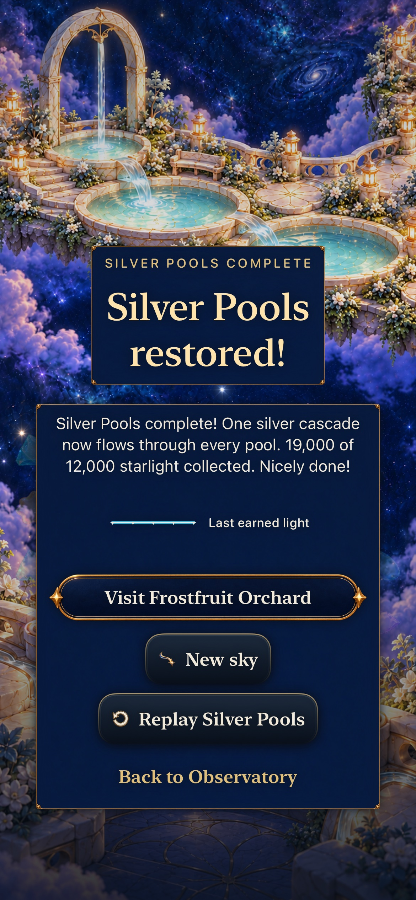
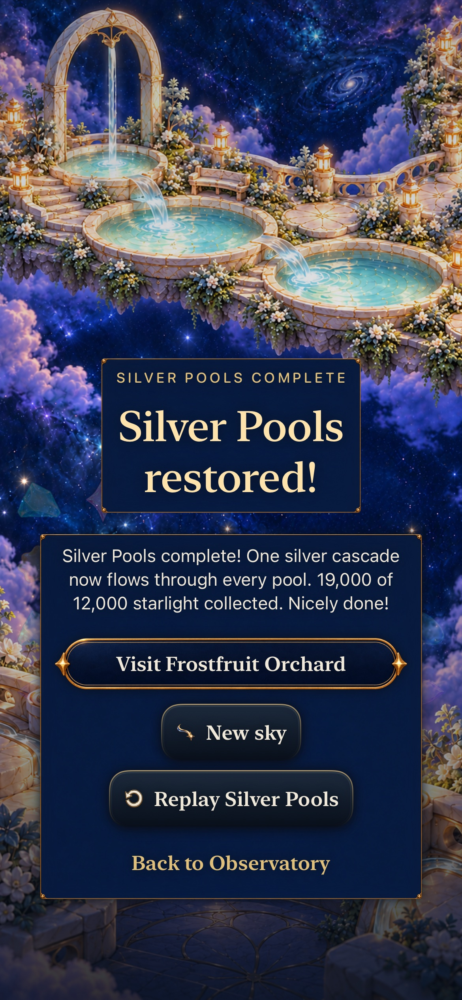
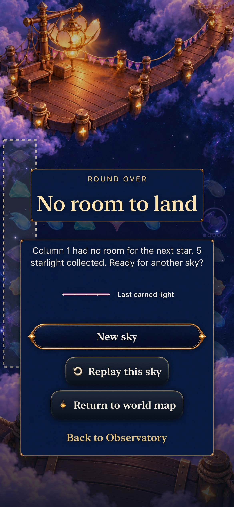
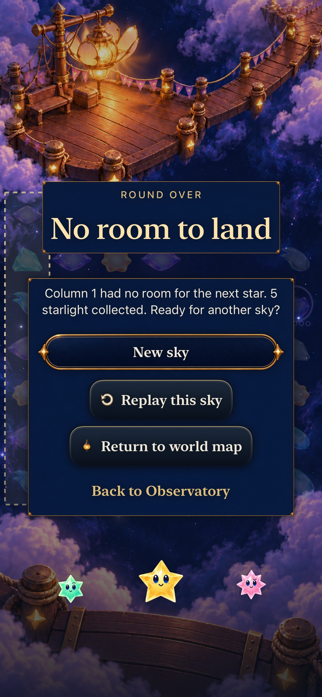
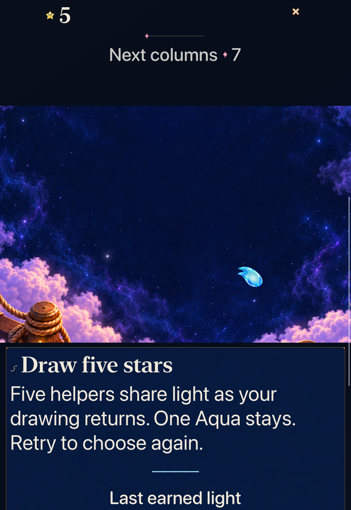
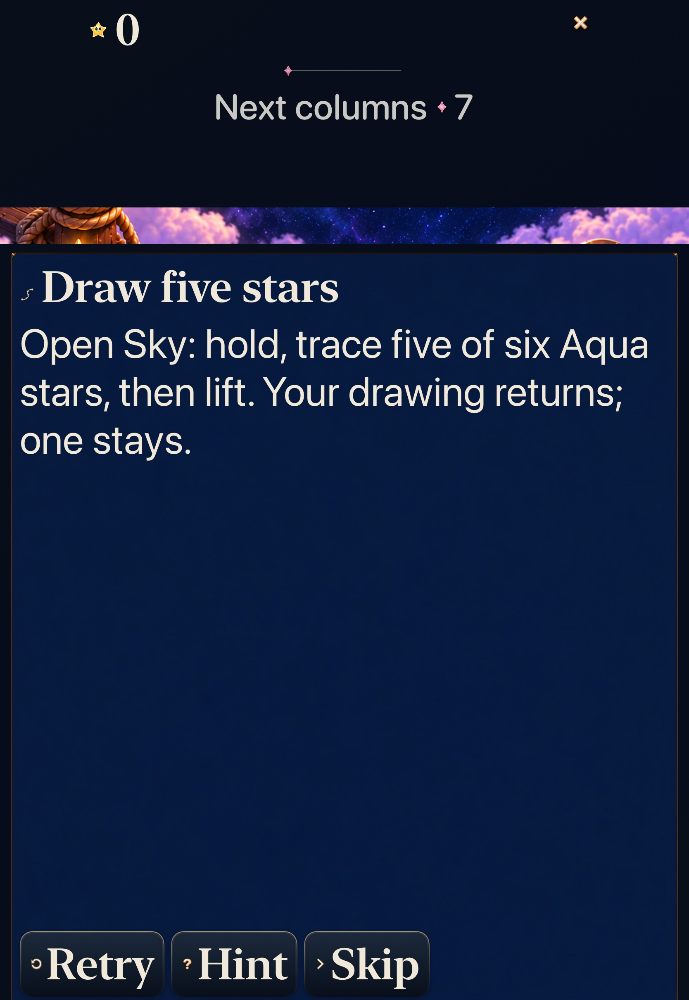
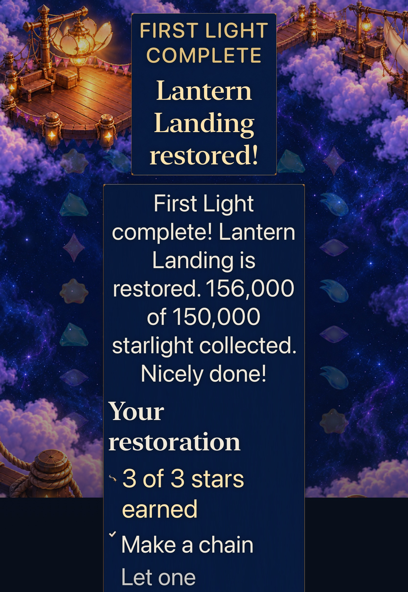
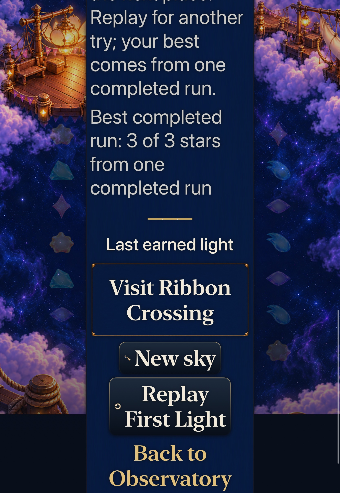

# Last earned light stays with its result

**Status:** Verified development slice · **Goal:** [#344](https://github.com/lbeezr/starfall/issues/344), identity9/10 under [#335](https://github.com/lbeezr/starfall/issues/335) · **Base:** `70f2932ef5df5d2106d2d8b44b1782e67f065c8f`

The immediate result retains a passive echo of the actual last earned constellation or automatic pattern beside its authoritative outcome and next action. A loss calls it **Last earned light**, without implying a repair. A cold-restored ending honestly omits unavailable geometry. This is development acceptance; actual uncoached recognition remains unmeasured.

## One session receipt, exact outcome

`SkyLightReceiptSession` extracts the existing live celebration publication/expiry owner and keeps one immutable `SkyFinalLightReceipt`. Capture comes synchronously from the committed transaction before phase callbacks or terminal teardown can discard board anchors. It retains the final earned phase's separate recipe paths or the exact manual walk, including gaps, revisits and selected drained helpers. A positive award without eligible shape geometry removes an older drawing; a zero-award move or losing shower keeps it honestly as last earned light.

The app-only round generation clears the record on Replay, new round/challenge, fixture replacement and practice reload. Preview/Back, ordinary input changes and settlement preserve the real round. Background cancels live work; the passive result cannot replay sound, packets or a receiver response. Cold initialization has no record, including a saved ending. `SkyResultSnapshot` remains the score/outcome/reason authority. No geometry is encoded or used for awards, ranking or progression.

`SkyFinalLightView` uses one bounded Canvas with uniform scale/translation, separate paths and at most 49 glints. Manual capture admits at most 196 walk entries; automatic capture retains up to 131 actual patterns with at most 8 entries each. Normal and quiet modes deliberately share the same static signature, with no new task/timer. Existing gameplay returns and ceremony motion retain their owners. Result actions never wait for decoration. Successful practice uses its isolated Store and never earns world progression. Both Story modes, exact historical Continue/Replay, archive 19, rules, RNG, scores, clocks and assets are unchanged.

## Source and checks

Runtime checkpoint `afb0496d70666355d8e58d0dd180c18336f72e5a` owns the App bytes. Accepted native-test checkpoint is `0acdcca1f423742380b1c0ba37d785040f0d9942`; runtime fingerprint `dev.207c6a5c5b`, actual local bundle **`dev.local`**, `com.starfall.prototype`, version 0.1.0/build 1. The explicit working-tree differences at native acceptance were noncompiled `App/README.md`, `docs/ENGINEERING.md` and untracked evidence. Final documentation does not recertify changed runtime inputs: all 700 recorded App/Core/test/config inputs are compared by hash, with source checkpoints and prepared-product paths retained in the raw receipt. [Verification](verification.json) records selected source hashes and every completed execution.

| Check | Actual result and source |
| --- | --- |
| Core | 352 passed, 0 failed, 0 skipped; fresh scratch build, 21.288s. All 68 package/Core/test inputs unchanged from base. |
| Affected hosted | 255 passed, 0 failed, 0 skipped at `9fcf278`; 17 new cases plus Store, phase, clock, cascade, receivers, flow, retained mode, Entry return, practice, trace and dialogue siblings. The raw xcresult tree confirms all51 Store methods and255 total; its condensed tool case list omitted one. |
| Native final acceptance |Four distinct methods pass, zero failures/skips in those accepted executions. Across all seven native executions, retain four passes and three earlier failures separately. |
| Debug |Arm64 `build-for-testing`, `ONLY_ACTIVE_ARCH=YES`, jobs 4; final test extension compiled and actually executed. |
| Release |Generic iOS Simulator Release, signing disabled, jobs 4, at the same unchanged App/config inputs. |
| Resources/tooling | 542-key strict catalogue, explicit membership of two App/two hosted/one native files, PBX lint, three planner tests, hygiene and diff checks pass. |

Commands use the existing `Starfall` scheme and Xcode 27.1 (27A9275), macOS 27.0.1. Core: `swift test --scratch-path /private/tmp/starfall-identity-09-20261024/CoreBuild`. Apple execution uses nonpersistent XcodeBuildMCP profile `starfall-identity-09-20261024`, prepared test products and explicit `-only-testing:` selectors, serial testing and unique result bundles. Release uses `xcodebuild -project Starfall.xcodeproj -scheme Starfall -configuration Release -sdk iphonesimulator -destination 'generic/platform=iOS Simulator' -derivedDataPath /private/tmp/starfall-identity-09-20261024/Release CODE_SIGNING_ALLOWED=NO -jobs 4 build`.

The 17 new hosted cases cover pre-callback final capture, separate simultaneous recipes, exact manual topology, positive nonshape invalidation, no-award/loss retention, round/fixture/practice replacement, failed replacement preservation, cold/save isolation, affine fit, malformed geometry rejection, bounded dense footprints, normal/quiet static equivalence, inactive withdrawal and practice reading. An actual synthetic resolver produces 75 recipes/478 entries; it is a resource fixture, not a reachable-save claim. The independent read-only Store/session review found no additional actionable defects.

## Native contrasts and inspected appearance

Both devices run iOS 27.0 Simulator, arm64: owned iPhone 17e `64231AFE-4CDB-4B5A-B6D5-70CD7CEED324` and iPad Pro 11-inch (M5) `255E141F-D4D6-45DA-89FF-51436BF1BBA7`. At most one owned device was Booted; both are confirmed Shutdown after acceptance. No unrelated resource was stopped.

- **Normal Silver win**, `4d02d828`: real current Silver4 exchange 9→10 earns 19,000, shows the actual final line and usable controls, preserves background/Map return, then replays the exact opening. Initially locked Frostfruit becomes ready; every unrelated place stays unchanged. A second earned win cold-restores the same score/outcome/world without a signature. Method 120.073s. Existing-install access admits Silver; this does not claim the earlier campaign was earned.
- **Normal full-sky loss**, `87266e82`: the existing horizontalFive Debug fixture performs a real five-star trace, then reaches overflow through ordinary Next showers. Score stays 5, the last earned drawing survives background/Map, no repair is earned, and cold restore omits geometry. Method 230.446s. This fixture retains historical Dusk generation and is not evidence for modern shower supply.
- **AX3XL actual-Calm Full Board win**, `4d02d828`: Settings is explicitly OFF→ON without a launch override; the frozen ten-exchange production route earns 156,000, both optional goals and 3 of 3 stars. Each complete result reading block and every action is separately reachable, enabled/hittable and inside the actual viewport. The final figure remains after earned Map return, Ribbon genuinely unlocks, exact Replay starts at 0 without a signature, and the observed original preference is restored. Method 227.595s.
- **AX3XL actual-Calm practice**, `0acdcca`: real Lantern Sky4 earns 15,000 at zero showers before entering the existing trace chapter. A real five-star drawing completes practice with one Aqua retained. Its complete passive signature/caption becomes visible through the outer page and inner reading scroll; background retains it. Retry and a canceled four remove it, while exit/Map/relaunch preserve the actual Story round, world and score. Preference restored. Method 193.255s.

Eight exact original-resolution JPEG85 exports were independently inspected. [Capture hashes, original attachments and scroll positions](captures.json) remain source-bound. A screenshot samples one reading position; native methods separately verify the other blocks/actions. Normal phone sampled motion is inspected separately from quiet static appearance.

| Earned in session | Cold restored |
| --- | --- |
|  |  |
|  |  |

| AX3XL actual-Calm practice | Retry |
| --- | --- |
|  |  |

| AX3XL actual-Calm earned result | Lower reading and actions |
| --- | --- |
|  |  |

## Failures retained and remaining limits

The first Debug test compile at `afb0496` rejected ambiguous `.nan`/`.infinity` literals; `9fcf278` explicitly qualifies CGFloat without changing assertions or runtime. First native Silver at `87266e8` earned its win/signature, then exposed an incorrect new world oracle that expected Frostfruit to remain locked. `4d02d828` requires the actual Silver/Frostfruit transitions and all unrelated places unchanged; the full corrected case passes, including its previously unreached cold return.

First tablet practice at `4d02d828` stopped before practice: Pause succeeded, but enabled Next shower was below the viewport(y1341 in a1210-point window). Test-only `7dc2f9c` proves Start sky, reveals through the existing bounded control helper, then keeps enabled/hittable/zero-shower checks. That attempt reaches completion but exposes a second new helper defect: it intersects an offscreen inner scroll with the app, gets an empty viewport and fails before any reveal gesture. Test-only `0acdcca` reveals the visible outer ancestor first, recomputes actual enclosing clips and then the inner reading area. The shared eight-gesture bound, full figure-size/containment checks and passive non-hittable contract remain. The entire corrected practice case actually passes. No product clock/hit-mapping cause, weakened assertion, blanket retry or forced-quiet workaround is claimed.

Explicit-output `simctl io recordVideo` recordings have verified files. Existing AVFoundation decoding, not a new package/ffmpeg, produced inspected whole-journey overviews and 51 requested 0.2-second samples from normal Silver 60–70s, retaining actual timestamps/repeats. These show 5,000→19,000 phase publication, terminal controls/static signature, background and return. They do not establish a complete 0.18-second helper-body trajectory, physical smoothness or sustained performance. The earlier phone shutdown request found it already Shutdown; its owner is unisolated, so no tool is blamed. No capacity failure or unchanged native rerun was used.

Actual uncoached recognition/enjoyment, physical devices, minimum-iOS 17 execution and actual VoiceOver remain separate. No player phone was probed or installed. Revisit signature recognition under #335/#206, or before changing capture, terminal lifecycle, geometry or nested reading owners. No temporary route, new rule, generator, asset family, schema or reward gate remains. Raw logs/products/results/recordings stay under `/private/tmp/starfall-identity-09-20261024/`.
