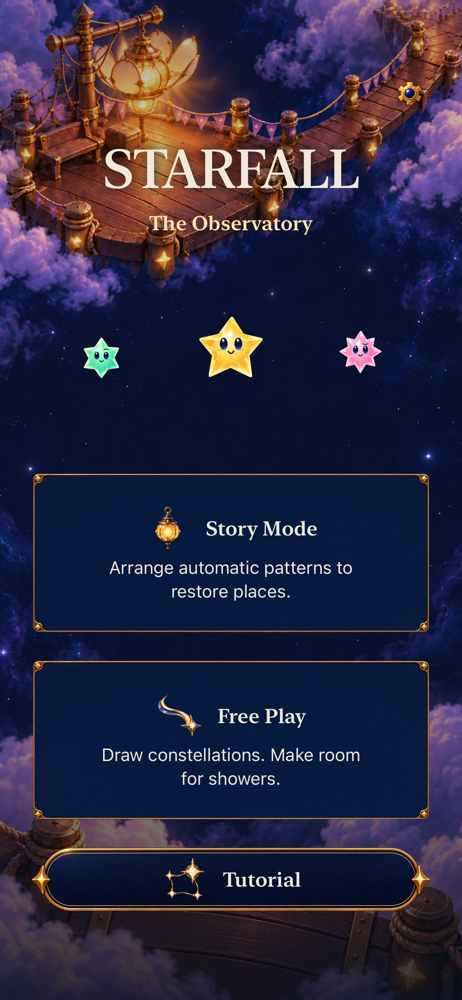
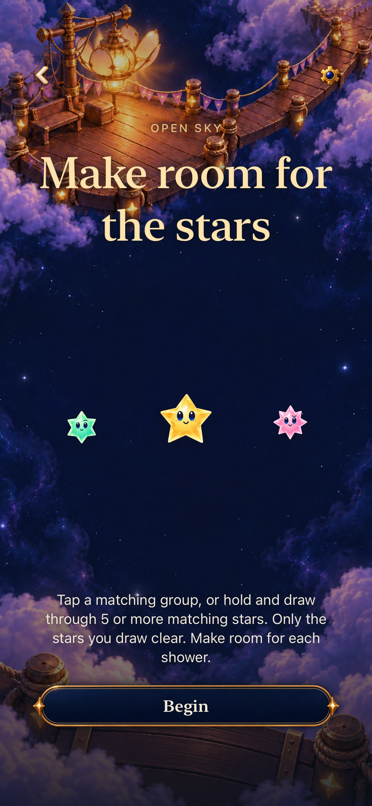
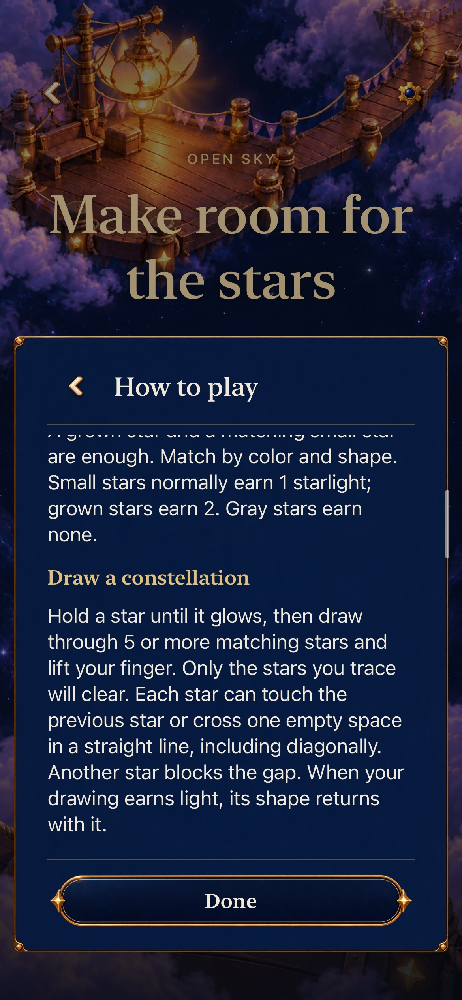
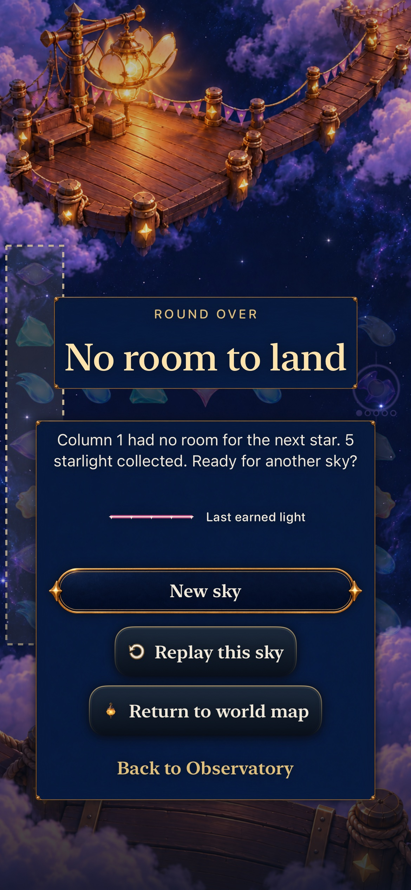
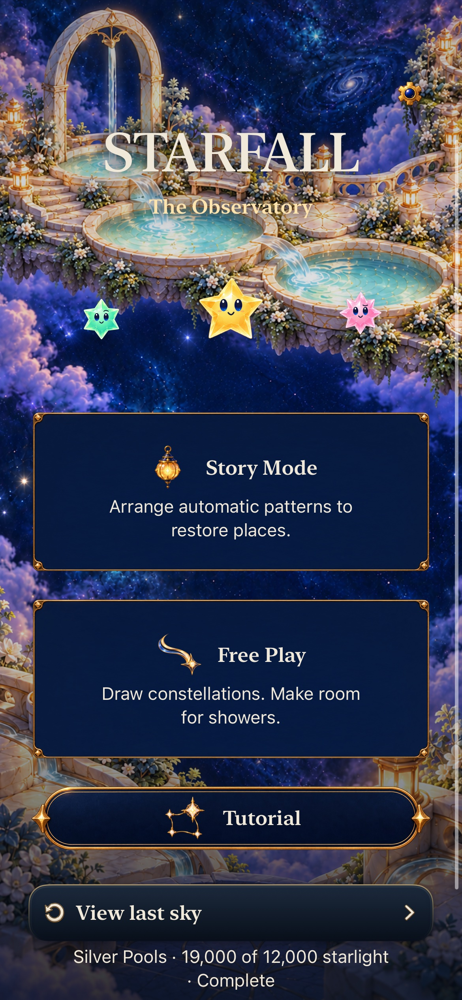
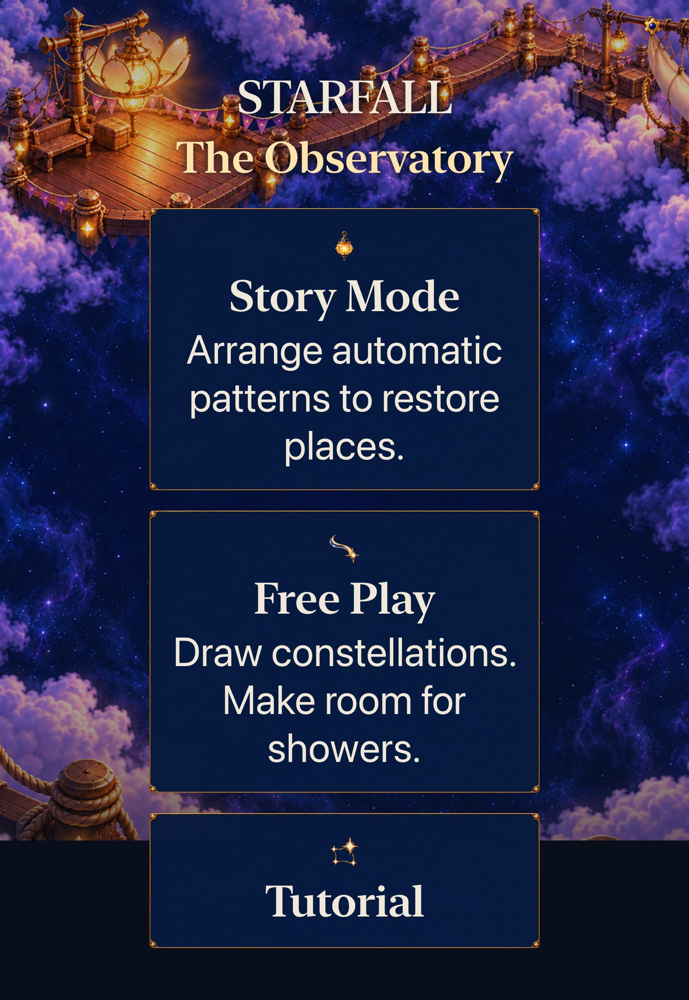
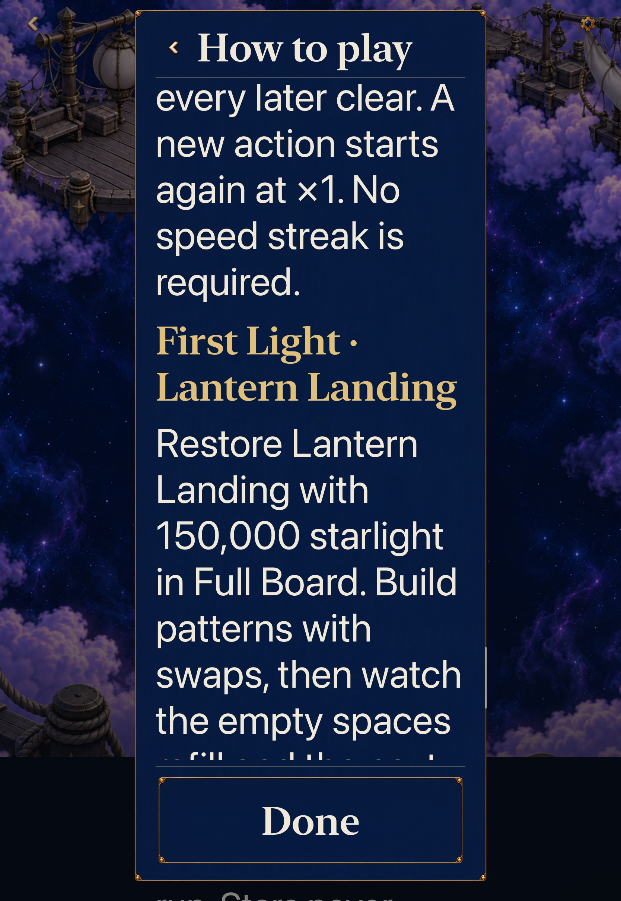
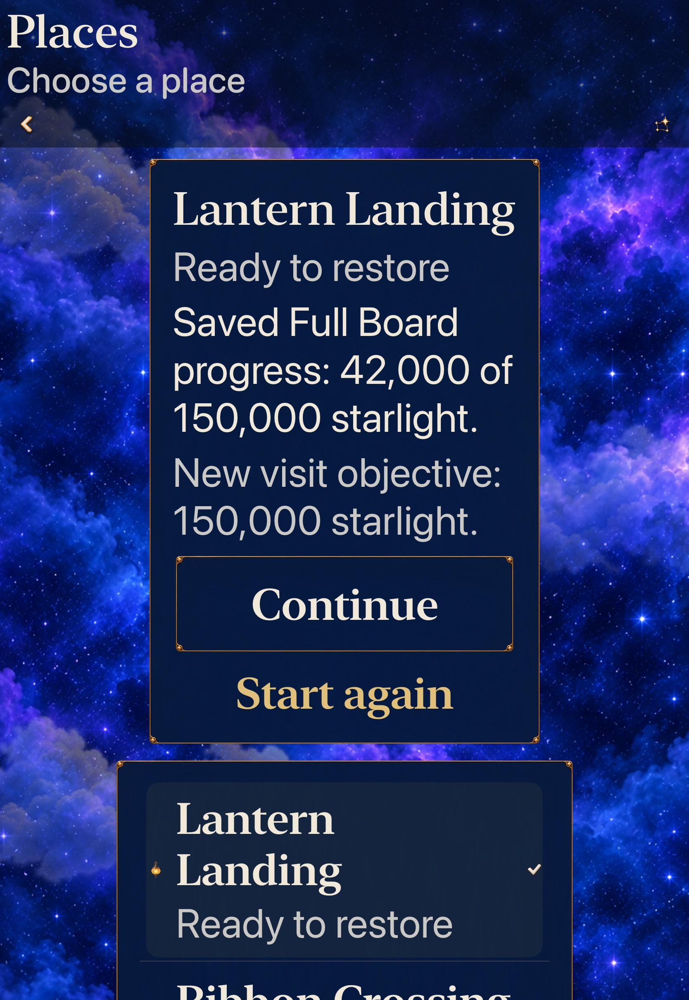

# One promise through Home and returning play

**Status:** Adopted development slice · **Source:** production checkpoint `92f37ab`; final native checkpoint `ea5d275` · **Build:** computed `dev.ea32539b25`, actual local bundle `dev.local` · **Date:** October 24, 2026

[Identity goal10 #345](https://github.com/lbeezr/starfall/issues/345) carries the exact drawings, automatic recipe returns, receivers and final-light signatures into ordinary Home, Entry, Help and returning play. Its hypothesis is that naming each mode's actual action makes the journey easier to understand; native checks can establish truthful instructions and preserved rounds, not uncoached recognition.

Home now pairs Story Mode with “Arrange automatic patterns to restore places” and Free Play with “Draw constellations. Make room for showers.” Native button labels remain literal. Open Sky Entry retains tap as an alternative, explains five chosen matching stars and selected-only clearing; Help qualifies the returned figure on actually earning light. Replay names retained starting sky/shower rules and the Begin replacement boundary. Full Board no longer calls its shipped rules a comparison.

The concrete defect was the unconditional final Help section: an Open Sky context with no restoration acquired fresh Lantern's automatic-pattern 150,000-point objective. `SkyHelpContext` now supplies an optional title/body only from its actual selected challenge/help. Current/historical Story, both Full Board locations and retained Lantern5 keep their exact instructions; previews do not replace the saved round. No Core, Store, score, RNG, clock, archive19, asset or reward behavior changes.

## Acceptance and source

The normal phone contrast uses a real Silver4 swap/repair and an authored historical Open Sky trace/overflow/Replay. The tablet uses actual Settings Calm at AX3XL, FullBoard6 Help and a real 42,000-point clear, canceled previews, exact Continue and explicit Sky4 replacement. The historical drawing fixture does not prove modern shower supply; Silver's existing-install admission does not prove earning earlier campaign access.

Raw commands, logs, products, results, recordings and source manifests are disposable under `/private/tmp/starfall-identity-10-20261024/`. [Verification](verification.json) records exact sources, selected counts, failures and limits. The final delta after `ea5d275` is documentation/evidence only. The recorded 662 runtime/test inputs remain identical; no older count certifies future changed inputs.

## Executed checks

| Check | Recorded result |
| --- | --- |
| Deterministic Core | 352 passed, zero failures/skips; 21.180 seconds; Core inputs unchanged |
| Selected hosted | 87 passed, zero failures/skips on final catalogue/test checkpoint `4ad6799` |
| Normal phone Story | Real Silver4 19,000-point repair, Frostfruit Ready, exact unrelated world, Home/View last sky and cold ending; 135.065-second method at `138a3d4` |
| Normal phone Open Sky | Real five-point trace, overflow without repair, last-earned figure, Replay Entry Back and new zero-score Replay; 265.124-second method at `cd751b8` |
| AX3XL Calm tablet | Complete Full Board Help, real 42,000-point clear, canceled mode/replay previews, exact Continue/relaunch, explicit Sky4 Begin and 15,000 at zero showers; 350.083-second method at `ea5d275` |
| Build/configuration | arm64 Debug build-for-testing, generic simulator Release, target membership, plist, 544-key catalogue and three planner tests pass |

These are selected development checks, not the full current Apple test matrix. Eleven product native executions retain four mechanically passing runs and seven failures. Only three distinct corrected journeys are accepted; the earlier passing Silver journey was visually rejected. Two temporary preference-cleanup methods are separate tooling, not product acceptance, and were removed before the final maintained test build. The final tablet MCP call timed out at 300 seconds while its exact owned XCTest continued; the actual result finalized successfully in 353.227 seconds. Its completed xcresult supplies acceptance; the case was not rerun.

## Inspected exports

Eight original-resolution JPEG exports were independently inspected. Complete short paragraphs and actions fit; long Help is read through overlapping native scrolling, not claimed to fit in one frame. Source and hashes are retained in [captures](captures.json).

The selected Open Sky Help paragraph is complete; unrelated earlier text is naturally clipped at the scrolling boundary. The tablet objective image is an interior position with text continuing above/below, while the test captures overlapping beginning-to-end reading. All fixed headers and Done actions remain readable. The loss image names the last earned five-point line and makes no repair claim.

Existing accepted normal-phone video was decoded at 68 requested positions across 69–90 seconds, retaining actual timestamps/repeated frames. Reviewed samples show Entry-to-play, real arrivals, held five-star selection, release, exact line rising, expiry and the surviving next board. The short helper trajectory is not completely sampled. Initial sandbox decoder/cache attempts failed before export; normal authorized access decoded the existing movie without an app rerun. Native video, exported stills, complete short motion trajectories, sustained performance and human perception remain different evidence.

## Corrections and limits

The initial simulator build began before the new native file had returned and stopped at a missing input. A sandbox Core command compiled no tests because its compiler cache was inaccessible; the same authorized command passed 352. The first phone Silver attempt stopped before gameplay because XCTest rejects an identifier longer than 128 characters; an exact-label predicate corrected the test query. Its next whole journey passed, but visual review rejected the Help-start measurement: the test selected an outer viewport and could capture clipped body text. The focused reader now selects the actual smallest scroll owner, excludes fixed chrome and captures overlapping text from beginning through end. Open Sky's first attempt stopped at its exact spoken label because the expected string omitted “Sunny.” The stronger Silver reader then stopped before gameplay after eight 45%-viewport drags had not reached the deep location section; recording inspection establishes that specific navigation limit. Locating a section now uses at most 80% of the actual viewport while retaining eight gestures; reading still advances in overlapping 45% steps. The historical fixture encodes one prior shower, and its ordinary Begin and Replay run the automatic clock. Recorded pauses showed two showers, so its new test now records those real arrivals instead of assuming one or zero; its exact five-point clear, zero-score Replay, world and post-pause counter checks remain. Current Story still requires zero showers. No product workaround, assertion weakening, forced quiet setting or speculative clock change ships.

The earlier Begin→Settings recording remains unisolated. Source review found asymmetric action-time checks, but no demonstrated clock fault; the ordinary admitted menu/pause journeys do not establish rapid-input latency or an exclusive cause. Physical iPhone/iPad comfort, minimum iOS17, actual VoiceOver, sustained performance and uncoached recognition remain separate. [The existing #206 packet](../../design/CURRENT_STORY_PLAYTEST.md#mode-and-return-observation) adds a neutral observation prompt without collecting answers or adding a development gate.

The tablet reader's first attempt reopened Help at its top, exhausting the existing eight navigation gestures before the deep objective. The final test reads refill then objective in one continuous visit, retaining eight-gesture bounds and overlapping reading. The next attempt found a test oracle saying “Continue” where the actual retained action is “Continue sky”; the exact literal oracle was corrected. Final accepted native bytes include both changes.

Original Calm was ON, independently established by the first tablet activity log. A temporary cleanup initially assumed OFF, then actual UI restored the demonstrated original ON; those two temporary methods and results remain separate raw receipts. The final maintained tablet case operates Settings OFF→ON without a masking launch override and restores ON. All review saves/preferences are isolated test domains; no physical phone or player data was touched. Both factory-owned simulators were confirmed Shutdown afterward. No unrelated resource was stopped.

No temporary product route remains. Retain this correction and the shared existing owners. Revisit the mode promise and return expectations at the next uncoached #206 session, or before changing Home, Help-context admission or Entry replacement ownership. Development acceptance does not close the identity parent's actual recognition question.
