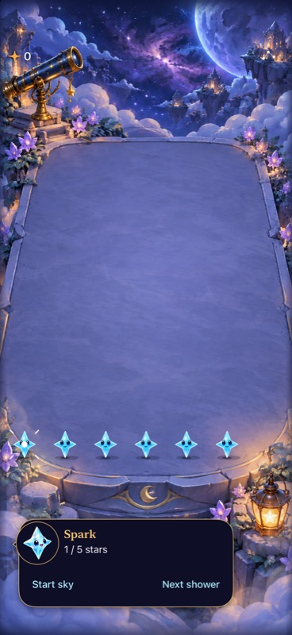
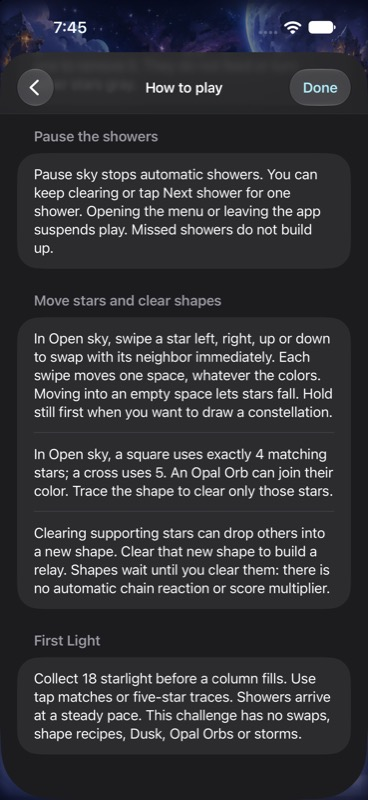

# Immediate four-direction swipes

**Result:** Partially verified · **Owner:** current implementer · **Date:** October 18, 2026

Movement now commits one exchange immediately; a stationary 300 ms hold selects constellation drawing. Neighbor color never changes gesture meaning. [Acceptance contract](../../design/IMMEDIATE_SWIPES.md) was written before implementation. Development checks establish deterministic behavior and simulator interaction; physical timing/comfort and actual VoiceOver remain unverified.

**Next action:** observe physical thumb play after the [individual canonical delivery](../gesture-delivery-2026-10-18/README.md). Development checks and merged-source identity are verified; physical comfort and actual VoiceOver remain open. Earlier verification below retains its original source.

## Outcomes against acceptance

| Criterion | Observed result | Limit |
| --- | --- | --- |
| Immediate four-direction exchanges | Production surface commits before release; native short strokes and all four directions pass, including maximum text | Contact-to-display latency is not measured on phone |
| Consistent color handling | Same-color strokes swap once; holding the destination does not arm drawing or repeat | Identical-looking stars can move without a visible color change; identities and ages still move |
| Hold then draw | Timer and cancellation tests pass; native held five-star path clears only five and leaves the sixth | The 300 ms duration and glow/haptic cue still need human comfort review |
| Incomplete/invalid held paths | Any colored star can begin; incomplete paths never fall back to tapping/swapping. Held Opal/Dusk cannot switch to an exchange | Opal/Dusk mode locking is covered in hosted state tests |
| Lifecycle and saves | Generation, resize, disable, detachment, multitouch and stale-timer checks pass; Settings/background and deterministic save continuation pass | No new save schema or resource membership |
| Animation | Native SpriteKit checks observe lateral slide then fall and upward motion even when gravity returns the star to its origin; quiet mode keeps the outcome | Still captures below establish appearance only |
| Accessibility | Largest-text vertical swaps pass; native accessibility controls retain four explicit Move actions and non-color labels | Actual VoiceOver is deferred to RC |

The reported failure came from ambiguous trace-versus-swap arbitration and release-only commitment. The physical-input owner now has pending, drawing and consumed states. A consumed contact cannot choose a second action from later movement, release or a stale timer. Core owns legal orthogonal exchanges and normal settlement. First Light still rejects exchanges; ordinary group clearing remains deliberate.

The examined sibling paths include coalesced/final-only samples, scroll arbitration, logical contact/clock ownership, accessible actions, Core neighbor legality, archive restore and scene identity movement. Direct exchanges unlock after their 140 ms slide; exchanges requiring gravity settle for another 200 ms. Moving columns still reject conflicting input; unrelated available columns remain usable. This protects committed rules but leaves rapid-retouch comfort as a phone check.

## Verification context

**Source:** Base `99803b38abf044bb2d0247acf79de70ac2410b7e` plus the explicit source/test hashes in [source-snapshot.json](source-snapshot.json). Final runtime build `dev.b8688c35ad`. The comprehensive hosted/native gesture checks and captures use `dev.cf23e7e034`, recorded in [gesture-source-snapshot.json](gesture-source-snapshot.json); the sole subsequent runtime difference updates the Debug review fixture sentence from “swipe and hold” to “Swipe to move, or hold then draw a recipe.” The final copy/build checks cover that change. Documentation changes are excluded from the runtime identity. No dependency, target, build-setting or save-schema changes.

**Environment:** Xcode 27.1 (`27A9275`), Swift 6.4, iPhone 16 Pro Max Simulator / iOS 27.0 (`24A434`), device `5107CBBF-108B-4B94-9125-A873F948A38C`. Normal motion unless the named check explicitly covers quiet mode.

| Check | Result / artifact |
| --- | --- |
| `swift test --disable-sandbox` | 168 pass; `artifacts/immediate-swipes/core-final.log` |
| Debug simulator test build | Pass; current source compiled by the final native/hosted runs |
| Release simulator build | Pass; XcodeBuildMCP log `build_sim_2026-10-18T23-46-15-503Z_pid62736_a9c962db.log` |
| Focused final gestures | 47 hosted checks and all 11 technique UI checks pass; selected Opal trace passes. Two pre-existing UI expectations initially still failed; corrections are recorded below. `final-gesture.xcresult` |
| Full hosted suite and corrected legacy UI | 271 hosted + 2 corrected UI pass, zero failures/skips; `final-hosted-and-baseline-fixes.xcresult` |
| Final Debug fixture wording | 22 affected hosted + 1 held-drawing UI pass, zero failures/skips; `final-fixture-copy.xcresult`; Core 168 and Release build pass again |
| Earlier integration breadth | 45 hosted + 27 of 30 UI pass; three failures also reproduce on unchanged baseline. Includes normal/rapid input, held tracing, restart, First Light win/full sky/restore, background, Settings dismissal, system Reduce Motion and large text. This run predates the last hold-eligibility/settling refinements and is supporting evidence, not final-source certification. `focused-native-2.xcresult` |
| Hygiene | `python3 scripts/ci-hygiene.py` and `git diff --check` pass |
| Physical device / actual VoiceOver | Not run; canonical delivery and RC acceptance remain separate |

Build/test commands use project `Starfall.xcodeproj`, scheme `Starfall`, the simulator above, `-sdk iphonesimulator CODE_SIGNING_ALLOWED=NO ARCHS=arm64 ONLY_ACTIVE_ARCH=YES`; tests additionally use `-parallel-testing-enabled NO` and named `-only-testing` selections. Explicit arm64 resolves the initial default build attempting x86_64 app compilation against an arm64 package module, without project changes. Core uses `CLANG_MODULE_CACHE_PATH=/tmp/starfall-swipe-clang SWIFTPM_MODULECACHE_OVERRIDE=/tmp/starfall-swipe-clang` because the sandbox cannot write the default user module cache.

## Failures investigated

The initial all-hosted run had one incorrect new assertion that a committed exchange should retain its logical contact. Existing presentation deliberately retires that ticket. The corrected test asserts retirement, committed state and harmless release; focused and full final reruns verify it.

Three older native tests failed identically in an untouched `git archive HEAD` baseline: Opal reward/value expectations predated feeding-Dusk adoption, and a dialogue-ending expectation predated current timing/Dusk copy. The retained trace earns 7, ending at 19; the shared drained Opals contribute no reward, ending at 27 after the colored tap. Current dialogue ends with the Dusk forecast after the cadence sentence. Updated assertions check these exact values and retain board, layout, tap, resume and viewport assertions. No runtime scoring/copy was changed to satisfy these tests. The first correction run exposed the drained-orb value and trailing Dusk sentence; those expectations were then corrected from the existing Core/catalogue contracts.

Raw xcresults, exports and logs stay under ignored `artifacts/immediate-swipes/`; XcodeBuildMCP build logs are in its workspace log folder. The broad run exceeded the tool's 300-second response timeout, but its underlying xcodebuild completed and its xcresult was inspected; subsequent batches were bounded.

## Inspected native presentation

**Inspected native XCTest capture — `99803b3` plus snapshot `cf23e7e034`, Debug, iPhone 16 Pro Max / iOS 27.0 Simulator, default text, full motion.** After a quick same-color swap, holding then drawing clears exactly five; the sixth remains. This redundant 3.9 MB frame stays in disposable `final-gesture.xcresult` output; the distinct armed-state and Help captures below are retained. The maximum-text vertical-swap frame was also inspected: the board stays intact while the large dialogue continues below the viewport and requires scrolling. These are sampled appearance checks, not measured latency or device feel. Existing artwork references remain source-bound; no historical frames were deleted because their coverage differs.

| Drawing armed | Updated Help |
| --- | --- |
|  |  |

**Native simulator captures — same `cf23e7e034` source and device, default text, Calm effects off.** Split touch-down/up inspection shows drawing armed before lift, with the count visible; haptic feel is not established by Simulator. Help was scrolled through the updated movement section and Done was activated. The live snapshot tool sometimes required a fresh snapshot after touch/scroll actions; these driver refresh warnings did not indicate app test failures. Help/rendering code is identical in final `b8688c35ad`; only the Debug fixture introduction differs.

**Fast-play follow-up:** the user identified rejected rapid follow-up touches as a likely frustration. A short, single-intent buffer tied to stable star identity is the recommended next investigation, with immediate registered feedback and bounded expiry. It is not implemented in this batch. Validate same-star retouch, disappearing stars, changing neighbors and lifecycle cancellation before accepting any deferred action; never replay a stale cell coordinate onto a replacement star.

## Current-main integration

The foundation was reconciled with `9aa4d7d4e715a52e729d498696bcdc4471e5f9b9`, retaining its automatic-aging retirement, save migration and the preceding feedback-order ownership fix. Local source `4a0b9e2` plus test-only correction `f8da265` has runtime identity `dev.5294727fd1`. It is independent of the uncommitted follow-up buffer in the working checkout.

- Core: 169 pass. Affected hosted plus three physical-driver UI checks: 71 pass, zero failures/skips, including four directions, same-color swap then five-star hold/draw, and maximum-text vertical strokes. `aging-integrated.xcresult`; Release build passes (`build_sim_2026-10-18T23-56-36-757Z_pid62736_efb2a8b6.log`).
- Clean export of `f8da265`: all 272 hosted tests pass, zero failures/skips. The export contains no follow-up-buffer changes. Result `/tmp/starfall-buffer-baseline-9aa4d7d/foundation-final-hosted.xcresult`; log `test_sim_2026-10-19T00-15-11-696Z_pid62736_de9feb09.log`.
- Integration uncovered a historical crowded-award fixture that assumes aging still removes stars: unchanged main `9aa4d7d` reproduces every failure. Seed 28 now overflows at shower 15. Test-only `f8da265` selects its still-live 12-shower state, asserts 33 occupied stars, and preserves the eight-point award, independent match, four layouts and full-motion checks. The corrected test passes both in the clean foundation export and with the later follow-up working source.
- Publication is blocked by automatic approval review's request for explicit permission to export changed files to the public `lbeezr/starfall` repository. The connected account, repository ownership, push access, git origin and canonical updater destination were verified before the second rejection. A repository-specific approval question is pending. No pull request, merge or physical installation is claimed.

Earlier source-bound captures remain unchanged. The current-main checks establish compatibility with the newer rules, not current phone feel or actual VoiceOver acceptance.
