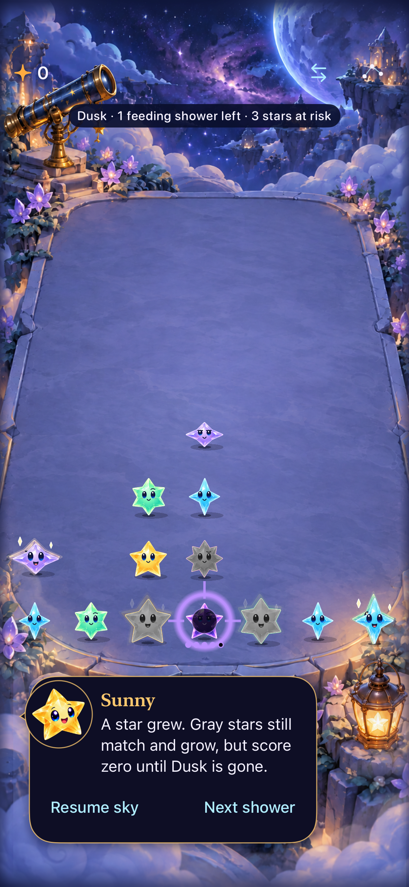

# Responsive gestures and a slower Dusk

**Result:** Verified development checks · **Owner:** current implementer · **Date:** October 18, 2026

Physical contacts now reach one recognizer before scroll arbitration can delay UIView touch delivery. Swaps arm after 150 ms instead of 350 ms, and incidental unavailable samples preserve a live trace. A physical-contact ticket and cancellation check prevent an expired dwell task from arming another touch. Dusk takes five feeding showers, with explicit save migration retaining accumulated feeds. Core, affected hosted suites, 12 distinct native scenarios and Debug/Release checks pass across the source-bound batches below. Physical feel and actual VoiceOver remain unverified.

**Next action:** Observe curved/branching swipes and fast repeated actions on the phone. No phone installation was performed.

## Acceptance and results

Criteria were recorded before implementation: immediate contact ownership despite a scroll container; a 150 ms neighboring-cell dwell; incidental sample misses preserve the selection; every terminal/reset event releases its clock hold; stale timers cannot arm a new physical contact. Settings, background, restart, resize and multitouch still cancel stale contacts. Changing columns remain protected until landed. Five-feed adoption preserves board, score, preview, RNG and existing feed counts; historical three-feed Core replay remains supported.

| Check | Result and limits |
| --- | --- |
| Core and save rules | 148 tests pass. Mixed seeded continuation covers 80 seeds across historical/current generations under both feeding rules. Focused adoption preserves progress and lost light; historical three-feed collapse remains exact; new-rule encode/decode continuation, replay, First Light exclusion and save validation pass. |
| Hosted stores/presentation | 88 affected checks pass before the final physical-contact ticket addition. Includes v5/v6 → v7 migration, no older-save fallback after current corruption, save-before-animation, stale callbacks, independent columns, clock holds, interruption, and sampled full-motion exchange/collapse. |
| Final contact-ticket checks | 18 focused TraceInputPolishTests and SkyTechniqueStoreTests pass after the ticket addition, including physical-contact replacement, cancellation, surface lifecycle, selection expiry and full/quiet exchange motion. Five-feed Dusk material/full-motion checks also pass in a final six-test hosted run. |
| Native tracing and recovery | Six distinct checks pass: chosen-five clearing/restore, stationary contact across a shower deadline, largest-text drawing/menu dismissal, multitouch/background recovery, slight ordinary-tap drift at normal/largest text, incomplete/outside trace cancellation followed by usable input. |
| Native Dusk | Three checks pass: five feeds/collapse/settings/background/restore, early release/valid zero reward, and actual system Reduce Motion with Accessibility XXXL threat/outcome controls. |
| Native swap/scroll and endings | Signed run passes quick-flick rejection, 200 ms held exchanges/empty-space fall, subsequent ordinary clear, largest-text quiet scrolling/recipe controls, and First Light win/full-sky/replay/restore. The final physical-contact ticket also passes the identical native swap case on Physics Review. |
| Build and hygiene | Debug simulator build/tests and Release arm64 simulator build pass. `python3 scripts/ci-hygiene.py` and `git diff --check` pass. No new target source files or dependencies. |
| Actual VoiceOver / physical device | Not run: development cadence; phone feel and release-candidate acceptance remain separate. No frame-latency measurement or human enjoyment claim. |

## Source and reproducibility

Base `11a16fc`; this workspace originally contained clean `f35eba8`, which predates the reported mechanics. [Final changed-input hashes](source.json), snapshot `5ebdafd5f3eb`, identify the tested working tree. [Earlier input hashes](source-before-contact-ticket.json), snapshot `3cded269c037`, differ in the final contact ticket/test and hosted five-feed material/motion fixture coverage; Dusk rules and presentation inputs are identical. The portable mixed-rule loop was expanded after the first native build; runtime rules were unchanged. All changes are in the normal app; no lab product, route or extra install identity.

Xcode 27.1 (27A9275), Swift 6.4, arm64, iOS 27.0 Simulator (24A434). Initial native checks used iPhone 17e / Crystal Glow QA `D65C5E40-734F-42BF-8F91-97E980ED19C2`; signed Dusk checks used Forecast Fallback QA `1E9DCEF5-BF64-4052-AF8D-A6A205F711EE`. Final hosted ticket checks used Physics Review `1199FBAF-FCA7-4F0D-BD49-8282154CC9EE`. No simulator was created, erased or shut down. Motion is normal except the dedicated actual Reduce Motion method, which restores its original setting.

Commands: `swift test`; `xcodebuild -project Starfall.xcodeproj -scheme Starfall -configuration Debug -destination 'platform=iOS Simulator,id=<ID>' -derivedDataPath /tmp/starfall-input-derived -parallel-testing-enabled NO -collect-test-diagnostics never ARCHS=arm64 ONLY_ACTIVE_ARCH=YES test`, selecting the suites/methods above with `-only-testing:StarfallAppTests/<suite>` or `-only-testing:StarfallUITests/<suite>/<method>`. Early runs used `CODE_SIGNING_ALLOWED=NO`; final signed runs use `CODE_SIGN_IDENTITY=- CODE_SIGNING_ALLOWED=YES DEVELOPMENT_TEAM= CODE_SIGN_STYLE=Manual`. Release uses `/tmp/starfall-input-release`, `-configuration Release -destination 'generic/platform=iOS Simulator' CODE_SIGNING_ALLOWED=NO build`.

Raw logs/results remain under `/tmp/starfall-input-*`: `core-final.log`, `hosted-qa.log`, `ticket-hosted-physics.log`, `release-final.log`, `native.xcresult`, `native-recovered.xcresult`, `signed.xcresult`, `final-swap.xcresult`, and `final-dusk-hosted.log`. Relative documentation links were checked; rendered Markdown was not inspected.

## Findings, failures and remaining scope

The source investigation found split ownership: the recognizer arbitrated scrolling while UIView callbacks owned game contact, move and release. UIKit could therefore delay or cancel delivery before the store held its shower clock. Moving the complete contact stream into the recognizer removes that dependency; reset cancellation shares the same terminal route. A second mechanism treated `enabled == false` for one incidental sample as a reason to destroy the entire trace. Availability now rejects only that sample, while changed board/generation still destroys the stale selection and final commit still checks ownership. Dwell completions check task cancellation and physical-contact identity in addition to board generation, so matching coordinates on a later touch cannot revive an earlier timer.

Related paths examined: ordinary taps, selected traces, direct exchanges, Arrange actions, accessibility tracing, shower deadlines, independent-column completion, settings/background/motion/scene invalidation, and Dusk warning/material/save owners. This is a bounded audit, not proof that every possible blocked action is eliminated. Landed-state ownership still intentionally rejects actions against changing columns.

Failed attempts remain evidence: the first native build omitted the repository's arm64 override and could not resolve StarfallCore for x86_64; the corrected arm64 build passed. The original iPhone 17e hosted runner stalled before assertions and was cancelled. A larger native run passed three cases, then its held-touch case timed out while XCTest waited to launch the app; a captured runner stack locates that launch wait. Restarting only the selected simulator's testmanagerd let the identical held-touch case pass. A following run passed that case and both ordinary-input cases, but its Dusk case was killed before setup/actions; it was not a gameplay assertion failure. A further focused run could not prepare a result bundle and was cancelled. Signed checks on another already-booted QA simulator then passed all three Dusk methods. The final ticket-hosted attempt on the affected simulator also stalled before assertions; the same focused suites passed on Physics Review. No assertions, animation settings or waits were relaxed. Two initial flow selectors named the wrong owning class and selected zero tests; the later run uses SkyFlowInteractionTests explicitly.

Observe physical swaps near a shower deadline and curved/branching draws next; tune the existing dwell only from that observed behavior. Full actual VoiceOver acceptance stays at release candidate. [Engineering follow-up](../../ENGINEERING.md#gesture-ownership-refinement--october-18-2026) records these limits.

## Inspected native presentation

**Runtime capture:** iPhone 17e / iOS 27.0 Simulator, normal motion, default text; 0.1.0 (1), `dev.local`, base `11a16fc` plus snapshot `3cded269c037`. The final contact-ticket addition does not change these presentation inputs. [Capture provenance](capture.json). Five marks and the final warning remain visible above the paused guide; screenshots do not establish animation or physical feel. The largest-text recipe control attachment was also inspected: its description wraps and Clear square/Cancel remain visible after scrolling. Raw captures stay disposable. The original three-feed captures remain unique historical rule evidence.
