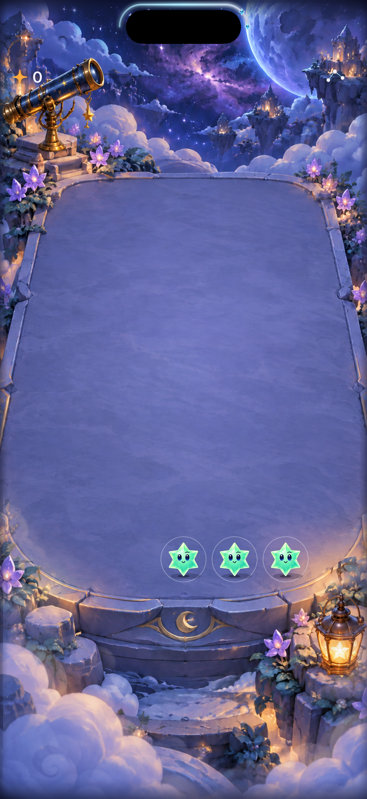

# Try a starlight curve above the camera island

**Status:** Historical trial; superseded by [production adoption](../shower-forecast-adoption-2026-10-17/README.md) · **Owner:** Current implementer · **Date:** October 17, 2026

Hypothesis: an aqua upper-contour countdown feels integrated with the camera island and clears the HUD. A temporary Debug launch argument, `--island-timer-review`, selects the presentation in portrait phone layouts with sufficient top inset. Release and ordinary launches keep the existing timer. No rules, persistence, scheduling, network or ActivityKit changes.

## Acceptance defined before native verification

- One timer reads the existing shower deadline; no new clock, callbacks or saved state.
- Fine vector stroke and a small head (extended at the user’s request to ordered incoming-star miniatures) stay outside the camera area and screen edge, including full-motion arrivals. Inspect a native island phone capture; simulator screenshots alone may omit the hardware mask.
- Pause, menu, background, restart and ending hide the curve without stale completions. Existing input remains usable.
- VoiceOver and accessibility text use the existing safe-area HUD; Calm and Reduce Motion retain progress without decorative glow. Small phones/tablets retain the original layout.
- Core, affected hosted/UI tests, Debug/Release simulator builds and hygiene pass; distinguish visual, motion, actual VoiceOver and physical checks.

**Decision point:** After native layout/interaction checks, show the user the running candidate. Adopt only after device fit and preference review, or remove the temporary argument/profile. The initial contour is calibrated artwork, not inferred hardware geometry; a public camera bounding-box API is not assumed.

## Candidate and verification

The user extended the trial to a forecast: up to five actual cast miniatures follow the upper contour, first committed arrival leading toward the right. `FallingSkyStore.forecast` supplies the ordered snapshot, including the current arriving wave during presentation. Core consumes that array in order and the scene staggers that same order by 0.09 seconds. No new generator or forecast cache exists. Ten-point miniatures may be too small for reliable recognition; that is a review question, not accepted usability.

The 148pt contour encloses a 126×37pt black capsule at y=11. Artwork backing makes app-only captures intelligible; it does not prove that hardware or an expanded system activity matches the profile. The lower half is unused. No health, mana, charge or danger rule is added.

**Source:** `f35eba87311f5e9e56740b9677bceb699154e8ae` plus the working-tree changes in `App/FallingSkyHUD.swift`, `App/FallingSkyView.swift`, `App/StarfallTheme.swift` and `UITests/FallingSkyInteractionTests.swift`. No new files require target membership. Not clean published-commit acceptance.

**Environment:** Xcode 27.1 (27A9275), arm64 host, iPhone 17 / iOS 27.0 simulator `A1C67F9D-6F58-4FB6-A842-D968783CDD2D`. Raw logs/results: ignored `artifacts/island-timer/`.

| Check | Result / limit |
| --- | --- |
| `swift test` | 63 passed; core/RNG/save code unchanged. |
| Initial Debug build | Failed because app selected x86_64 while local core artifact was arm64. Explicit `ARCHS=arm64 ONLY_ACTIVE_ARCH=YES` resolved it; no project setting changed. |
| Native pre-backing candidate | Debug test/build passed: one new UI flow and 23 store tests. UI covers top placement, committed forecast accessibility value, menu removal/dismissal, background/reactivation and largest-text HUD fallback. |
| Final backing candidate | Debug build/test passed: 1 UI flow and 23 hosted store checks. Release simulator build passed (`backing-native-tests.log`, `backing-release-build.log`). |
| `python3 scripts/ci-hygiene.py`, `git diff --check` | Passed again on the final working tree. |
| Visual | Final capture below inspected: curve clears authored capsule; two miniatures visible at its right end. Physical fit and 1/3/5-star recognition remain unverified. |
| Interruption/rule lifecycle | Hosted suite covers pause/background, deadline ownership, restart/stale work, motion changes, overflow and challenge completion. Those are store tests, not new visual win/loss acceptance. |
| Motion, rapid taps, endings/restart UI, Calm/system Reduce Motion visual matrix | Not fully inspected for this trial. No reduced-motion override used to pass the normal UI flow. |
| Actual VoiceOver / physical device | Not run in this development iteration. VoiceOver routes to the existing HUD; actual acceptance is separate. |

Commands use `xcodebuild -project Starfall.xcodeproj -scheme Starfall -configuration Debug -sdk iphonesimulator -destination 'id=A1C67F9D-6F58-4FB6-A842-D968783CDD2D' -derivedDataPath artifacts/island-timer/DerivedData CODE_SIGNING_ALLOWED=NO ARCHS=arm64 ONLY_ACTIVE_ARCH=YES -parallel-testing-enabled NO -only-testing:StarfallUITests/IslandTimerInteractionTests -only-testing:StarfallAppTests/FallingSkyStoreTests test`. Release uses configuration `Release`, derived data `artifacts/island-timer/ReleaseData`, and `build` without the test selectors.

**Next:** show the candidate, then verify physical fit, system-island expansion, miniature recognition and full-motion/interruption matrix before adoption. [Calibration follow-up](../../ENGINEERING.md#camera-island-trial-calibration).

**Native app capture — final dirty source identified in [SHA-256 manifest](source.json), iPhone 17 / iOS 27.0, Debug.** The black capsule is authored backing; the screenshot does not prove physical hardware alignment. Normal-motion UI run, captured after the first committed shower; a still does not verify animation quality.
