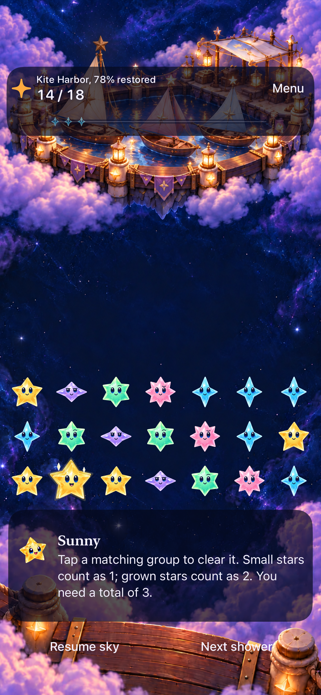
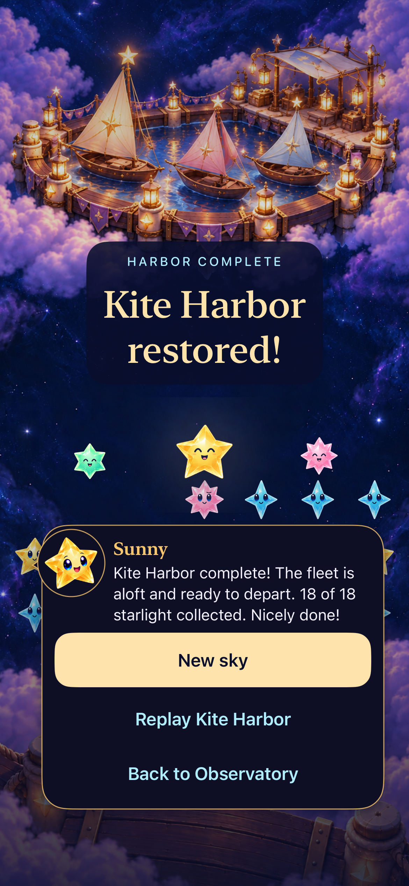

# Kite Harbor verification

**Result:** Verified development scope; delivery pending · **Owner:** Current implementer · **Date:** October 19, 2026

Kite Harbor adds a third selectable 18-light challenge with seed 42 and the existing rules. Five whole-image paintings per viewport restore its sails and mooring lights; completion uses existing light feedback and the ordinary result. Open sky remains the default. There are no campaign unlocks, tiny travelers or departure clips.

**Confirmed:** Core 178/178, Python tooling 55/55, all fifteen source paintings, all fifteen native scene states, three phone UI tests, the tablet rotation/state test, four compact sibling tests, a 49-star native clear and one normal-motion finishing clear. The first combined run passed **330/331** tests: one hosted canvas-size probe failed, then **17/17 affected hosted tests passed** after its correction. This is not a single clean rerun of the entire hosted suite. **Merge and canonical delivery remain pending.** Actual VoiceOver and physical play retain separate acceptance.

**Next action:** Root integrates the verified [production scope](../../design/kite-harbor-03/PRODUCTION_PLAN.md), then records the canonical installation receipt. This folder owns acceptance evidence; the [design package](../../design/kite-harbor-03/README.md) owns artwork and the offline reviewer.

## Verification context

**App source:** `c89ea67a3151dad9e589846bf5d82cf47d787511`, runtime **`dev.b05d0b243e`**. The initial phone run and retained PNGs use that implementation. Documentation-only changes were subsequently committed as `c161d52`; they do not change app inputs. The affected hosted rerun, tablet/compact tests, Release build and manual phone checks use `1bb2b51441b65af65468bf25d4e191a66df8a1d2`, incorporating the probe correction from PR #169 and UI-test-only maintenance from PR #170; runtime identity is unchanged.

**Environment:** Xcode 27.1, Debug, iOS 27.0 Simulator; iPhone 17e and iPad Air 11-inch M3. The tablet model/runtime were also checked against its device plist. Fixtures reset isolated review data. The compact run uses iPhone SE (3rd generation) on iOS 27.0.

The Core run used dirty base `0874a53`, with package inputs matching `c89ea67`, and finished at **12:38:52 EDT / 16:38:52 UTC**. It is not relabeled as a clean-commit run. [Verification metadata](verification.json) retains exact commands, source/device context, durations, artifact names and diagnostics. Raw logs, xcresults and the motion video remain disposable local artifacts.

## Outcomes against acceptance

| Check | Observed result | Evidence / limit |
| --- | --- | --- |
| Core rules/save | **178 passed, 0 failures**, 15.334 s wall | `swift test`; `/tmp/starfall-kite-core-tests.log`; source boundary above. |
| Python tooling | **55 passed**, 5.959 s | Five existing updater/native-plan/RC-platform/lifecycle/export suites; `/tmp/starfall-kite-python-tests.log`. Deliberate child-process failures/timeouts are expected fixture inputs. |
| Source art / provenance | **15 paintings inspected; 15 selected PNGs byte-identical to sources** | [Original records](../../design/kite-harbor-03/art-prompts.json) preserve all 21 generation attempts. [Asset manifest](../../design/kite-harbor-03/production-assets.json) records hashes/dimensions/bytes. Source-art review alone does not establish runtime clearance. |
| Initial combined native run | **330/331 passed, 0 skipped** | Three Kite UI tests passed; hosted 327/328 passed. The strict canvas-size assertion in `testRestoredSceneryAnchorResolvesTheExpandedCanvasInOverlayCoordinates` failed. Bundle `test_sim_2026-10-19T16-51-10-261Z_pid14605_7e99dfef.xcresult` completed in 353.803 s despite the MCP call timing out at 300 s. |
| Affected hosted rerun | **17/17 passed, 0 warnings/errors/skips**, 27.290 s | Corrected source `1bb2b51`; bundle `test_sim_2026-10-19T16-58-22-027Z_pid14605_f5a13ce3.xcresult`. The earlier 327 unchanged hosted passes and this targeted pass remain separate results. |
| Phone flow / save / interruption | **Three UI tests passed** | Actual 14→18 clear, named result, background/reactivation and saved-result relaunch, replay at zero; preview/cancel preserves both Lantern and Ribbon rounds until Begin; largest-text/system Reduce Motion win and usable replay. |
| Welcome discovery | **Manually inspected** | Fresh Welcome at `1bb2b51` initially shows the first challenge; scrolling reveals all three challenge buttons and Settings fully and readably. This is a separate source-bound manual observation, not an added automated test. |
| Native phone appearance | **All five milestones inspected** | Manual score 0/5/9 renders at `1bb2b51`, plus score 14/18 UI captures at `c89ea67`; same runtime. Clear HUD, readable cast, continuous artwork and dark-to-lit final mast fixture. [Capture manifest](captures.json). |
| Dense phone appearance / input | **49-star sample and one real clear passed** | Native snapshot had 49 occupied targets; bottom-left four-point group clear advanced score 9→13, with 46 stars observed afterward. This is one bounded dense interaction, not exhaustive full-board acceptance. |
| Normal-motion finish | **One actual finishing clear inspected** | [Video record](motion.json): 6.278 s; score 14→18, upward gold packets at 2.5 s, bright mast at 2.75 s, ordinary result from 3.25 s. No travelers. Still images are separate evidence. |
| Development accessibility | **Largest text and actual system Reduce Motion UI test passed** | AX3XL result uses its scroll surface to reveal Replay; no horizontal clipping in the retained frame. Actual VoiceOver has not run and remains an RC requirement. |
| Tablet input / rotation / states | **1/1 UI test passed**, 197.206 s; 0 failures/skips/warnings | `1bb2b51`; bundle `test_sim_2026-10-19T17-01-05-180Z_pid14605_b76ae6a8.xcresult`. Actual 5→9 landscape and 9→13 portrait clears; stable 49-cell mapping and sampled identities through rotation. All ten state assertions passed, and all ten tablet images were independently inspected without a blocking rendering/layout issue. |
| Compact / representative siblings | **4/4 passed**, 276.734 s; 0 failures/skips/warnings | `1bb2b51`, iPhone SE 3/iOS 27.0; bundle `test_sim_2026-10-19T17-04-45-302Z_pid14605_9f84788e.xcresult`. Kite/Ribbon/Lantern native win, saved result and replay; Open sky automatic rain, paused clear, replay and settings. Six selected appearance frames inspected. |
| Debug / Release / membership | **Debug tests and Release build passed** | Release at `1bb2b51`, unchanged `dev.b05d0b243e`: 15.303 s, 0 warnings/errors; `build_sim_2026-10-19T17-10-14-209Z_pid14605_16da44d9.log`. Native tests separately establish the Debug target and selected resources. |
| Integration / delivery / physical play | **Pending** | No Kite merge or canonical installation receipt claimed. Physical play and human satisfaction are not observed. |

## Selected phone evidence

| Before the finishing clear | Restored result |
| --- | --- |
|  |  |
| The 75% painting accompanies the truthful 78% score label (14/18). The dark lead mast remains visible. | An actual native winning clear reached 18/18. Ordinary ceremony stars and result actions are visible; no world-traversal characters are added. |

*Native iPhone 17e Simulator, iOS 27.0; `c89ea67`, `dev.b05d0b243e`; default text and normal motion enabled. These stills do not verify animation.*

The [scrolled AX3XL/Reduce Motion result](dev-c89ea67__kite-100__iphone-17e__ax3xl-reduce-motion-scrolled.png) shows New sky and Replay. Its title is partly above the viewport and the next action continues below; this is an intentional scroll position. The [Kite entry over a retained Ribbon round](dev-c89ea67__kite-entry__iphone-17e__retained-ribbon.png) shows a readable unrestored preview and entry actions. Save preservation is established by the test, not by the still alone.

The [49-star native frame](dev-1bb2b51__kite-050__iphone-17e__49-stars.jpg) retains the dense board before the observed clear. Seven durable image copies are unmodified, with byte equality, SHA-256, dimensions, source/device and variant metadata in [captures.json](captures.json). Three other phone and eight tablet milestone originals remain disposable.

The [50% tablet portrait](dev-1bb2b51__kite-050__ipad-air11-m3__portrait.png) and [50% tablet landscape](dev-1bb2b51__kite-050__ipad-air11-m3__landscape.png) retain the inspected views with readable HUD, board stars and controls over continuous artwork. Both are native iPad Air 11-inch M3 Simulator captures at `1bb2b51`, unchanged `dev.b05d0b243e`, iOS 27.0, default text and normal motion enabled. All ten tablet state captures are hashed and independently inspected. Together with the five phone states, this completes the fifteen-state visual review; it does not imply a completed device/build/accessibility matrix.

Two nonblocking portrait tradeoffs remain: the play HUD partly covers the lead sail/star, making the 75% anticipation subtler, and white Resume sky/Next shower labels have weaker contrast over bright clouds than in landscape. They remain readable in the inspected captures; the lead fixture is fully visible at the result. Recheck physical-device contrast before broader RC acceptance.

## Remaining limits

The offline reviewer passed JavaScript syntax and a minimal-DOM check covering all 57 score/view combinations, fixed identities, 24/40/49/0 densities, milestones, guides, query precedence, error messages and cast paths. **Browser rendering remains unverified:** the earlier local-file URL denial explicitly prohibited alternate-route workarounds; none were attempted.

Source-art/provenance and documentation checks do not establish native behavior. Six compact portraits were inspected without a material text/face or horizontal-clipping issue: Kite before win/result/replay, Lantern/Ribbon results and Open sky after settings dismissal. Lower help/result actions use the scroll surface and need not all fit the captured viewport; the tests separately verify actions. These disposable images are hashed in the capture manifest.

Compact portrait is verified; Kite compact-phone landscape was not independently sampled. The recorded checks do not establish actual VoiceOver, audio, physical play, performance or human enjoyment. The remaining nine locations, map traversal and future user-generated travel clips are outside this implementation.
