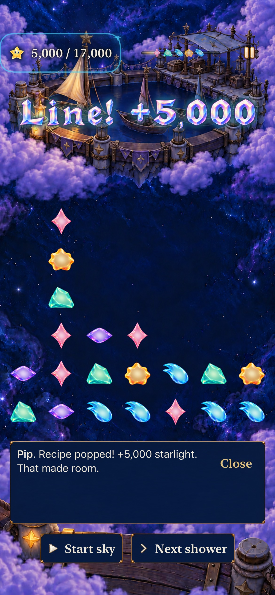
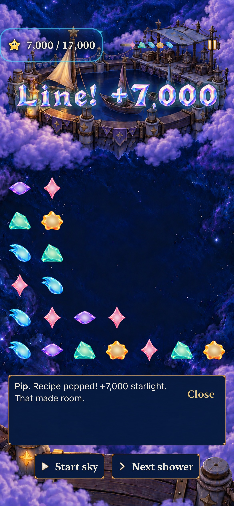

# Kite Harbor: headroom or immediate points

**Partially verified — October 23.** [#278](https://github.com/lbeezr/starfall/issues/278) gives explicit new Kite visits a complete revision-4 encounter: choose a smaller high-column clear or a larger low clear, recover, and restore the fleet at **17,000 points**. Historical Kite0 remains 18-light/manual. Core 249, affected hosted 103, three phone native tests, one earlier corrected automatic-shower test, one repaired tablet AX3XL/quiet test and arm64 Debug/Release pass. **Final phone automatic-clock acceptance remains unresolved: the latest shared-helper regression reached game but failed its first-shower expectation. The later direct phone automation session also could not start; merge acceptance remains pending, without attributing a game cause. Both owned simulators are shut down.**

[Verification and source hashes](verification.json) record base `c496576bde4e89c1f20370054d3c96bfa2f90886` plus explicit working-tree inputs. **`dev.ac2d935006` is the computed app-input fingerprint; actual tested bundle `StarfallBuildID` is `dev.local`.** Capture filenames identify that source fingerprint, not an installed build stamp or clean published commit. Source, Debug and Release dialogue catalogue SHA-256 all equal `72d48054c9ef563d39977a9d4141f08d590230b8e740a4e31dbece8506024a00`.

## What the checks establish

The recipe-free 24-star opening uses existing four-star lines/squares, five-star crosses, seed 42 mixed supply and gentle six-second showers. The high clear earns 5,000 and opens column 0; the low clear earns 7,000 and preserves rose ID 4. After the same shower, both paths can clear the other opening opportunity and recover crowded column 1. Their final clears earn 5,000/6,000, reaching 17,000/18,000; the difference comes from naturally grown rose ID 4. The winning action ends the round immediately, with no mandatory sequence, shower or hidden gate.

| Check | Recorded result and scope |
| --- | --- |
| Core | 249 passed, including 7 Kite tests: exact IDs/heights/awards, unchanged forecast, both finishes, conservation/Codable/replay, real overflow and retained Kite0. |
| Hosted | 103 passed, zero failures/skips: dialogue, flow, archive and journey selections. New Entry/Help use 17,000; historical Continue/replay keep 18 and their bytes. Preview/cancel cannot replace a save before Begin. |
| Phone comparison/history | 3 passed, zero failures/skips on iPhone 17e / iOS 27.0 Simulator: both current choices/finishes, paused Next-shower comparison, process restore, Replay, overflow, historical named win and Begin-only replacement. |
| Ordinary automatic shower | 1 corrected test passed: points-first reaches 18,000 after a real automatic shower and six recovery swipes. A genuine two-repair journey proves Seed locked beforehand and ready afterward, then opens its Entry through the selected map's Visit action. |
| Builds/resources |Explicit arm64 Debug build-for-testing and Release build passed; original catalogue is byte-identical in both bundles. Later native-test-only rebuilds passed. Test inventory 202→203 UI methods, 446 hosted methods is selection validation, not full-suite execution. |
| Tablet | 1 passed, zero failures/skips on iPad Pro 11-inch M5/iOS 27.0 Simulator at AX3XL with quiet effects: selected Entry/Help content, real points-first finish, readable result/onward and Seed Entry. Method 239.611s, bounded wrapper 296.515s. Help capture is top-only; full offscreen reading is not established. |

The three-test phone run used Kite native source SHA `5478003154604208eaf78f569a2486de9f41c0d39fb78486cfaa0f1353866e60`. The corrected added automatic-clock test uses `bba7460a69baab30a5e29f5bf5d016bfdd198a898bc1795951ad82d669c05d48`. Production Core/App/catalogue and hosted inputs are unchanged between them. The later shared Settings helper versions are bound separately in verification.json: iPad passed, the universal-coordinate phone attempt failed before game, and the conditional phone repair reached game but failed the shower expectation. Raw logs/results remain disposable under `/private/tmp/starfall-next-encounters-20261023/`; exact commands, limits, durations and selected counts are summarized in the verification file.

## Inspected phone appearance

| Space first: 5,000, more room on the left | Points first: 7,000, taller left columns retained |
| --- | --- |
|  |  |

The [Entry capture](dev-ac2d935006__iphone-17e__entry-default.jpg) shows the complete 17,000 objective, automatic-pattern explanation and Begin. The [earned result](dev-ac2d935006__iphone-17e__points-win.jpg) shows the restored fleet, exact 18,000 of 17,000 and readable Visit Seed Moon/Replay actions. Both opening receipts agree with the score and show distinct survivor layouts; the existing rich scenery remains behind the board.

The original phone points-first PNG, four phone JPEGs, six tablet PNGs and two promoted tablet JPEGs were inspected. [Capture provenance](captures.json) preserves original/final SHA-256, attachment identities and unchanged dimensions: **1170×2532 phone; 1668×2420 tablet**. Both batches use PNG→JPEG quality 70 without resizing; the tablet conversion used `sips`. Existing phone images and all original PNGs are unchanged. Stills come from paused comparisons, not the automatic-clock test, and do not establish motion chronology.

The [tablet onward frame](dev-ac2d935006__onward__ipad-pro11-m5__ax3xl-quiet.jpg) shows 18,000 of 17,000, Visit Seed Moon and Replay fully visible without shrinking text; lower Back to Observatory content extends below the viewport. Entry's full instruction and Begin were inspected in the temporary capture. The first XCTest Help capture showed only the Tutorial introduction. Later direct native reading closes that visual gap through overlapping location-specific captures below; it does not turn the interrupted XCTest extension into a pass.

## Failures, limits and next action

- Initial Debug invocation attempted x86_64 app compilation against an arm64 Core module and failed. Explicit `ARCHS=arm64 ONLY_ACTIVE_ARCH=YES` passed; no game-source correction was needed.
- The new automatic test first expected onward to jump directly to Entry. It failed at that incorrect assertion after recovery/result. The corrected test follows the existing selected map→Visit→Entry path and passes; this was a test assumption, not a demonstrated recovery defect.
- Initial iPad Settings AX activation left General selected and could not find Motion before game launch. Stable Accessibility identification, a visible row-center coordinate tap and a bounded Motion-hittable assertion passed on iPad; helper build passed 35.651s. The universal coordinate then failed on phone before game. The next repair checks for the Settings sidebar, preserving the alternate native-button path; its phone attempt reached game, but the first automatic-shower expectation failed. No app production bytes changed.

The automatic test demonstrates one executable recovery window with cached native coordinates and real swipes. It does not establish uncoached recognition, enjoyment, human setup effort or physical touch comfort. No physical-device session, canonical phone delivery, actual VoiceOver or full release-candidate acceptance is claimed. [The ordinary player packet](../../design/CURRENT_STORY_PLAYTEST.md) remains the human-observation follow-up; it adds no gate to this independent gameplay slice.

## Later direct reading and native capacity boundary

Direct XcodeBuildMCP interaction on the same built app completed the missing visual check: current Kite4 Replay Entry → Settings → Help → bounded scrolling → Done returned to the identical 17,000-point Replay Entry, without Begin. The overlapping [start](dev-ac2d935006__help-start__ipad-pro11-m5__ax3xl-quiet.jpg), [middle](dev-ac2d935006__help-middle__ipad-pro11-m5__ax3xl-quiet.jpg) and [end](dev-ac2d935006__help-end__ipad-pro11-m5__ax3xl-quiet.jpg) captures show every location-specific line at AX3XL and the reachable pinned Done control. This manual native inspection supplements the earlier passing tablet case; it is not a pass of the later interrupted XCTest extension.

The host had18 booted simulators, with only one owned factory simulator active. Later XCTest calls stalled over40seconds and the tablet round overflowed before the test could pause. A direct phone alternative then failed to create a remote automation session. No unrelated simulator/process was stopped. The user-directed turn interruption orphaned the bounded tablet command; root terminated only its verified owned group47197. Both owned devices are now shut down. These observations explain why more identical native attempts would be unhelpful; they do not isolate the phone repeat's clock cause. Keep the feature unmerged until the remaining observation is resolved with strict acceptance. Prepared Seed/Silver work stays ready behind this integration boundary.

A bounded independent review inspected pause/menu dismissal, Store scheduling/admission and the failed video. At actual timestamps60.735s and64.318s the forecast had reached its end while the post-clear board remained visible; Resume had dismissed the menu. This establishes delayed or absent visible delivery, not a specific clock defect or a proven host cause. Existing hosted pause-remainder/readiness tests pass. The next check is exactly the existing `testCurrentKiteAutomaticShowerAllowsPointsFirstRecovery`: retain the ten-second/exactly-one-shower condition, ordinary motion, six recovery exchanges,18,000/17,000 result and earned Seed unlock. Do not relax assertions, change clocks speculatively or rerun unchanged while native automation remains unavailable.

Concurrent main PR #292 subsequently added the Lantern enamel dialogue treatment. The draft integrates main `678f7c7c`, preserving its three App files and independent visual queue. Combined input fingerprint `dev.4448f4efe8` needs fresh native acceptance; the earlier captures and runtime checks above remain bound to `dev.ac2d935006`. Core/catalogue/hosted-test inputs are unchanged. This integration does not erase the unresolved actual-clock observation.

The combined-source generic arm64 Debug build-for-testing (43.534seconds) and Release build (13.932seconds) pass without booting a simulator. This supplies build/membership evidence for the new main integration; it does not resolve the pending native clock check or refresh the earlier visual source.

The separate roadmap and Project recovery merged through PRs294/295 on main `a11ec868`. #220’s own canonical item automatically reached Done at13:19:35 UTC. These changes are documentation only; the combined runtime fingerprint remains `dev.4448f4efe8`. The three gameplay leaves are now durable on main while this runtime draft retains its final native acceptance boundary.
