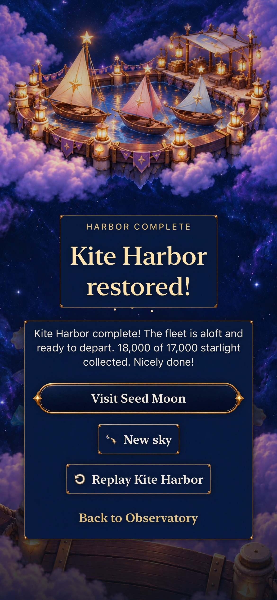
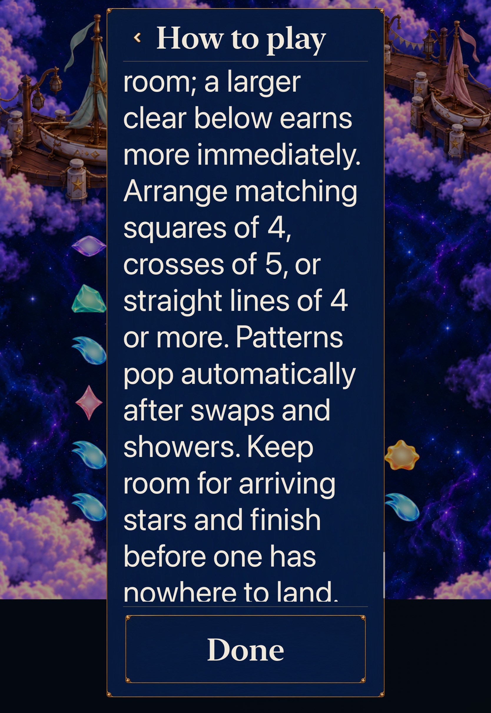
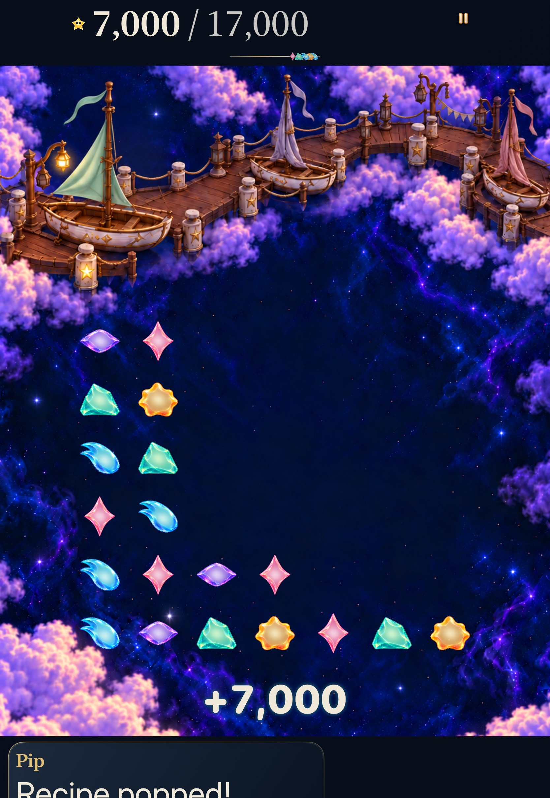

# Kite Harbor: headroom or immediate points

**Verified for scoped development — October 23.** [#278](https://github.com/lbeezr/starfall/issues/278) gives explicit new Kite visits a complete revision-4 encounter: choose a smaller high-column clear or a larger low clear, recover, and restore the fleet at **17,000 points**. Historical Kite0 remains 18-light/manual. Final HUD-integrated source `dev.dbc86ddbaf` passes the complete AX3XL quiet tablet case, four header/placement checks and Debug/Release. Matching Core inputs pass 249 tests; the preceding collection integration `dev.556659fb9f` passes 29 material checks and strict real-clock phone recovery. Earlier 103 dialogue/flow/archive/journey and three phone comparison/history cases retain their exact earlier sources and unchanged relevant input bytes. Next: integrate Kite, then Seed #279.

[Verification and source hashes](verification.json) record base `c496576bde4e89c1f20370054d3c96bfa2f90886` plus explicit working-tree inputs. **`dev.ac2d935006` is the computed app-input fingerprint; actual tested bundle `StarfallBuildID` is `dev.local`.** Capture filenames identify that source fingerprint, not an installed build stamp or clean published commit. Source, Debug and Release dialogue catalogue SHA-256 all equal `72d48054c9ef563d39977a9d4141f08d590230b8e740a4e31dbece8506024a00`.

## What the checks establish

The recipe-free 24-star opening uses existing four-star lines/squares, five-star crosses, seed 42 mixed supply and gentle six-second showers. The high clear earns 5,000 and opens column 0; the low clear earns 7,000 and preserves rose ID 4. After the same shower, both paths can clear the other opening opportunity and recover crowded column 1. Their final clears earn 5,000/6,000, reaching 17,000/18,000; the difference comes from naturally grown rose ID 4. The winning action ends the round immediately, with no mandatory sequence, shower or hidden gate.

| Check | Recorded result and scope |
| --- | --- |
| Core | 249 passed, including 7 Kite tests: exact IDs/heights/awards, unchanged forecast, both finishes, conservation/Codable/replay, real overflow and retained Kite0. |
| Hosted | 103 passed, zero failures/skips: dialogue, flow, archive and journey selections. New Entry/Help use 17,000; historical Continue/replay keep 18 and their bytes. Preview/cancel cannot replace a save before Begin. |
| Phone comparison/history | 3 passed, zero failures/skips on iPhone 17e / iOS 27.0 Simulator: both current choices/finishes, paused Next-shower comparison, process restore, Replay, overflow, historical named win and Begin-only replacement. |
| Ordinary automatic shower | 1 corrected test passed: points-first reaches 18,000 after a real automatic shower and six recovery swipes. A genuine two-repair journey proves Seed locked beforehand and ready afterward, then opens its Entry through the selected map's Visit action. |
| Builds/resources |Explicit arm64 Debug build-for-testing and Release build passed; original catalogue is byte-identical in both bundles. Later native-test-only rebuilds passed. Test inventory 202→203 UI methods, 446 hosted methods is selection validation, not full-suite execution. |
| Tablet | 1 passed, zero failures/skips on iPad Pro 11-inch M5/iOS 27.0 Simulator at AX3XL with quiet effects: selected Entry/Help content, real points-first finish, readable result/onward and Seed Entry. Method 239.611s, bounded wrapper 296.515s. Help capture is top-only; full offscreen reading is not established. |

The three-test phone run used Kite native source SHA `5478003154604208eaf78f569a2486de9f41c0d39fb78486cfaa0f1353866e60`. The corrected added automatic-clock test uses `bba7460a69baab30a5e29f5bf5d016bfdd198a898bc1795951ad82d669c05d48`. Production Core/App/catalogue and hosted inputs are unchanged between them. The later shared Settings helper versions are bound separately in verification.json: iPad passed, the universal-coordinate phone attempt failed before game, and the conditional phone repair reached game but failed the shower expectation. Raw logs/results remain disposable under `/private/tmp/starfall-next-encounters-20261023/`; exact commands, limits, durations and selected counts are summarized in the verification file.

## Inspected phone appearance

| Space first: 5,000, more room on the left | Points first: 7,000, taller left columns retained |
| --- | --- |
|  |  |

The [Entry capture](dev-ac2d935006__iphone-17e__entry-default.jpg) shows the complete 17,000 objective, automatic-pattern explanation and Begin. The [earned result](dev-ac2d935006__iphone-17e__points-win.jpg) shows the restored fleet, exact 18,000 of 17,000 and readable Visit Seed Moon/Replay actions. Both opening receipts agree with the score and show distinct survivor layouts; the existing rich scenery remains behind the board.

The original phone points-first PNG, four phone JPEGs, six tablet PNGs and two promoted tablet JPEGs were inspected. [Capture provenance](captures.json) preserves original/final SHA-256, attachment identities and unchanged dimensions: **1170×2532 phone; 1668×2420 tablet**. Both batches use PNG→JPEG quality 70 without resizing; the tablet conversion used `sips`. Existing phone images and all original PNGs are unchanged. Stills come from paused comparisons, not the automatic-clock test, and do not establish motion chronology.

The [tablet onward frame](dev-ac2d935006__onward__ipad-pro11-m5__ax3xl-quiet.jpg) shows 18,000 of 17,000, Visit Seed Moon and Replay fully visible without shrinking text; lower Back to Observatory content extends below the viewport. Entry's full instruction and Begin were inspected in the temporary capture. The first XCTest Help capture showed only the Tutorial introduction. Later direct native reading closes that visual gap through overlapping location-specific captures below; it does not turn the interrupted XCTest extension into a pass.

## Earlier failures and limits

- Initial Debug invocation attempted x86_64 app compilation against an arm64 Core module and failed. Explicit `ARCHS=arm64 ONLY_ACTIVE_ARCH=YES` passed; no game-source correction was needed.
- The new automatic test first expected onward to jump directly to Entry. It failed at that incorrect assertion after recovery/result. The corrected test follows the existing selected map→Visit→Entry path and passes; this was a test assumption, not a demonstrated recovery defect.
- Initial iPad Settings AX activation left General selected and could not find Motion before game launch. Stable Accessibility identification, a visible row-center coordinate tap and a bounded Motion-hittable assertion passed on iPad; helper build passed 35.651s. The universal coordinate then failed on phone before game. The next repair checks for the Settings sidebar, preserving the alternate native-button path; its phone attempt reached game, but the first automatic-shower expectation failed. No app production bytes changed.

The automatic test demonstrates one executable recovery window with cached native coordinates and real swipes. It does not establish uncoached recognition, enjoyment, human setup effort or physical touch comfort. No physical-device session, canonical phone delivery, actual VoiceOver or full release-candidate acceptance is claimed. [The ordinary player packet](../../design/CURRENT_STORY_PLAYTEST.md) remains the human-observation follow-up; it adds no gate to this independent gameplay slice.

## Earlier direct reading and native capacity boundary

Direct XcodeBuildMCP interaction on the same built app completed the missing visual check: current Kite4 Replay Entry → Settings → Help → bounded scrolling → Done returned to the identical 17,000-point Replay Entry, without Begin. The overlapping [start](dev-ac2d935006__help-start__ipad-pro11-m5__ax3xl-quiet.jpg), [middle](dev-ac2d935006__help-middle__ipad-pro11-m5__ax3xl-quiet.jpg) and [end](dev-ac2d935006__help-end__ipad-pro11-m5__ax3xl-quiet.jpg) captures show every location-specific line at AX3XL and the reachable pinned Done control. This manual native inspection supplements the earlier passing tablet case; it is not a pass of the later interrupted XCTest extension.

The host had18 booted simulators, with only one owned factory simulator active. Later XCTest calls stalled over40seconds and the tablet round overflowed before the test could pause. A direct phone alternative then failed to create a remote automation session. No unrelated simulator/process was stopped. The user-directed turn interruption orphaned the bounded tablet command; root terminated only its verified owned group47197. Both owned devices are now shut down. At that checkpoint, more identical native attempts were unhelpful and merge remained blocked. These observations do not isolate the phone repeat's clock cause; the recovered-capacity and final-integration sections below record later progress.

A bounded independent review inspected pause/menu dismissal, Store scheduling/admission and the failed video. At actual timestamps60.735s and64.318s the forecast had reached its end while the post-clear board remained visible; Resume had dismissed the menu. This establishes delayed or absent visible delivery, not a specific clock defect or a proven host cause. Existing hosted pause-remainder/readiness tests pass. The next check is exactly the existing `testCurrentKiteAutomaticShowerAllowsPointsFirstRecovery`: retain the ten-second/exactly-one-shower condition, ordinary motion, six recovery exchanges,18,000/17,000 result and earned Seed unlock. Do not relax assertions, change clocks speculatively or rerun unchanged while native automation remains unavailable.

Concurrent main PR #292 subsequently added the Lantern enamel dialogue treatment. The draft integrates main `678f7c7c`, preserving its three App files and independent visual queue. Combined input fingerprint `dev.4448f4efe8` needs fresh native acceptance; the earlier captures and runtime checks above remain bound to `dev.ac2d935006`. Core/catalogue/hosted-test inputs are unchanged. This integration does not erase the unresolved actual-clock observation.

The combined-source generic arm64 Debug build-for-testing (43.534seconds) and Release build (13.932seconds) pass without booting a simulator. This supplies build/membership evidence for the new main integration; it does not resolve the pending native clock check or refresh the earlier visual source.

The separate roadmap and Project recovery merged through PRs294/295 on main `a11ec868`. #220’s own canonical item automatically reached Done at13:19:35 UTC. These changes are documentation only; the combined runtime fingerprint remains `dev.4448f4efe8`. The three gameplay leaves are now durable on main while this runtime draft retains its final native acceptance boundary.

## Recovered native capacity and ordered recovery

At13:37 UTC, supported simulator inventory showed one unrelated device booted instead of the earlier18. The unchanged test now observed the automatic shower, but overflowed during recovery. Its original-resolution recording shows the first swipe buffered while arrivals were still landing; the next contact replaces that single intention. A first test repair waited for the existing “Next shower on its way” cue and asserted12,000 after the first clear. That clear passed, but the second shower interrupted the last recovery swipe; XCTest’s one-second predicate cadence spent part of the real recovery window.

The final test reuses the existing100ms native condition helper with the same deadlines, observes the landing boundary and confirms the first clear before continuing. It passes **1 passed, zero failures/skips**,87.493method seconds /120.310tool seconds, on combined source `dev.4448f4efe8`. It retains exactly one ordinary automatic shower without Next, ordinary motion, all six physical recovery swipes,18,000/17,000 and actual earned Seed access. No production clock, buffering, motion, rules or saves changed. This validates the complete recovery without identifying the earlier missing-shower repeat’s cause. Failed runs remain separately recorded in verification.json.

Main subsequently advanced through #296 (`612a369b`), changing collected-light appearance. Integration and refreshed source-bound native acceptance remain pending; the current tablet Help extension still has no passing completed run.

## Final integrated development acceptance

Clean input commit `a47e5ae80cb9d3f50f4dea1181d5d2c9876033bc` integrates main`612a369b` and its collection-light refinement. Computed runtime fingerprint **`dev.556659fb9f`** remains distinct from actual local bundle stamp `dev.local`. Later changes are evidence/docs only. The final 249 Core tests pass; Debug compilation succeeds in both supported native test runs and generic arm64 Release passes in 12.469 seconds. Catalogue hashes still match source and both bundles.

On iPhone17e/iOS27.0, **30 passed, zero failures/skips** pass: one strict actual-clock case and 29material/collection hosted methods. The phone method takes 85.161 seconds and keeps the ten-second first-shower deadline, observed landing, six physical recovery exchanges, exact 18,000/17,000 and earned Seed. [The current result](dev-556659fb9f__automatic-recovery-result__iphone-17e__default-text.jpg) shows the restored fleet and all four actions fully visible. [Earned Seed Entry](dev-556659fb9f__earned-seed-entry__iphone-17e__default-text.jpg) correctly retains its existing 18-light objective.

On iPadPro11M5/iOS27.0 at AX3XL/quiet, the **current extended** Help/round/onward test passes **1 passed, zero failures/skips**,183.997method seconds /223.851tool seconds. It completes heading/paragraph scroll assertions, returns through Done, finishes the real points-first encounter and reaches selected Seed then its Entry. All seven raw captures were inspected. Fresh heading/end captures are partial viewports, not an overlapping full-paragraph visual sequence; the earlier three manual full-reading captures stay bound to their original source. Main #296 changed collection drawing, not Help copy or its owner.

The earlier absent-shower repeat remains recorded without an isolated cause. Later responsive runs establish current acceptance; no clock, buffer lifetime, rule, score, save or motion changes were made to obtain it. Human comprehension, planning comfort, enjoyment, physical testing and actual VoiceOver remain unperformed.

| Current phone result | Current tablet Help ending (partial viewport) |
| --- | --- |
|  |  |

## Subsequent HUD integration

Main advanced through HUD PR #297 during publication. Its only runtime changes are `FallingSkyHUD` target emphasis and `FallingSkyView` explicit accessibility-size header stacking. The local merge preserves that work and both documentation records. Clean input `0b1d63f3` / **`dev.dbc86ddbaf`** passes **5 tests, zero failures/skips**: the current extended Kite tablet Help/round/onward case plus exact score reflow, award clearance and two forecast placement cases. The native method takes 173.773 seconds; the complete tool invocation takes 205.855 seconds. Debug compilation and generic arm64 Release (8.818 seconds) pass.

All Core, stores/clocks, rule/save/copy/catalogue and test bytes match the preceding integration. Its 249 Core, 103 dialogue/flow/archive/journey, 29 material and ordinary-clock phone evidence stays source-bound and is reused for those unchanged owners. No new clock, buffering or gameplay change was introduced by this merge. Later branch differences are docs and an inspected HUD capture only.

The final header capture retains native1668×2420 pixels. Exact score, forecast and pause remain readable; the lower dialogue extends beyond this viewport. It establishes this layout sample, not complete reading or motion.
