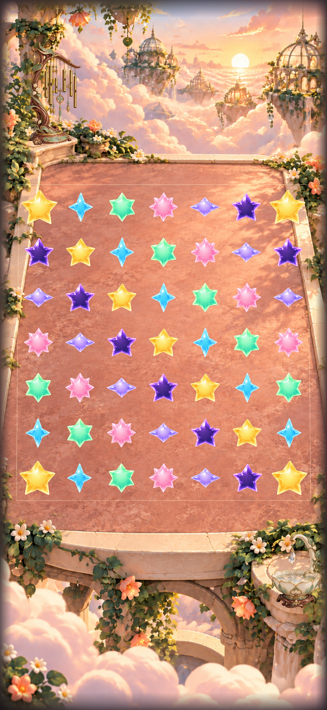
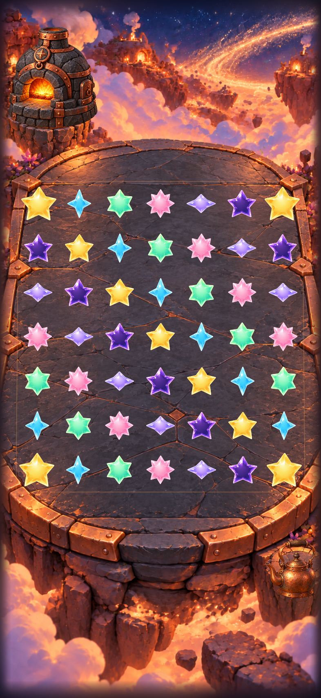
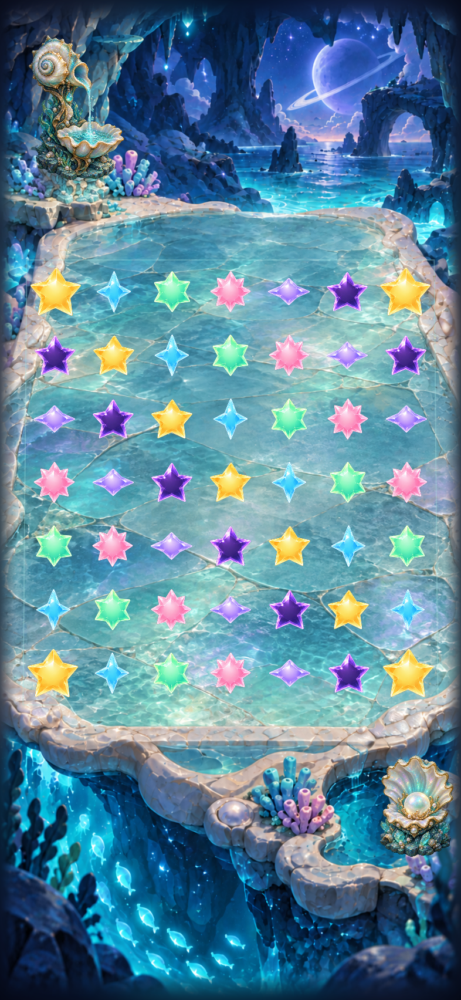
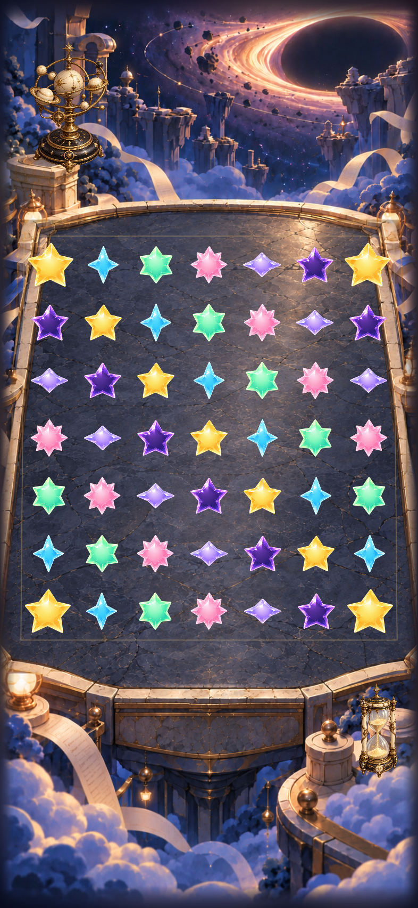

# Superseded initial source — f35eba8

These initial notes describe the obsolete baseline. Use [the reconciled report](README.md) for current integration results. Host previews below also predate the final rear-prop placement.

# Five selectable landing places

**Partially verified · development integration · October 18, 2026.** All five settings are integrated in Debug and Release source. Sky menu → Location remembers the choice, with two responsive prop layers per setting. Revised background plates and an inset shared arena projection improve platform clearance. Native interaction, motion and complete UI review remain **unverified**: Apple’s simulator service exhausted its dispatch worker pool before tests could execute.

**Baseline correction:** The user identified obsolete star circles in the recovered native capture. Investigation confirmed this checkout started at `f35eba8`, 121 commits behind main. That implementation and its native captures are superseded for acceptance. The environment work is reconciled onto `ac6aeb3`; current native verification is in progress. The shared simulator recovered without restarting it.

**Next action:** Complete current-main builds, hosted/UI tests and native visual inspection. Preserve current gestures, dialogue, screen flow and v7 saves. All results below explicitly naming `f35eba8` describe the initial source only.

## What changed

| Setting | Native prop buttons |
| --- | --- |
| Moonlit Observatory | Telescope tilt/glint; lantern warmth |
| Cloudsea Conservatory | Wind-harp sway; dew-catcher glimmer/ripple |
| Comet Hearth | Kiln warmth; kettle rock/steam |
| Prism Tide Grotto | Shell-fountain response; pearl shimmer |
| Eventide Archive | Orrery turn; sandglass glow |

One `LandingEnvironment` owns the ambient phase and finite cancellable responses. Settings/background cancel responses; changing location replaces only that environment identity. `LandingPlace` stores cosmetic metadata, while `landingPlace` is a separate preference with an Observatory fallback. Selection does not call a store mutation or consume gameplay RNG. Core/save schema and generation code are unchanged.

`LandingGeometry` supplies SpriteKit centers, native polygons, the visible inset perimeter and prop registration. All 49 cells retain full targets; near/far/side clearance is increased. A host check reproduced slight lantern clipping at tall aspect ratios. Registration now reserves minimum-target padding before placing both artwork and buttons; all ten props across five sizes passed the same checks. Native dispatch and current resized layouts still need verification.

## Host layout references

**Mac SwiftUI ImageRenderer references, 393×852 points at 2×.** These use the current environment/geometry source with TimelineView frozen and image loading adapted to AppKit. Packaged body cutouts are placed at shared centers, including grown-sized corners. Faces, SpriteKit contact shadows, HUD and native controls are omitted. These establish a static composition reference; they cannot accept iOS taps, gameplay readability, animation or accessibility.

| Cloudsea Conservatory | Comet Hearth |
| --- | --- |
|  |  |
| Prism Tide Grotto | Eventide Archive |
|  |  |

[Revised Observatory host reference](observatory-host-bodies.png). The flat opaque and stretched-texture arena candidates were rejected after preview inspection. Final code retains authored floor materials and draws a quiet inset inlay; new art removes floor motifs that could resemble pieces. Final native review must judge full-cast contrast and corner/rim clearance, especially the brighter Cloudsea/Grotto floors.

## Review-data isolation follow-up

Source inspection found that Observatory reset/review launches created fixture boards through the normal defaults domain. Sky Flow and Rankings already used isolated game suites, but their SwiftUI preference environment still used normal storage. `SkyDefaults` now supplies the same selected domain to both the store factory and app-root preference environment. Ordinary Debug/Release uses standard storage; review selection performs no writes or resets. No core/save schema changed.

The real Foundation selector passed Debug and Release host checks for domain separation, no initialization writes, existing Sky Flow/Rankings routes, missing/reset-only arguments and Release flag guards. Final `review-isolation-debug.log` and `review-isolation-release.log` builds passed. The focused hosted regression exercises a committed fixture clear and feedback/location writes while requiring normal data to remain unchanged; it **compiles but has not executed**. Native SwiftUI preference restoration is still pending.

An initial host harness failed because it assumed a cleared domain must be `nil`; Foundation can return an empty domain. The corrected check compares persisted contents before/after selection and independently checks ordinary save/preference keys. Failed output is retained as `review-defaults-debug-initial-failure.log`. This was a harness assumption, not a passed native save test.

The [earlier source manifest](pre-isolation-source.json) preserves the previous builds. [Current source/test hashes](source.json) identify the isolation follow-up. Environment, geometry and location-metadata hashes are unchanged, so the host composition figures above retain their original scope. Raw follow-up output is in the same ignored artifact folder.

## Checks and source limits

Source: `f35eba8` plus the declared working-tree changes and new resources in [source.json](source.json). This is working-tree evidence, not clean published-commit acceptance. Toolchain: Xcode 27.1 (27A9275); Mac host rendering and ImageIO/geometry checks. Attempted simulator: iPhone 17e, iOS 27.0, `4103C352-DFC2-493E-A224-DE4CE3D50889`.

| Check | Result |
| --- | --- |
| `swift test` | 63 passed, zero failures; core source unchanged. |
| Host geometry/ImageIO harness | Passed: 50 prop/layout cases, 49-cell center/inverse/full-target checks at five sizes, rim/cell union and source image/alpha decoding. This does not execute hosted XCTest or UIKit. |
| Final Debug `build-for-testing` | Passed, arm64 simulator. App, hosted tests and UI tests compile. |
| Final Release simulator build | Passed, arm64. All eight new resource names verified in compiled `Assets.car`; revised Observatory image is bundled through its existing imageset. |
| Hygiene, `git diff --check`, project plist | Passed. Explicit membership replaces the two renamed files and adds `LandingPlace.swift` and `SkyDefaults.swift`; tests use existing target members. |
| First build attempt | Failed on an app/package architecture mismatch; explicit arm64 builds resolved it. No build setting or assertion was weakened. |
| Hosted/UI execution | Interrupted before execution. Device creation and screenshots on two booted simulators also stalled. A one-second Apple `sample` found CoreSimulator’s 64-thread dispatch limit saturated by synchronous bridge requests. |
| Native gameplay/layout/motion | Unrun on final source: normal/rapid taps, win/loss, restart, settings dismissal, background/resume, actual Reduce Motion, full motion, compact phone and tablet orientations. The test matrix is authored, not passed. |
| Actual VoiceOver | Deferred to RC; not run on this development build. |
| Physical device / performance / human art approval | Unrun. Source textures and cast caches are bounded; decoded memory, frame pacing and feel still need device measurement. |

Commands use `Starfall.xcodeproj`, scheme `Starfall`, `CODE_SIGNING_ALLOWED=NO`, `ARCHS=arm64`, `ONLY_ACTIVE_ARCH=YES` and generic iOS Simulator for final compilation. Raw commands/logs, previews, the host harness and interrupted xcresult remain under ignored `artifacts/landing-places-2026-10-18/`. The [production brief](../../design/environments/production-set/README.md) and [exact built-in image prompts](../../design/environments/production-set/prompts.json) retain scope and asset provenance. Runtime artwork lives in `App/Assets.xcassets`; no external runtime service or dependency was added.
