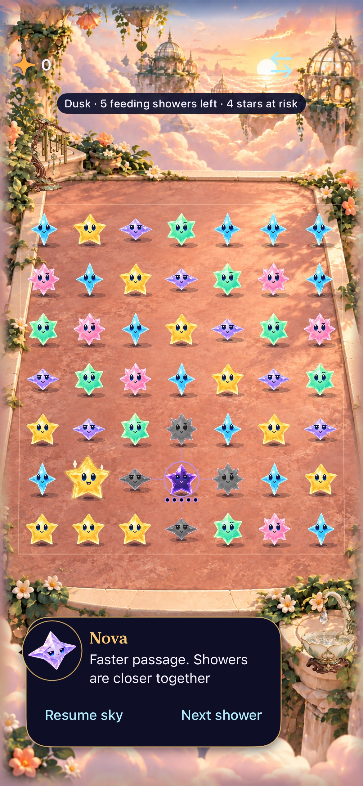
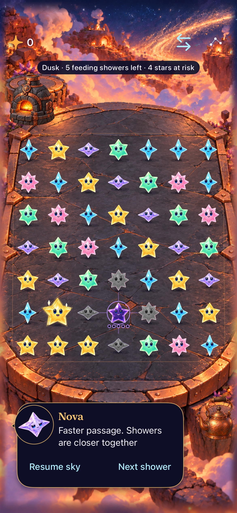
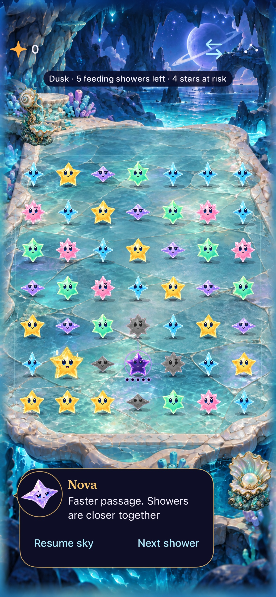
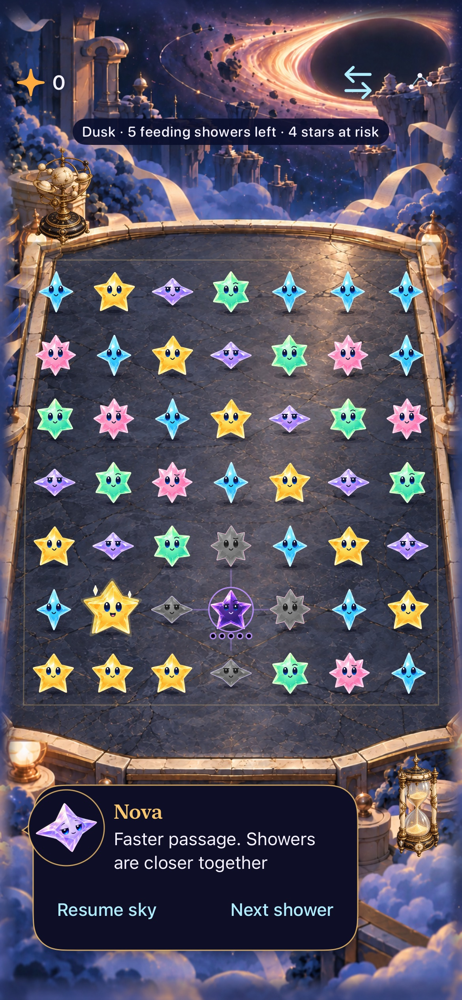
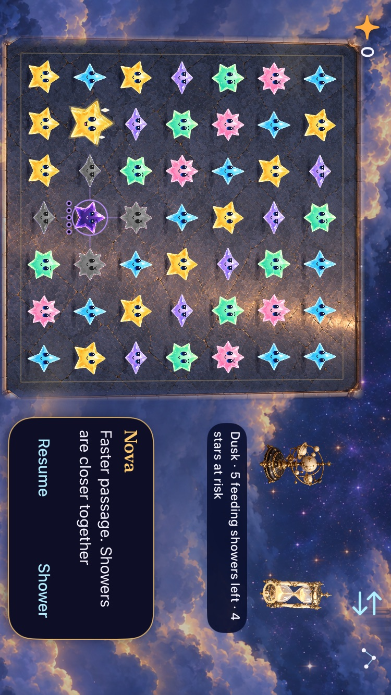
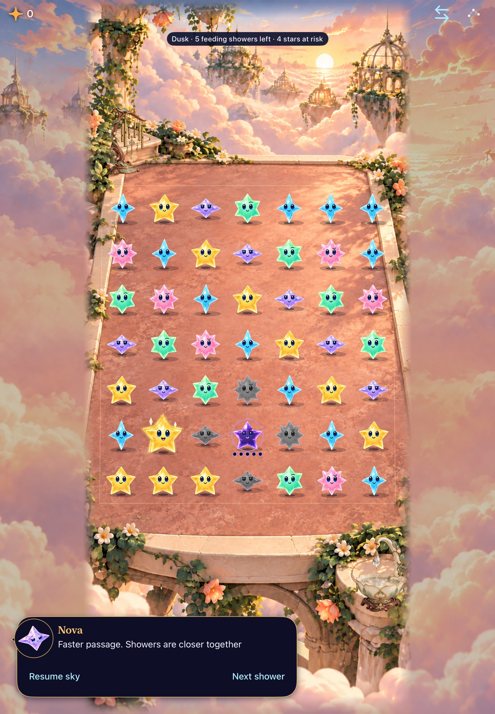
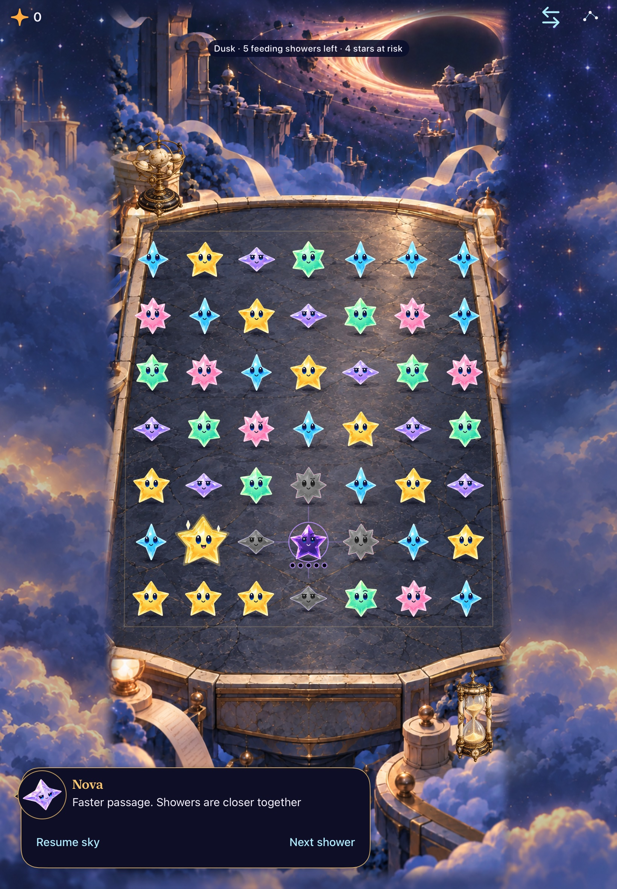

# Five settings with a responsive stage

**Result:** Verified development integration · **Owner:** current implementer · **Date:** October 18, 2026

All five locations are integrated with remembered selection, two interactive props each, a shared arena/input boundary and separate wallpaper for extra screen space. The source is reconciled onto `7ddc837`, including current open-spark selection and clear-award feedback. The native responsive foundation keeps the original portrait stage on phones/tablets, uses a compact terrace plus adjacent communication on short landscape screens, and scrolls short narrow/accessibility layouts instead of shrinking targets.

**Design gap identified by the user:** physical upper/lower UI grooves were already part of the intended template. This implementation still uses floating native panels and controls, so its functional layout/scenery verification does not fulfill that visual requirement. [Corrected design contract](../../design/environments/BOARD_TEMPLATE.md). The rigid framing concept remains unapproved; physical-device feel and release-candidate actual VoiceOver are separate acceptance work.

**Next action:** Review the native proportions below and refine decorative framing with the user. Physical-device feel and full actual VoiceOver remain device/RC work; no further gameplay or save changes are required for this integration.

## Native phone layouts

| Cloudsea portrait | Comet Hearth portrait | Prism Tide Grotto portrait | Eventide Archive portrait |
| --- | --- | --- | --- |
|  |  |  |  |

**Native runtime evidence:** dense isolated review board, normal motion, Calm effects off. Portrait: iPhone 17e, iOS 27.0 Simulator; landscape: iPhone SE (3rd generation), same OS. [Source hashes](accepted-source.json) and [attachment mapping](accepted-captures.json) identify the actual inputs. The later header-test fixture correction changes no app/resource input. The remaining circle on Dusk and grown-star aura are current state cues; enclosing contact/clear feedback is removed. Still captures show sampled composition, not animation feel or user preference. [Observatory portrait](dev-7ddc837-wip-6ae29cfa__observatory-portrait__iphone-17e.jpg) and [native maximum-text header](dev-7ddc837-wip-6ae29cfa__largest-text-header__iphone-se3.jpg) are retained separately. At maximum text the guide and lower scenery are revealed by scrolling.

## Source and ownership

[Runtime input hashes](accepted-source.json) record `7ddc837` plus working-tree snapshot `6ae29cfa`; [the prior snapshot](responsive-source.json) retains `46f2275f` before the 45-point control margin and harness corrections. Core rules, RNG and v7 saves are unchanged. `LandingGeometry` owns all cell polygons/centers, trace and swap mapping, arena outline, stage bounds, prop targets and compact communication column. `LandingEnvironment` owns cosmetic animation and cancellable prop responses; `LandingBackdrop` is static scenery outside the animation timeline. Location selection changes neither the round nor gameplay randomness. `SkyDefaults` keeps explicit review fixtures isolated from ordinary saves/preferences.

[Artwork and provenance](../../design/environments/production-set/README.md) include the wallpaper and compact terrace generation records. Separate low-detail scenery fills the viewport; soft overlap joins it to the stage without duplicating a gameplay floor or distinctive landmark. Texture plates adapt to the measured stage; characters and prop cutouts preserve aspect. There is no square cell grid or new enclosing selection feedback.

## Checks against acceptance

Toolchain: Xcode 27.1 (27A9275), iOS 27.0 Simulator, arm64; scheme `Starfall`. Serial test execution per simulator, code signing disabled. Raw logs and result bundles are ignored under `artifacts/landing-places-2026-10-18/`.

| Check | Result and scope |
| --- | --- |
| Core | 149 passed (`responsive-core.log`); core unchanged in the subsequent main reconciliation. |
| Current-main hosted | 230 passed on final source (`accepted-compact.xcresult`), including actual full-game award pixel checks and current open-spark selection. |
| Geometry/assets | Ten focused hosted methods passed (`responsive-fit.xcresult`): packaged assets/alpha, fallback, shared edges/inverse/renderer mapping, minimum 44-point cells and nonoverlapping aspect-preserved props, including 320-point portrait and 667×375 / 852×393 landscape. |
| Compact native, SE3 | Final source passed all five landscape locations, ten props, unchanged round, native far/front scoring, both landscape directions and return to portrait; maximum-text visible score/header and actual system Reduce Motion also passed (`accepted-compact.xcresult`). |
| Modern phone, 17e | All three location matrices passed: normal portrait, compact landscape and maximum-text quiet interactions. Rapid prop taps, corner clears, persisted choice, menu/background cancellation and restart passed (`accepted-phone.xcresult`). That bundle also contains one header fixture failure; the corrected header case passes on both SE3 and 17e in later bundles. App/resource inputs are identical. |
| Final phone gameplay | Visible maximum-text header, First Light win/replay/full-sky/restore and native swipe-hold swap with empty-destination falling passed (`accepted-gameplay.xcresult`). Earlier current-main normal opening animation/early clear and five-star native trace also passed before the one-point gameplay-button margin; no animation assertion or motion policy was weakened. |
| Final tablet, Air 11 M3 | Both methods passed: all five locations with props, persisted choice and native corner clears; Observatory portrait and both landscape directions (`accepted-tablet.xcresult`). |
| Debug / Release / hygiene | Debug test compilation, final Release simulator build (`accepted-release.log`), explicit source/resource membership, `python3 scripts/ci-hygiene.py`, `git diff HEAD --check` and project plist lint passed. |
| Actual VoiceOver / physical device / frame pacing / human art preference | Not run or not established on this batch. Full actual VoiceOver remains an RC check. |

The first compact check exposed a test navigation issue: full-screen swipes skipped the lazily created Location row on short menus. Bounded short list drags now reach the same real menu row. It also exposed floating-point cells infinitesimally below 44 points at the exact minimum; the stage is now 351 points, providing positive target-size margin without changing assertions. A source image height was 992 pixels; the new compact-material decode check uses a 900-pixel minimum rather than assuming generated assets are exactly square.

Screenshot review found the small landscape chat portrait and stacked actions left too little message space. Compact chat now preserves the speaker name and full accessible action labels, omits its decorative portrait, and uses one action row. Wider/portrait layouts retain the portrait. Long text still uses the existing bounded scrolling introduction. A preliminary right-rotation screenshot caught the rotation animation itself; the final check performs a real native clear and menu round trip before retaining that capture.

## Native iPad layouts

| Cloudsea portrait | Archive portrait |
| --- | --- |
|  |  |

**Native runtime evidence:** iPad Air 11-inch (M3), iOS 27.0 Simulator, Debug, dense review fixture, normal motion/Calm effects off, default text. Large tablet windows retain the central portrait camera and lower communication; short landscape windows use the side column shown above. All four new tablet portrait captures and the orientation capture were inspected. These samples demonstrate background coverage and usable registered targets, not every possible resizable-window size or human art approval.

## Earlier evidence and corrected baseline

[The reconciled portrait record](RECONCILED_SOURCE.md) retains source-bound `ac6aeb3` captures and preliminary failures. Its final tablet run subsequently passed all three methods, the largest-text header regression passed after separating header/canvas, and the complete integrated hosted suite passed 227 methods on `6f8155f`. The unchanged motion test also passed in a clean `ac6aeb3` baseline run and the full baseline suite passed 218 methods; one earlier mixed-run timing failure does not establish a durable timing defect or its elimination. Later same-source results above supersede those preliminary failures for this batch, with their narrower limits preserved.

The [initial record](INITIAL_SOURCE.md) describes obsolete `f35eba8`, 121 commits behind the then-current main. The user recognized retired circles in that capture; none of its previews accept current source. Later reconciliations preserve current gestures, recipes, dialogue, flow, saves and feedback. Working-tree checks are not clean published-commit acceptance.

The first latest-main native run retained two harness failures: a full swipe skipped a later location in the short list, and a corner clear was attempted during rotation/entry input suspension. The test now uses the same bounded short-drag helper for both menus, waits for native input readiness, and registers orientation cleanup in XCTest teardown. Existing Observatory fixture launches explicitly request Observatory so a remembered Archive choice cannot invalidate their prop precondition. Its largest-text check also exposed a nominal 44-point gameplay control reported fractionally below 44 by native coordinate conversion; theme now gives gameplay buttons a 45-point minimum, keeping all assertions unchanged. The contaminated remainder of that old-binary phone run was interrupted before final reruns; it is not acceptance evidence.

**Publication boundary, October 18:** the superseded Observatory landscape JPEG is retained only in local historical Git recovery, not this published package. Its attachment manifest remains an original record. See the [retirement register](../../SCREENSHOTS.md#october-18-2026--publication-boundary-for-two-historical-references).
