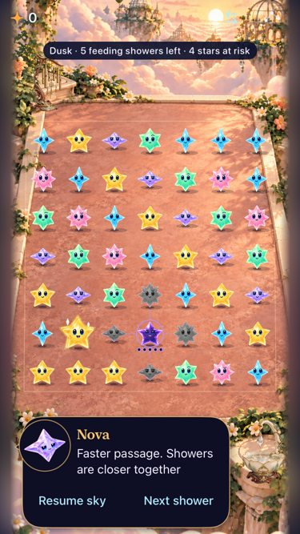
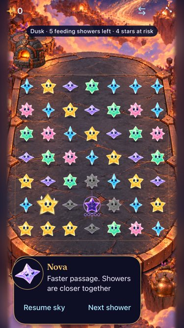
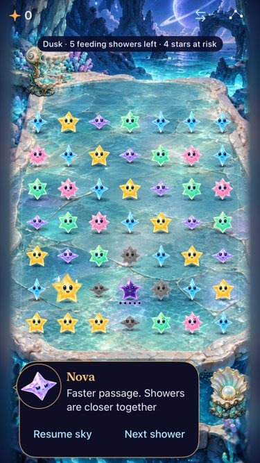
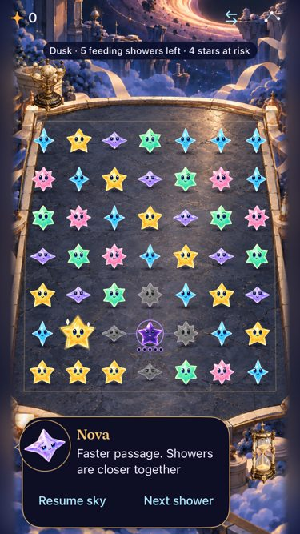

> Historical source-bound record. See [the current integration](README.md) for later header, wallpaper and orientation checks.

# Five selectable landing places

**Partially verified · development integration · October 18, 2026.** All five places are integrated into the normal Debug/Release app on `ac6aeb3`, with remembered menu selection, two interactive props each and shared arena/input geometry. Final compact-phone runs passed **149 core tests, 11 focused hosted tests and eight UI checks**, plus Debug/Release builds. Broader hosted and tablet failures remain recorded below; this is not release acceptance.

**Next action:** Explore the [shared responsive board template](../../design/environments/BOARD_TEMPLATE.md), then adopt its selected framing and wallpaper-extension contract. The user found the first rigid concept insufficient and requested phone/iPad/orientation comparisons. Complete final tablet acceptance, investigate the remaining hosted timing failure and resolve largest-text header presentation before release. Actual VoiceOver and physical-device testing remain separate RC/device work.

## Current native appearance

| Cloudsea Conservatory | Comet Hearth |
| --- | --- |
|  |  |
| Prism Tide Grotto | Eventide Archive |
|  |  |

**Native captures:** iPhone SE (3rd generation), iOS 27.0 Simulator, Debug, normal motion, Calm effects off, dense reset/review fixture. Source `ac6aeb3` plus runtime snapshot `7b468f99`; [full hashes and dirty paths](reconciled-source.json), [capture mapping](reconciled-captures.json). These are working-tree checks, not a clean published commit. [Observatory capture](dev-ac6aeb3-wip-7b468f99__active-play__iphone-se3__observatory.jpg). The current Dusk ring/feed marks and grown-star aura are retained; obsolete matching-group and dark-neighbor circles are absent. Still images establish sampled appearance, not motion feel or human preference.

## What the integration owns

Sky menu → Location remembers Observatory, Cloudsea, Hearth, Grotto or Archive through a cosmetic preference. Switching keeps score, stars, round and gameplay randomness unchanged. Each location has two native prop buttons with bounded responses: telescope/lantern, harp/dew catcher, kiln/kettle, fountain/pearl and orrery/sandglass. Repeated taps replace the response; menu, background, replacement and restart cancel its task.

`LandingGeometry` owns all render centers, native polygons, trace/swap hit mapping, column outlines, celebration anchors, the inlaid rim and prop registration. The terrace remains authored artwork with an open floor. The new solid rear props were initially large enough to obscure the score; native capture reproduced that defect. They now sit lower and smaller, with source aspect preserved. The final UI matrix asserts their actual frames do not intersect the score and exercises native far/front corner taps in every location.

`SkyDefaults` preserves current technique, dialogue and Sky Flow review suites and gives explicit Observatory reset/review launches their own suite. Store and root SwiftUI preferences share that choice. The selector is read-only; ordinary Debug/Release uses standard defaults. A real hosted regression clears a fixture and writes preferences while requiring ordinary saves/preferences to remain unchanged. Current v7 persistence, core rules and generation are unchanged from the reconciled main baseline. Removed rankings code stays removed.

## Checks and limits

Toolchain: Xcode 27.1 (27A9275), iOS 27.0 Simulator, arm64. Commands use project/scheme `Starfall`, `CODE_SIGNING_ALLOWED=NO`, `ARCHS=arm64`, `ONLY_ACTIVE_ARCH=YES` and serial tests. Final executions use `-collect-test-diagnostics never`; earlier failure-diagnostic collection hung after test completion and those xcodebuild processes were terminated. Raw logs/results are ignored under `artifacts/landing-places-2026-10-18/`.

| Check | Result |
| --- | --- |
| Current-main `swift test` | 149 passed, zero failures (`current-main-core.log`). Core unchanged since. |
| Final Debug test compilation | Passed (`prop-layout-tests-build.log`), explicit source/resource membership. |
| Final Release simulator build | Passed (`prop-layout-release.log`). |
| Focused hosted tests, SE3 | 11 passed: assets/alpha, fallback, geometry/rim/props, renderer mapping and isolated storage (`prop-layout-compact.xcresult`). |
| Final location/lifecycle/quiet UI, SE3 | Four passed: both five-location matrices, repeated props/background/restart, and actual system Reduce Motion. Covers persisted choice, unchanged round, all ten prop responses, menu/background cancellation, rapid prop input, native corner taps and largest-text quiet interactions. |
| Final gameplay UI, 17e | Four passed: native five-star trace, actual opening animation with early clear, First Light win/replay/full-sky and swipe-and-hold swap/empty-destination falling (`prop-layout-gameplay.xcresult`). |
| Broad preliminary hosted run | 222 methods executed, five assertion failures across two methods. New storage test expected an unadopted fixture; corrected to current `adoptingFeedingDusk()` and passes in final focused run. `NativeInputWindowTests.testIncomingFlightOverlapsRotationButLandsAfterIt` produced four failures, including absent landing observation. It is unchanged except shared geometry references elsewhere; causality is unresolved without a source-bound baseline comparison. Do not report the full hosted suite green. |
| Preliminary native matrix, 17e | Normal five-location matrix passed; largest-text quiet run missed a brief `Responding` state after event synthesis took over five seconds. No assertion/response duration was weakened. Final SE3 run passed with the adjusted prop layout. This does not prove the host-load failure class eliminated. |
| Preliminary tablet | Quiet largest-text matrix and supported-orientation test passed. Normal matrix failed one `At rest` expectation after Archive/menu dismissal. Final prop-layout tablet matrix has not run; cancellation timing remains to reproduce. |
| Visual review | All five final normal SE3 dense captures inspected. Largest-text Archive capture shows oversized header glyphs and the score is not visible in that frame; actions/guide use the existing scroll layout. Functional assertions do not accept that presentation. The responsive template must reflow it. |
| Hygiene / diff / project plist | Passed; rerun after subsequent changes. |
| Actual VoiceOver / physical device / performance / human art approval | Not run or not established on this integration. Full VoiceOver stays at RC. No phone installation was attempted. |

## Baseline correction and retained references

The first implementation started at `f35eba8`, **121 commits behind main**. The user recognized obsolete circles in a native capture; the source audit confirmed the issue. The environment changes were preserved and reconciled onto `ac6aeb3`, retaining current rendering, gestures, techniques, dialogue, flow and v7 saves. The old screenshots cannot accept the current game. [Initial notes and host-only previews](INITIAL_SOURCE.md) preserve their source limits; `source.json` and `pre-isolation-source.json` describe that older work, not this runtime snapshot.

Artwork provenance and exact built-in generation prompts remain in [the production set](../../design/environments/production-set/README.md). The shared board framing and extendable scenery are **concepts**, separate from the native integration and its evidence.
