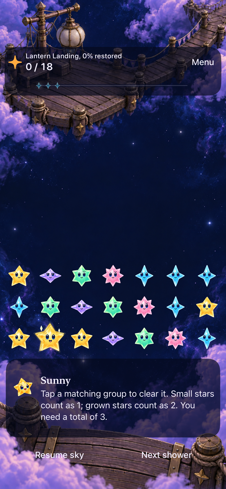
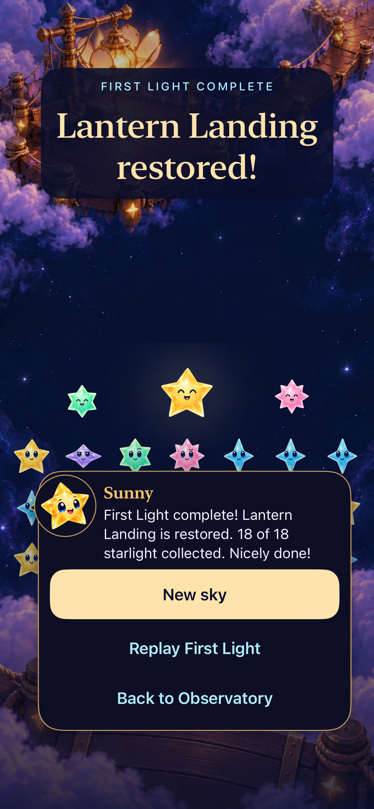
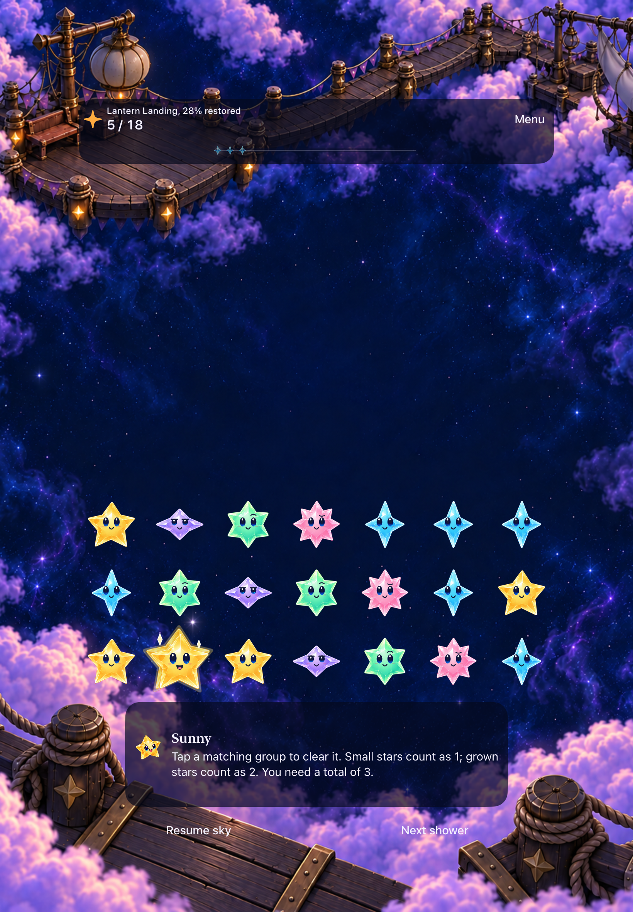
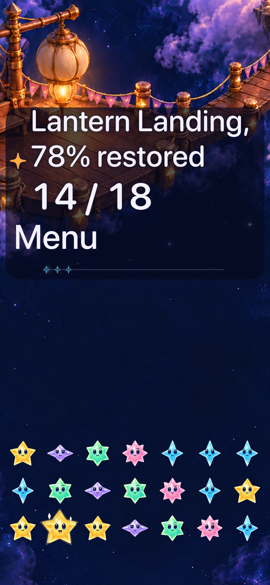
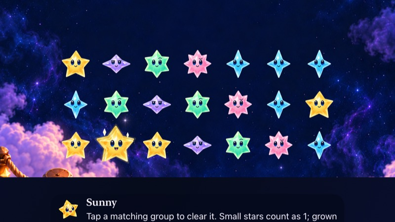

# Lantern Landing restoration acceptance

**Result:** Partially verified · **Owner:** Codex · **Date:** October 19, 2026

Lantern Landing is implemented in the normal app's optional First Light challenge. Its existing 18-starlight objective restores one continuous scene through five milestones. The rejected middle fade is removed; phone portrait, tablet portrait and tablet landscape each have bespoke artwork. Native development checks pass for progress, saved games, replay, rotation, compact landscape, largest text, Reduce Motion and the normal-motion ending. GitHub integration and physical installation are pending; this record does not claim delivery.

**Next action:** Publish to `lbeezr/starfall`, reconcile current main, and deliver through `scripts/device-update.py`; record its verified installation receipt. The user explicitly authorized that destination, merge and delivery after automatic review requested repository-specific confirmation. Actual VoiceOver remains an RC check. Physical gameplay and full-capacity native artwork review are separate remaining limits.

This folder owns source-bound acceptance and selected native captures for the [production plan](../../design/lantern-landing-01/PRODUCTION_PLAN.md). The [design package](../../design/lantern-landing-01/README.md) owns concepts and generated-art provenance. Raw test bundles and recordings are disposable local evidence.

## Outcomes against acceptance

| Criterion | Observed result | Evidence / limitation |
| --- | --- | --- |
| Existing rules, save and derived progress | Passed | Seed 42, steady showers, no dark stars, 18-light goal; no new save field/schema. Core boundary/replay/old-save checks and hosted selector/store checks pass. Survival remains the default. |
| Five restoration milestones | Passed | Committed scores 0/5/9/14/18 select 0/25/50/75/100 artwork. The HUD truthfully displays 0/28/50/78/100 percent. All 49 native cell identities and sampled frames remain stable. |
| Native clear, partial restore and entry cancellation | Passed | A real four-light clear advances 5 → 9; settings, backgrounding, relaunch and cancelling Replay retain the saved 9-light round. Final-source batch 06 repeats this path. |
| Winning clear, saved ending and replay | Passed | Native 14 → 18 clear, saved ending after relaunch, and replay at zero passed. First Light overflow and pending-entry Help passed separately. |
| Three continuous compositions | Passed in sampled native layouts | All 15 milestone views inspected. No middle cut, replacement center or feather boundary. Assets are proportionate and actual star bodies/faces remain readable. Native milestone fixtures contain 21 stars, not a full 49-star board. |
| Rotation and compact layout | Passed | iPad portrait → landscape → portrait preserves progress and accepts clears in both orientations. iPhone SE3 landscape uses the existing vertically scrollable canvas; a real win and reachable result actions were inspected. |
| Largest text and system Reduce Motion | Passed for development scope | Final-source batch 06 verifies the complete restoration header, winning clear and reachable result/replay actions. Actual VoiceOver was not run. |
| Normal-motion restoration and ending | Passed for sampled win | A 30-fps native recording shows the 14 → 18 clear, light reaching the lantern, its whole-image opening transition, and the ending. Hosted timing checks bound the last packet arrival before gameplay hands off. |
| Current-main integration and phone installation | Pending | Use the canonical updater, preserving the original app and player data. Installation is not physical gameplay acceptance. |

## Tested source and environment

**Final runtime source:** `8fb2e787a4ce9f36d9dd5f3e80a327c5977e2788`, runtime identity `dev.5afe4a3c23`, tree `61ee26d84a084988f030f4b19a38ad48d486837f`. Runtime inputs were committed and clean for final checks; subsequent differences are documentation and evidence only. This is a development worktree check, not yet a published-main export.

The continuous scenery was introduced at `caa0c5f` (`dev.4239835f1c`). Test-only `9872853` clarifies tablet coverage. `bd2b827` corrects compact-landscape artwork selection and packet timing. `8fb2e78` reflows the accessibility-size header. Earlier normal-size static captures remain representative of the same paintings; the changed accessibility header has replacement evidence below. The intermediate split-region renderer at `660379f` is superseded.

Native checks used Xcode 27.1 (27A9275), arm64, iOS 27.0 build `24A434`, the original Starfall app/scheme, and these simulators:

| Device type | Simulator ID | Use |
| --- | --- | --- |
| iPhone 17e | `21025903-D90D-4E30-BA74-45D3EFB2F5E4` | Phone milestones, lifecycle, ending, largest text, motion recording |
| iPad Air 11-inch (M3) | `4BA9208F-2CF6-45E6-BCB7-4DC93198295D` | Portrait/landscape milestones and native rotation/input |
| iPhone SE (3rd generation) | `EA0F7A30-21E1-4995-93F5-C4A983F4A354` | Compact landscape manual inspection |

Review fixtures require Debug, explicit reset and the isolated `Starfall.DialogueReview` suite. They do not reset normal player saves. Normal-motion checks use default text with Calm Effects and system Reduce Motion off; the separate accessibility test uses the largest accessibility text category and system Reduce Motion on.

## Checks and reproducible scope

| Check | Tested source / procedure | Result / local artifact |
| --- | --- | --- |
| Core | `caa0c5f`; `swift test` | **177 passed**, zero failures. Core unchanged afterward. `/private/tmp/lantern-core-caa0c5f.log`. |
| Batch 01 | First implementation preceding `64b0bd7`; all hosted tests and Lantern native class | 307 hosted and 3 native passed; 1 native failed because the test requested a First Light menu action while already in First Light. Corrected to Replay, then rerun in batch 02. `/private/tmp/lantern-native-01.xcresult`. |
| Batch 02 | `64b0bd7`; store, presentation, flow and dialogue hosted tests; native cancellation, overflow and pending Help | **87 passed**: 84 hosted, 3 native; zero failures/skips. `/private/tmp/lantern-native-02.xcresult`. |
| Batch 03 | `caa0c5f`; presentation hosted tests; phone milestones, largest-text/Reduce Motion ending, saved win/replay | **12 passed**: 9 hosted, 3 native; zero failures/skips. `/private/tmp/lantern-native-03.xcresult`. |
| Batch 04 | `9872853`; tablet five milestones in landscape and rotation/input test | **2 native passed**, zero failures/skips. `/private/tmp/lantern-native-04.xcresult`. |
| Batch 05 | `bd2b827`; presentation and celebration hosted tests; tablet five milestones in portrait | **26 passed**: 25 hosted, 1 native; zero failures/skips. Includes all 15 packaged images, packet bounds, crowded award layouts and interruption/stale-completion behavior. `/private/tmp/lantern-native-05.xcresult`. |
| Batch 06 | `8fb2e78`; phone largest-text/Reduce Motion ending and clear/settings/background/relaunch/entry-cancellation tests | **2 native passed**, zero failures/skips. `/private/tmp/lantern-native-06.xcresult`. |
| Builds | Debug phone/tablet/compact throughout the checks; final-source Release simulator build | Passed. Final Release log: `build_sim_2026-10-19T14-22-31-302Z_pid14605_8763c4fc.log`. No final Release warnings/errors reported. |
| Test matrix | `python3 scripts/native_test_plan.py --stage dev` | 316 hosted, 120 UI methods registered; tablet-only rotation excluded from phone selection. These counts are registration, not a claim all were run on final source. |
| Source hygiene | `python3 scripts/ci-hygiene.py`; `git diff --check`; changed-document relative-reference scan | Passed after evidence finalization; 644 relative references resolve. Rendered Markdown was not checked. |
| Browser concept | All 15 state/view combinations, 0/24/49-star densities, guides and keyboard controls | Loaded and inspected; no console errors observed. Browser assets/face placement are concepts, not native input or animation evidence. |
| Actual VoiceOver / physical play | Development cadence | Not run; VoiceOver deferred to RC. Physical gameplay remains unverified. |

Native batches used XcodeBuildMCP `test_sim` with explicit `-only-testing` selections, isolated result bundles, and `ARCHS=arm64 ONLY_ACTIVE_ARCH=YES CODE_SIGN_IDENTITY=- CODE_SIGNING_ALLOWED=YES DEVELOPMENT_TEAM= CODE_SIGN_STYLE=Manual`. Exact invocations and results are retained in the XcodeBuildMCP Starfall workspace logs. `xcrun xcresulttool get test-results summary --path <bundle>` supplied the reported counts. Batch attachment manifests remain under `/private/tmp/lantern-native-0N-attachments/manifest.json` for 03–06. No batch count should be summed as unique coverage because selections overlap.

## Why the seam appeared and what changed

The first renderer split a painting into independently positioned regions and faded their edges around the playfield. That spatial blend created the cloud line the user reported. The correction removes that composition mechanism at its owner, `LanternLandingEnvironment`: each milestone is one opaque, proportionately scaled image, and restoration crossfades whole images. Reached images remain opaque underneath the next image, preventing the backdrop from showing through during the transition. The board's geometry and native input mapping are unchanged.

The same boundary was checked in phone portrait, tablet portrait, tablet landscape, rotation and compact landscape. A separate canvas/viewport mismatch placed landscape scenery too low in the compact phone's tall scroll canvas; the selector now uses the portrait-tablet composition for that tall canvas, with the complete focal lantern kept visible. Largest text now uses an explicit vertical header, avoiding a squeezed/truncated restoration caption. No scenery mask is used to hide either layout issue.

One tablet dock fitting is lit at 25%, dark at 50%, and lit again at 75%. Overall restoration reads clearly, but individual fittings are not perfectly cumulative. This localized generated-art continuity issue is recorded in [engineering follow-up](../../ENGINEERING.md#lantern-landing-artwork-and-device-acceptance--october-19-2026). Whole-image transitions also blend the lantern outlines; this implementation is not an articulated petal rig.

## Visual and motion evidence

All five native milestones were inspected in each main composition, plus tablet rotation and the compact/large-text cases. Tablet rotation retains 5 light/28%, then a landscape clear reaches 9/50%; returning to portrait retains it, and another clear reaches 13/72%. The native input assertions and inspected images support those separate claims.

| iPhone 17e, 0 light | iPhone 17e, restored |
| --- | --- |
|  |  |

**Native Debug simulator stills — `caa0c5f`, `dev.4239835f1c`, default text/normal-motion configuration.** These show the continuous scenery and endpoints; motion is established by the recording below.

| iPad portrait, 5 light | iPad landscape, restored |
| --- | --- |
|  |  |

**Native Debug simulator stills — same runtime/artwork, batch-04 test revision `9872853`, iPad Air 11-inch (M3).** Five light selects the 25% artwork while displaying truthful 28% progress. Ordinary tablet portrait was also inspected from batch 05.

| Corrected largest-text header | Compact landscape play |
| --- | --- |
|  |  |

**Native Debug simulator stills — final source `8fb2e78`.** The first uses largest accessibility text/system Reduce Motion; the second uses default text/normal motion after scrolling. Compact landscape requires vertical scrolling; it does not show the entire board and controls simultaneously. The [compact result actions](dev-8fb2e78__restored-actions__iphone-se3__landscape-normal-motion.jpg) were reached after a real winning clear. The [replay entry](dev-8fb2e78__replay-entry__iphone-17e__normal-motion.png) preserves the location preview and readable Begin/cancel actions. The earlier [largest-text result](dev-caa0c5f__restored__iphone-17e__largest-text-reduce-motion.png) remains historical evidence of the scrolled ending, not the corrected header.

**Normal-motion recording:** `/private/tmp/lantern-8fb2e78-win.mp4`, 30 fps, 46.718 seconds, SHA-256 `34ed78e38ea7ced7fab6016a74ace0c41bcd863246578b187b3f7110eacf1775`. Source `8fb2e78`, iPhone 17e, default text, Calm Effects off, system Reduce Motion off. Ordered native frames were decoded with AVFoundation and inspected at 0.1-second intervals around the clear. At approximately 2.0 seconds, the committed 14 → 18 clear launches the light; by 2.1–2.3 seconds it reaches the upper lantern; around 2.4–2.5 seconds the opened scene appears; the ending follows around 2.6 seconds. Clouds remain continuous. This is a sampled visual review of an actual recording, not a still-image claim about motion or audio.

The earlier packet timing could outlive the clear-to-result handoff. Shared packet timing now bounds six lantern packets to 0.455 seconds, before the 0.56-second handoff, while retaining ordinary score-destination timing. Hosted checks verify both destinations; the native recording verifies the sampled win visually. The fix adds no score/save dependency on animation, result delay or input gate.

Retained capture hashes and contexts are in [captures.json](captures.json). They are unmodified native exports. Full-capacity native scene readability, physical gameplay and actual VoiceOver are not established by the sparse milestone captures, browser density preview or hosted award tests.
