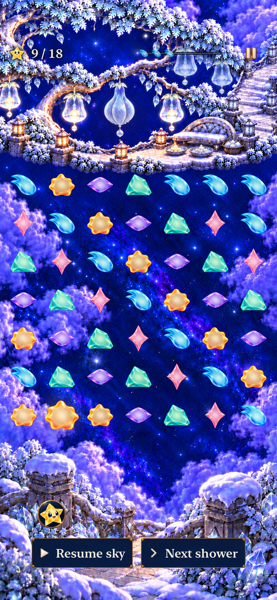

# Living starlight native integration

**Development verified; ready for publication, canonical delivery pending — October 20, 2026.** Seven gameplay pieces now hold one responsive inner light. Forecasts use the same resting appearance, while finite native responses give falling, contact and touch a brief acknowledgment. Original story characters, rules and saves remain unchanged.

Tested runtime **`dev.e2b265734e`** is main `d94903b69e864218ca2643ddc191676324f69654` plus working-tree snapshot **`756c0353`**, not a clean published commit. [Source hashes](source.json), [commands/results and timing comparison](verification.json), and [capture provenance](captures.json) bind the evidence below. Environment: iPhone 17e Simulator, iOS 27.0, Xcode 27.1 (`27A9275`), ARM64; QA device `D65C5E40-734F-42BF-8F91-97E980ED19C2`.

## What passed

| Check | Result and scope |
| --- | --- |
| Core | 185 passed, no failures or skips. |
| Build and membership | Debug test build and Release simulator build passed with the shared-shader implementation. |
| Hosted | 48 passed, no failures or skips: seven materials/rest parity, independent per-piece state, retained story cast, finite responses/reset, historical drain/pressure, lifecycle and fresh-survival input windows. |
| Native UI | 5 passed, no failures or skips: input before the last opening wave; dense overflow/named replay; dense rapid clear plus Settings/background preservation; largest-text/system Reduce Motion win; several automatic normal-motion forecast cycles. |
| Recorded motion repeat | The existing dense rapid-clear/Settings/background test passed again, 1/1 with no skips, while recorded. Sampled video inspection is described below; this is a repeat, not an additional distinct UI case. |
| Source hygiene | Repository hygiene and whitespace checks passed. Selected native checks are focused development coverage, not the complete hosted/UI/RC matrix. |
| Visual | Inspected small materials, native/forecast parity, a 49-piece Frostfruit board and sampled normal-motion video. Hosted native actions separately exercise finite responses for all seven families. |

`SkyPiece` keeps saved identities and forecast/flight/board routing. `LivingLight` caches a shell, interior mask and resting composite per family, plus seven shared shaders with immutable family uniforms. Per-node `a_light`, `a_drain` and `a_pressure` attributes keep responses independent; cancelling decorative motion preserves committed drain/pressure. Nine material references account for **6,029,312 nominal RGBA8 bytes**, with the existing grown aura separate. This is a raster bound, not measured GPU/process memory.

## Inspected appearance

**Native SpriteKit material export on the recorded snapshot.** All seven contours remain distinct at 24/36/44 points. The interiors form continuous light with no visible spill outside the rim in these stills. Dusk's notches remain open; white Opal retains its colored edge on light ground. The bottom row keeps special roles at ordinary size and compares colored bodies with one larger body and its aura. [Native versus forecast pairs](dev-d94903b-wip-756c0353__native-forecast-parity__iphone-17e__native-host.png) visually agree at rest; the native render is on the left and cached forecast on the right.

**Native full-board capture, normal-motion settings, default text.** This is the existing reset-only Frostfruit restoration fixture at 9/18 starlight and 50% restoration, before a real rapid clear. The five colored families remain distinct against both navy and bright clouds, with clear spacing around ordinary and enlarged bodies. Dusk and Opal are covered by the material sheet, not this restoration fixture. The associated UI test then clears through native input and verifies retained state through Settings and backgrounding.

A separate recording of that same passed test was sampled at 3-second intervals from 10–40 seconds, then every 0.15 seconds from 26–29 seconds. The inspected clear occurs around 27.8–28.1 seconds; falling/rebound settles by about 28.55 seconds. The light stays inside the varied silhouettes, and unrelated pieces do not move continuously. These are sampled observations, not continuous frame-time measurements or physical play. The disposable recording's SHA-256 and sampling bounds are retained in [verification.json](verification.json); no large video is committed.

## Initial timing failure and bounded correction

The initial hosted run executed 48 tests: **47 passed and one failed**. `NativeInputWindowTests.testRealSceneFreshSurvivalInputWindowsAcrossAutomaticStorm` observed a 4.408-second presentation at shower 10, leaving no scheduled input window. The other four sampled showers retained time for input.

A clean export of `d94903b` passed the same unchanged test on the same simulator. The implementation then moved from per-node shader construction to seven cached family shaders with per-node attributes. The complete 48-test shared-shader run passed, including every original timing assertion:

| Shower | Clean baseline ready time | Initial candidate | Shared-shader candidate |
| --- | ---: | ---: | ---: |
| 9 | 1.727 s | 1.752 s | 1.711 s |
| 10 | 1.201 s | 0.000 s | 1.226 s |
| 11 | 1.195 s | 1.234 s | 1.212 s |
| 12 | 1.171 s | 1.227 s | 1.230 s |
| 13 | 2.366 s | 2.382 s | 2.377 s |

Every final window exceeds the unchanged 0.5-second requirement. No game cadence, assertion or timing budget was relaxed. The initial stall's cause remains unconfirmed: shader sharing removes repeated program construction, but this comparison does not prove why the isolated stall occurred or establish sustained physical-device performance.

## Boundaries and delivery

The [design acceptance](../../design/star-cast/living-starlight-2026-10-20/README.md#native-acceptance) is implemented and development-verified in the normal target. There is no comparison app or player switch. The [browser study](../../design/star-cast/living-starlight-2026-10-20/browser-checks.json) remains concept history; [previous shard evidence](../gameplay-shards-2026-10-20/README.md) describes its earlier materials.

Publication and installation remain pending. Reconcile current main, publish the verified inputs, then use only [`scripts/device-update.py`](../../../scripts/README.md#one-app-iphone-updates). Record the installed source/build and OS-owned installation verification separately. No phone installation is claimed by these simulator checks.

Physical 49-piece frame pacing, light/family recognition and response comfort are not tested. Minimum-iOS rendering remains the existing platform gate. **Actual VoiceOver: deferred to RC; not run on this development build.** [ENGINEERING](../../ENGINEERING.md#active-debt-and-next-actions--october-18-2026) records the concrete follow-up. Raw logs/results remain under `/tmp`; the JSON records retain commands, selected counts and source boundaries.
