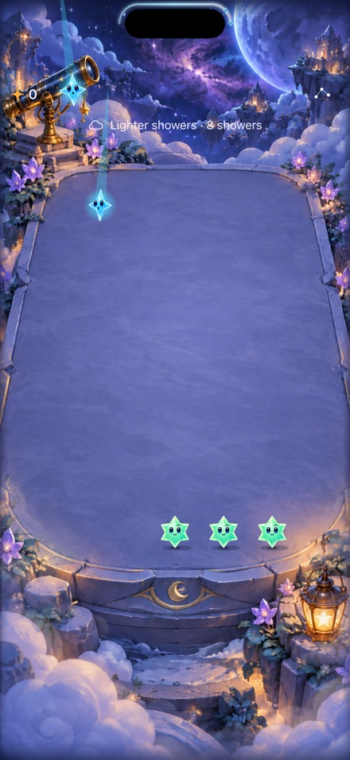
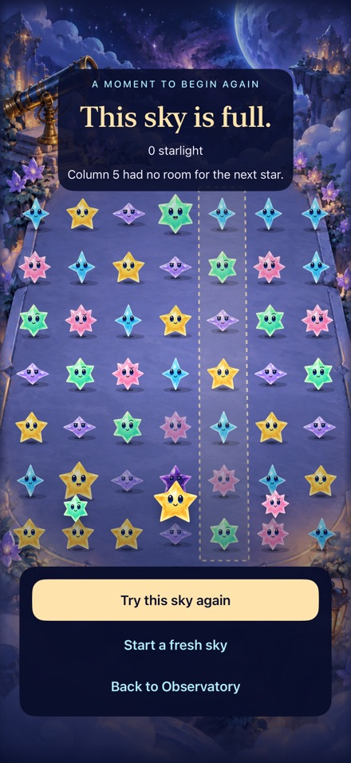

# Drawing and full-window polish in regular Starfall

**Result:** Partially verified · **Owner:** current implementer · **Date:** October 17, 2026

All changes target the normal `com.starfall.prototype` app. No separate lab is created or installed. Drawing holds showers from eligible touch-down, accepts continuous coarse/grazing hits and keeps the chosen path after a spatial miss. Core still validates each addition; lifecycle changes cancel stale input. Resting/clear/landing rings are removed in favor of the existing thread, finite sparks and surface light. New brisk skies use a 2/1.7/2.5-second cycle; existing skies retain saved timing.

**Next action:** Deliver the verified main source through the existing updater, then review physical drawing and camera fit at the next play session; actual VoiceOver remains an RC gate.

**Acceptance:** Preserve exact saved state/replay and ordinary taps; hold the single deadline during drawing with no catch-up; retain Opal, cancellation, maximum-text and menu/background behavior; fill the window and expose the 16 Pro Max camera forecast. Physical feel and actual VoiceOver remain separate RC work.

 

**Runtime evidence:** `dev.691d4458d3` on main `0a64c1f` plus this branch's source edits, iPhone 16 Pro Max / iOS 27.0 Simulator. Selected native attachments, resized JPEGs; original PNGs remain in ignored `native-attachments/`. These show full-window play/result layout and the Island forecast, not physical cutout fit or animation acceptance. The later cadence-background correction is verified separately below.

## Cause and scope

A hidden measurement row above the canvas reserved blank space even during endings and consumed the inset used for Island detection. The cue background also inherited safe-area expansion; it now paints only its own bounds. Moving the reservation inside the HUD keeps scenery/scene dimensions stable. The hardware profile previously recognized only iPhone 17; iPhone 16 Pro Max now uses the shared contour. Unknown/accessibility viewports keep the header fallback. Examined play/ceremonies, cadence V1/V2, settings, maximum text and forecast placement; this is not acceptance of every device profile.

Touch input previously began after drag slop, left the deadline running, sampled every six points and cancelled on a wrong spatial visit. Touch-down now owns the hold; analytic segment/circle hits use the same projection as native buttons. Spatial rejection preserves intent; snapshot/generation rejection cancels it. Ordinary tap, Opal prefix legality and selected-set commits retain their authoritative owners.

The initial checkout was stale. Its draft was preserved in stash `233c58f15dad9a02bcbb13ade0571b94de5a4fcc` and ignored `artifacts/direct-integration/pre-reconciliation/`; no stale build was installed. Focused fixes were reapplied to main `0a64c1f`, then reconciled with `06ce514` (Opal Float compatibility). Do not reapply the whole stale draft.

## Verification

Environment: Xcode 27.1 (27A9275), arm64 iPhone 16 Pro Max Simulator, iOS 27.0, device `5107CBBF-108B-4B94-9125-A873F948A38C`. Development test fixtures remain Debug-only inside the normal app. Raw logs and result bundles are under ignored `artifacts/direct-integration/`.

| Check | Result / limits |
| --- | --- |
| Core | `swift test`: 90 passed, including exact V2 slots and V1 save/replay. `current-core-final.log`. |
| Real saved round | The backed-up physical phone round decodes as valid with 41 starlight; all JSON fields compare equal after re-encoding, including `savedCadence`. No save migration/reset. |
| Hosted / native | 137 initial hosted checks passed; 12/13 initial native checks passed. The sole failure was the larger-phone scroll-only guide expectation below. Corrected run: 138 hosted checks and both guide/held-touch native cases passed (`final-hosted-and-trace.log`, `dev.bddc3cbb27`). The final paint-only correction compiled in Release and passed native Opal tracing (`final-phase-background.log`, `dev.6c198a270b`); screenshot inspection confirms scenery remains visible above the faster cue. Earlier integration failures (project-ID collision, extraction membership/helper access and outdated V1 expectations) are retained in raw logs and corrected. |
| Layout regression | The first larger-phone guide test required a scroll container even when all text fits. Corrected to assert either complete visible message containment or scrolling with fixed actions; the same guide case passed on iPhone SE3 / iOS 27.0 (`E90550D2-AE94-4695-8E6F-707BD527C12F`, `final-small-guide.log`, `test-without-building` against the final `dev.6c198a270b` product). |
| Build | Final Debug native build and Release simulator build passed (`final-release-bg.log`, `dev.6c198a270b`). Final source is `06ce514` plus this PR; intervening tests differ only by the explicitly described HUD paint correction. |
| Hygiene | `python3 scripts/ci-hygiene.py` and `git diff --check` passed. |
| Actual VoiceOver / human feel | Not run in this development pass. Physical curved/branching/multitouch gestures and cutout/expanded activity fit remain next-device/RC checks. |

No game generation/RNG, score, persistence namespace, external SDK or networking change. Versioned cadence is the sole core behavior change.

Native command base (isolated simulator saves):

```sh
xcodebuild -project Starfall.xcodeproj -scheme Starfall -configuration Debug \
  -destination 'platform=iOS Simulator,id=5107CBBF-108B-4B94-9125-A873F948A38C' \
  -derivedDataPath artifacts/direct-integration/main-current \
  ARCHS=arm64 ONLY_ACTIVE_ARCH=YES CODE_SIGNING_ALLOWED=NO \
  STARFALL_BUILD_ID=dev.bddc3cbb27 -parallel-testing-enabled NO \
  -test-timeouts-enabled YES -default-test-execution-time-allowance 200 \
  -only-testing:StarfallAppTests \
  -only-testing:StarfallUITests/ConstellationTraceNativeTests/testLongPausedGuidanceStaysBelowFrontStars \
  -only-testing:StarfallUITests/ConstellationTraceNativeTests/testStationaryTouchHoldsShowerBeforeDragAndTapStillWorks test
```

The broader first run used `dev.691d4458d3`, all nine `ConstellationTraceNativeTests`, `ShowerForecastInteractionTests`, the result-controls and welcome/another-sky cases in `SkyFlowInteractionTests`, and system Reduce Motion manual play. The final targeted run checks the corrected viewport-adaptive guide assertion and hosted debug capability snapshot on reconciled main. Release uses the same project/scheme with `-configuration Release -destination 'generic/platform=iOS Simulator'` and `build`, retaining arm64/signing options above.
