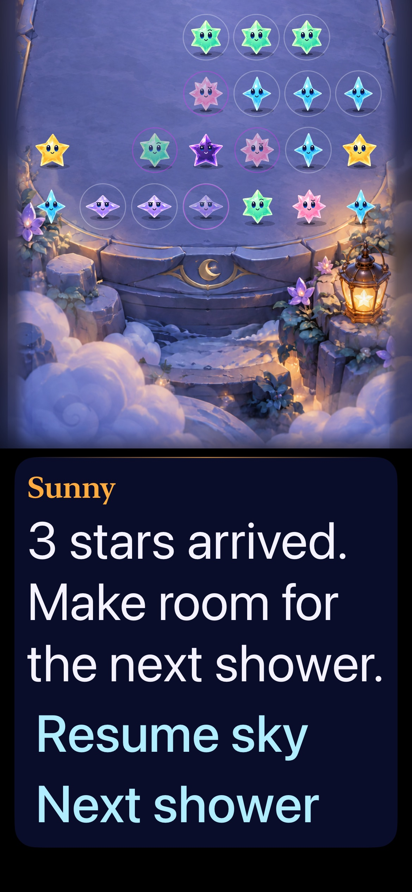

# Local main includes GitHub fixes and the latest mechanics evidence

**Result:** Verified within the checks below · **Owner:** current implementer · **Date:** 2026-10-17

Reconciled GitHub main 9a0a93e with local f24302d in clean merge c28fa23. Preserve local opening cadence, optional ranking implementation and mechanics evidence; include remote quiet automatic speech, large-text guide-title roles and the user-approved tracing-lab record. This merge does not adopt a new mechanic or claim current device/actual VoiceOver acceptance. No push was performed.

**Next action:** Continue the selected-trace opportunity-cost experiment from the reconciled source. Verify any later native comparison separately; existing older lab builds and offline samples retain their original source pins.

## Outcomes against acceptance

| Check | Observed result | Scope / limitation |
| --- | --- | --- |
| Git history and conflict resolution | Both parents retained | Remote test-driver refactor retained all local Observatory test names and added three flow checks. Current completed storm evidence retained over remote's older planned record. |
| Core | 63 passed | `swift test`; package source unchanged by reconciliation. |
| Hosted | 98 passed | All StarfallAppTests, including quiet explicit/automatic/terminal speech, opening/legacy clocks, cancellation, saves and offline ranking mocks. No live Game Center claim. |
| Native UI | Seven passed | First Light win/restore/replay and loss; opening clear before final wave; maximum-text settings; system Reduce Motion; menu/background; reachable props/paused controls. |
| Build | Debug test build and Release simulator build passed | arm64, code signing disabled. No phone install. |
| Visual inspection | Large-text guide and opening-clear captures inspected | Message and controls reflow below the playfield; Sunny stays subordinate. Opening capture shows ongoing arrivals after the earlier clear. Still frames do not verify motion quality. |
| Actual VoiceOver | Not rerun | Retain source-bound remote speech evidence; follow development/RC cadence. Hosted announcement assertions do not prove speech delivery on this merged source. |
| Hygiene | Passed | `python3 scripts/ci-hygiene.py`, `git diff --check`. |

## Verification context

Clean source c28fa238d1bf9618f870d78baf0af359fc294996 on the work branch. XcodeBuildMCP, Starfall scheme, iPhone 17e / iOS 27.0 private Simulator 536BCC00-751C-47BA-BC2F-C1702941CFC8; Debug tests and Release build. [Verification manifest](verification.json) preserves exact selected tests, arguments and raw result/log locations. This record and its image are documentation-only additions after native execution.

Merged-source Debug native capture, maximum text, scrolled to the guide after a manual shower. JPEG conversion preserves the full capture. This confirms the visible guide composition at this state, not landscape/tablet/device acceptance or automatic speech. Original PNG, opening-clear capture and remaining attachments stay in the raw result bundle.

## Integration boundaries

Conflicts were resolved by preserving current completed local experiment/ranking/opening records and merging the newer remote accessibility facts. No force push, history rewrite, normal-save reset, new app identity, production tracing route or white-star spawning. Production App changes are exactly the imported remote presentation/feedback fixes composed with existing local code; generation and ranking behavior were preserved.

Broader minimum-OS, device/custom-rotor and human gameplay acceptance remain separately open. The user-approved lab remains isolated; its older native Core/captures do not establish current-main timing or selected-trace production acceptance. Rebase the next timed experiment deliberately rather than treating an old save/fixture study as the current game.
