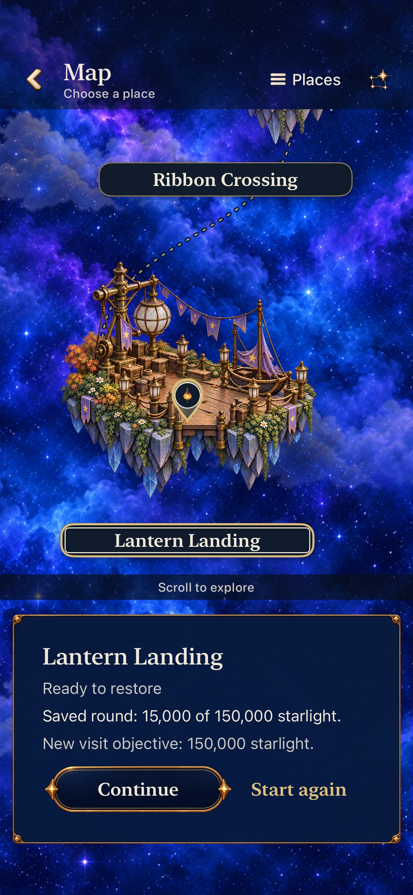
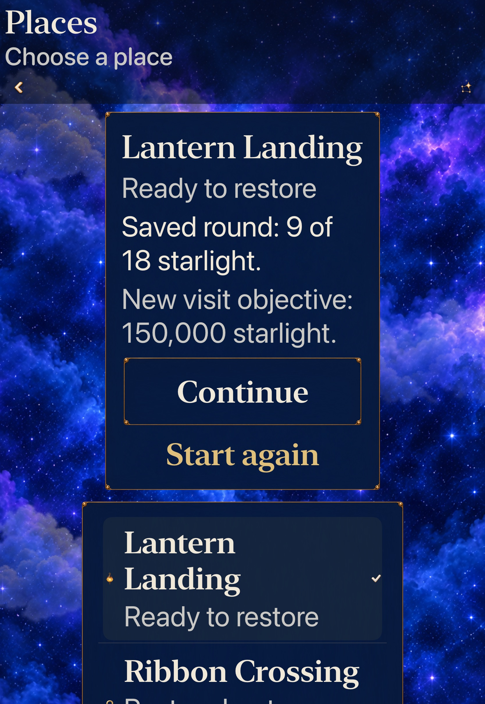

# Exact objectives on Map and Places

**Result:** Verified for selected development acceptance · **Owner:** Factory coordinator · **Date:** October 22, 2026

[Leaf #238](https://github.com/lbeezr/starfall/issues/238) makes unfinished restoration work visible before Continue or Start again. The shared destination card now shows the current new-visit objective and, separately, the matching unfinished round's exact saved progress. Historical Lantern stays **9 of 18**; current Lantern stays **15,000 of 150,000**. Begin remains the replacement boundary. This is a goal-driven enhancement; player comprehension is unmeasured.

`WorldMapGoalSnapshot` receives committed values and the selected journey. New targets come from the actual current definition; saved progress comes from the matching unfinished `StarlightRestoration`. Locked/unbuilt places receive no playable objective. Ended, unrelated and survival rounds supply no saved-progress label. The map gains no game/store mutation capability. Existing selection, navigation, actions and measured-card layout remain authoritative. Two typed catalogue labels reuse native typography/panels; no new asset, rule, save field or dependency is added.

## Source and verification

[source-inputs.json](source-inputs.json) records base `ae772448`, seven frozen source/test paths, snapshot `07d5cea32c27` and computed runtime `dev.c9772c178b`. The simulator displays `dev.local`, version 0.1.0 (1). Integration over `daf00b93` changes only documentation/evidence; every compiled app/Core/test input and all seven hashes stay identical. These are explicit working-tree checks; publication compares the clean tree and runtime identity.

macOS 27.0.1 arm64; Xcode 27.1 (`27A9275`); iOS 27.0 (`24A434`). Factory-owned iPhone 17e `64231AFE-4CDB-4B5A-B6D5-70CD7CEED324` and iPad Pro 11-inch (M5) `255E141F-D4D6-45DA-89FF-51436BF1BBA7` run serially and are shut down afterward. Other devices and physical player data are untouched.

| Check | Observed result |
| --- | --- |
| Core | 239 passed; zero failures/skips. |
| Hosted | Eight passed; all seven current targets, historical/current retained scales and restoration, locked/unbuilt/absent/ended cases, Entry/cancel preservation and typed catalogue contracts. |
| Phone native | Two passed: real 15,000-point opening, Map/Places equivalence, another ready place, unbuilt countercase, Entry/Settings cancellation and exact 49-cell/score/paused Continue; existing XL illustrated-map/marker/action assertions retained. |
| Tablet native | One AX3XL case passed: complete historical 9/18 and fresh 150,000 labels/actions, canceled new visit and unchanged historical Continue. |
| Debug / Release | Both arm64 builds passed. Existing source membership remains; both bundled catalogues equal frozen source bytes and include the new labels. |
| Hygiene / diff / links | Checked after explicit staging; rendered Markdown not inspected. |

All selected native/hosted checks finish with zero failures/skips. No assertion weakening, retry or quiet-motion substitute was needed. The changed classes contain 28 hosted flow and 20 native journey methods; this subset is not a full development/RC matrix. [verification.json](verification.json) retains exact commands/selectors, counts, device contexts, resource hashes and bounded receipts. Core uses `swift test --scratch-path <temp>/swift-build --jobs 2`; native commands use the existing `simulator-command.py` owner, explicit arm64 products, disabled parallel execution and `-collect-test-diagnostics never`. Raw output stays disposable under `/private/tmp/starfall-map-goals-20261023/` and adjacent `starfall-map-goals-*-20261023.log` files.

## Inspected native cards

| Current phone round / default text | Historical tablet round / AX3XL |
| --- | --- |
|  |  |

Complete labels and actions fit these inspected stills. The [equivalent Places card](dev-ae772448-wip-07d5cea32c27__places-retained__iphone-17e__default-text.jpg) retains the same meaning; [phone XL](dev-ae772448-wip-07d5cea32c27__world-map-retained__iphone-17e__extra-large-text.jpg) stacks actions while keeping the illustrated map. Scrolled world/list content extends beyond its own viewport. [captures.json](captures.json) binds four inspected originals and dimension-preserving JPEG exports to the snapshot; older map-state samples remain historical for the changed card.

Actual-touch checks establish navigation, committed opening outcomes and save preservation. Stills establish sampled appearance. Animation quality, measured contrast, physical comfort and human comprehension remain separate; actual VoiceOver stays deferred. Revisit wording and choice clarity at the next ordinary player session. #237 can follow after its active shared-file reservation clears; wider #240 outcomes remain open.
