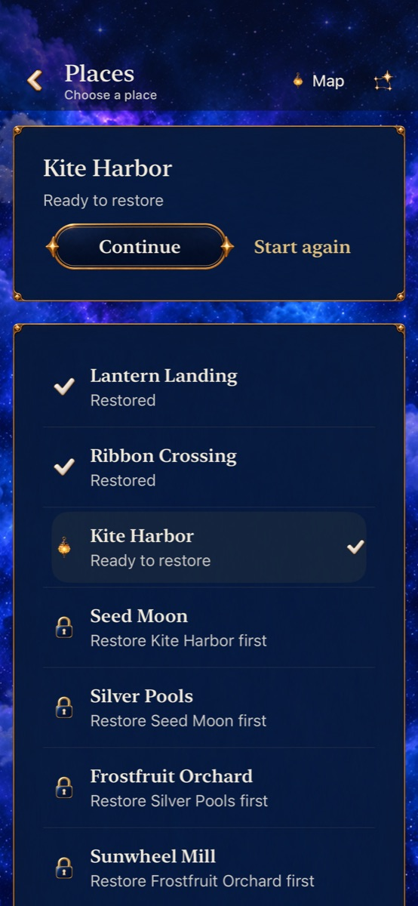
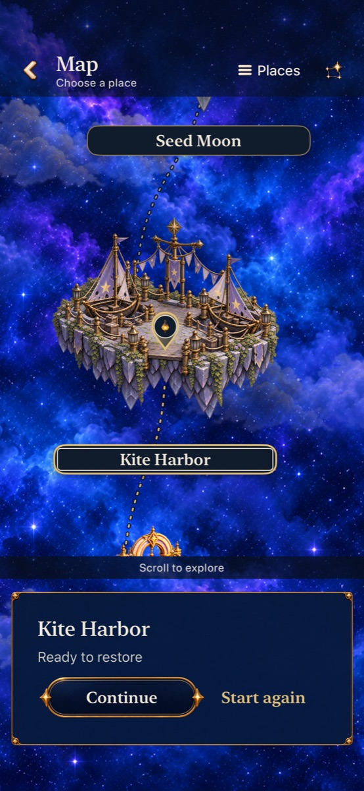

# Map/Places survives navigation

**Result:** Verified for development · **Date:** October 21, 2026

The app now preserves the player’s explicit Map/Places choice when canceling a destination’s Entry screen or returning through Home. Previously those routes destroyed `WorldMapView` and reset its local `@State` to Map. A native test reproduced the reset before the fix: after choosing Places → Start new visit → Back, the toggle read “Places” (the action to leave Map), instead of “Map” (the action to leave Places).

`FallingSkyView` now owns that UI state and passes a binding to the map. Selection and unlocks retain their existing journey owner. Mandatory Places layouts remain computed; they do not overwrite the explicit choice. The choice lasts for this navigation view’s lifetime and is not a new saved preference. No artwork, geometry, rules or save schema changes.

## Acceptance and results

- Before fix: one native regression failed at the exact Entry cancellation assertion.
- After fix: 24 hosted flow tests and three phone native tests passed; the same new navigation regression also passed on iPad Air 11-inch (M3). Zero failures or skips across both result bundles. These include Places/Map Entry cancellation, Home round trips, retained-round continuation availability, Tutorial coverage/return and largest-text background/return.
- Hygiene and diff checks: passed.
- Core: `swift test`, 225 passed, zero failures.
- Release simulator build: passed.
- Actual VoiceOver, physical-device play and animation acceptance: not run; this change concerns navigation state.

## Tested source and commands

Base `7a6dee86be1eacbec3b029a233df1684980119ce` plus [snapshot `da0057a7`](source.json). It records all dirty app/test inputs, including the earlier Tutorial hint changes. Earlier documentation edits do not affect builds. Xcode 27.1 (`27A9275`), arm64, iOS 27.0 Simulator. Phone: iPhone 17e `A0300936-14CC-4B3A-9B09-55B88D1D7624`. Native tests use normal motion; the separate largest-text test also uses the existing calm fixture.

```sh
swift test
python3 scripts/ci-hygiene.py
git diff --check
xcodebuild -project Starfall.xcodeproj -scheme Starfall \
  -destination 'platform=iOS Simulator,id=A0300936-14CC-4B3A-9B09-55B88D1D7624' \
  -derivedDataPath /private/tmp/starfall-low-fruit-dd \
  -resultBundlePath /private/tmp/starfall-map-mode-after.xcresult \
  -parallel-testing-enabled NO ARCHS=arm64 ONLY_ACTIVE_ARCH=YES \
  -only-testing:StarfallAppTests/SkyFlowStateTests \
  -only-testing:StarfallUITests/WorldMapReviewInteractionTests/testPlacesModeSurvivesEntryCancellationAndHomeRoundTrip \
  -only-testing:StarfallUITests/WorldMapReviewInteractionTests/testTutorialHidesCoveredMapAndPreservesSelectionAndRetainedRound \
  -only-testing:StarfallUITests/WorldJourneyInteractionTests/testLargestTextMapAndPracticeSurviveBackground test
xcodebuild -project Starfall.xcodeproj -scheme Starfall -configuration Release \
  -destination 'generic/platform=iOS Simulator' \
  -derivedDataPath /private/tmp/starfall-low-fruit-release-dd \
  ARCHS=arm64 ONLY_ACTIVE_ARCH=YES CODE_SIGNING_ALLOWED=NO build
```

The baseline used the same phone build/test command with only the new regression selected and result path `/private/tmp/starfall-map-mode-before.xcresult`, before changing the two map-state owners. Raw logs and xcresults remain disposable under `/private/tmp/starfall-map-mode-*`. Existing target members are edited; no membership change is needed. Release emits the tooling warning that App Intents metadata extraction is skipped without an AppIntents dependency.

The iPad run uses the same built product and native regression, with `test-without-building`, destination `377B8820-20E2-413E-B64F-D9E4CEB86AF4`, and result path `/private/tmp/starfall-map-mode-tablet.xcresult` (iPad Air 11-inch M3, iOS 27.0).

## Inspected return screens

[Five inspected samples](captures.json) show both presentations after Entry cancellation on phone/tablet, plus the phone’s mandatory largest-text Places fallback. Selection, headings and Continue/Start again controls are visible in both default-text return modes. The large-text sample wraps and scrolls; its separate interaction test reaches and activates controls. No artwork, layout or contrast acceptance is inferred beyond these inspected samples.

| Places after cancel | Map after cancel |
| --- | --- |
|  |  |

Debug source snapshot `da0057a7` at `7a6dee86` plus the recorded dirty inputs; iPhone 17e / iOS 27.0 Simulator, default text, normal motion. JPEG copies are reduced from the inspected native PNG attachments; exact source names, timestamps and hashes are in the index. No existing art captures were replaced.
