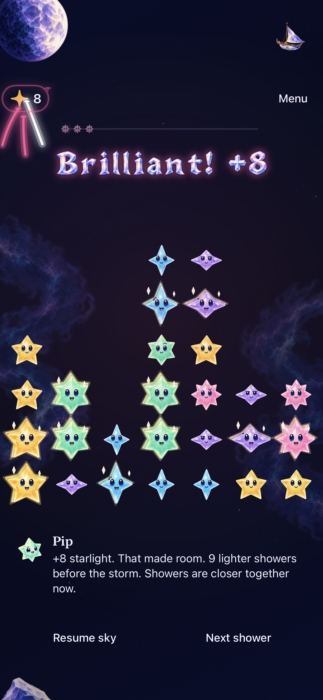
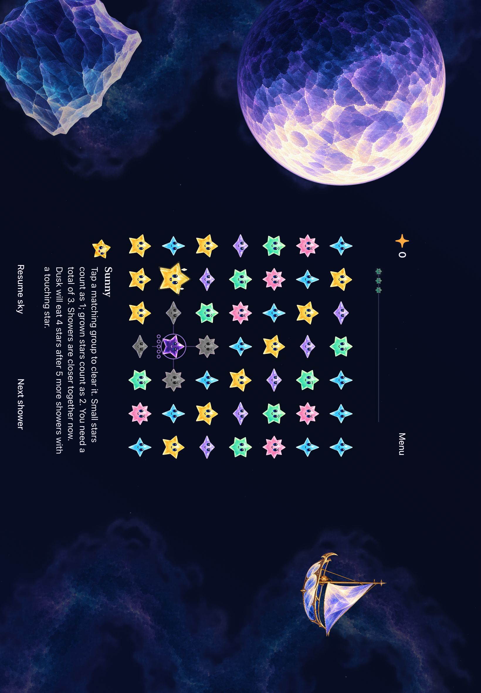
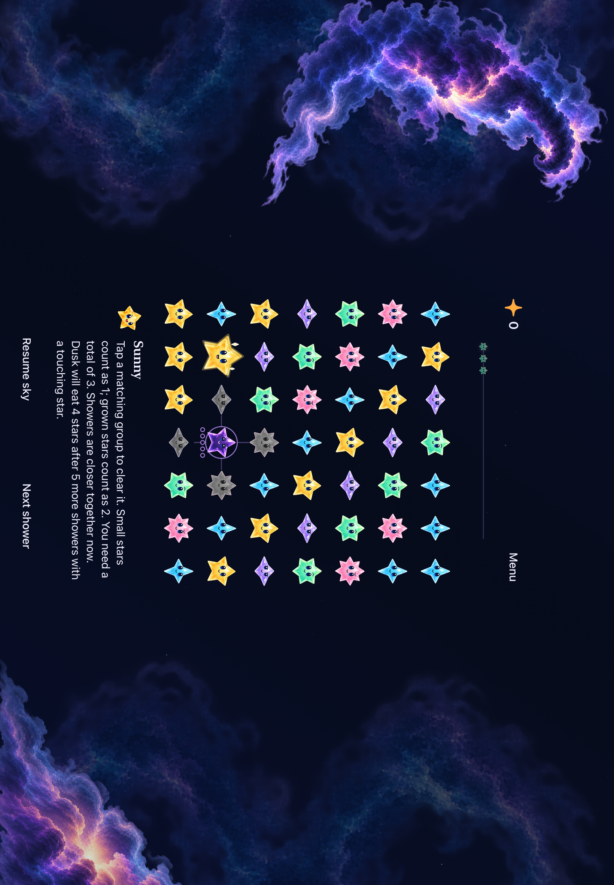
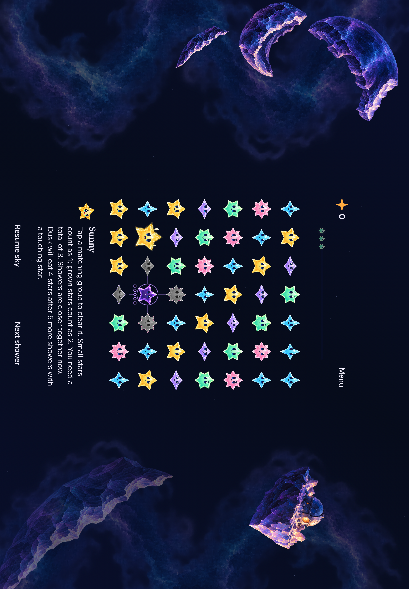
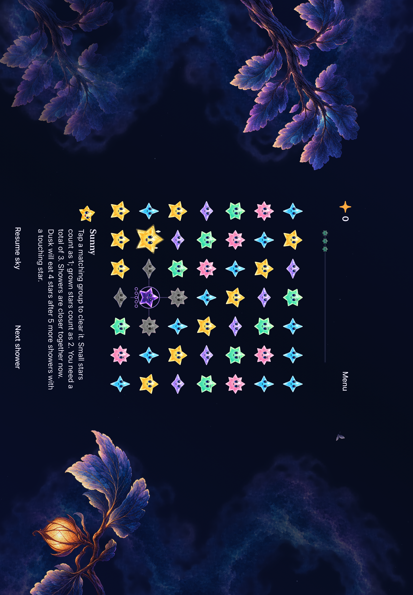
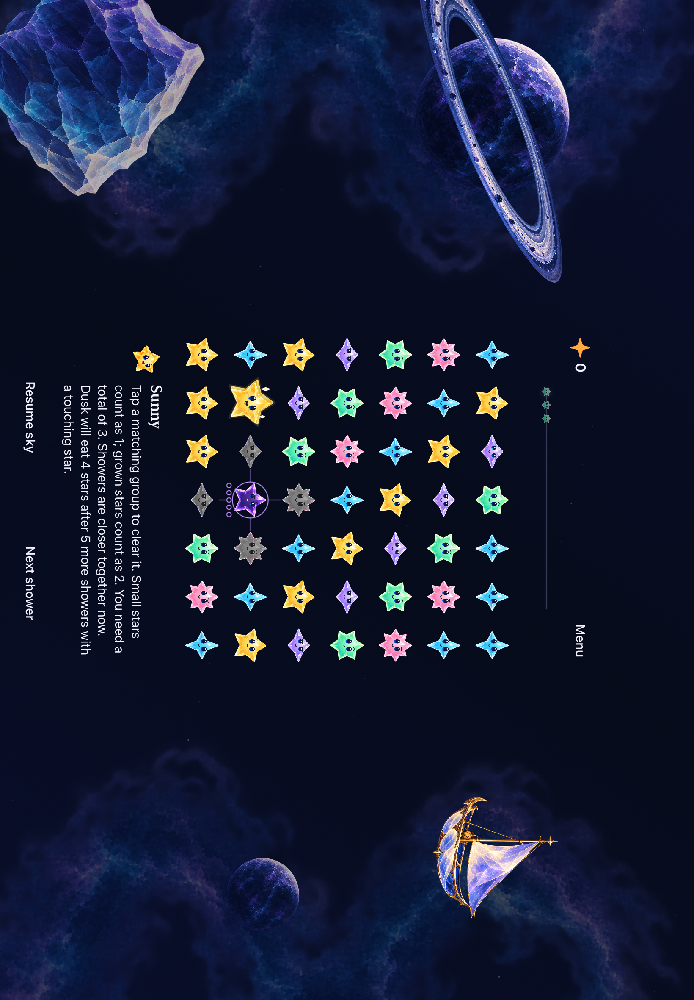
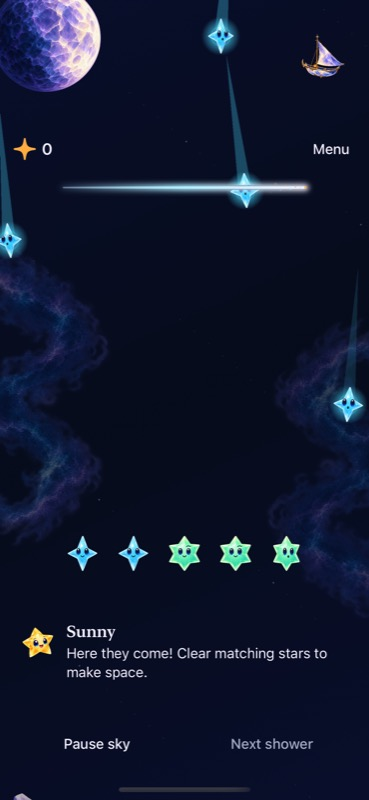
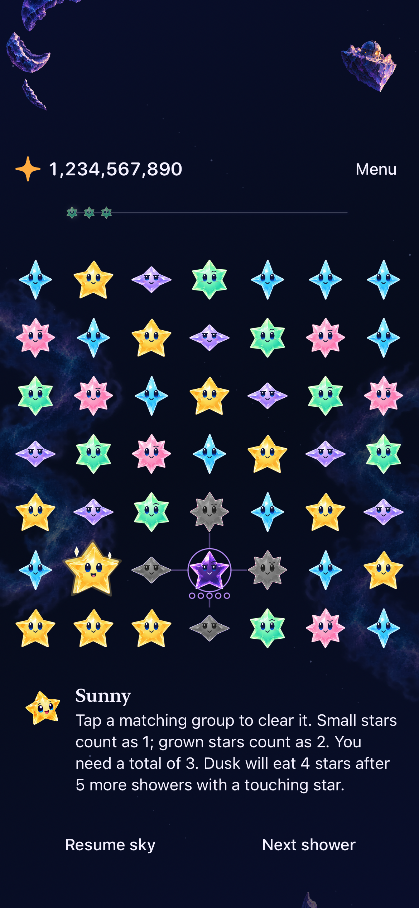
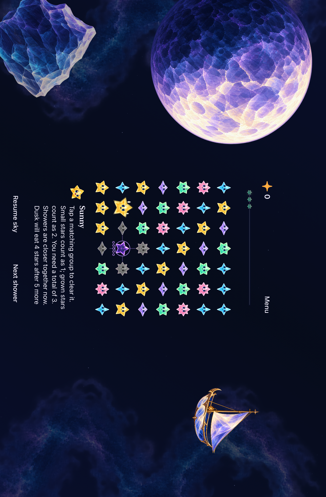

# Five nightscapes ready for native delivery

**Result:** Development validation passed · **Owner:** current implementer · **Date:** October 18–19, 2026

Moonwake, Nebula Cradle, Shatterlight Reach, Night Garden and Ringdrift now use sixteen separate alpha assets around a centered native playfield. All five are ordinary Location choices in Debug and Release. The existing shooting-star forecast, exact score, gestures, crystal award lettering and saved rounds remain intact. [Production acceptance](../../design/environments/night-production-09/README.md) and [asset provenance](../../design/environments/night-production-09/assets.json) define the scope.

**Next action:** Publish the verified tree to main and run the canonical device updater; append its verified installation receipt here. This is development delivery. Actual VoiceOver, physical comfort, sustained-device performance and App Store release acceptance are not established by these checks.

## Outcomes against acceptance

| Criterion | Result and practical limit |
| --- | --- |
| Five selectable night locations | Passed native selection/round preservation across all five, including menu dismissal and background/resume. Old preference raw values restore the corresponding new location. No unlocks or campaign. |
| Centered board and native input | Passed phone, iPad Air and iPad mini checks. Both tablet orientations assert the board center and visible control bounds, then clear the bottom-corner group through real native taps. Four directional swipes and held traces use the same mapping. Compact phones and accessibility sizes use a taller scrolling canvas. |
| Independent scenery | Five depth planes with separate landmark/story/near components. Moonwake's hull and cloth share source coordinates; Ringdrift's ring masks place the planet between front and rear arcs. No platform, contact shadow, cast row or scenery button. |
| Readable native HUD | Exact 100,000 and 1,234,567,890 scores, Menu, retained shower forecast and maximum accessibility text checked. Dialogue can scroll inside its bounded region; at accessibility sizes it flows below the board. |
| Rules, saves and interruptions | No core or save-schema changes. Core replay/save tests and hosted lifecycle tests pass. UI checks cover settings/background, rapid input, system Reduce Motion, calm effects, First Light win/replay and full-sky outcome. |
| Visuals and full motion | All five phone and wide iPad compositions inspected. Native normal-motion recording inspected through automatic showers; sampled consecutive frames show Twinkle descending, landing and returning to rest. Still captures establish composition only. |
| Release and delivery | Debug native tests and Release simulator build passed. Device installation is recorded separately below. |

## Tested source and commands

Final runtime source: `1c624cb93fe868ffd9e5f49745da694b6a9e66ca`, fingerprint **`dev.235ece3931`**, reconciled with main `c985a97` (protected award placement). Earlier phone/Air captures and tests use `f40be2e` / `dev.37c8873b91`; mini centering uses `08af480` / `dev.0c86648902`. The final integration adds reserved award space, a higher default header, margin art fitted to the remaining space, and a separate accessible award region below the cells. It preserves the centered board and current main's award rendering.

Local validation used `/tmp/starfall-celestial-production`, with no dirty runtime inputs. Subsequent evidence edits are documentation/captures only. GitHub commit `f9ab535` has exactly the same tree as local `1c624cb`; the final evidence commit does not change its runtime fingerprint. [PR #143](https://github.com/lbeezr/starfall/pull/143) owns publication.

Toolchain: Xcode 27.1 (`27A9275`), arm64, iOS 27.0 Simulator. Debug test builds used `Starfall`, `ARCHS=arm64 ONLY_ACTIVE_ARCH=YES CODE_SIGNING_ALLOWED=NO`, DerivedData `/tmp/starfall-celestial-build`. Release used `/tmp/starfall-night-release-build`. No iOS 17 runtime or physical interaction session was run.

| Check | Procedure | Result |
| --- | --- | --- |
| Core | `swift test` at `3a90755` (unchanged core through final source) | 169 passed, zero failures. `/tmp/night-final-core.log`. |
| Hosted | XcodeBuildMCP `test_sim`, `-only-testing:StarfallAppTests` at `3a90755` | 291 of 293 passed initially. Two obsolete visual expectations corrected at `f40be2e`; both focused reruns passed. This is 293 distinct passing checks across full and focused runs, not one all-green full run. |
| Phone | iPhone 17e; all `LandingPlaceInteractionTests`, all `SkyTechniqueInteractionTests`, system Reduce Motion case, First Light win/replay/full-sky case, two corrected hosted cases | 19 passed, zero failures. Native XCResult confirms success despite the MCP request timing out before Xcode finished. |
| iPad Air | Air 11-inch M3; all `LandingPlaceInteractionTests` | 3 passed, zero failures; all five locations in portrait/landscape, large scores, maximum text and calm outcomes. |
| iPad mini | mini A17 Pro; `LandingPlaceInteractionTests/testAllWorldsKeepTheRoundAndCenteredCellsAcrossOrientations` at `08af480` | Passed after reproducing and correcting the compact-layout classification. All five locations, both orientations. |
| Compact phone | iPhone SE (3rd generation), `LandingPlaceInteractionTests/testLargeScoresAndLargestTextReflowWithoutCoveringStars` at `08af480` | Passed; exact large score and maximum-text scrolling leave stars/control targets usable. |
| Release | XcodeBuildMCP `build_sim`, Release, iPad Air destination, same architecture/signing arguments | Passed at `08af480`, no warnings/errors reported. |
| Hygiene | `python3 scripts/ci-hygiene.py`; `git diff --check` | Passed before publication; repeat with final documentation. |
| Actual VoiceOver | Development cadence: native accessibility labels/targets and Dynamic Type checks only | Not run; full session remains RC work. |

Raw XCResults are in `~/Library/Developer/XcodeBuildMCP/workspaces/Starfall-27844ad883f3/result-bundles/`: hosted `test_sim_2026-10-19T01-20-28-140Z_pid56979_b3e8630e.xcresult`; phone `test_sim_2026-10-19T01-26-35-552Z_pid56979_7b670e61.xcresult`; Air `test_sim_2026-10-19T01-43-43-612Z_pid56979_fa5b9a33.xcresult`; mini rerun `test_sim_2026-10-19T01-51-27-403Z_pid56979_6b0757e2.xcresult`. Compact-phone bundle: `test_sim_2026-10-19T01-57-09-199Z_pid56979_0c46432a.xcresult`. Final Release log: `logs/build_sim_2026-10-19T01-56-43-958Z_pid56979_74bf263d.log` under the same workspace. Raw output is temporary local evidence, not a repository dependency.

The fresh-survival manual run reset only the isolated review namespace, with `--starfalls-reset --sky-flow-review -landingPlace observatory -calmEffects NO`. It went from welcome/entry through automatic showers to a full sky, with normal motion. `/tmp/night-normal-play.mp4` is 118.49 seconds; the inspected 62.2–62.8 second interval shows the arrival path and landing. The run does not establish sustained frame rate or device comfort. Two initial automation attempts did not settle promptly during transitions; subsequent native snapshots/taps and the bounded UI cases completed. No test assertion was relaxed to hide this.

## Final integration checks

At `1c624cb`, the phone run passed **22 checks**: `StarlightCelebrationTests`, `LandingArchitectureGeometryTests`, `LandingPlaceTests` and all `LandingPlaceInteractionTests`. The mini rerun passed all **3** location cases, including both orientations, large scores, maximum text and calm outcomes. The compact iPhone SE large-score/maximum-text case also passed at this source. Release rebuilt successfully with zero reported warnings/errors. The normal-motion full-game award cases visibly render ordinary, recipe, trace and relay awards; crowded current-rule captures preserve the independent remaining match.

Final artifacts under the same XcodeBuildMCP workspace: phone `test_sim_2026-10-19T02-12-21-056Z_pid56979_7d0de822.xcresult`; mini `test_sim_2026-10-19T02-12-57-439Z_pid56979_76479326.xcresult`; Release `build_sim_2026-10-19T02-12-28-045Z_pid56979_b171399f.log`. Compact-phone result: `test_sim_2026-10-19T02-23-11-006Z_pid56979_47e6124c.xcresult`. Earlier core and gesture results above remain applicable to their unchanged implementation; this focused rerun does not claim a new complete 293-test pass.

**Native `1c624cb`, 430×932 hosted view on iPhone 17e / iOS 27.0, current fresh-survival rules, default text, normal motion.** The award stays below the forecast and above the first playable row. Maximum-text +8 was separately inspected below the board; all five final phone scenes were re-inspected.

**Native `1c624cb`, iPad mini A17 Pro / iOS 27.0, default text, paused historical compatibility fixture.** The header moved upward to reserve awards while the board and control centers stayed fixed. Source-bound earlier wide compositions below retain the previous header position.

## Corrections found during verification

The mini landscape run initially put the board at y=449.8 instead of the 744-point window's center, y=372. The view classified the safe-area height as the whole playable canvas and incorrectly chose the 900-point scrolling layout. The fix classifies full canvas height, including safe-area insets, with a compact threshold below the mini's height. The exact failing native case now passes. Phone and Air use their existing branches; small phones and accessibility sizes intentionally retain scrolling. Stage Manager remains unverified.

Shared cell boundaries initially differed by floating-point roundoff when computed separately. One edge calculation now owns neighboring rectangles and inverse mapping. Native corner taps and hosted geometry tests passed. The two inherited hosted failures expected a removed ground light and an award in the old header position. Their corrected checks assert the floating clear light and actual local award region without weakening the bright-pixel threshold. Main's gesture and crystal-depth changes were merged before these reruns.

## Inspected native appearance

**Native source `f40be2e` — iPad Air 11-inch M3 / iOS 27.0 Simulator, default text, normal motion enabled, paused dense review fixture.** The fixture deliberately retains historical Dusk/aging states for compatibility checks; it does not represent the current fresh-game rule set. All five phone compositions were also inspected from the matching phone XCResult. [Capture hashes and provenance](captures.json) identify selected unmodified exports.

| Fresh opening | Exact large score |
| --- | --- |
|  |  |

**Native source `f40be2e` — iPhone 17e / iOS 27.0.** Opening: fresh survival, default text, Calm effects off, XcodeBuildMCP optimized JPEG. Score: isolated score fixture, default text, Calm effects on, unmodified XCTest PNG. No rendered screenshot is used as evidence for an animation by itself.

**Native source `08af480` — iPad mini A17 Pro / iOS 27.0, default text, paused historical review fixture.** Center and control bounds pass. The long historical paused instruction scrolls within the dialogue region; control targets remain outside it. [Engineering follow-ups](../../ENGINEERING.md#nightscape-geometry-and-layers--october-18-2026) retain physical, Stage Manager and RC checks.

## Delivery

Publication and canonical updater receipt pending. Do not infer a phone installation from simulator success.
