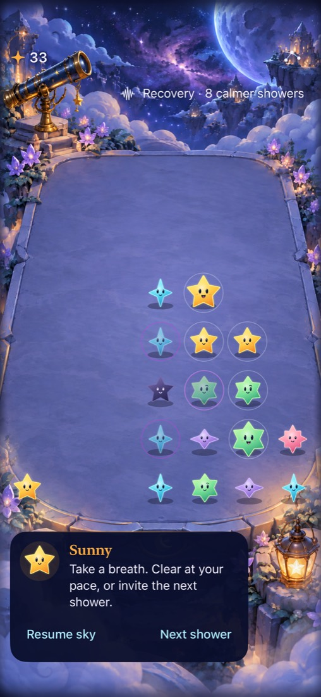
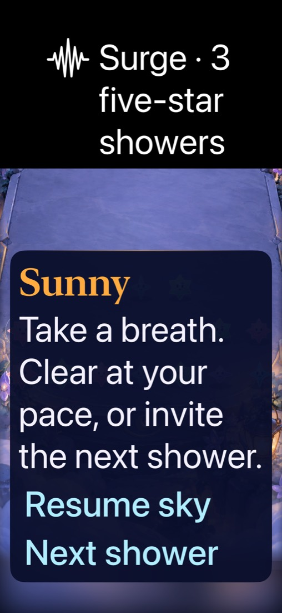
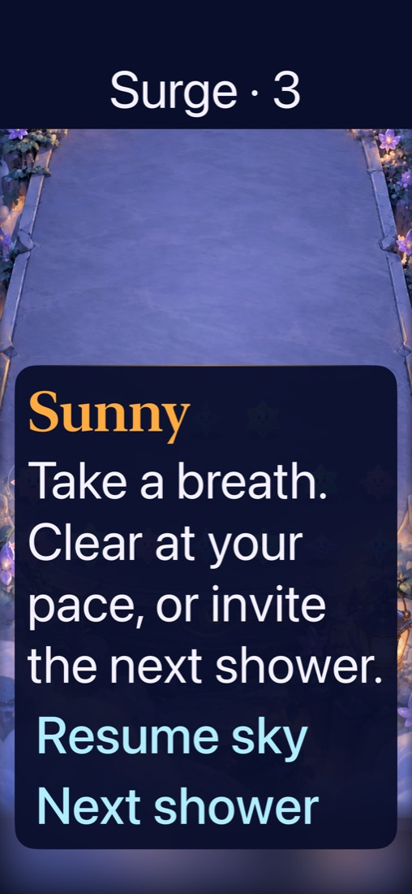

# Timed shower phases on the integrated Observatory

**Result: Partially verified isolated trial · Date: 2026-10-17.** Natural paired showers and three-shower Surges now export from one immutable integrated-Observatory source. Production rules and saves are untouched. Current native checks support phase boundaries, interrupted arrivals, restore, ordinary projected taps and focused VoiceOver speech/activation. Short visual phase copy improves maximum-text fit without shrinking type. Automatic announcement delivery, complete maximum-text play and human preference remain unverified; a baseline maximum-text cell tap failed.

**Next action:** refine paused committed-outcome feedback, then repeat the choice comparison, resolve baseline maximum-text play and observe automatic/full-motion events before deciding whether to adopt or remove Surge. This continues the user's shower-variety / timeboxed-event exploration; it introduces no levels or campaign.

## Hypothesis and bounded scope

A visible warning, three five-star showers and a calmer recovery may change clear/wait choices more clearly than natural shower variety alone. Both exports share the integrated Observatory, ordinary controls, committed previews, dark-star settings and core patch owner. Surge adds only bounded shower scheduling and presentation. First Light stays fixed; old saves retain their generation. Frozen HUD comparisons remain historical reproductions.

`python3 tools/mechanics/prepare-observatory-labs.py --ref 3439e48` reproduces this base. Use `--ref HEAD` for a deliberate new committed-source comparison, or `--source <snapshot>` to reuse exact captured bytes. Omitting both captures tracked working-tree bytes and labels their dirty status. Each pair validates snapshot hashes, uses separate bundles/defaults suites, records tool/core hashes, and appends checks to existing target members. Launch either with `--starfalls-reset --shower-phase-fixture` for seed 5 after eight canonical showers/clears, or without the fixture for ordinary play. Do not infer cold-opening preference from the prepared board.

## Outcomes against acceptance

| Criterion | Observed result | Limit |
| --- | --- | --- |
| Preserve rules, committed previews and saved generation | Both candidate core suites: 61 passed each. Independent baseline capture: 160 current + 160 marker-absent saves × 12 steps; fresh/restored First Light × 80; 200 candidate opening/round-trip samples, both passed. | No human balance inference. Core bytes match the previously measured algorithms after naming normalization. |
| Phase warning / event / recovery survive interruptions | 20 hosted store tests + two announcement-policy tests passed; native boundary/clear/menu/background/relaunch scenario passed through shower 13. | No automatic announcement delivery claim. |
| Phase remains usable at largest text | Full speech labels retained; short visible warning/count, full system text sizing, cue under 120pt, manual controls reachable. Native test passed. | Guide/board composition still obscures stars at controls. Matched natural-only baseline failed its own maximum-text initial cell clear. Complete large-text play is not accepted. |
| Actual screen-reader focus and activation | [Actual speech transcript](voiceover.txt): warning, Next shower, Surge count. Focused-control double-tap advanced shower. Ordinary prop test passed after teardown. | No complete VoiceOver round, rotor, unsolicited-announcement listening or device acceptance. |
| Isolated reproducible builds | Debug app/test compilation and Release builds passed for both exports; no new app membership required. | Base is clean `3439e48`, not subsequent luminous-trail commit `e90275b`. |
| Useful player choices / enjoyment | [Completed simulated comparison](playtest.md): earlier clears in Surge; clear order changed dark removal. | Prepared-board agent simulation is not first-time human evidence. |

## What changed after failures

The first VoiceOver trial used a remote-location double tap that did not activate the focused button. Its XCTest abort bypassed Swift `defer`, leaving VoiceOver enabled; later ordinary taps then focused controls instead of activating them. A native diagnostic measured enabled state and restored ordinary touch; all three unchanged baseline interactions passed afterward. The experiment now registers XCTest teardown **before enabling VoiceOver**, restores and asserts the prior state, terminates its app through teardown, and attaches speech before assertions. The corrected test double-taps at the focused native control. No app input rule was changed to satisfy it.

Apple's installed `XCUIVoiceOverService.h` documents `currentSpeech()` as speech for the currently focused element. The old expectation that it proved an unsolicited announcement was invalid; that claim was removed. Actual focused warning and phase-count speech plus shower activation remain required assertions. The announcement-selection tests still cover exactly warning, entry and recovery. Automatic delivery needs listening evidence.

The exported pre-promotion package fixture initially compared a legacy decoded save with a new candidate initializer, yielding nine mismatches in one method. The export now removes the candidate generation marker from its independent control before advancing; all original continuation assertions remain. Independently captured baseline replay fixtures then passed both candidate binaries. Production tests/core were not changed.

The first largest-text phase sentence occupied three lines. Short visible copy now fits one line for the captured event and preserves the full accessibility label. The native maximum-text test asserts a bounded cue height. This is a presentation improvement, not acceptance of the underlying board/guide arrangement.

Actual iPhone 17e simulator capture, Debug trial from `3439e48`, shower 13, ordinary text. Phase remains above the projected landing surface; screenshot proves composition only.

Actual rejected trial composition: full phase sentence consumed excessive vertical space.

Actual revised trial: visible “Surge · 3” with full spoken label. The guide still overlays stars while controls are in view; this is an explicit remaining limit.

## Verification context

Source and tool hashes: [source.json](source.json). Base is an archived committed tree, excluding local project/signing, branding and later HUD edits. Every native run used Xcode 27.1, arm64, iPhone 17e / iOS 27.0 simulator `A84C81F5-AE41-496A-97AE-E17C63E18D29`; scheme Starfall, `CODE_SIGNING_ALLOWED=NO ARCHS=arm64 ONLY_ACTIVE_ARCH=YES`, `-parallel-testing-enabled NO`. System Reduce Motion was already enabled; this batch does not prove full falling animation quality. Actual VoiceOver was enabled only for its dedicated trial and restored afterward.

Raw artifacts live under `~/Library/Developer/XcodeBuildMCP/workspaces/Starfall-27844ad883f3/` (logs and result-bundles):

| Run | Result / selection | Artifact stem |
| --- | --- | --- |
| First committed-source VoiceOver | Failed before shower advance; cleanup registered | `test_sim_2026-10-17T16-33-09-961Z_pid40582_ccabcc4d.xcresult` |
| Corrected focus/activation + two phase methods + ordinary projected taps | 4 passed | `test_sim_2026-10-17T16-35-01-669Z_pid40582_914045cc.xcresult` |
| Hosted current store + BurstPhaseAnnouncementTests | 22 passed | `test_sim_2026-10-17T16-37-07-363Z_pid40582_c9b7e13f.xcresult` |
| Final short-copy phase methods + ordinary prop response/menu cancellation | 4 passed | `test_sim_2026-10-17T16-37-59-663Z_pid40582_992b753c.xcresult` |
| Final natural-only projected taps / props / largest text | 2 passed, 1 failed at maximum-text first cell clear (`ObservatoryInteractionTests.swift:201`) | `test_sim_2026-10-17T16-40-01-395Z_pid40582_df1d3264.xcresult` |
| Final Surge Release | Build passed | `build_sim_2026-10-17T16-39-46-143Z_pid40582_d170fe24.log` |
| Final natural Release | Build passed | `build_sim_2026-10-17T16-41-05-320Z_pid40582_c612365b.log` |

Core command: `swift test --package-path <export>` (61 each; logs `/tmp/starfall-committed-{natural,surge}-core.log`). Independently compile `ShowerCompatibility.swift` with only `StarfallExperiment` renamed to `FallingSky` against baseline core for `--capture`, then against each candidate for verification. Presentation-only revisions retain identical core hashes. Frozen `prepare-native-lab.py --surge-showers` Swift output remains byte-identical across App/Core/AppTests/UITests to the prior verified export `starfall-native-showers-9eijdxkr`; shared fragment extraction does not change historical scenarios. Python compilation, hygiene and diff whitespace checks passed.

Full native fresh/replayed win/loss, rapid taps beyond the hosted due-rain scenarios, normal-motion event playback, complete screen-reader play, tablet/minimum-OS/device and first-time human preference remain open for the combined trial. Keep it isolated until the next observed comparison and explicit adoption/removal decision.
