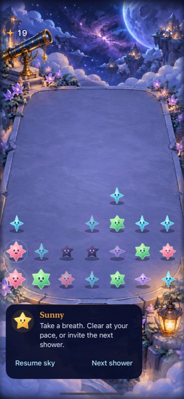
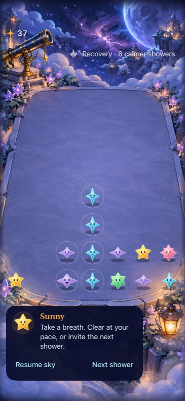

# Current Observatory: simulated natural versus Surge play

**Recommendation: extend the isolated Surge trial; do not adopt yet.** The phase cue changed one agent's clear/wait choices, and a clear-order counterexample showed that available matches were not interchangeable. Static paused Sunny copy did not explain consequential outcomes. Refine bounded paused outcome feedback before another rule change.

**Limits:** One familiar agent, Natural first and Surge second, seed-5 prepared board, paused/manual showers 8–13. Exact connected values and adjacency were read mainly from accessibility cell labels, with screenshots for visible layout/cues. This is not first-time human learning, enjoyment, real-time urgency, animation or actual VoiceOver acceptance. Scores do not establish which rules are better.

## Observed decisions

The agent stated intended decisions before acting and could clear freely. Both rounds began at 19 starlight, ended without loss and used the ordinary-text isolated Debug apps from clean base `3439e48`. [Installed executable/dylib hashes](source.json) match the tested Debug products. No source/system settings changed.

| Initial shower | Natural: intention → result | Surge: intention → result |
| --- | --- | --- |
| 8 | No legal group; wait → 19. | Warning says heavy phase after this shower; no group, wait → 19. |
| 9 | Hold rose worth 4 for growth → 19. | Three heavy showers ahead; clear rose for space → 23. |
| 10 | Remote rose will not remove central blockers; wait → 19. | Clear mint to open another column → 27, advance. |
| 11 | Aqua pairs remain worth only 2; wait → 19. | Clear lower rose blocker, then amber to lower its column → 33. Upper dark star remains. |
| 12 | Rose stopped growing; bank 4 for space → 23. | Recovery, but mint offers immediate blocker removal; clear it → 37, aqua joins to value 4. Then wait. |
| 13 | No legal group; would wait. Stop at 23. | Eight calmer showers; retain aqua 4 / violet 3 and wait. Stop at 37. |

Ready groups at initial settled states 8–13 were 0/1/1/1/1/0 in Natural and 0/1/1/2/2/2 in Surge. These were inferred from accessibility values, not a visible counter. Different actions produce different future boards; this is an observed decision trace, not a controlled score comparison.

The strongest counterexample occurred at Surge 11: clearing lower rose first dropped the upper dark star. Amber became diagonal to it, so clearing amber did not remove that star. The agent adjusted at 12 when mint offered an adjacent clear. Recovery therefore did not imply waiting automatically. This supports inspecting clear order and geometry as real choice dimensions, while the agent's prior knowledge limits learning claims.

## Feedback was the material obstacle

After each settled shower and clear in both apps, Sunny still said “Take a breath. Clear at your pace, or invite the next shower.” There was no settled guide explanation for growth, score changes, dark removal or amber's non-removal. The agent reasoned through them using familiar rules and accessibility values. This is weak evidence that an unfamiliar player could understand the same outcomes from the visible guide.

Source inspection supports the observation: `FallingSkyStore` already creates committed clear/dark/growth messages, but the paused `FallingSkyView` supplies fixed companion copy. The interface contract intentionally keeps flowing play quiet. Next experiment: show bounded committed-outcome feedback during paused/manual exploration, preserve the existing clock/save ownership and leave ordinary active play quiet. Test growth, dark removal, non-removal, invalid groups, interruption and restore separately. Do not introduce a dialogue engine, tutorial progression or another permanent pilot route.

Actual ordinary-text simulator capture: Natural, score 19. The guide is unchanged after the agent's waits.

Actual ordinary-text simulator capture: Surge, score 27, one heavy shower remains. The centre blockers make clear order consequential.

Actual ordinary-text simulator capture: score 37, Recovery eight calmer showers. Sunny still supplies generic paused copy. These stills establish composition only.

## Decision and next check

Extend only to refine feedback and repeat the bounded choice comparison. Keep the same canonical natural/Surge algorithms, save guarantees and prepared fixture for reproduction; add an uncoached cold opening before any human-learning claim. The next decision remains adopt/revise/remove based on relevant native checks and observed player choices, with maximum-text baseline play and automatic-announcement listening still open in the [trial record](README.md).
