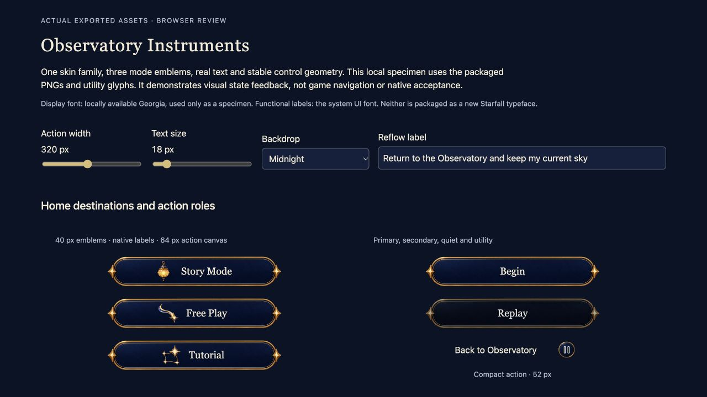

# Observatory UI source kit verified

**Result:** Verified for source assets and export handoff; native adoption pending · **Date:** October 19, 2026

The [reusable Observatory kit](../../../Artwork/ObservatoryUI/README.md) is produced: three transparent mode emblems, three blank material skins and twenty authored utility glyphs, with reproducible exports and a real-text state/stretch specimen. It supports the accepted game UI direction without changing the app.

**Next action:** Use these assets in the existing app's native component/typography specimen, then adopt verified screen batches under the [system plan](../../design/GAME_UI_SYSTEM.md). This report does not approve native layout, interactions or physical readability.

## Outcomes against acceptance

| Criterion | Result |
| --- | --- |
| Dedicated, consistent glyph family | 20 editable SVGs; 60 transparent black-template PNGs at 24/48/72 pixels; 20 single-page vector PDFs. All parse, dimension, edge and template checks pass. |
| Independent vector fidelity | PDFium renders compared with SVG at 12×; weighted alpha overlap 0.993188–0.999246 across all 20 glyphs. No raster PDF content. |
| Illustrated mode and shared material family | Six original ImageGen masters preserved unchanged; exact prompts, source paths and hashes in [provenance](../../../Artwork/ObservatoryUI/PROMPTS.json). Eighteen registered 1×/2×/3× exports decode with embedded sRGB and transparent outer margins. |
| Correct stretch geometry | Fixed 48-point action ends, horizontal stretching only; compact role uniformly scales before stretching. Reading panels keep 32-point corners and support both axes. Illustrated emblems remain aspect-fit. Checked static examples and browser reflow. |
| Small utility clearance | 20-point glyph inside 32-point bezel; native target remains independently at least the existing 45 points. Pause, settings and trace ink sampled separately from the central backdrop region. |
| Contrast and opacity measurements | Pearl ink against declared content regions over midnight, bright cloud and white: minimum 12.9531:1. Actual sampled utility ink: minimum 14.2201:1. Central alpha minimum is 251/255, near-opaque. These are pixel-region measurements, not whole-screen or all-state accessibility certification. |
| Determinism and invalid inputs | Glyph rerun: 102 files byte-identical; four unsupported SVG cases rejected. Raster rerun: 20 files byte-identical; malformed and 1×1 inputs rejected before writing; unsupported density override rejected. |
| Bounded resource use | Raster density exports total 782,875 encoded bytes and 3,024,896 decoded RGBA bytes across all densities. One 3× set is 1,944,576 decoded bytes. No runtime memory claim. |
| Browser behavior | Mode response, selected toggle and Sound switch changed observable specimen state. Two disabled controls remain disabled. All 11 image elements loaded. Width 220 with text 34 and a long label had no horizontal button overflow; mode art stacks above text in the tall panel role. Bright backdrop and default appearance inspected. |
| Repository checks | `python3 scripts/ci-hygiene.py` and `git diff --check` pass; package text whitespace, local links and manifest source/export hashes checked. |

## Source and environment

Source base: `cfd6ab7`, with this uncommitted source package and its documentation. Pre-existing design changes were retained in root README, documentation indexes, `docs/design/GAME_UI_SYSTEM.md`, `OBSERVATORY_INTERFACE.md`, the October 19 atlas and approved concept. This batch adds `Artwork/ObservatoryUI/`, updates `Artwork/README.md`, records this evidence and reconciles current status. **Build-affecting dirty inputs: none**; App, Core, tests, Xcode configuration and resource catalogs were not modified. Acceptance is for these working-tree inputs, not a clean published commit. [Review input hashes](review-inputs.json) identify the manifests, prompts, HTML and retained browser capture; manifests identify every asset hash.

Host: macOS 27.0.1, arm64. Browser: Codex in-app browser at 1280×720 CSS pixels. Default capture: 320 px action width, 18 px specimen type, Midnight background. Large-text exercise: 220 px action width, 34 px specimen type, Bright cloud background. These are browser dimensions, not native Dynamic Type categories or simulator evidence. Georgia and system UI fonts are local specimen choices; no new display font is packaged.

Export tools: Python 3.12.14, Node 24.19.0, Pillow 12.3.0, ReportLab 4.4.9, pypdfium2 5.14.0, PDFium 156.0.8076.0, Sharp 0.35.5, librsvg 2.63.2, libvips 8.18.7. Repository hygiene uses host Python 3.9.6. No dependency installation was performed. The optional `game-dev` CLI was unavailable; no canonical-package receipt is claimed.

Exact successful export commands, from the repository root:

```sh
/Users/lbeezr/.cache/codex-runtimes/codex-primary-runtime/dependencies/python/bin/python3 Artwork/ObservatoryUI/build/glyphs.py --node /Users/lbeezr/.cache/codex-runtimes/codex-primary-runtime/dependencies/node/bin/node --node-modules /Users/lbeezr/.cache/codex-runtimes/codex-primary-runtime/dependencies/node/node_modules
node Artwork/ObservatoryUI/build_rasters.mjs --node-modules /Users/lbeezr/.cache/codex-runtimes/codex-primary-runtime/dependencies/node/node_modules
python3 scripts/ci-hygiene.py
git diff --check
```

The browser specimen was served with `python3 -m http.server 8767 --bind 127.0.0.1 --directory Artwork/ObservatoryUI` and exercised using native browser controls. An initial ambiguous status locator and a Backdrop label locator failed; unique observed element IDs resolved those review-tool failures. No app failure was inferred. Review scripts and temporary comparison images were disposable; durable metrics remain in the two asset manifests.

## Inspected appearance and limits



*Current source-asset specimen, `cfd6ab7` plus the hashed kit, Codex browser 1280×720. Real text overlays reusable art. This is not a game screen or native screenshot. The complete [material review sheet](../../../Artwork/ObservatoryUI/previews/rasters.png) and [glyph sheet](../../../Artwork/ObservatoryUI/previews/glyphs.png) were also visually inspected.*

Generated sources contain scattered alpha-1 samples outside the subject. Deterministic normalization crops alpha≥2 support with two source pixels of padding; every RGBA sample inside is preserved, and discarded alpha-1 counts are recorded. There was no repaint, denoising or matte removal. The action's actual source proportions required fixed full-height ends instead of the initially anticipated all-axis slicing; the registered contract follows the produced geometry.

During review, the narrow large-text example split Tutorial mid-word and light review captions lost contrast over the bright background. The browser specimen now stacks mode art above tall labels and uses dark review captions on bright fields. This affects specimen layout only.

Native import/membership, iOS build, Swift/Core tests, touch interaction, actual VoiceOver, native animation, performance and physical-device review were not run: this batch changes source artwork and documentation only. Existing Crystal Comet and all gameplay remain untouched. The next native pass must establish those applicable checks; browser reflow and sampled contrast do not substitute for them.
