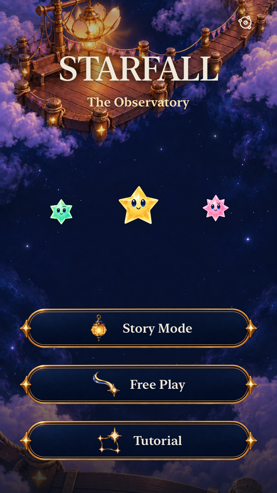

# Observatory UI native integration

**Result:** Adopted; affected development checks verified. **Owner:** Current implementer. **Date:** October 19, 2026.

The normal app adopts the Observatory interface: Story Mode, Free Play and Tutorial on Home; authored brass/nightglass controls; dedicated glyphs; edge-anchored gameplay instruments; compact bottom dialogue; and shared settings, map, tutorial, entry and result surfaces. Core rules, saved rounds, journey admission and the Crystal Comet celebration renderer retain their existing owners.

**Delivery:** Merge and canonical current-main installation pending. A simulator build does not establish phone installation.

## Source and scope

[Design and acceptance](../../design/GAME_UI_SYSTEM.md) · [Artwork provenance](../../../Artwork/ObservatoryUI/README.md) · [Runtime/test input hashes](source.json) · [Checks and exact commands](checks.json) · [Capture index](captures.json).

Base `cfd6ab75af5408d74c4850dcecac2b2b50215b46`; final runtime `dev.77015d0909`, final dirty build/test snapshot `dc0392d2430e`. Checks were run from the explicitly dirty working tree recorded in `source.json`. Publication must preserve those runtime bytes; documentation, evidence, `.gitattributes` and test-only changes do not alter the runtime fingerprint. No Core, save schema, RNG or progression rules changed.

Xcode 27.1 (27A9275), macOS 27.0.1 arm64, iOS 27.0 Simulator. Debug interaction devices: iPhone 17e (`862714B3-4526-470F-85BB-7FB33EAA1E87`), iPhone SE (3rd generation, `02B7AF2E-1F1C-40F6-AA83-C67EA962B656`) and iPad Air 11-inch (M3, `377B8820-20E2-413E-B64F-D9E4CEB86AF4`). The Debug/Release builds use the shared `Starfall` scheme, arm64, signing disabled and isolated temporary DerivedData.

## Verification

| Boundary | Result |
| --- | --- |
| Core | `swift test`: 184 passed, zero failures. Runtime Core inputs are unchanged. |
| Hosted | All 337 passed on `dev.68e5909355`. Later changes affect ceremony accessibility ownership, panel bounds, sheet gesture ownership and the accessibility canvas reserve. The three new artwork tests passed in the later phone run; all 17 celebration tests passed against the corrected reserve. |
| Native interaction | 29 distinct affected UI cases have passing evidence across the recorded source epochs. Original phone: 20/26 passed, followed by corrected cases; compact: 4/4 plus normal-motion 1/1; tablet orientation/home/map/settings and final compact switch/large-text corrections pass. All runs have zero skips. Intermediate failures remain recorded, not converted into green runs. |
| Build | Debug native builds and final `dev.77015d0909` Release succeeded. |
| Resources | [All 26 catalog resources](resources.json) verified in Debug and Release; 124 source-manifest hashes, 78 PNG dimension/alpha contracts, 20 SVGs, 20 PDFs and 38 imported payload hashes pass. Explicit project membership and no orphan assets verified. |
| Visual | Nine retained native captures inspected: compact Home, Entry, clear feedback, scrolled largest-text settings/Entry, tablet paused play and landscape map, plus final compact large-text guide controls and 48-point preference rows. These identify their exact source epochs. |
| Animation | Normal-motion SE Home → Entry → play → menu/background test passed. A recorded run's sampled frames show entrance, falling stars, clear feedback and sheet transitions. No continuous-motion quality or frame-pacing measurement is claimed. |
| Actual VoiceOver | Not run; follows the existing RC cadence. Native accessibility labels, values, targets and large text are checked separately. |
| Physical device | Not established by simulator evidence. Canonical updater receipt pending; physical play remains separate. |

This is affected development coverage, not the full native UI matrix or RC acceptance. The existing plan reports 337 hosted and 143 development UI methods. `checks.json` retains exact selected commands, completed methods, failures and zero-skip counts; raw logs, result bundles and movies remain disposable under `/tmp`.

## Corrections found during native review

1. **Ceremony identifier ownership.** Settings and Entry Back were visible native buttons, but the unused `sky.flow.*` identifier on the enclosing GeometryReader replaced their leaf IDs. A leaf-only ignore modifier failed to fix that propagation and also changed the exported element type. Removing the ancestor ID and both leaf ignore modifiers restored native Buttons and their own IDs. Actions and retained-save behavior are unchanged. The [failed attempts](failure-history.json) are retained; passing cases use the original behavior assertions.
2. **Dialogue paint bounds.** The reading panel inherited the entire available height. Applying its background to the fitted content before the outer height cap restores a snug panel in portrait and landscape; scroll fallback still caps long messages and keeps actions reachable.
3. **Medium-sheet scrolling.** The unchanged tablet story-map case could not scroll the lower menu item into view. A content-shape attempt failed and was removed. Recorded native frames showed the grabber, navigation bar and content moving together, then rebounding: the sheet consumed the drag. Both menu presentations now use `.presentationContentInteraction(.scrolls)`; the exact map/entry/cancel case and the largest-text settings sibling pass.
4. **Switch selector migration.** The authored toggle exposes a single actionable native Switch over its 44-point row. XCTest also lists an internal child Switch with a zero frame; the old test targeted that implementation detail. Native inspection and a real parent tap proved its value change. The test now targets the named Switch, requires enabled/hittable status and 44-point bounds, and retains exact value persistence, restoration and no-save assertions. The exact tablet case passes. A subsequent compact check found its medium sheet scales the 44-point row to 42.12 points (359/375). A bounded three-second diagnostic confirmed the frame stays scaled; the shared preference target is now 48 points, retaining the 44-point effective-target assertion. The exact compact case passes, including value restoration after scrolling in the gameplay menu. A blind scroll helper initially overshot Sound; the existing bounded directional helper now locates each control by its actual element type, including Switch, within its owning scroll view. Button ownership and behavior assertions remain intact.
5. **Accessible award reserve.** Review found the new scrolling canvas reserved only 20 points below the arena while the existing accessible award occupied the 112-point apron. `FallingSkyView.readingCanvas` now owns the actual clip boundary with that existing accessibility reserve. The strengthened existing celebration test consumes the same boundary and requires the award to end before the guide. Star positions, gesture mapping and the renderer are unchanged.

The compact large-score test also exposed an obsolete scroll coordinate: once the board moved upward, it repeated a ten-point drag across the newly fixed header. Its bounded driver now uses the visible empty apron below the board and stops at the header edge. Existing score, board exclusion, control visibility and target-size assertions remain.

An early 339-test smoke run had one new raster assertion fail because asset compilation thinned unused density renditions. The corrected test verifies selected backing dimensions and point registration; it passed in the 337-test hosted run. After that early run finished, Xcode's diagnostic collector stalled; only that owned collector was stopped so Xcode could finalize the failed result. Later runs use `-collect-test-diagnostics never`, retain failures/captures, and use no automatic retries or motion suppression to get green results.

## Visual evidence and source reuse

*Debug Simulator, iPhone SE (3rd generation), default text, `dev.818f578f8b`; actual app capture, not a mock.*

The `dev.818f578f8b` captures include the corrected ceremony IDs and snug dialogue. The `dev.f0badc738c` tablet captures add scroll-priority sheets. The final runtime adds the accessibility canvas reserve and a 48-point preference-row target; ordinary Home/map/paused-play imagery is unchanged. Final compact captures verify the guide controls and preference presentation on `dev.77015d0909`. Earlier largest-text captures remain labeled with their source and do not prove the final award-guide separation. The strengthened 17-test celebration suite and compact native checks verify the changed boundary separately.

The [normal-motion record](motion.json), raw `/tmp/starfall-observatory-native-motion.mp4`, belongs to `dev.818f578f8b`. Sampled frames at 25–55 seconds show entry fade, background/foreground, showers, a +3 award, and menu presentation. App-switcher frames are the test's deliberate interruption. This sampling and passing interaction test do not certify physical comfort or sustained performance.

## Ownership and remaining limits

`ObservatoryArtwork` owns glyph mappings, mode emblems and nine-slice surfaces; `StarfallTheme` owns material, typography and native control styles. Twenty PDF glyphs and eighteen raster renditions total 814,454 payload bytes. SVG masters and raster provenance remain in the source kit. UI reading text is scalable native type; Crystal Comet remains the celebration treatment.

The HUD follows viewport safe edges while the board retains `LandingGeometry`. Automatic play omits permanent manual-control slots; pause/manual guidance remains available below the board. Large text scrolls the board and guide beneath fixed edge controls. Tutorial practice retains save/progression isolation.

Physical contrast, thumb comfort, sustained device performance, minimum-iOS support and actual VoiceOver remain distinct [engineering follow-ups](../../ENGINEERING.md#observatory-interface-physical-acceptance--october-19-2026). No App Store/RC acceptance is claimed. The only phone delivery path is `scripts/device-update.py run`, with current-main ancestry, Core checks, signing and actual installed-identity verification intact.
