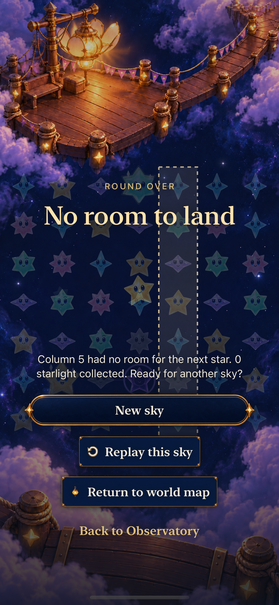

# Observatory UI parity refinement

**Result:** Merged and installed on the original iPhone · **Owner:** Current implementer · **Date:** October 20, 2026

The refinement reduces the gap between the [approved Observatory atlas](../../design/interface/atlas-2026-10-19/README.md) and the native HUD, menus, results and tutorial. Settings use one authored frame, secondary controls use shallow fittings, and a paused sky starts with a small character portrait. Twenty rendered utility icons replace the flat native glyphs. The compact rerun passed all four cases; the later tablet run passed all three. The menu correction passes both motion/interaction cases on `dev.03800cee00`. The final reading/action rerun passes largest-text game/Studio and all-speaker coverage on `dev.22a4a0f991`, including stronger checks for the visually identified action-label defect. [Ten inspected stills](captures.json) establish sampled appearance, with source limits.

**Delivery:** [PR #185](https://github.com/lbeezr/starfall/pull/185) merged as `386b2f8fad44d1f9c8379a00b03af6b10ca9861c`. The published tree matches the reviewed source. The canonical updater verified `dev.4bcedba5e6` on the original iPhone 16 Pro Max / iOS 26.6.2 after 184 Core tests and signature checks; the observed connection was wired. [Publication and installation receipt](delivery.json). No player-data reset or automatic launch was performed. Actual VoiceOver, iOS 17 runtime and physical-play acceptance remain separate.

## Outcomes against acceptance

| Criterion | Candidate change | Evidence and limit |
| --- | --- | --- |
| Gameplay leaves the board clear, with reachable manual controls of at least 44 points | The HUD keeps exact score/target values with a small cast symbol, an edge forecast and utility control. The paused guide collapses to a portrait; reopening and closing it retain independent bottom actions. | Collapsed/reopen/close passed on iPhone 17e and SE. Largest-text reading reaches the final line with unchanged text size and fixed actions; the full game/Studio method passed again on `dev.22a4a0f991` with stronger action-label assertions. Menu pause/resume and subsequent automatic showers passed on `dev.03800cee00`. |
| Menu, preferences, Help and balance have one frame | `SkyMenuSurface` owns the authored header, scrolling body and fixed footer. The menu now presents full-screen without a second system sheet frame. Preferences are a separate game-menu destination; pre-play settings open the same preference page directly. | Menu traversal passed on phone and tablet; balance persistence/arrival changes passed on `dev.beb612a874`. Retained menu, preference and scrolled balance stills show the shared material. They do not cover every long-page or text-size state. |
| Preferences preserve their existing owner and saved values | Sound, Haptics and Calm effects remain bindings to existing owners. Balance choices use visible native buttons with selected state. | Shared welcome/game preferences, no-save/round assertions and balance persistence passed on the refinement runtime. The rendered-icon command misspelled this preference selector and selected zero instances; the correct method passed in the compact rerun. |
| Compact panels belong to the same material family | `ObservatoryCompactSurface` renders the authored reading frame at half scale. It replaces the old rounded slab in `starfallPanel`; compact and secondary buttons use the same shallow fitting with wrapping text. Utility ornament remains smaller than its 48-point target. | Artwork loading, registration and large-label layout checks passed. Inspected phone/compact/tablet stills show the authored borders and rendered icons; physical-size legibility and comfort remain separate. |
| Result and mode choices have a clear hierarchy | The retained-sky action is compact. A restored result gives World Map the primary treatment, with replay/new-sky controls secondary and Home quiet. The result yields decorative space when its full scenic stack does not fit, then scrolls only if the compact version also cannot fit. | The corrected SE win/replay/full-sky case passed. Result actions above the visible final board and tablet landscape home/entry/preferences passed on `dev.beb612a874`; the retained result and home stills show these sampled states. |
| Tutorial instructions and progression remain visible | The practice guide uses the shared material, readable detail disclosure and a progression footer outside the scrolling prose. Ordinary portrait practice crops unused scenery around the unchanged board mapping. Only controls relevant to the current step appear. | Three hosted presentation checks and neighboring native tutorial cases passed. After the board ownership fix, the original shower-control regression passed on `dev.e5980859cf`; largest-text quiet practice survived background and dismissal on `dev.beb612a874`. |
| Utility icons have the game's rendered material and legible native registration | Twenty original-color PNG image sets replace the native PDF glyphs, at the same 24-point registration and 1×/2×/3× densities. Native controls retain semantics and targets. | All three hosted artwork checks passed with the compiled rendered assets, including every original-color icon, density registration and large labels. Offline export verification and native appearance acceptance remain distinct. |
| Rules, saves and tutorial isolation remain intact | This batch changes presentation, copy and native test setup. It does not change Core rules, RNG, the save schema or progression ownership. | All 184 Core tests passed. The first preference test preserved no-save/round boundaries; the tutorial examples returned to the unchanged round. This is bounded evidence, not a complete retained-save or physical upgrade acceptance run. |

## Tutorial corrections

The tutorial pass covers five presentation problems: coordinate instructions now use the same top-down mapping as native board labels; Hint/Less starts in a truthful visible-detail state; manual shower and pause controls appear only at the step teaching them; Square copy describes its actual tap while strict trace lessons retain their method; and the instruction/progression region remains available below the practice board. None changes the chapter's deterministic moves or awards progression.

The first tutorial run found an additional ownership defect: the underlying game and presented practice both exposed `experiment.board`, making the single-board query ambiguous. Hiding the surrounding presentation did not resolve it in the refinement run. The correction now removes the identifier, value, children and rotor entries at the underlying board's accessibility owner while a modal or ceremony is presented; the original shower lesson passes on the rendered-icon runtime. A negative/non-finite initial frame warning also appeared in the first tutorial run. The guide height has a positive lower bound after reserving control space; subsequent completed bundles listed below contain no runtime warnings.

## Diagnosed failures and corrections

| Failure | Cause and correction | Verification still needed |
| --- | --- | --- |
| Duplicate tutorial board | Two accessibility owners survived modal presentation. The underlying board now owns its inactive state directly, and the menu uses one full-screen presentation. | Original shower lesson passed on `dev.e5980859cf` and final `dev.4bcedba5e6`; its retained practice still was inspected at the recorded earlier runtime. |
| Largest-text guide and actions could not fit together | The reading layout budget did not reserve the actual edge header and fixed controls. The guide now uses the measured reading viewport and control height. The next run reached the reading check, but a final drag too short to cross native pan slop did not move the text. The test maintains a real minimum drag while keeping overlapping reading positions, unchanged text size, fixed controls and complete-text assertions. | Game reading passed on `dev.beb612a874`; the subsequent Debug Studio step failed separately. The full method passed on `dev.eb2844791f`. Earlier failed bundles retain their failed status. |
| Compact result Replay was not hittable | Restored-scene clearance, a large heading, the 110-point decorative cast and score prose pushed Replay below the SE viewport. Results now first try the scenic composition, then a compact bottom-aligned composition without decorative cast/clearance/heading inset, then a scroll fallback for oversized text. | Compact First Light win/replay/full-sky rerun passed on `dev.93ae37d0b8`. Existing assertions are unchanged; the later full-sky result still was inspected on `dev.beb612a874`. |
| Tablet hosted nudge award failed its pixel assertion | The captures visibly show `+3`, but the test sampled the obsolete `LandingGeometry.crownFrame` band. Its y169–225 pt crop missed the award around y110–160 pt in the 390×844 hosted window. The test resolves the actual board/header anchors into capture coordinates and requires a nonempty, in-bounds, stable region. | Ordinary/recipe/trace/relay hosted award rerun passed on tablet, `dev.beb612a874`; the same additional-bright-pixel threshold, exact score/category and lifetime assertions remain. |
| Largest-text Debug Studio preview did not fit | After game reading passed, the authoring preview still used an unbounded paragraph. Studio now gives the shared reader its actual viewport budget and keeps outer authoring scrolling separate from inner reading and fixed Next/Close actions. | Full largest-text game/preview and bundled all-speaker/retained-round methods passed on `dev.eb2844791f`. |
| Normal-motion forecast case did not finish its pause/menu transition | The full-screen cover detaches the scene, so the old `sceneReady` guard rejected the explicit menu Pause action. The view now permits that choice, immediately suspends again, and relies on existing readiness admission before restarting clocks. | Both focused methods passed on `dev.03800cee00`: exact Pause/Resume labels, full 48-point targets, dismissal, a new automatic shower, pause again, and active-message reopening. The failed Studio bundle remains recorded. |
| Largest-text Studio actions wrapped despite an interaction pass | Visual inspection of `dev.eb2844791f` found Continue on three lines and Close on two. Shared script controls now use a horizontal row only if the natural label widths fit; otherwise they stack at full width. A strengthened native assertion requires single-line-height, full-width vertical controls. | Both native methods passed on `dev.22a4a0f991`. Independent beginning/end inspection confirms readable final text and fixed, single-line vertical Continue/Close; normal-text prose and horizontal actions also remain readable. The prior interaction pass alone did not establish visual acceptance. |
| Release exposed an iOS-version rotor warning | `Optional<Wrapped>` conformance to `AccessibilityRotorContent` is only available from iOS 27; the app supports iOS 17. The conditional rotor builder is replaced with empty/populated data selection inside `ForEach`, preserving inactive-board semantics. | `dev.22a4a0f991` clean-export Release compiled with this warning. The corrected source `dev.4bcedba5e6` passes the focused covered-board tutorial case (1/1, no skips) and clean-export Release without the optional-conformance warning. |

## Rendered utility provenance

The [rendered-utility record](../../../Artwork/ObservatoryUI/RENDERED_UTILITIES.md), [exact prompts and source hashes](../../../Artwork/ObservatoryUI/masters/utilities-v2/PROMPTS.json), and [export manifest](../../../Artwork/ObservatoryUI/rendered-utility-manifest.json) identify the production assets. Seventeen utility sources were generated individually with built-in ImageGen; Story, Free Play and Tutorial reuse the unchanged mode masters. No icon was sliced from a concept board.

*Inspected offline specimen, not a runtime screenshot. The 24-point column uses the actual 1× exports; other columns resample the registered 3× files. Source hashes, alpha-bound cropping with four source pixels of bleed, native catalog replacement and eight exporter fixtures passed. The compiled-catalog checks passed in the rendered-icon run. Final in-game visual, motion and physical acceptance remain separate.*

## Inspected native appearance

| Collapsed phone HUD | Compact preferences | Full-sky result |
| --- | --- | --- |
|  |  |  |

**Native Debug stills, iOS 27.0 Simulator, default text:** respectively `dev.e5980859cf` on iPhone 17e, `dev.93ae37d0b8` on iPhone SE (3rd generation), and `dev.beb612a874` on iPhone 17e. These are three different working-tree snapshots over base `d0dfcc1`, not one final build. [captures.json](captures.json) binds all ten files to source runtime, test attachment and SHA-256; [checks.json](checks.json) embeds the matching dirty-input manifests.

The remaining inspected samples are the [phone Sky menu](dev-e5980859cf__sky-menu__iphone-17e__default.png), [scrolled balance choices](dev-beb612a874__balance__iphone-17e__scrolled.png), [largest-text reading end](dev-beb612a874__dialogue-reading-end__iphone-17e__accessibility-xxxl.png), [completed shower tutorial](dev-e5980859cf__tutorial-showers-complete__iphone-17e__default.png), [tablet portrait menu](dev-beb612a874__sky-menu__ipad-air11__portrait.png), [tablet landscape home](dev-beb612a874__home__ipad-air11__landscape.png), and [corrected XXXL Studio reading end](dev-22a4a0f991__dialogue-studio-reading-end__iphone-17e__accessibility-xxxl.png). The Studio sample uses `dev.22a4a0f991`; independent inspection confirms the final “tap match.” and single-line vertical Continue/Close above Done. The balance page is deliberately scrolled; the game XXXL frame shows the final paragraph lines after reading, with Close and manual actions fixed. Its Dusk wording belongs to a historical-rule review fixture, not fresh survival rules.

These images establish the sampled material, hierarchy and placement. They do not establish motion, actual VoiceOver, physical readability, all screen/state-map variants, or final-source certification after the later rotor compatibility change. The earlier game XXXL still predates the separate corrected Studio sample. Help and unpictured text-size/device combinations retain capture gaps. Earlier native UI captures remain historical for replaced chrome.

## Verification context

**Source:** Base `d0dfcc1062eb8c109ceded861d9d80110ebf7824`, branch `codex/observatory-ui-parity`, with uncommitted App, artwork/resource, hosted-test and native-test changes. [checks.json](checks.json) preserves the exact pre-build source and command documents for the `rendered`, `compact-rendered`, `final-phone`, `final-tablet`, `studio-final`, `menu-motion-final` and `reading-actions-final` and `rotor-compatibility` invocations under `/tmp/starfall-ui-*-{source,command}.json`. Each runtime is bound to its own dirty build/test input list; the final reading/action runtime is `dev.22a4a0f991`. Completed counts and methods were read from each xcresult with `xcrun xcresulttool get test-results summary` and `tests`. Earlier runs lack full per-run manifests; the initial report snapshot is historical and must not be substituted for other inputs. Final clean-export Release passed on `dev.4bcedba5e6`; only the rotor data-selection compatibility correction separates it from the final reading/action runtime. The exact published tree and subsequent canonical receipt are recorded in [delivery.json](delivery.json); `checks.json` retains the pre-publication verification snapshot.

**Environment:** Xcode 27.1 (`27A9275`), macOS 27.0.1 as reported by completed bundles; isolated iPhone 17e, iPhone SE (3rd generation) and iPad Air 11-inch (M3) Simulators, iOS 27.0 (`24A434`), arm64, Debug, scheme `Starfall`. Each invocation disabled parallel test execution and code signing. Methods include ordinary and accessibility XXXL text where named; system motion changes remain explicit in their setup.

| Check | Recorded result | Source and scope |
| --- | --- | --- |
| Initial baseline build setup | Failed, then passed with explicit arm64 settings | Runtime `dev.77015d0909`. The first build could not resolve `StarfallCore`; the app/package architecture mismatch was corrected in the invocation with `ARCHS=arm64 ONLY_ACTIVE_ARCH=YES`. No repository architecture change was needed. |
| Initial candidate simulator build | Passed | Runtime `dev.56e4f89641`. Compilation only. |
| First hosted/native subset | 18 passed, 0 failed, 0 skipped | Runtime `dev.5c7defa1b7`; 15 hosted checks and three native HUD/menu/preference checks. Result bundle `/tmp/starfall-ui-parity-first.xcresult`. |
| Tutorial subset | 6 passed, 1 failed, 0 skipped | Same runtime; three hosted checks passed and three of four native cases passed. `testShowerLessonExposesOnlyItsCurrentControl` failed on duplicate board accessibility owners. The result also contains the invalid-frame warning. `/tmp/starfall-ui-parity-tutorial.xcresult`. |
| Core | 184 passed, 0 failures | `/tmp/starfall-ui-parity-core.log`; Core sources are unchanged in this batch. |
| Refinement phone subset | 17 passed, 2 failed, 0 skipped | Runtime `dev.3b6fa2d8e8`; `/tmp/starfall-ui-parity-refinement.xcresult`. Largest-text guide fitting and duplicate tutorial-board queries failed. |
| Compact phone subset | 5 passed, 1 failed, 0 skipped | Same runtime; `/tmp/starfall-parity-compact.xcresult`. First Light result Replay was off-screen. |
| Tablet subset | 19 passed, 1 failed, 0 skipped | Same runtime; `/tmp/starfall-parity-tablet.xcresult`. The hosted nudge award test used a stale crop. |
| Rendered-icon phone subset | 5 passed, 1 failed, 0 skipped; selection mismatch | Runtime `dev.e5980859cf`; `/tmp/starfall-ui-rendered.xcresult`. Three artwork checks, menu traversal and shower lesson passed; largest-text dialogue scrolling failed. The intended preference method was misspelled as `testWelcomePreferencesShareValuesWithGameMenuAndDoNotCreateASave`, so it selected zero tests rather than passing or skipping. |
| Rendered-icon compact rerun | 4 passed, 0 failed, 0 skipped; exact selection matched | Runtime `dev.93ae37d0b8`; `/tmp/starfall-ui-compact-rendered.xcresult`. Result replay/full sky, the correctly named preference method, largest-text settings and the collapsed/reopened guide all passed. |
| Later phone subset | 3 passed, 1 failed, 0 skipped; exact selection matched | Runtime `dev.beb612a874`; `/tmp/starfall-ui-final-phone.xcresult`. Balance persistence/arrivals, largest-text quiet tutorial/background/dismissal, and visible final-board result actions passed. Largest-text game reading passed its bounded checks, then the same method failed at the Debug Studio preview. |
| Later tablet subset | 3 passed, 0 failed, 0 skipped; exact selection matched | Runtime `dev.beb612a874`; `/tmp/starfall-ui-final-tablet.xcresult`. Corrected hosted ordinary/recipe/trace/relay awards, landscape home/entry/preferences, and HUD/menu round-preservation passed. |
| Studio and normal-motion subset | 2 passed, 1 failed, 0 skipped; exact selection matched | Runtime `dev.eb2844791f`; `/tmp/starfall-ui-studio-final.xcresult`. Full largest-text game/Studio and bundled all-speaker/retained-round methods passed. `testNormalMotionForecastCompletesSeveralAutomaticCycles` failed at the pause/menu dismissal expectation. A later visual review separately found wrapped Studio actions. |
| Menu/motion correction | 2 passed, 0 failed, 0 skipped; exact selection matched | Runtime `dev.03800cee00`; `/tmp/starfall-ui-menu-motion-final.xcresult`. The original normal-motion forecast case and active-message reopening case passed after correcting explicit menu action admission. |
| Adaptive script-action layout | 2 passed, 0 failed, 0 skipped; exact selection matched | Runtime `dev.22a4a0f991`; `/tmp/starfall-ui-reading-actions-final.xcresult`. Largest-text game/Studio and bundled all-speaker/retained-round methods passed, including single-line-height/full-width stacked-action assertions. |
| Initial clean-export Release | Compiled with a minimum-OS warning; subsequently corrected | Runtime `dev.22a4a0f991`; `/tmp/starfall-ui-parity-release.log` ends `BUILD SUCCEEDED`. `/tmp/starfall-ui-release-export.json` and `/tmp/starfall-ui-release-command.json` bind the separate source export and exact Release command. The iOS 27-only optional rotor warning prompted the correction and final checks below. |
| Final covered-board compatibility | 1 passed, 0 failed, 0 skipped | Runtime `dev.4bcedba5e6`; `/tmp/starfall-ui-rotor-compatibility.xcresult`. Original shower tutorial verifies current controls and the single active board; no runtime warnings. |
| Final clean-export Release and hygiene | Passed | Runtime `dev.4bcedba5e6`; `/tmp/starfall-ui-parity-release-final.log`, with source/command snapshots embedded in checks.json. The minimum-OS warning is removed; only expected no-AppIntents metadata extraction remains. Explicit staging, resource membership, hygiene and diff checks passed. |
| Publication and canonical installation | Verified | [Delivery receipt](delivery.json): PR #185, main `386b2f8fad`, runtime `dev.4bcedba5e6`. The updater rebuilt archived main, passed 184 Core tests and signing, and verified the actual installed identity on the original phone. |
| Inspected native appearance | Ten stills retained and inspected | [Capture index](captures.json) and the section above identify device, runtime, exact attachment and hash. These are visual-only samples; source differences and unpictured states remain explicit. Atlas images are concepts. |
| Observed animation | Bounded behavioral checks passed; comprehensive visual acceptance separate | Normal-motion forecast cycles passed on `dev.03800cee00`. Inspected stills and extracted failure frames do not establish comprehensive animation quality or physical comfort. |
| Actual VoiceOver and physical play | Not run for this candidate | Native accessibility assertions and verified installation do not establish those acceptance categories. |

## Remaining verification

The selected development checks and clean-export Release are complete. The final compatibility change affects rotor content construction; it does not alter captured geometry or artwork. The ten indexed stills cover selected HUD, settings, balance, reading, tutorial, result, home and corrected Studio states; Help and other device/text variants remain outside that visual set. Refresh affected [visual-reference entries](../../design/VISUAL_REFERENCE.md#capture-index) when later runtime changes alter their appearance. The earlier native screenshots do not establish this candidate's full appearance.

Rendered utilities and the shared UI refinement are adopted for the normal development app; no comparison route remains. The independent modular map redesign is outside this batch. Publication and canonical delivery are complete for this batch. Future delivery continues through reconciled main and the canonical updater, including its existing Wi-Fi reachability check when needed.

Raw logs, DerivedData, result bundles and temporary captures remain outside Git. This folder retains the report, structured check/source record, capture index and ten selected PNGs.
