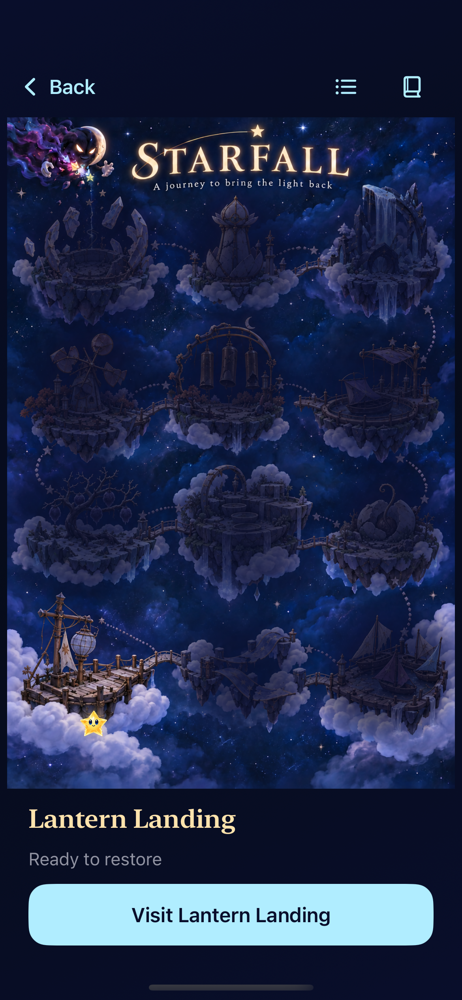
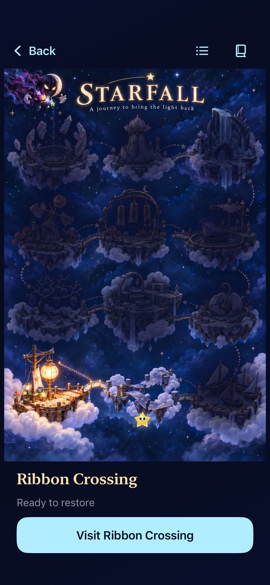

# Official maps, shared actions and real-board practice

**Result:** Development-verified; ready for integration · **Owner:** Current implementer · **Date:** October 19, 2026

Play on the start screen opens a full-page painted world with saved repairs. Five locations are ready; seven remain unavailable. Players can revisit restored locations or continue an unfinished selected location without replacing its board. Open Sky and the current-sky shortcut remain secondary start-screen options. The original modal map was rejected by the user and removed.

All five restoration rules support swaps and recipes without changing supply, seed or cadence. Twenty-one tutorial chapters use production input and the real store without replacing a saved round or earning completion. The old Try rows, scenery selector, sixteen exclusive images and Help-diagram view are retired. The optional skippable intro video is deferred.

[Integration contract](../../OFFICIAL_LOCATIONS_AND_TUTORIAL_PLAN.md) · [Painted sources](../../design/world-01/production/README.md) · [Final source hashes](source.json) · [Native run summaries](verification.json) · [Capture provenance](captures.json).

## Source and environment

Base `6c2483ab09f80751218feb02170079e04c0959b0`, branch `codex/official-world-integration`. Both source manifests enumerate every changed runtime, project and test input, including deleted files. Documentation-only edits are excluded from runtime identity. [The preceding snapshot](source-before-header.json) differs from the final runtime only in the map header: its three navigation glyphs now have bounded sizes, with a spoken Back label at accessibility text sizes. The map paintings, geometry, routing, completion and practice rules are unchanged by that final adjustment.

Xcode 27.1 (27A9275), iOS 27.1 SDK, arm64 iOS 27.0 Simulator, shared Starfall scheme, iOS 17 deployment target:

- Phone: Starfall Landing Acceptance, `21025903-D90D-4E30-BA74-45D3EFB2F5E4`, 390 × 844 points; DerivedData `/tmp/starfall-official-world-build`.
- Compact: iPhone SE (3rd generation), `EA0F7A30-21E1-4995-93F5-C4A983F4A354`; DerivedData `/tmp/starfall-world-compact`.
- Tablet: iPad Air 11-inch (M3), `4BA9208F-2CF6-45E6-BCB7-4DC93198295D`, 820 × 1180 points; DerivedData `/tmp/starfall-world-tablet`.
- Release DerivedData `/tmp/starfall-world-release`. Raw logs/xcresults remain disposable under XcodeBuildMCP's Starfall workspace.

## Checks and their scope

Core: **184 passed**, zero failures, using `swift test --disable-sandbox --scratch-path /tmp/starfall-map-plan-build --cache-path /tmp/starfall-map-plan-package-cache --config-path /tmp/starfall-map-plan-config --security-path /tmp/starfall-map-plan-security`, with `/tmp/starfall-map-plan-clang-cache` and `/tmp/starfall-map-plan-swift-cache` module caches. All 21 reference scripts assert exact score, occupancy and showers. All five challenges retain historical raw behavior and adopt current actions deterministically. Core did not change during the later page-layout work.

Hosted: the complete **334-test suite passed** after full-page routing was added. That combined run also contained two native cases: the production gesture/practice case passed, while the map accessibility wrapper hid child identifiers and failed the largest-text case. The wrapper was fixed and the failed native case passed separately. Final phone flow/world/copy checks pass **41/41** (39 hosted + 2 native); tablet copy/map checks pass **14/14** (12 hosted + 2 native); the final compact accessibility check passes **1/1**, all with zero failures or skips. A failed combined run is not represented as an entirely green run.

Native coverage includes all five official locations with four directional swaps and a scored clear in each; real tap/swap/held-five trace lessons with Retry and unchanged saved bytes; square/cross/Opal/relay lessons with exact outcomes, default/system Reduce Motion and maximum text; map locked/unavailable gating, Entry cancellation, page Back, Continue without board replacement, real winning clear, persisted repair after relaunch, tablet rotation and all twelve 44-point landmark targets. Compact largest-text practice survives backgrounding. The selected native checks are not the entire remote development matrix or an actual VoiceOver session.

Apple calls use `ARCHS=arm64 ONLY_ACTIVE_ARCH=YES CODE_SIGNING_ALLOWED=NO -parallel-testing-enabled NO` with explicit `-only-testing` selections. Debug and Release builds pass. Project membership is explicit: 49 app sources, 28 hosted sources (including the intentionally shared timing fixture) and 22 native test sources. Both map plates are packaged in Debug and Release; all sixteen retired names and the reset-only world fixture flag are absent from Release. Hygiene and `git diff --check` pass; native-plan and updater Python checks pass (3 + 21). No deployment tooling changed.

## Resolved findings

The original bug was a Core capability boundary: the presence of any challenge disabled arrangements and exact four-star traces. Action version 1 fixes that invariant; app restore/replay adopt it idempotently, preserve committed generation/forecast values, and archive v9 retains validated old readers. Invalid current archives never fall back silently.

Native iteration exposed a fixed-height practice guide trapping Retry, rows obscured by floating bars, a hidden underlying navigation bar incorrectly restricting fullscreen input, a 36-point tutorial Done label, and destination actions buried below all twelve large-text rows. Practice now flows at accessibility sizes, Done has a real 44-point footer, and selected-location actions precede the list. Input helpers measure the actual owning scroll viewport and visible bars, including SE footer controls, without blanket retries or weaker outcome assertions.

The initial map sheet clipped the painting on iPad; the user's feedback superseded that design entirely. The replacement is an actual `SkyFlowScreen.worldMap` page. A container accessibility identifier initially propagated onto every button; explicit child containment preserves each landmark's identity. The container's native accessibility bounds include child hit slop, so full-width assertions measure its intersection with the screen. Tablet rotation uses the existing closure-based geometry predicate, and virtualized menu rows are revealed before lookup. Resume initially passed an unnecessary placeholder to strict copy rendering; the final branch supplies no placeholder for Start again. Each affected case is rerun after its correction. The final visual review bounded oversized accessibility header glyphs; text content continues to scale.

## Visual and acceptance limits

Inspected native phone/tablet captures show the complete painted map, no modal or underlying Welcome, no numbered badges or unfamiliar helpers, dark unreached landmarks and the real amber cast traveler. The first repair lights Lantern Landing and its outgoing road, leaves the next place damaged but reachable, and persists after relaunch. Portrait keeps details below the painting; landscape keeps them beside it. These are inspected stills, not a claim of animation quality.

No physical installation was invoked. Physical touch comfort, contrast measurement, tutorial comprehension, listening/haptics and actual VoiceOver remain open. Curved multi-segment recipe drawings have Core/store coverage; straight held traces and recipe taps have native coverage. There is no free-roaming world controller or intro/travel video. Seven levels still need their production content. [ENGINEERING](../../ENGINEERING.md) records those review triggers and the remaining typed-routing cleanup.

## Selected native views

| Fresh journey | First repair saved |
| --- | --- |
|  |  |

[Tablet landscape](dev-6c2483a-wip-3c1c09b7a7__world-damaged__ipad-landscape.png) and [final compact largest-text Places](dev-6c2483a-wip-ac5579652b__world-places__iphone-se3-ax3xl.png) show the other inspected layouts. Capture hashes and exact source stages are in `captures.json`.
