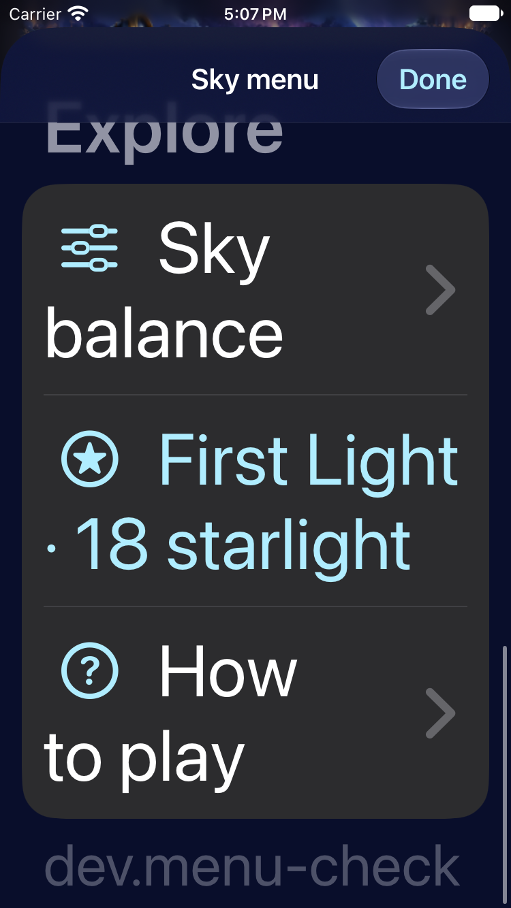

# One Starfall app, updated from main

**Result:** Verified one-app delivery; cancelled broad CI and targeted corrections recorded · **Owner:** current implementer · **Date:** 2026-10-17

The user requests one installed app now, with the approved constellation swipe and repeatable updates from GitHub main. Regular `com.starfall.prototype` retains the chosen 0-starlight round; the lab's 26-starlight sky is backed up, not imported. Both downloaded saves decode with the adopted core and re-encode with every JSON field unchanged. Those preflight checks kept both apps in place; the verified delivery and retirement are recorded below.

**Next action:** continue gameplay polish with automatic development updates. Complete the next broad remote run after the targeted corrections; full RC acceptance remains separate.

## Outcomes against acceptance

| Criterion | Result and scope |
| --- | --- |
| Selected-set rules and saves | 63 core tests pass, including old-save continuation, ordinary tap/trace separation, selected IDs, preview/replay and invalid walks. Actual original/lab preference save payloads both validate; original remains selected. |
| Native gesture and store boundaries | Final clean-source invocation passes 24 hosted store tests and 4 UI tests, zero failures/skips: chosen five from six, insufficient/outside release, ordinary/rapid taps, saved relaunch and largest-text drawing/build metadata. Hosted checks cover stale input across pause, settings, restart, fixture, motion and shower boundaries. |
| Supporting normal play | Earlier working-tree run completes 16 UI cases and 24 hosted cases. Fifteen UI cases pass, including automatic rain, background/relaunch/overflow, balance, menu, First Light win/loss, large text, paused guidance, Reduce Motion and one inherited focused VoiceOver check. One old help-copy assertion fails; it is corrected to check both actual-star count and light value, then passes in the final invocation. The earlier command remained resolving packages after its case summaries and was stopped; it is not a passing command. |
| Build and membership | Release Simulator and signed Debug iPhone builds pass. The Debug fixture is absent from Release; no extra app identity or Game Center work is added. Built signed bundle/Info.plist verifies `com.starfall.prototype` and `dev.bc187c831e`. |
| Delivery decisions | Six isolated updater tests pass: runtime versus docs identity, exact-source/latest CI status, disconnect, pending CI, failed install/cached retry, and unchanged/docs-only skip with actual installed-source provenance retained. Two matrix tests preserve all non-VoiceOver cases and restore five named actual sessions for RC. |
| Actual delivery | Configured device discovery succeeds. A real first poll safely waits for main CI on the pre-adoption commit. Signed build is cached and verified; installation/one-app inventory/service activation remain pending. |
| Accessibility and motion | Full actual VoiceOver: deferred to RC. Native largest-text/ordinary Reduce Motion checks are narrower evidence. No new physical haptic/animation quality acceptance; the user-approved lab first pass remains source-bound. |

## Verification context

**Source:** Clean local `821e95c` is the final native-test tree; the GitHub branch is verified tree-identical. App/core/config runtime is `dev.bc187c831e`. Core final checks and Release/device builds preceded later test/script/documentation commits, which did not change those runtime inputs. Base GitHub main is `9a0a93e`; unrelated local Game Center/connector work is excluded. The earlier broad native run is supporting working-tree evidence, not exact final-tree acceptance.

**Environment:** Xcode 27.1 (27A9275), macOS 27.0.1 arm64. Debug UI/hosted tests: iPhone 17e, iOS 27.0 (24A434), simulator `A84C81F5-AE41-496A-97AE-E17C63E18D29`. Signed build targets the configured connected iPhone 16 Pro Max / iOS 26.6.2. No physical playthrough or phone screenshot is claimed by building.

Reproduce from the clean source:

```sh
python3 scripts/ci-hygiene.py
python3 scripts/test_device_update.py
python3 scripts/test_native_test_plan.py
bash -n scripts/ci-simulator.sh
git diff --check
swift test
xcodebuild -project Starfall.xcodeproj -scheme Starfall -configuration Debug \
  -destination 'platform=iOS Simulator,id=A84C81F5-AE41-496A-97AE-E17C63E18D29' \
  -derivedDataPath /tmp/starfall-oneapp-dd ARCHS=arm64 ONLY_ACTIVE_ARCH=YES \
  CODE_SIGNING_ALLOWED=NO STARFALL_BUILD_ID=dev.integration -parallel-testing-enabled NO \
  -only-testing:StarfallAppTests/FallingSkyStoreTests \
  -only-testing:StarfallUITests/ConstellationTraceNativeTests \
  -only-testing:StarfallUITests/FallingSkyInteractionTests/testFirstShowerIsPlayableAndManualInputStaysPaused test
```

Final native xcresult reports **28/28 passed, 0 skipped**. Raw output: `/tmp/starfall-oneapp-{core-final,native,native-final,release,device}.log`; final xcresult and inspected attachments are under `/tmp/starfall-oneapp-dd/Logs/Test/` and `/tmp/starfall-oneapp-attachments/`. Retained preference backups are local under `~/Library/Application Support/Starfall Device Updates/backups/`, never committed. Setup/status/disable are in [scripts](../../../scripts/README.md#one-app-iphone-updates); [policy](../../DEVELOPMENT_BUILDS.md) owns delivery and RC cadence.

The final selected-five, largest-text menu and ordinary-clear screenshots were inspected. They show readable controls, five points with the sixth star retained, and usable menu dismissal; stills do not establish trail/burst motion or haptic feel. Runtime visuals remain the approved first-pass design; [historical lab captures](../constellation-trace-2026-10-17/README.md) keep their original source attribution.


## Actual one-app delivery

The local LaunchAgent installed **`dev.bc187c831e` from GitHub main `ba348d758b2b2e5dcc63bf0f4fccf75bc357a7fc`** on the connected iPhone. Its recorded validation is local core tests passed, signature verified and `mainCIAtInstall: pending`. Core tests also pass **63/63** from a fresh `git archive` of that exact main commit, without relying on a developer checkout. The signed cache has the identical runtime fingerprint and verified bundle/Info.plist; no uncommitted app code was used.

The original all-CI gate waited roughly twenty minutes. The user prioritizes development iteration, so the tested host follow-up uses local core tests and signed-build verification while broader CI runs in parallel, holding known failures. This is an explicit delivery-policy change, not a passing remote test claim. [Main CI run 39067366898](https://github.com/lbeezr/starfall/actions/runs/39067366898) was still running at installation. Release/VoiceOver acceptance is not waived.

After installation, a fresh preferences download matched the pre-delivery committed round and every checked game preference; score remained **0**. The lab was backed up again, then uninstalled. A real phone inventory now contains exactly one `com.starfall.*` app: **Starfall / `com.starfall.prototype`**. No save import, reset, original-app uninstall or automatic game launch occurred. The active mechanics simulator also received regular Starfall with the same runtime build ID and its old candidate was removed; other named QA simulators were not changed.

The LaunchAgent is registered in the logged-in user's GUI session, checks every 120 seconds and exited its successful install run with code 0 and no service stderr. Its installed scripts were compared byte-for-byte with the tested local host follow-up. `installed.json` retains actual source/build/validation; documentation-only checks use `checkedSource` without rewriting installed provenance. Status/config/logs and the original/lab preference backups remain under `~/Library/Application Support/Starfall Device Updates/`.

Host follow-up checks: **9 updater tests and 3 matrix tests pass**, including failed local-core blocking, pending-CI local validation, failed-CI holds, configuration/device/signing ownership and reconfiguration locking, plus Bash 3.2 empty/populated matrix arguments. Bash syntax, hygiene and diff checks pass. The running host helper is this tested follow-up; its publication follows the initial adoption PR. No additional app runtime changes are part of it.

Local physical receipts: `/tmp/starfall-oneapp-final-inventory.json`, `/tmp/starfall-lab-retirement.json`, before/after preferences under `/tmp/starfall-original-*-delivery.plist`, and Application Support `installation.json` / `installed.json`. No phone UI/speech/physical haptic playthrough is claimed; the installation and saved-state checks are the physical-device evidence here.


## Remote run and targeted corrections

Run **39067366898** finished **cancelled**, not passed, after roughly 26 minutes. [Compact source-bound summary](cloud-run-summary.json) retains the six failed UI case summaries and the runner's case-budget warning. Cloud core **63/63** and the Release build passed. UI case summaries include 21 passes and 6 failures; the 38-case UI matrix and subsequent 89 hosted checks did not complete. Do not credit this run as full acceptance.

The new Build section consumed space ahead of menu actions on the small phone. Build metadata is now an Explore footer, restoring the primary controls' order/space. Shared native menu navigation scrolls to lazy rows. The Observatory welcome assertion now checks the approved drawing copy. The automatic-clear test keeps the queried board paused during XCTest lookup/activation, then separately resumes arrivals; its name now states that scope. No game clock was changed. The background/overflow case's inner wait permits 120 seconds, but the runner cancelled it at a rounded 120-second outer allowance even though its gameplay assertions later reached completion around 132 seconds. Its specific allowance is now 240 seconds within the existing maximum, retaining the same inner assertions/timeouts; [XCTest's time-allowance contract](https://developer.apple.com/documentation/xctest/xctestcase/executiontimeallowance) explains the minute rounding. The complete serial CI job is bounded at 35 rather than 25 minutes. These are targeted corrections, not blanket retries, relaxed outcomes or a remote pass claim.

After the menu/input-test corrections, **5/5 focused native tests pass, zero skips**, on iPhone SE (3rd generation) / iOS 27.0: largest-text drawing/build metadata, automatic arrivals followed by paused clear/settings, balance persistence/arrival changes, First Light completion/restore/replay, and Observatory menu/help/balance continuity. Xcode 27.1; source is the follow-up working tree with no app/runtime changes after this run. Raw result: `/tmp/starfall-footer-se-dd/Logs/Test/Test-Starfall-2026.10.17_17-06-45--0400.xcresult`; output `/tmp/starfall-footer-se-native.log`. Core **63/63**, updater **10/10**, matrix **3/3**, Bash syntax, hygiene and diff checks pass. The specific overflow-budget correction has not yet been rerun in the original cloud environment; the next complete cloud run and RC acceptance must retain that distinction.



**Runtime evidence — follow-up menu, iPhone SE / iOS 27.0 Simulator, verification build label `dev.menu-check`.** The inspected scrolled capture shows version metadata after the controls; native tests also activate those controls and dismiss the menu. It does not verify phone rendering, spoken accessibility or motion. App runtime fingerprint after this correction is **`dev.8f04d7ab96`**; the updater will install that committed main source in place when the follow-up merges.
